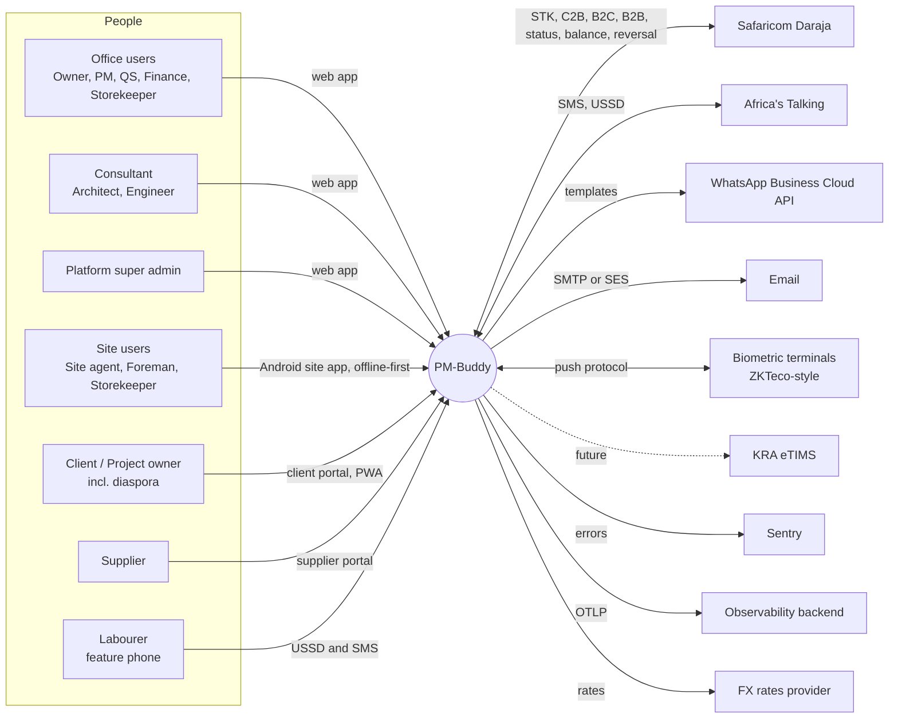
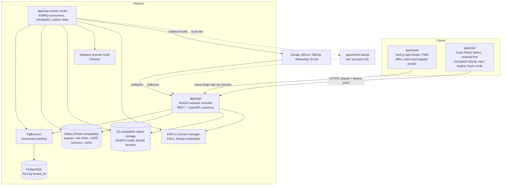
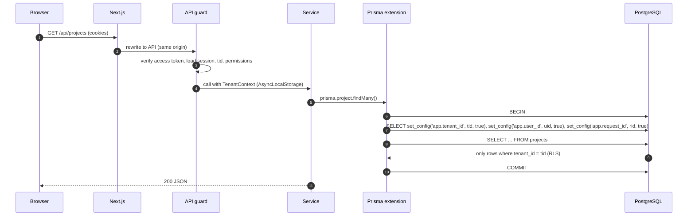
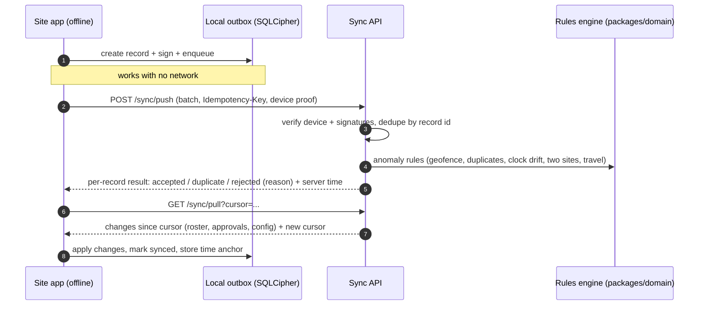
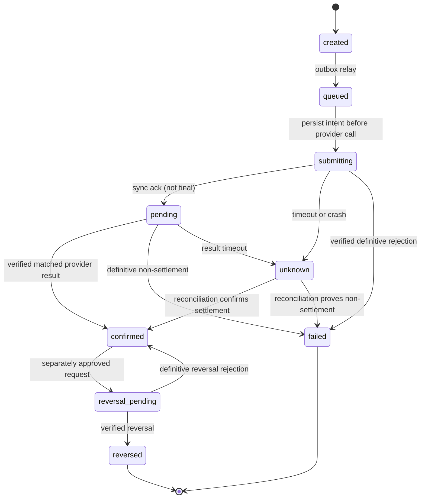
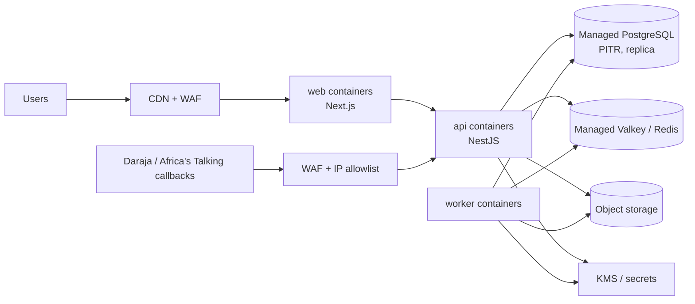

# PM-Buddy: Architecture

> **Status:** Phase 0 draft for approval. This is a living document. Decisions are tracked in §22, open items in [QUESTIONS.md](./QUESTIONS.md), and compliance items in [COMPLIANCE_TODO.md](./COMPLIANCE_TODO.md).
>
> Related: [ROADMAP](./ROADMAP.md) · [ERD](./ERD.md) · [OpenAPI outline](./api/openapi-outline.yaml) · [Threat model](./THREAT_MODEL.md) · [DPIA template](./DPIA_TEMPLATE.md) · [Configuration register](./CONFIGURATION.md)
>
> The [brief §15 safeguards](./PROJECT_BRIEF.md#15-mandatory-safeguards-pm-buddy-additions) take precedence. Detailed contracts: [workflows](./WORKFLOWS.md), [invariants](./INVARIANTS.md), [financial model](./FINANCIAL_MODEL.md), [offline sync](./OFFLINE_SYNC.md), [operations](./OPERATIONS.md), [release plan](./RELEASE_PLAN.md). These are design requirements, not a claim that the target architecture is implemented; see [implementation status](./IMPLEMENTATION_STATUS.md).

---

## 1. Goals and quality attributes

| Attribute | What it means for PM-Buddy | Main design responses |
|---|---|---|
| **Trust and integrity** | Money moves and biometrics are involved; diaspora clients rely on verifiable progress | Snapshot-bound maker-checker, step-up MFA, append-only redacted audit, evidence provenance/limitations, signed offline records |
| **Tenant isolation** | One contractor must never see another's data | `tenant_id` everywhere, PostgreSQL RLS (fail-closed), composite tenant foreign keys, automated isolation tests |
| **Offline-first on site** | Poor connectivity, low-to-mid Android phones | Expo app with encrypted SQLite, local outbox, push/pull sync, clock-drift detection |
| **Configurability** | Tax, statutory, M-Pesa and overtime rules change | Effective-dated, scoped, versioned configuration with `COMPLIANCE-REVIEW` status; payroll snapshots the rule versions it used |
| **Kenyan context** | KES, M-Pesa, EN/SW, feature phones, `2547…`/`2541…` numbers | Daraja behind `PaymentProvider`, USSD/SMS self-service, shared i18n catalogues, phone normalisation in `packages/domain` |
| **Reliability** | M-Pesa, SMS and WhatsApp can be slow or down | Outbox pattern, BullMQ with retries and backoff, idempotency keys, async state machines, reconciliation |
| **Scalability** | Thousands of workers and tens of thousands of transactions per tenant | Stateless API, horizontal scaling, queues, connection pooling, partitioned append-only tables, read models |
| **Operability** | Small team, cloud-agnostic for now | Modular monolith, Docker everywhere, OpenTelemetry, pino JSON logs, Sentry, IaC in Phase 9 |

---

## 2. System context



---

## 3. Containers



**Why a modular monolith?** Payroll, payments, the cost ledger and audit must commit atomically, and the team is small. A single deployable NestJS codebase with strict module boundaries gives that consistency with simple operations. The **worker** is the same codebase started in worker mode (`main.worker.ts`), so it scales independently from the HTTP API. Modules can be extracted into services later if load or team structure requires it (§22, D-01).

---

## 4. Backend modules (bounded contexts)

| Module | Owns (main tables, see [ERD](./ERD.md)) | Notes |
|---|---|---|
| `identity` | users, credentials, sessions, refresh tokens, MFA factors, passkeys, devices | Auth, MFA, step-up, device binding |
| `tenancy` | tenants, memberships, roles, permissions, project memberships, invitations | RBAC and project scoping |
| `audit` | audit_log | Append-only, hash-chained |
| `config-rules` | config_rules, statutory_rules (+ bands), overtime_rules, public_holidays, mpesa_tariffs | Effective-dated resolution |
| `projects` | projects, project_status_changes, sites, site_geofences, wbs_nodes, milestones | Implemented in D2.1 (§4.1) |
| `bq` | bqs, bq_versions, bq_bills, bq_sections, bq_items, bq_imports, bq_mapping_templates (D2.2); rate_buildups, instructions, variation_orders (D2.3) | Excel import pipeline; implemented in D2.2 (§4.2) |
| `schedule` | schedule_activities, dependencies, baselines, delay_events | Gantt |
| `progress` | progress_measurements, valuations, payment_certificates, retentions | Earned value, certificates |
| `labour` | labourers, trades, skill_levels, labour_settings, labour_engagements, labourer_accreditations, labourer_consents, do_not_rehire_events, labour_rates, gangs, gang_memberships, labour_saved_views | Field-level encryption; implemented in D3.1 (§4.3) |
| `attendance` | attendance_devices, attendance_events, anomalies, timesheets, timesheet_lines | Capture-method plugins |
| `biometrics` | biometric_enrolments, biometric_templates | **Separate key hierarchy**, restricted service account |
| `payroll` | pay_periods, payroll_batches, payroll_lines, payroll_line_items, advances, piece_rate_jobs | Pure calculations live in `packages/domain` |
| `payments` | payments, payment_channels, payment_provider_requests, payment_callbacks, reconciliations, recon_items | Daraja behind `PaymentProvider` |
| `procurement` | materials, units, unit_conversions, suppliers, requisitions, rfqs, quotations, lpos, grns, supplier_invoices, three_way_matches | |
| `stores` | stores, stock_ledger_entries, stock_issues, stock_transfers, stock_takes | Append-only ledger |
| `finance` | cost_entries, budgets, petty_cash_floats, expenses, cash_flow_items | Every shilling is tagged |
| `site-ops` | site_diaries, photos, inspections, test_results, snags, safety (incidents, toolbox talks, PPE), plant, fuel | |
| `documents` | documents, document_versions, compliance_items | Expiry reminders |
| `notifications` | notification_templates, notifications, notification_preferences | Provider interface per channel |
| `ussd` | ussd_sessions (Redis), labourer_pins | Africa's Talking |
| `sync` | sync_changes (change log), device_sync_state | Site app push/pull |
| `files` | files | Pre-signed URLs, scanning |
| `reports` | materialised views, export_jobs | PDF and Excel |
| `platform` | (cross-tenant) tenant admin, billing, platform config | Uses a separate, audited DB role |

**Boundary rules**

1. A module reads and writes only its own tables. Other modules go through its exported application service. This is enforced with `dependency-cruiser` rules in CI.
2. Side effects across modules (for example, "payroll approved" → create payment requests) use **domain events** written to an `outbox_events` table in the same transaction, then relayed to BullMQ.
3. **Pure domain logic** (payroll maths, statutory deductions, EVM, valuations, BQ totals, unit conversions, theoretical consumption, geofence maths, anomaly rules, M-Pesa SMS parser, phone normalisation) lives in `packages/domain`. It has no I/O, is heavily unit-tested, and is shared with the site app where useful (for example, offline geofence checks).

### 4.1 Projects module (D2.1)

`apps/api/src/modules/projects` (controller, `ProjectsService`, `SitesService`, `WbsService` for the WBS and milestones, `TeamService`, `ProjectAccess`). Every endpoint runs in the tenant transaction (`TenantScope`) and authorises through `AccessPolicy`; the project is looked up by the URL ID inside the caller's tenant (404 otherwise), so another company's IDs behave like unknown IDs. Every change writes a hash-chained audit event whose metadata lists **field names only** (plus `reasonGiven`); client contacts, coordinates and reasons are never copied into the audit log.

| Endpoint (`/api/v1`) | Permission |
|---|---|
| `GET projects?status=&search=` | `projects.view` (company-wide roles see every project; other roles see assigned ones) |
| `POST projects` | `projects.create` + step-up (MFA within five minutes) |
| `GET projects/:id` (detail: project, effective permissions, activation gaps, status history) | `projects.view` on the project |
| `PATCH projects/:id`, `POST projects/:id/status` | `projects.manage` on the project; `version` required (409 `version-conflict`) |
| `GET projects/:id/sites`, `GET …/sites/:siteId/geofences?at=` | `projects.view` |
| `POST projects/:id/sites`, `PATCH …/sites/:siteId`, `PUT …/sites/:siteId/geofence` | `projects.manage` |
| `GET projects/:id/wbs`, `GET projects/:id/milestones` | `projects.view` |
| `POST/PATCH/DELETE projects/:id/wbs[/:nodeId]`, `PUT projects/:id/wbs/order`, `POST/PATCH/DELETE projects/:id/milestones[/:milestoneId]`, `POST …/milestones/:milestoneId/status` | `projects.manage` |
| `GET projects/:id/team` | `projects.view` (candidates only for callers who may assign) |
| `PUT/DELETE projects/:id/members/:userId` | `users.invite` + step-up, and `projects.manage` on the project; escalation guard |

- **Lifecycle (brief §15 C).** `planning → active | cancelled`, `active → on_hold | completed`, `on_hold → active | cancelled`, `completed → closed`. Cancelling and putting on hold need a reason. Activation needs a client name, a contract sum above zero, a contract type, start and end dates, county and town, and at least one site with a geofence (`activationGaps` lists what is missing; 409 `activation-incomplete`). Closed and cancelled projects are read-only (409 `project-read-only`), and the code is fixed once a project leaves planning. The rules live once in `packages/domain` (`project-lifecycle.ts`) and are repeated in the database (`app.guard_project` trigger, `projects_active_details_check`), so a bypassed API check still cannot skip a state. Each transition is appended to `project_status_changes` (no UPDATE/DELETE for `pmb_app`, plus a trigger).
- **Contract types.** `lump_sum`, `remeasurement`, `design_and_build`, `cost_plus`, `labour_only`. JBC/FIDIC are standard *forms* of contract rather than pricing bases, so they are not in this list; a contract-form field can join with the BQ module if needed.
- **Geofence storage and versioning (D-27).** A site's geofence lives in `site_geofences`, one row per version, never updated. A radius is stored as `center_lat`/`center_lng` (`numeric(9,6)`) and `radius_m` (20–5,000); a polygon as a jsonb array of `{lat,lng}` (an open ring of 3–100 distinct vertices; the closing vertex is implied). CHECK constraints (`site_geofences_shape_check`, `app.geofence_polygon_valid`) enforce the Kenya bounding box (lat −5…5.5, lng 33.5…42), the vertex count, distinct vertices, the radius range and a polygon area of 100 m²–25 km²; self-intersection and the area/perimeter are computed by the shared `packages/domain/geofence.ts` (also used by the web editor) and stored as `area_m2`/`perimeter_m`. A trigger numbers versions and stamps `effective_from` from the database clock, strictly increasing per site under the site row lock. `GET …/geofences?at=<timestamp>` returns the version in force at that moment, which attendance (D3.3) will use for captures. PostGIS was not added: the checks needed now are simple, and spatial indexing can come with attendance if it is needed.
- **WBS weights.** A node's `weight_basis_points` is its share of its parent (10,000 = 100 %). Rule: **every sibling group must add up to exactly 100 %** before progress can be computed; until then (and, in D2.1, always, because progress measurements arrive in D6.3) the API returns `progress: null` and the web shows "unavailable". Parents are referenced through `(tenant_id, project_id, parent_id)`, a trigger refuses cycles, and the tree is at most six levels deep.
- **Milestones.** `planned → in_progress | achieved | cancelled`, `in_progress → achieved | cancelled`, `achieved → in_progress` (reopen, with a reason). Achieving needs an actual date that is not in the future; cancelling and reopening need a reason. Only planned milestones can be deleted (`app.guard_milestone`).
- **Team.** Members are company members with access to the project: company-wide roles (with their role's project permissions) or assigned members with role ∩ assignment. Assignments carry any of the project-scoped permissions in `PROJECT_ASSIGNABLE_PERMISSIONS` (§8).
- **Development seed.** `pnpm db:seed` (refused when `NODE_ENV=production`) creates the synthetic company "Jenga Bora Builders Ltd" with an owner (TOTP enrolled), a project manager, a site agent, three projects with sites, geofences, WBS and milestones. It is idempotent: a second run reports every record as already present.

### 4.2 BQ module and Excel import (D2.2)

`apps/api/src/modules/bq` (controller with `BqUploadGuard`, `BqImportsService`, `BqViewerService`, `BqExportService`, `BqTemplatesService`, `BqAccess`, `BqObjectStore`, `BqVersionWriter`, and `parsing/` for the worker and file inspection). The import logic that has no I/O (sheet scoring, header detection, unit normalisation, number parsing, hierarchy, classification, reconciliation, the state machine and the money maths) lives in `packages/domain/src/bq`, so the API and tests share one implementation; request and response schemas live in `packages/validation/src/bq.ts`, and the vocabulary (statuses, limits, issue codes with their severities, units) in `packages/types/src/bq.ts`.

| Endpoint (`/api/v1/projects/:id/bq…`) | Permission |
|---|---|
| `GET` (current version, bills, summary, import status and overrides), `GET bills/:billId` (one bill's sections and items), `GET search?q=` | `bq.view` |
| `GET export/xlsx?locale=`, `GET export/pdf?locale=` (rate limit 60 per 10 minutes per user) | `bq.view` |
| `GET imports`, `POST imports` (multipart `file`), `GET imports/:importId`, `POST …/parse` (retry a stored upload), `GET …/sheets/:sheetIndex/rows?from=&count=` (raw rows for the mapping screen, at most 200), `PUT …/mapping`, `POST …/apply-template`, `POST …/validate`, `PUT …/resolutions`, `GET …/preview`, `POST …/commit`, `POST …/abandon`, `GET …/source` (original file) | `bq.import` |
| `GET templates`, `POST templates`, `DELETE templates/:templateId` (company mapping templates) | `bq.import` |

`bq.edit` (manual edits) is not used yet: D2.2 has no manual editing. Permissions go through `AccessPolicy`/`ProjectAccess` (role ∩ assignment for project-scoped users); the tenant comes from the session and the project from the URL inside the tenant transaction, so another company's IDs behave like unknown IDs (404). Every change (upload, refusal, parse or parse failure, mapping, validation, resolutions, commit, abandon, template create/delete) and every export writes a hash-chained audit event whose metadata holds field names, counts, codes and digests only; file names, descriptions and amounts are never copied into the audit log.

**Upload and parsing safety (brief §15 F; see also §17).**

1. Before the body is read, `BqUploadGuard` refuses a declared `Content-Length` over 10 MB (+64 KB of multipart overhead) with 413, requires a session (401) and rate-limits uploads (60 per hour per user). Multer then enforces the 10 MB limit on the file itself (413 `payload-too-large`).
2. The type comes from the **content signature**, never the extension alone: `.xlsx` must be a ZIP (`PK\x03\x04`) and `.xls` an OLE compound file (`D0 CF 11 E0`); a mismatch is 415 `unsupported-file-type`.
3. For `.xlsx`, the ZIP **central directory** is read before anything is inflated: more than 10,000 entries, ZIP64, encrypted entries, a declared uncompressed total above 100 MB or a ratio above 100:1 is 422 `unsafe-archive`; a package without `[Content_Types].xml` and `xl/workbook.xml` is 415; a `vbaProject.bin` (macros) is 415 `macro-workbook`.
4. SHA-256, size, the sanitised original name (path, control and invisible characters removed, other unusual characters replaced; at most 120 characters) and the uploader are recorded. The `MalwareScanner` hook runs next (`MALWARE_SCANNER=development` is a no-op that records `not_scanned`/`development-noop`; `disabled`, the default, refuses uploads with 503 until ClamAV is wired, see the TODO in `src/infra/malware-scanner.ts`). The result is stored on the import.
5. The original is stored in the private bucket at `tenants/{tenantId}/projects/{projectId}/bq-imports/{importId}/source.{xlsx|xls}`; the user's file name is never part of the key (a CHECK enforces the key format).
6. Parsing runs in a `worker_threads` worker with `resourceLimits` (384 MB old-generation heap), a 30-second time limit (the worker is terminated) and at most two concurrent parses with eight waiting (503 `parser-busy` beyond that). The worker loads only SheetJS and reads with `{ dense: true, cellFormula: true, cellHTML: false, cellStyles: false, sheetRows: 20,001 }`; it refuses more than 50 sheets, 20,000 rows per sheet, 100 columns per sheet or 200,000 non-empty cells, and encrypted or unreadable workbooks (the import becomes `failed` with a stable `failureCode`).
7. **Formulas are never evaluated.** A formula cell keeps SheetJS's cached value and is flagged (`formula-cell` warning); a formula with no cached value is an error. Every value is treated as untrusted text: control characters are stripped (`control-characters-removed`), text is capped at 4,000 characters, and numbers come only from numeric cells or strictly parsed numeric text (thousands separators, `KShs`/`KES`, parentheses for negatives); anything else in a numeric column is `non-numeric`. The parsed grid is stored gzipped next to the source (`parsed.json.gz`) so later steps never re-run the parser.

**Detection heuristics.** Each sheet is scored as a `bill`, a `summary` (collection or grand summary) or `other` from its name (`Bill No. 2`, `Summary`, `Collection`) and contents. The header row is the best-scoring row in the first 60 that matches the column vocabulary (tolerant English spellings such as Item/Ref/No., Description/Particulars, Unit, Qty/Quantity, Rate/Unit rate, Amount/Total/KShs/KES, and common Kiswahili terms such as *Maelezo*, *Kipimo*, *Kiasi*, *Bei*, *Jumla*); the confidence is the share of mapped key fields weighted by match quality. The proposal also suggests the first and last data rows, the bill number and the bill title (from "BILL NO. 2 – SUBSTRUCTURE"-style headings or the sheet name). The user confirms or edits all of it per sheet. Mapping templates (per company) store the column mapping by **header signature** (normalised header texts in column order) and are offered when a sheet's signature matches.

**Hierarchy and classification.** Rows become Bill → Section → Item. A section heading is a row with a description but no quantity, rate or amount, in capitals or a short title followed by a referenced item; unpriced explanatory text is kept as section notes; multi-line descriptions continue onto the item above. Carried-forward, brought-forward, page-total, collection and bill-total rows are recognised by their wording, **excluded from items** and used for reconciliation. Bills are classified as preliminaries (usually Bill 1), measured, provisional (PC and provisional sums), dayworks or contingency, and items as measured, preliminary, provisional_sum, pc_sum, pc_attendance, pc_profit (percentage lines after a PC sum), contingency or daywork. An amount with no quantity or rate is a lump sum (`lump-sum` info). Units are normalised (m³/m3/cum → `m3`, m²/m2/sqm → `m2`, lm/m → `m`, kg, t/tonne → `t`, No./Nr → `nr`, `item`, LS/Sum → `ls`, % → `pct`, plus hours, days, weeks, months, litres, sets and pairs); an unknown unit keeps its text as `other` (`unknown-unit` info), and the original spelling is always kept (`unit_raw`).

**Validation report.** Stored with the import (JSON, capped at 300 entries per code while the counts stay complete) with a stable code, severity, sheet and row for each issue (the full list is `BQ_ISSUES` in `packages/types`). Errors (duplicate reference within a section and page, negative quantity, non-numeric number, formula without a value, sheet amount ≠ quantity × rate beyond KES 1.00, no items, duplicate bill number, no bills) block the commit. Warnings (missing unit, quantity without rate and the reverse, unpriced item, formula cell, page/collection/bill/brought-forward totals that differ, summary lines that differ or are missing, subtotal, VAT or grand total that differ, grand total ≠ contract sum, truncated text, precision rounded) must each be accepted with a reason. Row resolutions: use the computed amount, use the sheet amount (stored as `amount_source = sheet_override` with the reason), or exclude the row. The grand summary's VAT line is read and compared; VAT is always recomputed.

**Rounding (FINANCIAL_MODEL, D-05).** Quantities and rates are exact decimals (`numeric(20,4)`; more than four decimals are rounded half-up with a `precision-rounded` warning; numbers from Excel are reduced to 15 significant digits first, which removes binary-float noise such as `0.30000000000000004`). Each line amount = quantity × rate computed with `decimal.js`, **rounded once per line, half-up (ties away from zero) to the cent**, stored as integer minor units. Bill totals are sums of line amounts; VAT = subtotal × rate, rounded half-up to the cent once on the subtotal; grand total = subtotal + VAT. The sheet's own amount is kept in `sheet_amount_minor` and compared, never trusted. The database repeats the rules: a CHECK per item (`amount_minor = round(quantity × rate × 100)` for computed lines) and a deferred constraint trigger that re-adds bills and items and checks the version totals at commit.

**Import state machine.** `uploaded → parsed → mapped → validated → committed`, plus `failed` (parse refused) and `abandoned` (by the user) as end states, and `superseded` when a later import replaces the draft. Saving a mapping from `mapped` or `validated` returns to `mapped` and clears the report and resolutions; resolutions keep the import `validated`. Transitions live in `packages/domain` (`bq/lifecycle.ts`) and are repeated in the database (`app.guard_bq_import`), which also makes the source columns (file name, size, SHA-256, keys, scan result, uploader) immutable. The user can leave and resume any unfinished import; invalid moves are 409 `invalid-import-state`.

**Version model and atomic commit.** D2.2 creates one BQ per project ("Bill of Quantities") with **version 1 in `draft` status, source `import`**. Commit rebuilds the BQ from the stored grid, mapping and resolutions, checks that the result still matches the validated report (`report_digest`, else 409 `validation-stale`) and that every error is resolved and every warning accepted (else 409 `commit-blocked`), then, in **one transaction** (the project row is locked `FOR NO KEY UPDATE` so commits for one project run one at a time, the import row `FOR UPDATE`, 120-second limit): creates the BQ and version or, if a draft exists, deletes its bills, sections and items and rewrites them (`version` is bumped); snapshots the VAT rate, its rule key and status (`bq.vat.rate`, COMPLIANCE-REVIEW) and the rounding rule onto the version; writes bills, sections and items in chunks of 1,000; links the import to the version and marks the previous committed import `superseded`; and writes the audit event. Any failure rolls everything back (an e2e test forces a failure after the first chunk). Once a version is no longer a draft, re-import is 409 `bq-not-draft` (approval, variations and revisions arrive in D2.3). The runtime role cannot DELETE imports, BQs or versions, and content triggers refuse changes to non-draft versions.

**Exports.** Excel (SheetJS): a Summary sheet and one sheet per bill with sections, items, section subtotals and bill totals; amounts are numeric cells with a KES number format, and every text cell that starts with `=`, `+`, `-`, `@`, a tab or a carriage return is prefixed with an apostrophe (`spreadsheetSafeText`, §17.7). PDF (pdfmake): A4, company and project header, `KES 1,250,000.00` formatting, `DD/MM/YYYY` dates in Africa/Nairobi, page numbers and a "Draft" watermark while the version is a draft; Roboto is loaded into pdfmake's virtual file system and URL and local-file access are denied, so a document cannot fetch anything. PDFs are limited to 10,000 items (422 `export-too-large`). Both stream with `Content-Disposition: attachment` and an ASCII-only file name built from the project code (plus an RFC 5987 `filename*`).

### 4.3 Labour module (D3.1)

`apps/api/src/modules/labour`: `LabourController` (`/labour/*`) and `GangsController` (`/labour/gangs`), with `LabourSetupService` (trades, skill levels, settings), `LabourRatesService`, `LabourersService` (registration, changes, status, reveal, do-not-rehire, engagements), `LabourRecordsService` (NCA cards, consent, alerts), `GangsService`, `LabourViewsService`, the read model `LabourerReader`, `LabourAccess` (permission checks on projects) and `LabourCrypto`/`FieldCipher` (§10). Like the projects module, every endpoint runs in the tenant transaction and authorises through `AccessPolicy`; IDs from the URL are looked up inside the caller's company and labourers the caller cannot view are 404. The full request/response contract is in [`apps/api/README.md`](../apps/api/README.md#labour-registry-d31); the shared schemas are in `packages/validation/src/labour.ts`.

| Endpoint (`/api/v1/labour`) | Permission |
|---|---|
| `GET setup` (trades, skill levels, settings, `canConfigure`, `manageableProjects`) | `labour.view` somewhere or `config.manage` |
| `POST setup/defaults`, `POST/PATCH trades[/:id]`, `POST/PATCH skill-levels[/:id]`, `PUT settings` | `config.manage` |
| `GET rates?projectId=`, `GET labourers/:id/rate?projectId=&date=&basis=` | `labour.manage` or `finance.view` (on the project when given) |
| `POST rates`, `DELETE rates/:id` (scheduled rates only) | company rates `config.manage`; project and labourer rates `labour.manage` on the project |
| `GET labourers?…filters` (search: names and worker numbers only) | `labour.view` (company-wide roles see everyone; others see labourers engaged, now or before, on their projects) |
| `POST labourers/lookup` (`{identifier}` in the body) | `labour.view`; exact blind-index match of a full ID, phone or KRA PIN among visible labourers |
| `POST labourers` (with consent) | `labour.manage` on `projectId`, or a company-wide role without a project |
| `GET labourers/:id` | `labour.view`; the do-not-rehire flag only for managers, its reason only with `labour.do_not_rehire` |
| `PATCH labourers/:id`, `POST labourers/:id/status`, `POST/PATCH/DELETE labourers/:id/accreditations[/:cardId]` | `labour.manage` (`version` required where the resource has one) |
| `POST labourers/:id/engagements`, `POST …/engagements/:engagementId/end` | `labour.manage` on the project (plus `labour.do_not_rehire` and an override reason for a flagged worker) |
| `POST labourers/:id/reveal` (`{field, purpose}`) | `labour.view_sensitive` + step-up (MFA within five minutes) |
| `PUT labourers/:id/do-not-rehire` | `labour.do_not_rehire` + step-up |
| `POST labourers/:id/consents`, `POST …/consents/withdraw` | `labour.consent` |
| `GET accreditation-alerts?projectId=` | `labour.view` |
| `GET/POST/DELETE views[/:id]` | `labour.view`; saved views belong to the user |
| `GET/POST gangs`, `GET/PATCH gangs/:id`, `POST gangs/:id/members`, `POST …/members/:membershipId/leave` | `labour.view` to read; `labour.manage` on the gang's project to change |

- **Under 18 (brief §6).** Age is computed on the registration date (and on an engagement's start date) in Africa/Nairobi with `isOldEnoughToRegister` from `packages/domain`, which matches PostgreSQL's `date - interval '18 years'` exactly (a 29 February birthday turns 18 on 1 March in non-leap years). The database repeats it: `registered_on` is set by a trigger to the Nairobi date and `labourers_minimum_age_check` refuses `date_of_birth > registered_on - 18 years`; the engagement trigger checks the start date. API refusals are 400 `under-minimum-age`.
- **Identifiers (brief §7).** ID/passport number, phone, KRA PIN, NSSF and SHA numbers and the next-of-kin contact are stored only as ciphertext (`*_enc`); duplicate and do-not-rehire checks use blind indexes (`id_number_bidx` unique per company, `kra_pin_bidx` unique, `phone_bidx` not unique so shared family phones are warned about, not refused). The ID index ignores the document type and leading zeros of all-digit numbers (D-35), so the same number resubmitted as a passport or alien ID is caught. Full identifiers are searched only through `POST labourers/lookup`, with the identifier in the body; the registry's GET search refuses terms with digits (other than worker numbers), the web keeps identifier searches out of URLs and sign-in redirects, and saved views never store search text (API schema and a database CHECK) (D-36). Responses carry masked values (`•••••678`, phones `2547•••••101`); a value that cannot be decrypted shows `•••••` and logs a warning without the value. Revealing a full value needs `labour.view_sensitive`, fresh MFA (step-up; 403 `mfa-required` when the account has no MFA) and a purpose from a fixed list, and writes `labourer.sensitive_revealed` (field and purpose, never the value).
- **Do not rehire.** Setting or clearing needs `labour.do_not_rehire`, step-up and a reason of 10–500 characters, stored encrypted in the append-only `do_not_rehire_events`; the trigger refuses a flag change without a matching event in the same transaction. A registration whose ID or KRA PIN belongs to a flagged person is refused (409 `do-not-rehire-match` with `match`); a phone match, an engagement or a reactivation of a flagged person needs `labour.do_not_rehire` and a recorded override reason (an `override` event). Duplicate IDs return 409 `duplicate-identity` with `match {labourerId, workerNo, matchedOn}` so the user engages the existing worker instead of creating a ghost record (`ProblemDetailsFilter` passes only those keys).
- **Consent.** Registration requires consent to the current notice (`CURRENT_CONSENT_NOTICE`: version, EN/SW text in the catalogues, SHA-256 digests pinned in `packages/types` and stored with each record); a deferred constraint trigger refuses a labourer without a consent row. Withdrawal keeps the records, sets `withdrawn_at` from the database clock and blocks new engagements and reactivation until consent is recorded again. Biometric consent is not part of D3.1; `CONSENT_KINDS` and `labourer_consents_kind_check` are the D3.4 extension point.
- **Rates.** Rows in `labour_rates` are never updated; a new rate is a new row starting today or later (400 `rate-backdated`), and only a rate that has not started can be deleted. Resolution (`resolveRate` in `packages/domain`, also `GET labourers/:id/rate`): labourer on project → project trade + skill → project trade → company trade + skill → company trade, then the latest `effective_from` on or before the date. The minimum-wage check is reported as `not_configured` (CR-PAY-09).
- **NCA alerts.** Computed on read from `labourer_accreditations` with the company's lead time (`labour_settings.accreditation_alert_days`, default 30): expired, expiring and missing (when the skill level expects a card) for active labourers. There is no queue infrastructure yet, so nothing is sent; reminders can reuse this query when notifications arrive.
- **Gangs.** Named per project (optionally at one of its sites) with a leader who must be a current member; memberships keep join/leave dates, one open gang per labourer and project, and joining needs an engagement on that date. Leaving a project or the company ends the memberships it supported.
- **Audit.** Every change writes a hash-chained event (`labourer.registered`, `.updated`, `.status_changed`, `.sensitive_revealed`, `.do_not_rehire_set`/`_cleared`/`_overridden`, `.consent_recorded`/`_withdrawn`, `.engaged`, `.engagement_ended`, `.accreditation_added`/`_updated`/`_removed`; `labour.rate_created`/`_cancelled`, `labour.trade_*`, `labour.skill_level_*`, `labour.settings_updated`, `labour.defaults_installed`, `labour.view_saved`/`_deleted`; `gang.created`, `.updated`, `.member_added`, `.member_left`) whose metadata lists field names, IDs, dates and flags only, never identifiers, ciphertext, reasons or amounts.
- **Development seed.** `db:seed` adds 15 trades, 4 skill levels, 40 synthetic labourers (clearly fictional names; national IDs `900000xx`, phones in the `0700 000 0xx` block, KRA PINs `A9000000xxZ`; nothing is ever sent to them), rates, 6 gangs on the demo projects, NCA cards (some expiring or expired) and one do-not-rehire case; idempotent like the rest of the seed.


### 4.4 Attendance and timesheets module (D3.3 web slice)

`apps/api/src/modules/attendance`: `AttendanceController` (`/attendance/*`) with `AttendanceSettingsService` (period cut-off, rule versions, holidays), `MusterService` (overview, muster roll, day submit/confirm/return), `CorrectionsService`, `AnomaliesService`, `PeriodsService` (list, detail, submit, approve, reject, reopen, payroll lines, labourer summary) and `AdjustmentsService`; shared pieces are `TimesheetCalculator` (loads rules, holidays and records and calls the pure `computeLabourerDay` in `packages/domain`), `PeriodStore` (finds or creates the weekly period covering a date) and `AnomalyEvaluator` (re-runs `detectDayAnomalies` for changed labourer-days). `AttendanceCommands` wraps every command: optional `Idempotency-Key` (8–128 characters; the same key and payload replays the stored response with `Idempotent-Replayed: true`, another payload is 409 `idempotency-key-reused`), the tenant row lock, the redacted hash-chained audit event and the transactional outbox in one transaction. Problems are RFC 9457 with attendance codes (`period-locked`, `same-person`, `period-changed`, …); database rule violations map to 409 `attendance-rule`.

| Endpoint (`/api/v1/attendance`) | Permission |
|---|---|
| `GET overview` | `attendance.view` (projects listed) |
| `GET settings` | `attendance.view`, `timesheets.manage_rules` or `config.manage` somewhere |
| `PUT settings/periods` | `config.manage` |
| `POST rules`, `DELETE rules/:id` | `config.manage` (company default) or `timesheets.manage_rules` on the project (override) |
| `POST rules/defaults`, `POST holidays`, `POST holidays/defaults`, `DELETE holidays/:id` | `config.manage` |
| `GET projects/:projectId/muster?siteId&date&gangId` | `attendance.view` |
| `PUT projects/:projectId/muster` | `attendance.record` |
| `POST days/:dayId/submit` | `attendance.record` |
| `POST days/:dayId/confirm`, `POST days/:dayId/return` | `attendance.confirm`, not the submitter (confirm: nor anyone who recorded the day) |
| `POST days/:dayId/corrections` | `attendance.override` + step-up |
| `GET projects/:projectId/corrections`, `POST corrections/:id/approve`, `POST corrections/:id/reject` | `attendance.view`; decisions `attendance.confirm`, not the requester |
| `GET anomalies`, `POST anomalies/:id/review` | `attendance.view`; review `attendance.review_anomalies`, not a recorder |
| `GET projects/:projectId/periods`, `GET periods/:id` | `attendance.view` |
| `GET periods/:id/lines` | `attendance.view`, `payroll.prepare` or `finance.view`; approved periods only |
| `POST periods/:id/submit`, `POST periods/:id/reopen` | `timesheets.submit` |
| `POST periods/:id/approve`, `POST periods/:id/reject` | `timesheets.approve`, not the submitter |
| `POST periods/:id/adjustments` | `attendance.override` + step-up |
| `GET projects/:projectId/adjustments`, `POST adjustments/:id/approve`, `POST adjustments/:id/reject` | `attendance.view`; decisions `timesheets.approve`, not the requester |
| `GET labourers/:labourerId/summary` | `attendance.view` on a project the labourer worked on |

- **Capture methods.** Records carry `capture_method`; only `web_manual` (a supervisor's entry on the muster roll) is implemented. `qr_card`, `face`, `fingerprint` and `terminal` are reserved in `CAPTURE_METHODS` with nullable evidence columns (device, device and server time, GPS and accuracy, geofence result and version, match confidence, photo, client event id) that a CHECK keeps empty for `web_manual`; the site app (D3.2–D3.3) and biometrics (D3.4) will write the same rows (§13).
- **Muster roll and maker-checker.** One `attendance_days` row per site and date and one `attendance_records` row per labourer, site and date (database-unique). Only labourers engaged on the project that day can be recorded (409 `not-engaged`, also a trigger); inactive and do-not-rehire labourers can be recorded but are flagged. A recorder submits the day; a different person with `attendance.confirm` confirms or returns it (the API and a trigger refuse the submitter and anyone who created or updated a record of the day). After submission, changes are corrections with a reason and step-up, decided by someone other than the requester. Every command checks the version the caller read. A day cannot be returned to draft while a correction is pending (409 `pending-corrections`, also a trigger), and a correction is applied only while its day is submitted or confirmed and the record still holds the values it was asked against (409 `correction-outdated`, also a trigger), so a correction never overwrites a newer value (review fix 4). For periods, maker ≠ checker binds the current submission: after a reopen, the person who rejected may submit again for someone else to approve (review fix 1).
- **Computation.** `packages/domain/src/attendance` is pure integer arithmetic on minutes and half-day units (no floating point): a labourer's day is computed once across all sites and projects (overlapping minutes counted once, breaks, overnight shifts, the governing rule of the earliest worked record, normal and overtime split by day type: public holiday over rest day over weekday, half-day units, lateness on weekdays only), then shared between the records, so a two-site day is never paid twice. Half days (review fix 2): each `half_day` record is worth one half, at most two halves a day, and the threshold applies only when a `present` record is involved (never lowering the labelled halves); a `half_day` record receives at most one half, so the result does not depend on record order, site or project. Records in approved periods keep their snapshot allocation and others share only the remainder; the day is also recomputed with nothing locked, and a locked share that differs is reported as `lockedDrift` (review fix 3).
- **Rules and holidays.** Effective-dated rule versions (company default plus project overrides; `resolveTimesheetRule`) and a per-company holiday calendar; neither can change inside a submitted or approved period, so approved timesheets are never recomputed with other rules. Unverified rules cannot drive production approval (COMPLIANCE-REVIEW CR-PAY-08).
- **Periods.** Weekly per project (Q-C4: Friday–Thursday, cut-off Thursday 18:00 Africa/Nairobi, `zonedDateTime`), created when the first attendance of the week is saved. `open → submitted` after the cut-off with every day confirmed and no pending correction (the submission stores a SHA-256 digest of the computed lines), `submitted → approved` by a different person with no open anomaly and an unchanged digest (409 `period-changed`), or `submitted → rejected → open`. Approval inserts the immutable `timesheet_lines` snapshot and a `timesheet.period_approved` outbox event in the same transaction.
- **Adjustments.** Changes to approved periods never touch them (INVARIANTS): an adjustment with a reason and step-up is approved by someone else; its `delta` (after − before) lands as an `adjustment:<id>` line in the project's next open period. The new share is the record's share of the whole day recomputed with nothing locked. When another record of the day changes after a period was approved (a correction, an edit on another project, another adjustment), `AnomalyEvaluator` opens a blocking `locked_share_changed` anomaly on the day's records in open periods and proposes one pending adjustment with unchanged values (`proposed = previous`, reason `AUTOMATIC_ADJUSTMENT_REASON`, requested by the person whose change caused it, audited with `automatic: true`); approving it by someone else moves the locked share to the recomputed one and clears the anomaly (D-43). A rejected automatic proposal is not repeated until the day changes again; a reviewer can dismiss the anomaly with a note.
- **Anomalies.** `two_sites`, `overlapping_times`, `excess_hours` (above the rule's plausible maximum), `not_engaged`, `labourer_inactive`, `do_not_rehire`, `accreditation_invalid` (no valid NCA card when the skill level expects one) and `manual_override` (a correction), re-evaluated on every save, correction and submission; conditions that disappear are `cleared`. `locked_share_changed` (above). Open anomalies block approval; reviewers resolve or dismiss with a note and cannot have recorded the attendance.
- **Payroll contract.** D4.1 reads `GET /attendance/periods/:id/lines` (or `timesheet_lines` directly) for approved periods only; see [apps/api/README.md](../apps/api/README.md#payroll-facing-timesheet-contract).
- **Development seed.** `db:seed` adds the holiday calendar, the unverified demonstration rule and nine weeks of synthetic muster rolls for the seeded labourers (`src/seed/attendance-seed.ts`): past weeks approved, the last complete week submitted, the current week open, a two-site day and an excessive-hours day left open for review, and one approved adjustment.

---

## 5. Folder structure

```text
pm-buddy/
├─ apps/
│  ├─ web/                 # Next.js (App Router): office app, client portal, supplier portal, PWA
│  │  └─ src/
│  │     ├─ app/
│  │     │  ├─ (auth)/      # sign-in, sign-up, MFA
│  │     │  ├─ (office)/    # office app shell + modules
│  │     │  ├─ (client)/    # client portal
│  │     │  ├─ (supplier)/  # supplier portal (D7.2)
│  │     │  └─ site/        # D0 only: web mock-ups of the site app
│  │     ├─ components/     # app components (ui/ = shadcn primitives until D1.2)
│  │     ├─ i18n/           # next-intl request config (catalogues come from packages/i18n)
│  │     ├─ lib/            # formatters, API client, utils
│  │     └─ mocks/          # D0 prototype data (removed as real APIs land)
│  ├─ api/                 # NestJS modular monolith (D1.1)
│  │  ├─ prisma/            # schema, migrations, RLS SQL, seed
│  │  ├─ test/              # e2e suite against the compose services (pmb_test database)
│  │  └─ src/
│  │     ├─ main.ts         # HTTP entrypoint (app.setup.ts holds the shared pipeline)
│  │     ├─ telemetry.ts    # OpenTelemetry preload, active when OTEL_EXPORTER_OTLP_ENDPOINT is set
│  │     ├─ main.worker.ts  # worker entrypoint (BullMQ, schedulers, outbox relay)
│  │     ├─ config/         # validated environment (schema in packages/validation)
│  │     ├─ common/         # guards, interceptors, tenant context, problem+json, idempotency, logging
│  │     ├─ infra/          # Prisma, Valkey and object-storage clients
│  │     └─ modules/<module>/{api,application,domain,infra}/
│  ├─ site/                # Expo React Native site app (D3.2)
│  └─ mock-daraja/         # Daraja simulator for dev and tests (D4.2)
├─ packages/
│  ├─ types/               # shared TS types, permission catalogue, enums
│  ├─ validation/          # Zod schemas shared by web, site and api
│  ├─ domain/              # pure calculation engines (no I/O)
│  ├─ i18n/                # EN/SW ICU message catalogues (web, site, SMS/USSD) and the i18n:check parity script
│  ├─ ui-tokens/           # design tokens shared by web and site app
│  ├─ api-client/          # generated from OpenAPI (openapi-typescript + openapi-fetch)
│  └─ config/              # shared tsconfig presets (lint rules: root .oxlintrc.json, D-25)
├─ infra/
│  ├─ docker/              # docker-compose: postgres, valkey, rustfs, mailpit (pgbouncer, clamav later)
│  └─ terraform/           # IaC modules (Phase 9, once the cloud is chosen)
├─ tests/
│  ├─ e2e/                 # Playwright (web)
│  └─ load/                # k6 scripts
├─ docs/                   # this documentation, demos, ADRs
├─ .github/                # CI workflows and Dependabot
├─ .pnpmfile.mjs           # keeps pnpm-lock.yaml registry-agnostic (D-26)
├─ package.json            # root scripts (turbo)
├─ pnpm-workspace.yaml
└─ turbo.json
```

> **Current state:** the workspace, `apps/web` (prototype, `/status`, `/design-system` and the live `/foundation` console), `apps/api` (health, identity, tenancy, roles and permissions), `packages/{types,validation,domain,i18n,config}`, `infra/docker` and `.github/` exist. The EN/SW catalogues moved from `apps/web/messages` to `packages/i18n/src/messages` (D1.2); `pnpm --filter @pm-buddy/i18n i18n:check` checks their parity. Everything else arrives in the deliverable named in [ROADMAP](./ROADMAP.md).

---

## 6. Multi-tenancy and data isolation

**Model:** shared database and shared schema. Every tenant-owned table has `tenant_id uuid NOT NULL`.

### 6.1 Defence in depth

| Layer | Control |
|---|---|
| API | The tenant comes **only** from the authenticated session (the `tid` claim), never from request bodies or headers. Project access is checked by the policy guard. |
| Application | A tenant context (AsyncLocalStorage) is required by every repository call. A missing context throws. |
| Database: RLS | `ENABLE` and `FORCE ROW LEVEL SECURITY` on every tenant table. The policy is `USING (tenant_id = current_setting('app.tenant_id', true)::uuid) WITH CHECK (…)`. If no setting is present the result is `NULL`, so the policy **fails closed**. |
| Database: foreign keys | **Composite tenant FKs.** Each parent exposes `UNIQUE (tenant_id, id)` and children reference `(tenant_id, parent_id)`. A row can never point at another tenant's row, even through a bug. |
| Database: roles | `pmb_migrator` owns the schema (DDL). `pmb_app` has DML only, no `BYPASSRLS`, and only `INSERT`/`SELECT` on `audit_log`. `pmb_reporting` is read-only with RLS. `pmb_platform` can bypass RLS but is used only by audited platform jobs. |
| CI | A migration check fails the build if any table with `tenant_id` lacks RLS enabled, forced and with a policy. The tenant-isolation suite is generated from the Prisma model list, so new tables are covered automatically. |

### 6.2 Request flow



`set_config(..., true)` is transaction-local, so it is safe with PgBouncer in transaction-pooling mode. Wrapping every query in a transaction costs a little latency, which is acceptable for this workload. Hot read paths can batch queries in one transaction.

### 6.3 Project scoping

Project-level access (who can see or act on project X) is enforced in the application layer through `ProjectMembership` and the policy guard, and covered by tests. RLS stays at tenant level, as the brief requires. Client and supplier principals are external memberships limited to specific projects or suppliers.

---

## 7. Identity, authentication and sessions

| Concern | Design |
|---|---|
| Identifiers | Email and/or phone. Phones are normalised to `2547XXXXXXXX` / `2541XXXXXXXX` by `packages/domain/phone`. |
| Passwords | **Argon2id** (`@node-rs/argon2`) with OWASP-recommended parameters (19 MiB, t=2, p=1). Minimum 12 characters, maximum 128. No composition rules. **Password policy (D1.3)** on every new password (registration and reset; there is no other password change yet): a small local common-password list, then **zxcvbn-ts strength ≥ 3** (`@zxcvbn-ts/core` with the common and English dictionaries; the identifier, its parts, the display name and "pm-buddy"/"pmbuddy" are context words; the first 64 characters are scored to bound CPU), then the optional **breached-password check** behind `PasswordBreachChecker`: `AUTH_BREACHED_PASSWORD_CHECK=hibp` queries the Have I Been Pwned range API with k-anonymity (only the first five hex characters of the SHA-1, `Add-Padding: true`, two-second timeout) and **fails open** with a warning that contains neither the password nor its hash. Refusals are 400 problems with the generic codes `password-too-weak` / `password-breached`; the score is never returned. The checks depend only on the submitted values, so they reveal nothing about whether an account exists. |
| OTP | SMS or WhatsApp via `NotificationProvider`. Six digits, five-minute expiry, stored hashed, rate-limited per identifier, IP and device. Used for verification and recovery. Low-privilege roles may also use it as a second factor. |
| MFA | **TOTP** (RFC 6238, `otpauth`), **passkeys** (WebAuthn, `@simplewebauthn/server`) and hashed one-time recovery codes. **Mandatory for anyone holding an MFA-required permission** (§8; Owner/Director, Finance and Admin by default), enforced at role assignment, invitation acceptance, company selection and login, and by a database trigger. |
| Factor model | An account has zero or more MFA **factors**: at most one TOTP secret (`users.mfa_secret`, encrypted) and up to ten named passkeys (`webauthn_credentials`). `users.mfa_enabled` means "has at least one factor" and is **maintained by the database** (`app.maintain_user_mfa`, fed by a trigger on `webauthn_credentials`), so the privileged-MFA triggers accept passkey-only users. Dropping to no factor is refused while the user holds an MFA-required permission, in the API (409) and in that trigger; the privileged-membership and role triggers share-lock the user row, so a concurrent role grant and factor removal serialise. Adding a factor needs a sign-in within five minutes or, once the account has a factor, MFA verified within five minutes: a password alone never adds a factor. The first factor signs out other sessions, verifies the current one and brings ten single-use recovery codes when none are unused. Any factor satisfies sign-in MFA and step-up; recovery codes cover a lost factor. |
| Passkeys | `@simplewebauthn/server` (browser: `@simplewebauthn/browser`). Relying party = `WEB_ORIGIN`: exact origin match, RP ID = its hostname. Attestation `none`; **user verification required** at registration and assertion; EdDSA, ES256 and RS256 (ML-DSA waits for stable runtime support). Challenges are random, stored server-side as SHA-256 digests in `auth_challenges`, **bound to the user and session**, single-use (a new request supersedes the old one) and valid five minutes. Credential IDs are unique across accounts; the signature counter must increase except for authenticators that always report 0. A passkey step-up sets the session's MFA time exactly like TOTP and **shares the MFA lockout**: unknown, replayed or expired challenges, wrong origin or RP ID, bad signatures, counter regressions and missing user verification are failures; five in a row lock MFA for 15 minutes, revoke the session and notify the user. Listings never return credential IDs or public keys. Registration and removal send security notifications (user-level events, not in a company's audit log). Passwordless (discoverable-credential) sign-in is not offered yet. |
| Access token | JWT signed with EdDSA or ES256 (`jose`), **10-minute TTL**. Claims: `sub`, `tid` (active tenant), `sid` (session), `amr`, `auth_time`, `mfa_at`. Sent in the `__Host-pmb_at` cookie (httpOnly, Secure, SameSite=Lax, Path=/). |
| Refresh token | Opaque 256-bit random value, stored as a **SHA-256 hash** with a family ID. **Rotated on every use.** If a used token is presented again, the whole family is revoked and the user is alerted. Sent in the `__Secure-pmb_rt` cookie with Path=/api/v1/auth (the versioned API base path). Idle and absolute lifetimes are configurable and shorter for privileged roles. |
| Step-up MFA | Sensitive actions (payment approval, payout, changing a payee's phone number, changing statutory rules) require `mfa_at` within N minutes (configurable). Otherwise the API returns `401` with problem type `step-up-required`. `POST /auth/step-up` returns a short-lived step-up token, sent back in the `X-Step-Up-Token` header. The token is **bound to the action**: it carries a hash of the approval ID and amount, a lightweight form of transaction signing. |
| CSRF | SameSite cookies, a same-origin API (Next.js rewrites), a double-submit `X-CSRF-Token` header on state-changing requests, and Origin/Referer checks. |
| Site app | Bearer access token held in memory. Refresh token in SecureStore (Android Keystore). **Device binding:** on enrolment the device generates a key pair, and each refresh or sync request carries a proof-of-possession signature over a server nonce. |
| Kiosk tablets | Device principal registered to a site. A supervisor unlocks with PIN plus Android BiometricPrompt. **BiometricPrompt is never used to identify labourers** (brief §5.5). |
| Labourers (USSD) | National ID plus a 4–6 digit PIN (Argon2id), with lockout after N failures. PIN reset is supervisor-assisted with an OTP to the registered phone. |
| Sessions UI | Users can see and revoke active sessions and devices. Admins can force sign-out. |

**Notifications from identity.** Verification codes, reset tokens, invitations and security alerts go through `NotificationProvider` (§15) on the `email`, `sms` or `whatsapp` channel: email identifiers use email, phone identifiers use SMS. They are sent after the response (`notifyLater`) so neither status nor timing reveals whether an account exists, and a delivery failure is only logged. Until Africa's Talking (D7.3) and an email provider are approved, production uses the disabled provider (every send fails explicitly) and development uses loopback Mailpit for every channel.

**Library choice (D-03):** the auth module is built on vetted primitives: `@node-rs/argon2`, `jose`, `otpauth`, `@simplewebauthn/*`, `@zxcvbn-ts/*`, and the Node `crypto` CSPRNG. **No cryptography is hand-rolled.** An external IdP was considered (Keycloak, managed identity providers) and so was Better Auth. They were set aside for now because of phone-first login, USSD PIN auth, device binding and action-bound step-up. See [QUESTIONS.md](./QUESTIONS.md), Q-A3.

---

## 8. Authorisation: RBAC with project scope

- **Permission catalogue.** Granular strings such as `projects.create`, `bq.edit`, `bq.approve_variation`, `attendance.override`, `payroll.prepare`, `payroll.review`, `payments.approve`, `payments.disburse`, `labour.view_sensitive` and `config.manage_statutory`, defined once in `packages/types` (`PERMISSIONS`, grouped by area: the part before the dot). `GET /api/v1/permissions` serves the catalogue grouped by area. The database lists the same keys in CHECK constraints (`tenant_roles_permissions_check`, `project_permissions_check`), so a new permission needs a migration as well as the code change.
- **Company-level and project-scoped permissions.** `tenancy.manage`, `users.invite`, `roles.manage`, `audit.view`, `config.manage`, `config.manage_statutory`, `projects.create` and `procurement.manage_suppliers` are company-level (`TENANT_LEVEL_PERMISSIONS`). Every other tenant permission is project-scoped (`PROJECT_PERMISSIONS`). `platform.admin` belongs to platform operators only.
- **System roles.** Immutable bundles from the brief's table (§3), defined in `SYSTEM_ROLE_PERMISSIONS` (table below). They live in code, not in the database; a membership stores the role key.
- **Custom roles (D1.4).** A company can create, rename, change and delete roles made of catalogue permissions (`tenant_roles`: name, permissions, `tenant_wide`). Memberships and invitations reference a system role key, or `custom` plus `custom_role_id` through the composite foreign key `(tenant_id, custom_role_id) → tenant_roles(tenant_id, id)`, so no row can name another company's role. `tenant_roles` has forced RLS; before a company is selected a user can read only the custom role they hold there.
- **Guards.** Changing roles needs `roles.manage` plus step-up MFA (verified within five minutes) and is audited (`role.created`, `role.updated` with added/removed permissions, `role.deleted`, `membership.role_changed`).
  - System roles are immutable (403).
  - `platform.admin` can never be granted: request schemas reject it (400) and the database CHECK refuses it.
  - **Privilege-escalation guard:** nobody can create, change, assign or remove a role carrying a permission they do not hold, and only a company-wide role can grant company-wide scope. This applies to role edits, invitations, member role changes, member removal and project assignments (an assigner can grant only project permissions they hold on that project).
  - A role still held by members cannot be deleted (409, plus `ON DELETE RESTRICT`); nor can one named in a pending invitation. Expired and accepted invitations that named it are removed with it.
  - The last owner cannot be removed or demoted (409).
- **Member role change.** `PUT /tenants/current/members/:userId/role` is the only way to change a member's role. It revokes the member's active sessions in that company, so they sign in again under the new permissions.
- **Evaluation.** One policy service, `AccessPolicy` (`apps/api/src/modules/identity/access-policy.ts`), serves every tenancy and project endpoint: `require(scope, permission, { projectId?, stepUp? })`, `requireAny`, `projectWhere` (list filters), `resolveRole` and `assertGrantable`. The tenant and the caller's membership come from the session inside the tenant transaction; project IDs from the URL are looked up in that tenant (404 otherwise), never trusted from a body. Permissions are evaluated per request, so a custom role change applies at the caller's next request.
- **Project scope.** Company-wide roles (`owner`, `finance`, and custom roles marked company-wide) hold their project-scoped permissions on every project. Every other role needs a `ProjectMembership`, and its effective project permissions are **role ∩ assignment**. A project-scoped permission used without a project counts as company-wide use and needs a company-wide role. Since D2.1 an assignment can carry any permission in `PROJECT_ASSIGNABLE_PERMISSIONS` (`packages/types`): `projects.view`/`manage`, `bq.*`, `labour.*`, `attendance.*`, `payroll.prepare`/`review`, `procurement.requisition`/`approve`, `stores.manage`, `finance.view`, `site.diary`/`photos`, `quality`/`safety`/`plant`/`documents.manage` and `reports.view`. The `project_permissions_check` constraint (migration `20261110100000_projects_sites_geofences`), the assignment request schema and the web lists use the same list. An assignment only narrows the member's role: a permission their role lacks has no effect.
- **MFA by permission.** Holding any of `payroll.approve`, `payments.approve`, `payments.disburse`, `payments.reverse`, `finance.manage`, `config.manage_statutory`, `roles.manage`, `tenancy.manage` or `platform.admin` (`MFA_REQUIRED_PERMISSIONS`) makes enrolled, verified MFA mandatory: at sign-in, when selecting the company, when accepting an invitation and on every company request. The database enforces the same rule: `app.require_privileged_mfa()` on memberships (system roles via `app.system_role_requires_mfa`, custom roles via `app.permissions_require_mfa`), and `app.require_role_member_mfa()` refuses to add a privileged permission to a custom role while any holder lacks MFA. The API e2e suite checks the database lists against the shared code.
- **Approval limits** (later) are attributes on an assignment, for example `payments.approve ≤ KES 2,000,000`.
- **Maker-checker.** The person who prepared a batch cannot review or approve it. This is enforced in the domain service and with a DB `CHECK` / trigger on approval rows.
- **Sensitive fields.** For example, the do-not-rehire reason, full ID numbers and bank details are returned only with `labour.view_sensitive` or `finance.view_sensitive`. Everyone else sees masked values. Since D3.1: revealing a labourer identifier needs `labour.view_sensitive` plus step-up and is audited with a purpose; the do-not-rehire flag is visible with `labour.manage` or `labour.do_not_rehire` and its reason only with `labour.do_not_rehire`; recording or withdrawing consent needs `labour.consent` (§4.3).

### 8.1 System role defaults

Derived from brief §3; `packages/types` `SYSTEM_ROLE_PERMISSIONS` is the source of truth and its tests pin the rules (owner holds every tenant permission; clients and suppliers hold only their portal and view permissions; nobody but the platform operator holds `platform.admin`). Portal permissions cover the portal actions the brief lists (a client paying instalments and approving variations, a supplier's LPOs, deliveries and invoices).

| Role | Scope | MFA required | Permissions |
|---|---|---|---|
| `platform_admin` | Platform operator, not a company role | Yes | `platform.admin` |
| `owner` | All projects | Yes | All 50 tenant permissions (everything except `platform.admin`) |
| `project_manager` | Assigned projects | No | `projects.view`, `projects.manage`, `bq.view`, `bq.edit`, `bq.import`, `bq.approve_variation`, `labour.view`, `labour.manage`, `labour.do_not_rehire`, `labour.consent`, `attendance.view`, `attendance.override`, `attendance.review_anomalies`, `attendance.confirm`, `timesheets.submit`, `timesheets.approve`, `timesheets.manage_rules`, `payroll.prepare`, `payroll.review`, `payments.view`, `procurement.requisition`, `procurement.approve`, `finance.view`, `site.diary`, `site.photos`, `quality.manage`, `safety.manage`, `plant.manage`, `documents.manage`, `reports.view` |
| `site_agent` | Assigned projects | No | `projects.view`, `bq.view`, `labour.view`, `labour.consent`, `attendance.view`, `attendance.record`, `attendance.confirm`, `timesheets.submit`, `procurement.requisition`, `site.diary`, `site.photos`, `quality.manage`, `safety.manage`, `reports.view` |
| `foreman` | Assigned projects | No | `projects.view`, `labour.view`, `labour.consent`, `attendance.view`, `attendance.record`, `site.diary`, `site.photos` |
| `quantity_surveyor` | Assigned projects | No | `projects.view`, `bq.view`, `bq.edit`, `bq.import`, `finance.view`, `documents.manage`, `reports.view` |
| `storekeeper` | Assigned projects | No | `projects.view`, `procurement.requisition`, `stores.manage` |
| `finance` | All projects | Yes | `config.manage_statutory`, `projects.view`, `labour.view`, `labour.view_sensitive`, `attendance.view`, `timesheets.approve`, `payroll.review`, `payments.view`, `payments.approve`, `payments.disburse`, `payments.record_cash`, `payments.reverse`, `finance.view`, `finance.manage`, `finance.view_sensitive`, `reports.view` |
| `client` | Assigned projects | No | `projects.view`, `bq.view`, `portal.client` |
| `consultant` | Assigned projects | No | `projects.view`, `bq.view`, `bq.approve_variation`, `site.photos`, `quality.manage`, `documents.manage`, `reports.view` |
| `supplier` | Assigned projects | No | `projects.view`, `portal.supplier` |

Endpoint permissions today: member list `users.invite` or `roles.manage` (+ step-up, as identifiers are personal data); invitations and project assignments `users.invite` (+ step-up); member removal and every role change `roles.manage` (+ step-up); audit log `audit.view` (+ step-up); project creation `projects.create` (+ step-up); project rename `projects.manage` on that project; project list filtered by `projects.view`; role list `roles.manage` or `users.invite`.

---

## 9. Data architecture

| Topic | Decision |
|---|---|
| Primary keys | **UUIDv7** (time-ordered, index-friendly), generated by the database or the app |
| Money | **Integer minor units** (`bigint` cents) plus a `currency` column. Never floats. The API sends `{ "amountMinor": 125000000, "currency": "KES" }`, which is safe up to 2^53−1 cents. |
| Quantities and rates | `numeric(20,4)` in the database, **decimal strings** in the API, and `decimal.js` in `packages/domain`. Rounding mode is configurable (default half-up to cents). |
| Time | `timestamptz` stored in UTC and displayed in **Africa/Nairobi**. Business dates (attendance day, pay period) are `date` values in Nairobi local time. |
| Standard columns | `tenant_id`, `created_at`, `created_by`, `updated_at`, `updated_by`. `deleted_at` where soft delete applies. `version` for optimistic locking on editable aggregates. |
| Append-only | `audit_log`, `attendance_events` (corrections are new events), `stock_ledger_entries`, `payment_callbacks`, `cost_entries`. Corrections are always reversing or adjusting entries. |
| Partitioning | Monthly declarative partitions for `audit_log`, `attendance_events`, `payment_callbacks` and `notifications` once volumes warrant |
| Search | Full-text search plus `pg_trgm` for names. Encrypted fields are searched through **blind indexes** (HMAC-SHA-256 with a separate key). |
| Reporting | Materialised views refreshed by jobs feed dashboards. Heavy reports run on a read replica (Phase 9). |

---

## 10. Field-level encryption and key management

- **Encrypted fields:** national ID, alien ID or passport number, KRA PIN, phone numbers, bank account details, NSSF and SHA numbers, next-of-kin contacts and **biometric templates**.
- **Envelope encryption:** each tenant has a data encryption key (DEK) wrapped by a key-encryption key (KEK) held in a KMS or secrets manager. The algorithm is AES-256-GCM through a vetted library. Associated data binds each ciphertext to `(tenant_id, table, column, row_id)`. Ciphertext carries the key version.
- **Biometric templates use a separate KEK.** Only the `biometrics` module's service identity can unwrap it. Templates are never logged, exported or sent to analytics.
- **Blind indexes** (HMAC with a separate key) allow exact-match lookups, such as "is this ID already registered?" and USSD login, without decrypting.
- **Rotation:** KEKs rotate in the KMS. DEKs are re-wrapped. A background job re-encrypts data lazily.
- **Deployment note (threat model OR-01).** In a single codebase this separation is only logical. Before biometrics go live (D3.4), the biometrics module runs as a separately deployed worker with its own identity, and only that identity may unwrap the biometric KEK.
- **Implemented in D3.1 (labourer identifiers, D-30).** `FieldCipher` (`apps/api/src/modules/labour/field-cipher.ts`) uses Node's AES-256-GCM. Instead of a KMS-wrapped DEK per tenant, each company's key is derived with HKDF-SHA-256 from a versioned master key (`FIELD_ENCRYPTION_KEYS`, `pm-buddy/data-v<n>`, info `tenant:<id>`); the envelope is `[0x01][key version][12-byte nonce][ciphertext][16-byte tag]` and the associated data is `pmb-field-v1|tenant|table|column|row`, so a ciphertext copied to another row, column or company fails to decrypt. Blind indexes are HMAC-SHA-256 under a separate per-company key derived from `FIELD_BLIND_INDEX_KEY`. Several key versions can be listed at once (`needsRotation`/`reencrypt` exist; a re-encryption job does not yet). Missing or malformed keys stop the API at start-up. Bank details and biometric templates are not stored yet (D4.x, D3.4).
- **Provider (D-07):** behind a `KeyManagementProvider` interface. Locally it uses OpenBao/Vault transit or a dev-only static KEK from `.env`. In the cloud it uses the chosen KMS. This is finalised in D1.3, the first deliverable that stores encrypted phone numbers.

---

## 11. Configuration and rules (effective-dated)

The brief forbids hardcoding statutory rates, M-Pesa limits and fees, overtime rules and holidays. Every such value is a **configuration rule**:

```text
config_rules(id, key, scope[platform|tenant|project], scope_id, value jsonb,
             effective_from date, effective_to date null, version int,
             source_reference text, compliance_status[draft|needs_review|approved],
             approved_by, approved_at, created_*, updated_*)
```

- **Typed values.** Each `key` has a Zod schema in `packages/validation/config`, for example `payroll.paye.bands`, `payroll.shif`, `mpesa.b2c.limits`, `attendance.overtime`, `bq.vat.rate` and `procurement.min_quotes`.
- **Resolution.** `resolve(key, { tenantId, projectId }, onDate)` returns the most specific active version (project, then tenant, then platform).
- **Reproducibility.** Payroll lines, valuations and certificates store the IDs of the rule versions they used. Changing a rule never changes an approved record.
- **Governance.** Statutory changes need the `config.manage_statutory` permission and maker-checker approval. Every change is audited. Rules with `compliance_status ≠ approved` show a warning banner wherever they are used.
- **Register.** [CONFIGURATION.md](./CONFIGURATION.md) lists every key with its seed value, source and review status.

---

## 12. Offline-first site app and sync

### 12.1 Stack

- **Core:** Expo (latest SDK) with Expo Router and TypeScript (strict).
- **Local data:** SQLite encrypted with SQLCipher, through `expo-sqlite` (SQLCipher option) or `op-sqlite`, chosen in D3.2.
- **State:** TanStack Query for online data and Zustand for UI state.
- **Device capabilities:**
  - `expo-camera` for photos and QR scanning
  - `expo-location`
  - `expo-secure-store` (Android Keystore)
  - `react-native-nfc-manager`
- **Biometrics:** native modules for USB/OTG fingerprint scanners.

### 12.2 Records created offline

Attendance events, diary entries, GRNs, stock issues, progress measurements, photos and safety incidents can all be created offline. Each record carries:

- a client-generated UUIDv7, `device_id` and a monotonic `device_seq`;
- the device wall-clock time and Android `elapsedRealtime` plus `bootId`;
- a GPS fix (lat, lon, accuracy, GNSS time, mock-location flag);
- an **Ed25519 signature** over the canonical payload, made with the device key held in the Keystore-backed secure store.

### 12.3 Protocol



### 12.4 Conflict rules (from the brief)

Approved or locked records are immutable: reject attempted edits with a reason while preserving unsynced evidence for correction/review. Attendance, stock and financial events are append-only with linked corrections. Editable drafts use optimistic version checks; consequential conflicts preserve both versions for review, never silent last-write-wins. See [OFFLINE_SYNC.md](./OFFLINE_SYNC.md).

### 12.5 Clock integrity

On each successful sync the device stores an anchor `(serverTime, elapsedRealtime, bootId)`. For an offline record made on the same boot:

`expected = anchor.serverTime + (event.elapsedRealtime − anchor.elapsedRealtime)`

If `|deviceTime − expected|` is greater than the configured threshold, the record is flagged `CLOCK_DRIFT`. If the device rebooted with no new anchor, GNSS time from the location fix is used where available. Otherwise the record is flagged `TIME_UNVERIFIED`.

### 12.6 Device registration and kiosk mode

A PM provisions the device by QR code. Each device is registered to exactly one site, and lost devices can be revoked remotely. Full kiosk lock-down uses Android lock-task mode, which may need MDM or device-owner provisioning (Q-S2).

### 12.7 Photos

Photos are kept in app-private storage and uploaded separately through pre-signed URLs with a SHA-256 content hash. The server checks the hash, extracts EXIF data and records the server receipt time.

### 12.8 Visible sync status

The app always shows the number of pending records, the last sync time and any errors. Records are never dropped silently.

---

## 13. Attendance capture methods

```text
interface CaptureMethod {
  id: 'qr_card_photo' | 'nfc_card_photo' | 'face_kiosk' | 'fingerprint_usb' | 'terminal_push';
  requiresBiometricConsent: boolean;
  enrol?(worker): Promise<EnrolmentResult>;            // biometric methods only
  capture(ctx: { siteId; rosterIds; deviceId }): Promise<CaptureResult>;
}
CaptureResult = { workerId | null, confidence, liveness?, evidencePhotoId?, method, raw? }
```

- **Fallback (mandatory, built first in D3.3).** A QR or NFC worker card, a live photo and supervisor confirmation. It always works offline.
- **Biometric methods (D3.4, one first).**
  - **Face kiosk:** 1:N matching against **this site's roster only**, with liveness detection.
  - **USB/OTG fingerprint:** vendor SDK behind a native module.
  - **Terminal push:** server-side `AttendanceDeviceAdapter` for ZKTeco-style push protocols.
- **Matching threshold.** Configurable. Below the threshold, the app falls back to card + photo + supervisor.
- **Server-side anomaly rules** (`packages/domain/attendance`):
  - duplicate within a window
  - outside the geofence (point-in-polygon or radius)
  - same worker on two sites
  - impossible travel
  - clock drift
  - mock location
  - device not registered to the site
  - low confidence
  - missing check-out
  - manual override (reason required; always flagged)
- **Timesheets.** Built from events using the configured rules: normal hours, breaks, lateness grace, half-day, absence, and overtime multipliers for weekdays, rest days and public holidays. Timesheets lock once payroll is approved.


**Implemented so far (D3.3 web slice).** `packages/types` `CAPTURE_METHODS` = `web_manual` (implemented: a supervisor's muster-roll entry), `qr_card`, `face`, `fingerprint`, `terminal` (reserved), and `CAPTURE_EVIDENCE_FIELDS` names the nullable evidence columns on `attendance_records` that those methods will fill (device id, device time, server receipt time, GPS and accuracy, geofence result and version, match confidence, photo file, client event id). A method plugs in by producing an attendance entry (labourer, site, date, status, times) plus its evidence; the timesheet computation, anomaly rules, confirmation and payroll contract do not change.

---

## 14. Payments architecture (Safaricom Daraja)

### 14.1 Interfaces and configuration

```text
interface PaymentProvider {
  stkPush(req), stkQuery(req), registerC2BUrls(req),
  b2c(req), b2b(req), transactionStatus(req), accountBalance(req), reversal(req),
  parseCallback(kind, rawBody): ParsedCallback
}
```

- **Per-tenant `PaymentChannel`:**
  - environment (sandbox or production) and shortcodes (Paybill, Till, B2C)
  - references to secrets: consumer key and secret, STK passkey, initiator name and password, and Safaricom's public certificate
  - **Secrets live in the KMS or secrets manager, never in the database in plain text, in code or in logs.**
  - `SecurityCredential` is generated at call time with Node `crypto.publicEncrypt` and the Safaricom certificate.
- **OAuth tokens** are cached per channel in Redis with TTL `expires_in − margin`. A single-flight lock prevents refresh stampedes.

### 14.2 Payment state machine



**An attempt becomes `confirmed` only from verified provider evidence matched by identifiers, amount, currency and direction.** Acceptance is not settlement. An uncertain attempt retains its reservation and blocks resubmission until reconciled; internal idempotency is not proof of external exactly-once delivery. Obligations, attempts, provider transactions, allocations and journal postings remain separate.

### 14.3 Payroll payout sequence (B2C)

```mermaid
sequenceDiagram
  autonumber
  participant Dir as Director (web)
  participant API as API
  participant DB as PostgreSQL
  participant W as Worker (BullMQ)
  participant M as Daraja
  Dir->>API: approve immutable versioned snapshot (fresh step-up MFA)
  API->>DB: TX: identity-based maker-checker + approval + obligations + outbox
  W->>M: Account Balance (float check)
  M-->>API: balance result callback
  API->>DB: store raw callback, enqueue
  W->>W: advisory balance check; reserve authorised internal funding
  loop each payroll line, rate-limited
    W->>DB: persist submitting intent; enforce outstanding balance and payout pause
    W->>M: B2C SalaryPayment (OriginatorConversationID = our request id)
    M-->>W: sync ack (ConversationID)
    W->>DB: state pending or unknown; store protected redacted evidence
  end
  M-->>API: result callback per line (unique URL token)
  API->>DB: commit durable inbox before 200; process later if queue unavailable
  W->>DB: verify ids/amount/currency/direction; atomic allocation + balanced journal
  W->>W: timeout/crash means unknown; reconcile before another provider call
  W->>API: notify payslip SMS (EN/SW)
```

### 14.4 Callback hardening

Verify current official provider callback authentication/status-query capabilities before implementation; do not assume signatures exist. Callback protections are layered and are not independently proof of settlement:

1. **HTTPS only.** The callback URL is `/webhooks/mpesa/{channelToken}/{kind}/{requestToken}`, with an unguessable per-channel token **and** a per-request token.
2. **Configurable IP allowlist** of Safaricom ranges (a config rule, not code).
3. **Persist durable inbox, then acknowledge.** Protected/redacted evidence is committed before `200`; return non-success if persistence fails. Process repeatably even if the queue was unavailable at intake.
4. **Match to a stored request** by supported identifiers, amount, currency and direction. **Never match by phone number**, which may be masked. Quarantine unknown/mismatched callbacks and alert; do not apply them.
5. **Idempotency.**
   - Provider receipt uniqueness is scoped to tenant/provider account; allocations and journal postings cannot repeat.
   - Explicit transition guards prevent regression; contradictory results open a dispute rather than being silently ignored.
   - Keys bind tenant, operation and payload fingerprint; changed payloads conflict. Define key retention and residual external duplicate risk.
6. **C2B validation URL.** Must answer synchronously and fast (accept or reject) against open invoice and project codes and configured limits.

### 14.5 Other payment rules

| Rule | Design |
|---|---|
| Recipient verification | Verify details independently before approval using supported procedures; changes invalidate approval. Names returned after payout are detection evidence only, not pre-payment verification. |
| Reconciliation | A daily job matches records against the M-Pesa statement, uploaded as CSV from the M-Pesa organisation portal or pulled if an API is available. Results are matched, unmatched or disputed. |
| Charges | A tariff table (effective-dated config) estimates charges before payout. Actual charges from results or statements are booked as project `cost_entries`. |
| Limits | Per-transaction, daily and per-recipient limits are configurable and checked before submission. |
| Unusual payouts | Rules flag a new recipient with a large amount, many payouts to one number, or payouts outside business hours. Flagged payouts need extra approval. |
| Cash and bank | Recorded as `payments` with an evidence photo or signature, a reason and the approver. Cash always needs a reason. |
| Retries | Bounded/provider-specific; reconcile unknown outcomes before a new attempt. Notification failure retries only the notification. A payout pause preserves queued obligations. |

> Endpoint versions (for example, B2C v1 vs v3) and field names are verified against the current Daraja documentation in D4.2. The mock server in `apps/mock-daraja` mirrors them for tests.

---

## 15. Notifications and messaging

- **Providers.** Each channel sits behind a `NotificationProvider`:
  - SMS and USSD: Africa's Talking
  - WhatsApp Business Cloud API
  - Email: SMTP or SES
  - Push: Expo / FCM
- **Today (D1.3).** `apps/api/src/modules/notifications` defines `NotificationProvider.send({ channel, recipient, subject, text })` with channels `email`, `sms` and `whatsapp`. The **development provider** delivers every channel to loopback Mailpit: email to the address, SMS and WhatsApp to `phone-<number>@development.invalid` with a `[DEVELOPMENT ONLY][SMS]` or `[DEVELOPMENT ONLY][WHATSAPP]` subject prefix. The **disabled provider** (the production default, `AUTH_NOTIFICATION_TRANSPORT=disabled`) throws on every send. No real provider exists yet; Africa's Talking arrives in D7.3.
- **Templates** are versioned, **EN/SW** and in ICU message format, stored in `packages/i18n` with overrides in the database. WhatsApp templates must be pre-approved by Meta. SMS templates are checked against segment length.
- **Dispatch** goes outbox → queue → provider, with delivery receipts via callbacks, retries with backoff and an optional fallback (WhatsApp → SMS).
- **Preferences** are per user per event. Critical security notifications always go out.

---

## 16. USSD and SMS self-service (labourers)

- `POST /webhooks/africastalking/ussd` receives form-encoded `sessionId`, `serviceCode`, `phoneNumber` and `text`, and responds with `CON …` or `END …` within the provider's timeout.
- The menu engine is stateless: it reads the `text` path and keeps session state in Redis.
- The labourer chooses a language (EN/SW) and authenticates with ID number + PIN, with lockout.
- The menu shows days worked this period, amount earned, payments received and advances outstanding. Responses are short and **contain only the worker's own data**.

---

## 17. Files and media

1. The client requests a **pre-signed PUT**, constrained by content type, maximum size and SHA-256.
2. The file lands under `quarantine/`, which emits `file.uploaded`.
3. The worker:
   - sniffs the type from magic bytes;
   - runs the `MalwareScanner` hook (ClamAV);
   - extracts EXIF data (GPS and time);
   - creates thumbnails;
   - strips metadata from shared variants while keeping the original metadata in the database;
   - promotes the file to `private/`.
4. Downloads use **short-lived pre-signed GET URLs**, issued only after an authorisation check. Buckets are private.
5. **"Verified" photo badge.** A photo gets the badge only if its EXIF GPS is inside the site geofence, its EXIF time matches the device time and the server receipt time within a threshold, and its hash matches the uploaded content.
6. **Reused photos.** A perceptual hash (pHash) is stored for every photo. A near-duplicate of an earlier photo, submitted as new progress or delivery evidence, is flagged (threat model A-13).
7. **Exports.** Every CSV or Excel cell that starts with `=`, `+`, `-`, `@`, a tab or a carriage return is escaped, to stop formula injection when a user opens the file. PDFs are rendered from server-side templates only. The renderer has no network access and runs JavaScript only from our own templates, which blocks SSRF (threat model T-15, T-20).
8. **Spreadsheet imports (D2.2).** BQ workbooks are uploaded through the API (multipart, 10 MB) rather than a pre-signed PUT, because the file must be inspected before it is stored: content-signature check, ZIP central-directory limits (100 MB uncompressed, 100:1, no ZIP64, no encryption, no macros), SHA-256 and the `MalwareScanner` hook, then storage under a server-chosen key in the private bucket. Parsing happens in a resource-limited worker that never evaluates formulas. The original stays available to `bq.import` holders through the API (`GET …/source`), never through a public URL. Details in §4.2.

---

## 18. Web application

| Concern | Choice |
|---|---|
| Framework | Next.js App Router (latest stable). React Server Components for read-heavy pages; client components plus TanStack Query for interactive tables and forms. |
| Routing | Route groups: `(auth)`, `(office)`, `(client)` and `(supplier)`, each with its own layout and access rules. |
| API access | Same-origin `/api/*` rewrites to the API (D-16), so cookies stay first-party. Typed client generated from OpenAPI (`packages/api-client`). Every response is parsed with the shared `packages/validation` schemas before it is used. |
| Sign-in and sessions (D2.1) | `/sign-in` uses the real API: password, then TOTP, passkey or recovery-code step-up when the account requires MFA, then company selection when the user has several (a single company is selected automatically). Browser calls go through `lib/live-api.ts` (CSRF token from `/auth/csrf`, exact Origin via same-origin rewrites, one single-flight `/auth/refresh` on 401). Server components call the API at `API_INTERNAL_URL` through `lib/server-api.ts`, forwarding only the request's `Cookie` header; tokens stay in httpOnly cookies and never reach client JavaScript. The office layout shows the signed-in user and company. Live pages (`/projects/**`) need a session: without one they redirect to `/sign-in?next=…`, and `next` is accepted only as a same-site relative path (`lib/safe-next.ts`). The server cannot refresh (the refresh cookie's path is `/api/v1/auth`), so an expired access token sends the user to sign-in, where the client refreshes silently and returns. Prototype screens stay reachable under `/prototype/…` and are labelled as prototypes. |
| Maps (D2.1) | `react-leaflet`. The site editor is a small custom component (no Leaflet-Geoman): click to add polygon vertices, drag to move, select and delete, undo, or a centre plus radius slider; a coordinate list is the keyboard-accessible alternative and edits the same state. Area and perimeter come from `packages/domain`. OpenStreetMap tiles load only when `NODE_ENV !== "production"` (D-10); tests replace them with a blank tile. |
| UI | Tailwind CSS, shadcn/ui (Radix primitives), lucide icons. **Recharts** through shadcn charts (D-09). TanStack Table for dense tables. Leaflet for maps (D-10). Gantt library chosen in D6.2 (D-14). |
| Forms | React Hook Form with Zod schemas from `packages/validation`, shared with the API |
| i18n | `next-intl`, with the locale taken from the user preference or a cookie. Catalogues come from `packages/i18n` (D-11). Formats: `KES 1,250,000`, `DD/MM/YYYY`, Africa/Nairobi. |
| Theming | Neutral base with a **royal blue** accent. Light and dark mode through `next-themes`. High-contrast tokens for sunlight use on mobile. |
| PWA | Serwist service worker: installable and caches the shell. Offline-first is the site app's job. |
| Security headers | Strict CSP with nonces, HSTS, `frame-ancestors 'none'`, `Referrer-Policy: strict-origin-when-cross-origin`, `Permissions-Policy`. No secrets in client bundles. |
| Performance | Route-level JS budgets. Client and portal pages are interactive in under ~3 s on a mid-range Android on 3G (measured with Lighthouse CI in D9.2). |
| Accessibility | WCAG 2.2 AA: axe checks in Playwright, keyboard paths, visible focus, 44 px touch targets on mobile |

---

## 19. Observability

- **Logs.** pino JSON with `requestId`, `tenantId`, a pseudonymous `userId` and `deviceId`. **Redaction paths** cover passwords, tokens, cookies, Daraja credentials, phone and ID numbers, and every biometric field.
- **Traces and metrics.** OpenTelemetry SDK with HTTP, Prisma, BullMQ and Redis/Valkey instrumentation, exported over OTLP to a collector. The backend is chosen with the cloud.
- **Errors.** Sentry for web, API and site app, with PII scrubbing and release tracking.
- **Health.**
  - `GET /api/v1/health/live` reports on the process.
  - `GET /api/v1/health/ready` checks the database, Valkey and object storage (the queue backlog threshold joins in D4.2). It answers 503 when anything is down; error details are hidden in production.
  - The web `/status` page shows the readiness report live (D1.1).
- **Business signals.** Payouts pending or failed, unmatched callbacks, sync backlog per device, anomaly rates, OTP send failures and queue depth all feed alerts.

---

## 20. Deployment (cloud-agnostic until the Phase 9 decision)



| Topic | Plan |
|---|---|
| Environments | `local` (docker-compose and mock Daraja), `staging` (Daraja sandbox), `production`. Preview environments per PR are optional. |
| Abstractions | `StorageProvider` (S3 API, with an Azure Blob adapter if needed), `KeyManagementProvider`, `SecretsProvider`, `NotificationProvider`, `PaymentProvider`, `MalwareScanner`. These keep us cloud-agnostic. |
| Data residency | **COMPLIANCE-REVIEW.** The Data Protection Act 2019 (Part VI) and its regulations govern cross-border transfers and may restrict some processing to Kenya. Phase 9 compares in-country hosting (Kenyan data centres or colocation) with an offshore hyperscaler region plus documented safeguards. See CR-DP-05 in [COMPLIANCE_TODO](./COMPLIANCE_TODO.md). |
| Backups | Target **RPO ≤ 15 min**, **RTO ≤ 4 h** for acknowledged server data; prove by coherent DB/object/config/key restore from the first relevant phase. Pause payouts and reconcile provider outcomes before workers resume; never blindly replay restored outbox. Unsynced device records are outside server RPO. Final rehearsal in D9.3, then quarterly. |
| CI/CD | GitHub Actions with required checks on a protected `main`. Images get an SBOM (syft), are scanned (Trivy) and signed (cosign). Deployments use GitHub Environments with manual approval for production. |

---

## 21. Testing strategy

| Level | Tooling | Scope |
|---|---|---|
| Unit | Vitest | `packages/domain` (payroll, statutory boundaries, EVM, valuations, conversions, anomaly rules, SMS parser) at ≥ 90 % line and branch coverage; formatters; validation |
| Integration | Vitest + supertest against the docker compose services (PostgreSQL, Valkey, RustFS), using a separate `pmb_test` database that the suite migrates itself | API modules, **RLS and tenant-isolation suite**, outbox, queues |
| Contract | OpenAPI response validation in tests; generated client compile check | API ↔ web and site |
| Payments | `apps/mock-daraja` scenarios: success, failure, timeout, duplicate, out-of-order, unknown callback; nightly sandbox smoke tests | D4.x |
| E2E | Playwright (web); **Maestro** for the site app (D-12) | Payroll → M-Pesa payout; material request → delivery → payment; BQ import → valuation |
| Accessibility | axe-core in Playwright | Every new screen |
| Load | k6 | Payroll payout and attendance sync (D9.2) |
| Security | CodeQL, gitleaks, dependency review, OSV-Scanner, Trivy, ZAP baseline against staging | CI from D1.1, ZAP in D9.1 |

---

## 22. Decision log

| ID | Decision | Status | Rationale / alternatives |
|---|---|---|---|
| D-01 | NestJS **modular monolith** plus a separate worker process from the same codebase | Accepted | Atomic financial workflows and a small team. Microservices are premature. Boundaries are enforced so modules can be extracted later. |
| D-02 | Shared-schema multi-tenancy with **RLS + composite tenant FKs** | Accepted | Required by the brief. Schema-per-tenant was rejected because of migration and operations cost at many tenants. |
| D-03 | Auth built on **vetted primitives** (argon2, jose, otpauth, SimpleWebAuthn) inside NestJS | Proposed | Phone-first login, USSD PIN, device binding and action-bound step-up don't fit off-the-shelf IdPs well. Alternatives: Better Auth, Keycloak, managed IdP (Q-A3). |
| D-04 | **Prisma** with a transaction-scoped `set_config` extension for RLS; RLS policies in raw SQL migrations | Accepted | Required by the brief. The cost is one transaction per request. Hot paths batch their queries. |
| D-05 | Money as **integer minor units**; quantities and rates as `numeric` / decimal strings | Accepted | Avoids float errors (brief §10) |
| D-06 | **UUIDv7** identifiers | Accepted | Time-ordered (good for indexes), and the site app can generate them offline |
| D-07 | **Envelope encryption** behind `KeyManagementProvider`; provider chosen with the cloud | Proposed | Cloud-agnostic now. OpenBao/Vault transit locally. Separate KEK for biometrics. |
| D-08 | **Custom push/pull sync** with signed records | Proposed | Needs signature checks, clock-drift detection and anomaly rules at ingest. Alternatives: PowerSync, ElectricSQL (re-check in D3.2). |
| D-09 | **Recharts** (through shadcn/ui charts) | Accepted (prototype) | Matches the design system. ECharts stays an option for heavy charts. |
| D-10 | **Leaflet**; OSM tiles in dev, production tile provider TBD | Proposed | OSM's tile usage policy limits production use (Q-T4). |
| D-11 | `next-intl` (web) and `use-intl` (site) over **shared ICU catalogues** in `packages/i18n`; server templates use the same catalogues | Accepted | One source of truth for EN/SW |
| D-12 | Vitest, Testcontainers, Playwright, and **Maestro** for mobile E2E | Proposed | Maestro is simpler with Expo than Detox |
| D-13 | Excel parsing and writing: **SheetJS Community Edition 0.20.3** (Apache-2.0) from the official CDN tarball (`https://cdn.sheetjs.com/xlsx-0.20.3/xlsx-0.20.3.tgz`, sha512 integrity in the lockfile), run in a `worker_threads` worker with heap and time limits after a ZIP central-directory check (§4.2) | Accepted (D2.2) | The `xlsx` package on npm (0.18.5) is outdated and has advisories; SheetJS reads both `.xlsx` and legacy `.xls` and can write the export. ExcelJS reads only `.xlsx`. The CDN tarball is the only `tarball:` entry the lockfile allows. |
| D-14 | Gantt: an MIT-licensed component, chosen in D6.2 | Proposed | Avoids GPL and commercial licence risk |
| D-15 | PDF: **pdfmake 0.3.x** (MIT; 0.3.13 pinned) rendering declarative document definitions server-side in Node; no headless Chromium | Accepted (D2.2) | No browser to patch or sandbox and no HTML/JS from data, so no SSRF surface (URL and local file access are denied in pdfmake's access policies); A4 tables, headers, footers, page numbers and watermarks cover the BQ export and later certificates. Large documents are capped (10,000 items) because rendering is in-process for now; moving it to the worker comes with the reports module. |
| D-16 | Web calls the API through **same-origin rewrites** | Accepted | First-party cookies and simpler CSRF |
| D-17 | **On-device 1:N face matching** on kiosks, with encrypted roster templates | Proposed | Needed for offline use. Must be covered in the DPIA. Server-side matching is the alternative when online (Q-B1). |
| D-18 | **Cloud-agnostic** until before Phase 9 | Accepted (your decision) | Provider abstractions in §20 |
| D-19 | Product name **PM-Buddy**; royal blue accent on a neutral base | Accepted (your decision) | |
| D-20 | **TypeScript 5.9** pinned for the web app | Accepted (D0), narrowed in D1.1 | typescript-eslint supports TS < 6.1, so `apps/web` stays on 5.9 with ESLint (`eslint-config-next`). The API and shared packages moved to TS 6 (D-25). TS 7 (native compiler) waits for tooling support. Re-checked at each phase. |
| D-21 | Next.js 16 **Cache Components off** in the D0 prototype | Accepted (D0) | The locale cookie is read on every request. Revisit in D1.2 with real data fetching. |
| D-22 | **pnpm 12** with dependency build scripts allow-listed in `pnpm-workspace.yaml` (`allowBuilds`) | Accepted (D0) | Supply-chain hardening: no install scripts run unless approved. |
| D-23 | shadcn/ui **radix-nova** style with Radix primitives and the `cn` helper | Accepted (D0) | Current shadcn default. Components live in `apps/web` until they move to a shared package in D1.2. |
| D-24 | Local services: **PostgreSQL 18.6, Valkey 9.1, RustFS 1.0.4, Mailpit**; new dependencies may not use AGPL, GPL or SSPL licences | Accepted (D1.1) | Valkey (BSD-3) is Redis-compatible without Redis 8's AGPL/SSPL licensing. MinIO no longer publishes community images, so RustFS (Apache-2.0, S3-compatible) stands in; the app only uses the S3 API (§20), so any S3 service works. PostgreSQL 19 is not released yet. Dependency review in CI blocks copyleft licences that would bind the SaaS or the distributed site app. |
| D-25 | API and shared packages use **TypeScript 6.0, oxlint (type-aware) and Vitest 4**; the web app keeps ESLint (D-20) | Accepted (D1.1) | This is what NestJS 12's CLI generates. oxlint is much faster and needs no TS-version-bound plugin. `@nestjs/core` 12 is ESM-only, so the API is ESM with `.js` import suffixes. Shared packages build to `dist/` and are marked `sideEffects: false`. |
| D-26 | **Supply-chain controls in CI**: registry-agnostic lockfile with sha512 integrity, actions pinned by commit SHA, images pinned by digest, Dependabot with a 7-day cooldown, gitleaks, CodeQL and dependency review | Accepted (D1.1) | `.pnpmfile.mjs` strips registry-mirror tarball URLs (for example a corporate npm proxy) before the lockfile is written, so CI and contributors install from their own registry. Turborepo runs in strict env mode: runtime settings are listed in `globalPassThroughEnv`, and build inputs such as `API_INTERNAL_URL` are part of the cache key. |
| D-27 | **Geofences as append-only versions** in `site_geofences` (radius in numeric columns, polygon as a jsonb `{lat,lng}` array) with database CHECKs and a version/`effective_from` trigger; no PostGIS yet | Accepted (D2.1) | Attendance must evaluate the geofence in force at capture time (§15 E/G), so a past version is never changed. Numeric columns and jsonb are enough for the bounding-box, vertex and area checks; the polygon maths (self-intersection, area, perimeter) is shared TypeScript in `packages/domain`, so the web editor and the API agree exactly. PostGIS can be added with D3.3 if spatial queries need indexing. |
| D-28 | **Explicit project and milestone lifecycles** enforced in the API and by database triggers; optimistic concurrency with a `version` column | Accepted (D2.1) | Brief §15 C. The transition tables live once in `packages/domain`; the triggers stop a bypassed API check. `version` makes concurrent edits fail with 409 instead of overwriting. |
| D-29 | Office pages render on the server with the user's cookies (`API_INTERNAL_URL`), and mutate from the browser through same-origin rewrites | Accepted (D2.1) | Tokens never reach client JavaScript; the server forwards only the `Cookie` header. |
| D-30 | **Labourer field encryption with HKDF-derived per-company keys** from versioned master keys in configuration (AES-256-GCM, row-bound associated data, separate HMAC blind-index key) | Proposed (D3.1) | Meets brief §7 now without choosing a KMS (D-07 stays open). Moving to KMS-wrapped DEKs later means adding a key version backed by the provider and re-encrypting; the envelope already carries the version. The blind-index key cannot rotate without recomputing every index. |
| D-31 | **Consent notices are versioned catalogue text with pinned SHA-256 digests**; each consent record stores the version, language, digest, method and witness | Proposed (D3.1) | The worker's agreement must be traceable to the exact words shown in their language; a test fails if published text changes, so new wording becomes a new version. |
| D-32 | **Labour rates are effective-dated rows that are never updated**, with precedence labourer → project skill → project trade → company skill → company trade | Proposed (D3.1) | Payroll (D4.1) must reproduce the rate of any past day; payroll lines should snapshot the rate row they used. |
| D-33 | **Saved registry views are private to each user** (per company), next to four built-in views | Proposed (D3.1) | Views are personal working filters; company-shared views can be added later without changing the stored filter format. |
| D-34 | **NCA alerts are computed on read**, not by a scheduled job | Proposed (D3.1) | No queue infrastructure exists yet; the query is the single source a later reminder job can reuse. |
| D-35 | **The ID blind index ignores the document type** (and leading zeros of all-digit numbers) | Proposed (D3.1, after review) | Indexing `type:number` let a flagged or duplicate person re-register with the same digits under another document type. A real collision between different documents is unlikely and is resolved by a manager through the existing record (the 409 names it). |
| D-36 | **Identifiers never travel in URLs or saved views**: exact lookups use `POST /labour/labourers/lookup`; GET search covers names and worker numbers; saved views store no search text | Proposed (D3.1, after review) | Query strings end up in browser history, proxy and server logs and sign-in redirects; saved views were stored and served in plaintext. |
| D-37 | **The web slice records one muster entry per labourer, site and day** (status, times, break, notes) with a pluggable `capture_method` and reserved evidence columns, instead of the signed check-in/check-out event stream of §12 | Proposed (D3.3 web slice) | Supervisors enter daily rolls in the web app now; the site app's events can later write the same rows (or derive them) without changing timesheets or payroll |
| D-38 | **Timesheet arithmetic is integer minutes and half-day units in `packages/domain`**, computed per labourer-day across all sites, then shared between records | Proposed (D3.3) | No floating-point drift; the same day is never counted twice; the web mock, the API and payroll use one implementation |
| D-39 | **Approval snapshots immutable `timesheet_lines`** (with rule version ids and source record ids) and binds to a digest taken at submission | Proposed (D3.3) | Payroll reads exactly what was approved; a change between submission and approval is refused (409 `period-changed`) |
| D-40 | **Corrections before approval, adjustments after**: both need a reason, step-up and a different decider; adjustments land as separate lines in a later open period | Proposed (D3.3) | INVARIANTS: closed periods are adjusted, never mutated; the approved record and its payroll stay reproducible |
| D-41 | **Commands accept an optional `Idempotency-Key`** stored with a request fingerprint and the response, and write audit and outbox events in the same transaction | Proposed (D3.3) | WORKFLOWS shared rules; the web client sends a fresh key per action so a retried request is not applied twice |
| D-42 | **Inactive and do-not-rehire labourers can be recorded but are flagged**; labourers not engaged on the project that day are refused | Proposed (D3.3) | A person who turned up must be visible for pay disputes, but nobody can be put on a project roll without an engagement |
| D-43 | **A changed locked share is surfaced, not absorbed**: the day is recomputed with nothing locked; a differing approved share opens a blocking `locked_share_changed` anomaly and the system proposes an adjustment (same values) for someone else to approve | Proposed (D3.3 review) | Later changes on another project could otherwise leave an approved project over- or underpaid silently; adjustments keep approved periods immutable |

---

## 23. Glossary

| Term | Meaning |
|---|---|
| BQ / BoQ | Bill of Quantities, prepared by the Quantity Surveyor (QS) |
| AI / EI | Architect's / Engineer's Instruction |
| VO | Variation Order |
| PC sum | Prime Cost sum |
| Prov. sum | Provisional sum |
| IPC | Interim Payment Certificate |
| DLP | Defects Liability Period |
| EVM | Earned Value Management: PV (planned value), EV (earned value), AC (actual cost), CPI = EV/AC, SPI = EV/PV |
| LPO | Local Purchase Order |
| GRN | Goods Received Note |
| RFQ | Request for Quotation |
| Muster roll | Daily attendance register |
| Kibarua (pl. vibarua) | Casual labourer |
| Fundi | Skilled tradesperson |
| STK Push | M-Pesa Express payment prompt on the payer's phone |
| C2B / B2C / B2B | Customer-to-business / business-to-customer / business-to-business M-Pesa flows |
| Paybill / Till | M-Pesa business shortcodes (account-based / buy goods) |
| eTIMS | KRA electronic Tax Invoice Management System |
| NCA | National Construction Authority |
| NSSF / SHIF / AHL / NITA | Pension fund / Social Health Insurance Fund / Affordable Housing Levy / National Industrial Training Authority levy |
| ODPC | Office of the Data Protection Commissioner |
| DPIA | Data Protection Impact Assessment |
| WIBA / OSHA | Work Injury Benefits Act / Occupational Safety and Health Act |
