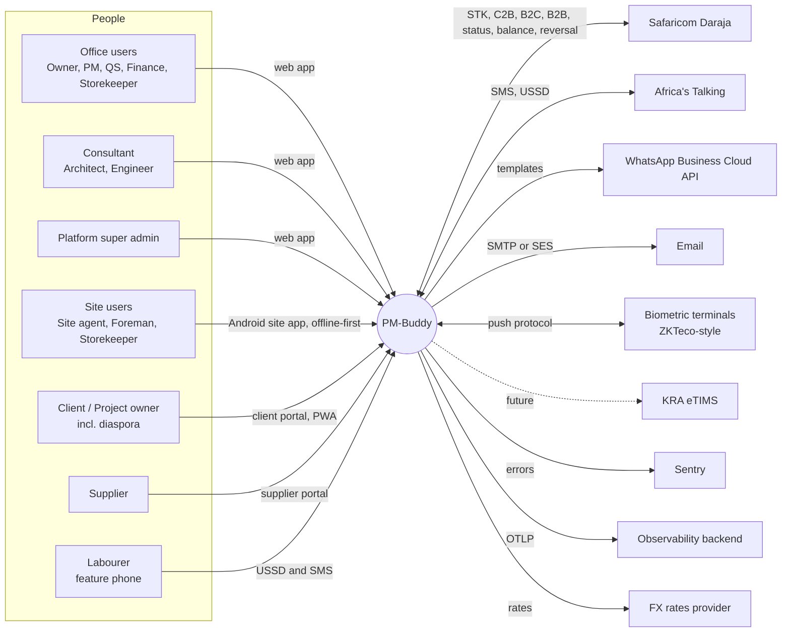
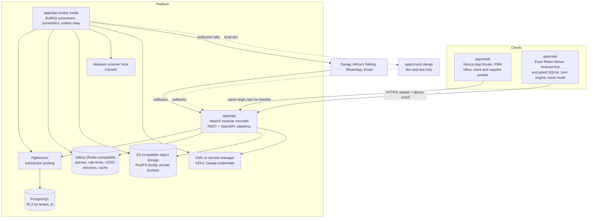
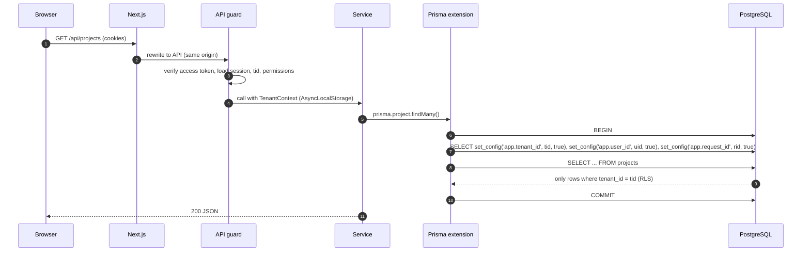
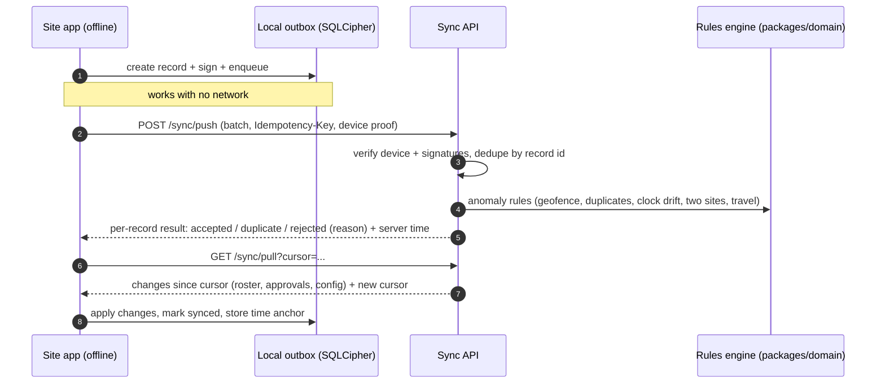
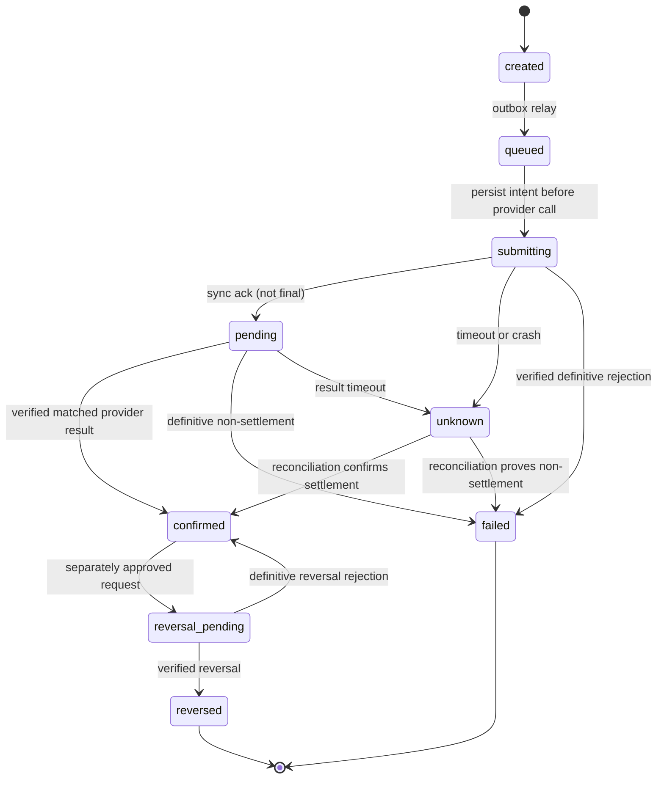
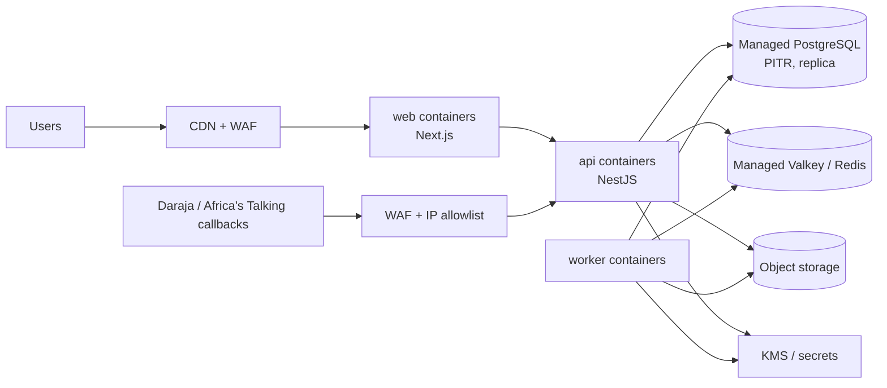

# PM-Buddy: Architecture

> **Status:** Phase 0 draft for approval. This is a living document. Decisions are tracked in §22, open items in [QUESTIONS.md](./QUESTIONS.md), and compliance items in [COMPLIANCE_TODO.md](./COMPLIANCE_TODO.md).
>
> Related: [ROADMAP](./ROADMAP.md) · [ERD](./ERD.md) · [OpenAPI outline](./api/openapi-outline.yaml) · [Threat model](./THREAT_MODEL.md) · [DPIA template](./DPIA_TEMPLATE.md) · [Configuration register](./CONFIGURATION.md)
>
> The [brief §15 safeguards](./PROJECT_BRIEF.md#15-mandatory-safeguards-pm-buddy-additions) take precedence. Detailed contracts: [workflows](./WORKFLOWS.md), [invariants](./INVARIANTS.md), [financial model](./FINANCIAL_MODEL.md), [offline sync](./OFFLINE_SYNC.md), [operations](./OPERATIONS.md), [release plan](./RELEASE_PLAN.md). These are design requirements, not a claim that the target architecture is implemented; see [implementation status](./IMPLEMENTATION_STATUS.md).

---

## 1. Goals and quality attributes

| Attribute | What it means for PM-Buddy | Main design responses |
|---|---|---|
| **Trust and integrity** | Money moves and biometrics are involved; diaspora clients rely on verifiable progress | Snapshot-bound maker-checker, step-up MFA, append-only redacted audit, evidence provenance/limitations, signed offline records |
| **Tenant isolation** | One contractor must never see another's data | `tenant_id` everywhere, PostgreSQL RLS (fail-closed), composite tenant foreign keys, automated isolation tests |
| **Offline-first on site** | Poor connectivity, low-to-mid Android phones | Expo app with encrypted SQLite, local outbox, push/pull sync, clock-drift detection |
| **Configurability** | Tax, statutory, M-Pesa and overtime rules change | Effective-dated, scoped, versioned configuration with `COMPLIANCE-REVIEW` status; payroll snapshots the rule versions it used |
| **Kenyan context** | KES, M-Pesa, EN/SW, feature phones, `2547…`/`2541…` numbers | Daraja behind `PaymentProvider`, USSD/SMS self-service, shared i18n catalogues, phone normalisation in `packages/domain` |
| **Reliability** | M-Pesa, SMS and WhatsApp can be slow or down | Outbox pattern, BullMQ with retries and backoff, idempotency keys, async state machines, reconciliation |
| **Scalability** | Thousands of workers and tens of thousands of transactions per tenant | Stateless API, horizontal scaling, queues, connection pooling, partitioned append-only tables, read models |
| **Operability** | Small team, cloud-agnostic for now | Modular monolith, Docker everywhere, OpenTelemetry, pino JSON logs, Sentry, IaC in Phase 9 |

---

## 2. System context



---

## 3. Containers



**Why a modular monolith?** Payroll, payments, the cost ledger and audit must commit atomically, and the team is small. A single deployable NestJS codebase with strict module boundaries gives that consistency with simple operations. The **worker** is the same codebase started in worker mode (`main.worker.ts`), so it scales independently from the HTTP API. Modules can be extracted into services later if load or team structure requires it (§22, D-01).

---

## 4. Backend modules (bounded contexts)

| Module | Owns (main tables, see [ERD](./ERD.md)) | Notes |
|---|---|---|
| `identity` | users, credentials, sessions, refresh tokens, MFA factors, passkeys, devices | Auth, MFA, step-up, device binding |
| `tenancy` | tenants, memberships, roles, permissions, project memberships, invitations | RBAC and project scoping |
| `audit` | audit_log | Append-only, hash-chained |
| `config-rules` | config_rules, statutory_rules (+ bands), overtime_rules, public_holidays, mpesa_tariffs | Effective-dated resolution |
| `projects` | projects, project_status_changes, sites, site_geofences, wbs_nodes, milestones | Implemented in D2.1 (§4.1) |
| `bq` | bqs, bq_versions, bq_bills, bq_sections, bq_items, bq_imports, bq_mapping_templates (D2.2); instructions, variation_orders, variation_lines, variation_status_changes, rate_buildups, rate_buildup_versions, rate_buildup_lines, bq_item_rate_links (D2.3) | Excel import pipeline (D2.2, §4.2); baseline approval, versions, variations and rate build-ups (D2.3, §4.3) |
| `schedule` | schedule_settings, schedule_activities, schedule_dependencies, schedule_baselines, schedule_baseline_items, schedule_delays, schedule_delay_activities | Gantt, CPM, baselines and the delay log; implemented in D6.2 (§4.6) |
| `progress` | progress_measurements (+ photos, reviews), contract_settings, valuations (+ lines, materials, adjustments); site diaries and photos; schedules | Measurement, interim valuations and payment certificates (retention and releases in the certificate sequence), earned value and cost to complete (D6.3 part A, §4.10); diaries and photos (D6.1); the schedule (D6.2) |
| `labour` | labourers, trades, skill_levels, labour_settings, labour_engagements, labourer_accreditations, labourer_consents, do_not_rehire_events, labour_rates, gangs, gang_memberships, labour_saved_views | Field-level encryption; implemented in D3.1 (§4.3) |
| `attendance` | attendance_devices, attendance_events, anomalies, timesheets, timesheet_lines | Capture-method plugins |
| `biometrics` | biometric_enrolments, biometric_templates | **Separate key hierarchy**, restricted service account |
| `payroll` | pay_periods, payroll_batches, payroll_lines, payroll_line_items, advances, piece_rate_jobs | Pure calculations live in `packages/domain` |
| `payments` | payments, payment_channels, payment_provider_requests, payment_callbacks, reconciliations, recon_items | Daraja behind `PaymentProvider` |
| `procurement` | units, materials, unit_conversions, material_prices, procurement_settings, suppliers, supplier_contacts, supplier_phone_changes, supplier_payout_versions (D5.1); requisitions, rfqs, quotations, lpos, grns, supplier_invoices, three_way_matches (D5.2) | Catalogue, conversions, prices and suppliers with payout maker-checker (D5.1, §4.4) |
| `stores` | stores, stock_balances, stock_ledger_entries, stock_movements, stock_movement_lines, stock_transfers, stock_transfer_lines, stock_takes, stock_take_lines, stock_take_counts, stock_reorder_levels (D5.3; code in `modules/procurement/stores`) | Append-only ledger with locked running balances, weighted average cost (§4.6) |
| `finance` | cost_codes, budgets (versions, lines), cost_entries (append-only ledger), cost_journals, petty_cash_floats (entries, top-ups, expenses, receipts, counts), cash_flow_items; read models for budget against actual and committed, the forecast and spend alerts | Every shilling is tagged (D5.4, §4.8) |
| `site-ops` | site_diaries, photos, inspections, test_results, snags, safety (incidents, toolbox talks, PPE), plant, fuel | |
| `quality` | quality_settings, checklist_templates + checklist_template_items, inspections + inspection_items + inspection_item_photos, snags + snag_photos, cube_sets + cube_results, slump_tests, project_completions | Inspections, concrete tests, snags, completion and the DLP; implemented in D6.1 (§4.7). Site diaries and photos are in `progress` (D6.1 increments 1–2) |
| `safety` | safety_settings, safety_inductions, toolbox_talks + toolbox_talk_attendees, ppe_issues, safety_incidents + safety_incident_people + safety_incident_photos, corrective_actions, first_aid_kits + first_aid_kit_checks, first_aiders, first_aid_treatments (D8.2, §4.9) | Injury details only for `safety.manage` (D-74); closed incidents locked by triggers |
| `plant` | plant_settings, plant_items, plant_moves, plant_operators, plant_meter_resets, plant_usage_logs, plant_fuel_issues, plant_breakdowns, plant_services (D8.3, §4.11) | Company register; append-only usage and fuel with monotonic meters; fuel variance an estimate (D-94); nothing posts to the cost or stores ledgers (D-93) |
| `documents` | documents, document_versions, compliance_types, compliance_records, instruction_responses, instruction_attachments, approval_requests, approval_responses; extends D2.3's `instructions` into the consultant instructions log (D8.4, §4.13) | Versioned documents with exactly one current version; the compliance register with statuses derived on read and in-app reminders; the instructions log and approval requests (independent answers bound to the file's SHA-256) |
| `notifications` | notification_templates, notifications, notification_preferences | Provider interface per channel |
| `ussd` | ussd_sessions (Redis), labourer_pins | Africa's Talking |
| `sync` | sync_changes (change log), device_sync_state | Site app push/pull |
| `files` | files | Pre-signed URLs, scanning |
| `reports` | materialised views, export_jobs | PDF and Excel |
| `platform` | (cross-tenant) tenant admin, billing, platform config | Uses a separate, audited DB role |

**Boundary rules**

1. A module reads and writes only its own tables. Other modules go through its exported application service. This is enforced with `dependency-cruiser` rules in CI.
2. Side effects across modules (for example, "payroll approved" → create payment requests) use **domain events** written to an `outbox_events` table in the same transaction, then relayed to BullMQ.
3. **Pure domain logic** (payroll maths, statutory deductions, EVM, valuations, BQ totals, unit conversions, theoretical consumption, geofence maths, anomaly rules, M-Pesa SMS parser, phone normalisation) lives in `packages/domain`. It has no I/O, is heavily unit-tested, and is shared with the site app where useful (for example, offline geofence checks).

### 4.1 Projects module (D2.1)

`apps/api/src/modules/projects` (controller, `ProjectsService`, `SitesService`, `WbsService` for the WBS and milestones, `TeamService`, `ProjectAccess`). Every endpoint runs in the tenant transaction (`TenantScope`) and authorises through `AccessPolicy`; the project is looked up by the URL ID inside the caller's tenant (404 otherwise), so another company's IDs behave like unknown IDs. Every change writes a hash-chained audit event whose metadata lists **field names only** (plus `reasonGiven`); client contacts, coordinates and reasons are never copied into the audit log.

| Endpoint (`/api/v1`) | Permission |
|---|---|
| `GET projects?status=&search=` | `projects.view` (company-wide roles see every project; other roles see assigned ones) |
| `POST projects` | `projects.create` + step-up (MFA within five minutes) |
| `GET projects/:id` (detail: project, effective permissions, activation gaps, status history) | `projects.view` on the project |
| `PATCH projects/:id`, `POST projects/:id/status` | `projects.manage` on the project; `version` required (409 `version-conflict`) |
| `GET projects/:id/sites`, `GET …/sites/:siteId/geofences?at=` | `projects.view` |
| `POST projects/:id/sites`, `PATCH …/sites/:siteId`, `PUT …/sites/:siteId/geofence` | `projects.manage` |
| `GET projects/:id/wbs`, `GET projects/:id/milestones` | `projects.view` |
| `POST/PATCH/DELETE projects/:id/wbs[/:nodeId]`, `PUT projects/:id/wbs/order`, `POST/PATCH/DELETE projects/:id/milestones[/:milestoneId]`, `POST …/milestones/:milestoneId/status` | `projects.manage` |
| `GET projects/:id/schedule`, `…/schedule/baselines[/:baselineId]` (D6.2, §4.6) | `projects.view` and one of `SCHEDULE_READ_PERMISSIONS` (a working permission; not portal-only roles) |
| `GET projects/:id/schedule/delays[/:delayId]` (D6.2) | `projects.view` and one of `DELAY_LOG_READ_PERMISSIONS` (`projects.manage`, `site.diary`, `bq.edit`, `finance.manage`: the contractor's staff) |
| `PUT …/schedule/calendar`, `POST/PATCH/DELETE …/schedule/activities[/:activityId]`, `PUT …/activities/:activityId/progress`, `POST/PATCH/DELETE …/schedule/dependencies[/:dependencyId]`, `POST …/schedule/baselines`, `POST …/schedule/delays`, `POST …/delays/:delayId/amend`, `POST …/delays/:delayId/withdraw` (D6.2) | `projects.manage`; read-only when closed or cancelled |
| `GET projects/:id/quality/…` (D6.1, §4.7) | `projects.view` and one of `QUALITY_READ_PERMISSIONS` (not portal-only roles) |
| Quality changes (D6.1) | Record: `site.diary` or `quality.manage`; sign off, verify, correct, certify: `quality.manage`, independent of the maker; propose completion: `projects.manage` |
| `GET projects/:id/team` | `projects.view` (candidates only for callers who may assign) |
| `PUT/DELETE projects/:id/members/:userId` | `users.invite` + step-up, and `projects.manage` on the project; escalation guard |

- **Lifecycle (brief §15 C).** `planning → active | cancelled`, `active → on_hold | completed`, `on_hold → active | cancelled`, `completed → closed`. Cancelling and putting on hold need a reason. Activation needs a client name, a contract sum above zero, a contract type, start and end dates, county and town, and at least one site with a geofence (`activationGaps` lists what is missing; 409 `activation-incomplete`). Closed and cancelled projects are read-only (409 `project-read-only`), and the code is fixed once a project leaves planning. The rules live once in `packages/domain` (`project-lifecycle.ts`) and are repeated in the database (`app.guard_project` trigger, `projects_active_details_check`), so a bypassed API check still cannot skip a state. Each transition is appended to `project_status_changes` (no UPDATE/DELETE for `pmb_app`, plus a trigger).
- **Contract types.** `lump_sum`, `remeasurement`, `design_and_build`, `cost_plus`, `labour_only`. JBC/FIDIC are standard *forms* of contract rather than pricing bases, so they are not in this list; a contract-form field can join with the BQ module if needed.
- **Geofence storage and versioning (D-27).** A site's geofence lives in `site_geofences`, one row per version, never updated. A radius is stored as `center_lat`/`center_lng` (`numeric(9,6)`) and `radius_m` (20–5,000); a polygon as a jsonb array of `{lat,lng}` (an open ring of 3–100 distinct vertices; the closing vertex is implied). CHECK constraints (`site_geofences_shape_check`, `app.geofence_polygon_valid`) enforce the Kenya bounding box (lat −5…5.5, lng 33.5…42), the vertex count, distinct vertices, the radius range and a polygon area of 100 m²–25 km²; self-intersection and the area/perimeter are computed by the shared `packages/domain/geofence.ts` (also used by the web editor) and stored as `area_m2`/`perimeter_m`. A trigger numbers versions and stamps `effective_from` from the database clock, strictly increasing per site under the site row lock. `GET …/geofences?at=<timestamp>` returns the version in force at that moment, which attendance (D3.3) will use for captures. PostGIS was not added: the checks needed now are simple, and spatial indexing can come with attendance if it is needed.
- **WBS weights.** A node's `weight_basis_points` is its share of its parent (10,000 = 100 %). Rule: **every sibling group must add up to exactly 100 %** before progress can be computed; until then (and, in D2.1, always, because progress measurements arrive in D6.3) the API returns `progress: null` and the web shows "unavailable". Parents are referenced through `(tenant_id, project_id, parent_id)`, a trigger refuses cycles, and the tree is at most six levels deep.
- **Milestones.** `planned → in_progress | achieved | cancelled`, `in_progress → achieved | cancelled`, `achieved → in_progress` (reopen, with a reason). Achieving needs an actual date that is not in the future; cancelling and reopening need a reason. Only planned milestones can be deleted (`app.guard_milestone`).
- **Team.** Members are company members with access to the project: company-wide roles (with their role's project permissions) or assigned members with role ∩ assignment. Assignments carry any of the project-scoped permissions in `PROJECT_ASSIGNABLE_PERMISSIONS` (§8).
- **Development seed.** `pnpm db:seed` (refused when `NODE_ENV=production`) creates the synthetic company "Jenga Bora Builders Ltd" with an owner (TOTP enrolled), a project manager, a site agent, three projects with sites, geofences, WBS and milestones. It is idempotent: a second run reports every record as already present.

### 4.2 BQ module and Excel import (D2.2)

`apps/api/src/modules/bq` (controller with `BqUploadGuard`, `BqImportsService`, `BqViewerService`, `BqExportService`, `BqTemplatesService`, `BqAccess`, `BqObjectStore`, `BqVersionWriter`, and `parsing/` for the worker and file inspection). The import logic that has no I/O (sheet scoring, header detection, unit normalisation, number parsing, hierarchy, classification, reconciliation, the state machine and the money maths) lives in `packages/domain/src/bq`, so the API and tests share one implementation; request and response schemas live in `packages/validation/src/bq.ts`, and the vocabulary (statuses, limits, issue codes with their severities, units) in `packages/types/src/bq.ts`.

| Endpoint (`/api/v1/projects/:id/bq…`) | Permission |
|---|---|
| `GET` (current version, bills, summary, import status and overrides), `GET bills/:billId` (one bill's sections and items), `GET search?q=` | `bq.view` |
| `GET export/xlsx?locale=`, `GET export/pdf?locale=` (rate limit 60 per 10 minutes per user) | `bq.view` |
| `GET imports`, `POST imports` (multipart `file`), `GET imports/:importId`, `POST …/parse` (retry a stored upload), `GET …/sheets/:sheetIndex/rows?from=&count=` (raw rows for the mapping screen, at most 200), `PUT …/mapping`, `POST …/apply-template`, `POST …/validate`, `PUT …/resolutions`, `GET …/preview`, `POST …/commit`, `POST …/abandon`, `GET …/source` (original file) | `bq.import` |
| `GET templates`, `POST templates`, `DELETE templates/:templateId` (company mapping templates) | `bq.import` |

D2.2 itself has no manual editing; `bq.edit` is used from D2.3 for instructions, variations, build-ups and item links (§4.3). Permissions go through `AccessPolicy`/`ProjectAccess` (role ∩ assignment for project-scoped users); the tenant comes from the session and the project from the URL inside the tenant transaction, so another company's IDs behave like unknown IDs (404). Every change (upload, refusal, parse or parse failure, mapping, validation, resolutions, commit, abandon, template create/delete) and every export writes a hash-chained audit event whose metadata holds field names, counts, codes and digests only; file names, descriptions and amounts are never copied into the audit log.

**Upload and parsing safety (brief §15 F; see also §17).**

1. Before the body is read, `BqUploadGuard` refuses a declared `Content-Length` over 10 MB (+64 KB of multipart overhead) with 413, requires a session (401) and rate-limits uploads (60 per hour per user). Multer then enforces the 10 MB limit on the file itself (413 `payload-too-large`).
2. The type comes from the **content signature**, never the extension alone: `.xlsx` must be a ZIP (`PK\x03\x04`) and `.xls` an OLE compound file (`D0 CF 11 E0`); a mismatch is 415 `unsupported-file-type`.
3. For `.xlsx`, the ZIP **central directory** is read before anything is inflated: more than 10,000 entries, ZIP64, encrypted entries, a declared uncompressed total above 100 MB or a ratio above 100:1 is 422 `unsafe-archive`; a package without `[Content_Types].xml` and `xl/workbook.xml` is 415; a `vbaProject.bin` (macros) is 415 `macro-workbook`.
4. SHA-256, size, the sanitised original name (path, control and invisible characters removed, other unusual characters replaced; at most 120 characters) and the uploader are recorded. The `MalwareScanner` hook runs next (`MALWARE_SCANNER=development` is a no-op that records `not_scanned`/`development-noop`; `disabled`, the default, refuses uploads with 503 until ClamAV is wired, see the TODO in `src/infra/malware-scanner.ts`). The result is stored on the import.
5. The original is stored in the private bucket at `tenants/{tenantId}/projects/{projectId}/bq-imports/{importId}/source.{xlsx|xls}`; the user's file name is never part of the key (a CHECK enforces the key format).
6. Parsing runs in a `worker_threads` worker with `resourceLimits` (384 MB old-generation heap), a 30-second time limit (the worker is terminated) and at most two concurrent parses with eight waiting (503 `parser-busy` beyond that). The worker loads only SheetJS and reads with `{ dense: true, cellFormula: true, cellHTML: false, cellStyles: false, sheetRows: 20,001 }`; it refuses more than 50 sheets, 20,000 rows per sheet, 100 columns per sheet or 200,000 non-empty cells, and encrypted or unreadable workbooks (the import becomes `failed` with a stable `failureCode`).
7. **Formulas are never evaluated.** A formula cell keeps SheetJS's cached value and is flagged (`formula-cell` warning); a formula with no cached value is an error. Every value is treated as untrusted text: control characters are stripped (`control-characters-removed`), text is capped at 4,000 characters, and numbers come only from numeric cells or strictly parsed numeric text (thousands separators, `KShs`/`KES`, parentheses for negatives); anything else in a numeric column is `non-numeric`. The parsed grid is stored gzipped next to the source (`parsed.json.gz`) so later steps never re-run the parser.

**Detection heuristics.** Each sheet is scored as a `bill`, a `summary` (collection or grand summary) or `other` from its name (`Bill No. 2`, `Summary`, `Collection`) and contents. The header row is the best-scoring row in the first 60 that matches the column vocabulary (tolerant English spellings such as Item/Ref/No., Description/Particulars, Unit, Qty/Quantity, Rate/Unit rate, Amount/Total/KShs/KES, and common Kiswahili terms such as *Maelezo*, *Kipimo*, *Kiasi*, *Bei*, *Jumla*); the confidence is the share of mapped key fields weighted by match quality. The proposal also suggests the first and last data rows, the bill number and the bill title (from "BILL NO. 2 – SUBSTRUCTURE"-style headings or the sheet name). The user confirms or edits all of it per sheet. Mapping templates (per company) store the column mapping by **header signature** (normalised header texts in column order) and are offered when a sheet's signature matches.

**Hierarchy and classification.** Rows become Bill → Section → Item. A section heading is a row with a description but no quantity, rate or amount, in capitals or a short title followed by a referenced item; unpriced explanatory text is kept as section notes; multi-line descriptions continue onto the item above. Carried-forward, brought-forward, page-total, collection and bill-total rows are recognised by their wording, **excluded from items** and used for reconciliation. Bills are classified as preliminaries (usually Bill 1), measured, provisional (PC and provisional sums), dayworks or contingency, and items as measured, preliminary, provisional_sum, pc_sum, pc_attendance, pc_profit (percentage lines after a PC sum), contingency or daywork. An amount with no quantity or rate is a lump sum (`lump-sum` info). Units are normalised (m³/m3/cum → `m3`, m²/m2/sqm → `m2`, lm/m → `m`, kg, t/tonne → `t`, No./Nr → `nr`, `item`, LS/Sum → `ls`, % → `pct`, plus hours, days, weeks, months, litres, sets and pairs); an unknown unit keeps its text as `other` (`unknown-unit` info), and the original spelling is always kept (`unit_raw`).

**Validation report.** Stored with the import (JSON, capped at 300 entries per code while the counts stay complete) with a stable code, severity, sheet and row for each issue (the full list is `BQ_ISSUES` in `packages/types`). Errors (duplicate reference within a section and page, negative quantity, non-numeric number, formula without a value, sheet amount ≠ quantity × rate beyond KES 1.00, no items, duplicate bill number, no bills) block the commit. Warnings (missing unit, quantity without rate and the reverse, unpriced item, formula cell, page/collection/bill/brought-forward totals that differ, summary lines that differ or are missing, subtotal, VAT or grand total that differ, grand total ≠ contract sum, truncated text, precision rounded) must each be accepted with a reason. Row resolutions: use the computed amount, use the sheet amount (stored as `amount_source = sheet_override` with the reason), or exclude the row. The grand summary's VAT line is read and compared; VAT is always recomputed.

**Rounding (FINANCIAL_MODEL, D-05).** Quantities and rates are exact decimals (`numeric(20,4)`; more than four decimals are rounded half-up with a `precision-rounded` warning; numbers from Excel are reduced to 15 significant digits first, which removes binary-float noise such as `0.30000000000000004`). Each line amount = quantity × rate computed with `decimal.js`, **rounded once per line, half-up (ties away from zero) to the cent**, stored as integer minor units. Bill totals are sums of line amounts; VAT = subtotal × rate, rounded half-up to the cent once on the subtotal; grand total = subtotal + VAT. The sheet's own amount is kept in `sheet_amount_minor` and compared, never trusted. The database repeats the rules: a CHECK per item (`amount_minor = round(quantity × rate × 100)` for computed lines) and a deferred constraint trigger that re-adds bills and items and checks the version totals at commit.

**Import state machine.** `uploaded → parsed → mapped → validated → committed`, plus `failed` (parse refused) and `abandoned` (by the user) as end states, and `superseded` when a later import replaces the draft. Saving a mapping from `mapped` or `validated` returns to `mapped` and clears the report and resolutions; resolutions keep the import `validated`. Transitions live in `packages/domain` (`bq/lifecycle.ts`) and are repeated in the database (`app.guard_bq_import`), which also makes the source columns (file name, size, SHA-256, keys, scan result, uploader) immutable. The user can leave and resume any unfinished import; invalid moves are 409 `invalid-import-state`.

**Version model and atomic commit.** D2.2 creates one BQ per project ("Bill of Quantities") with **version 1 in `draft` status, source `import`**. Commit rebuilds the BQ from the stored grid, mapping and resolutions, checks that the result still matches the validated report (`report_digest`, else 409 `validation-stale`) and that every error is resolved and every warning accepted (else 409 `commit-blocked`), then, in **one transaction** (the project row is locked `FOR NO KEY UPDATE` so commits for one project run one at a time, the import row `FOR UPDATE`, 120-second limit): creates the BQ and version or, if a draft exists, deletes its bills, sections and items and rewrites them (`version` is bumped); snapshots the VAT rate, its rule key and status (`bq.vat.rate`, COMPLIANCE-REVIEW) and the rounding rule onto the version; writes bills, sections and items in chunks of 1,000; links the import to the version and marks the previous committed import `superseded`; and writes the audit event. Any failure rolls everything back (an e2e test forces a failure after the first chunk). Once a version is no longer a draft, re-import is 409 `bq-not-draft` (baseline approval, variations and later versions: §4.3). The runtime role cannot DELETE imports, BQs or versions, and content triggers refuse changes to non-draft versions.

**Exports.** Excel (SheetJS): a Summary sheet and one sheet per bill with sections, items, section subtotals and bill totals; amounts are numeric cells with a KES number format, and every text cell that starts with `=`, `+`, `-`, `@`, a tab or a carriage return is prefixed with an apostrophe (`spreadsheetSafeText`, §17.7). PDF (pdfmake): A4, company and project header, `KES 1,250,000.00` formatting, `DD/MM/YYYY` dates in Africa/Nairobi, page numbers and a "Draft" watermark while the version is a draft; Roboto is loaded into pdfmake's virtual file system and URL and local-file access are denied, so a document cannot fetch anything. PDFs are limited to 10,000 items (422 `export-too-large`). Both stream with `Content-Disposition: attachment` and an ASCII-only file name built from the project code (plus an RFC 5987 `filename*`).

### 4.3 BQ versions, variations and rate build-ups (D2.3)

Same module (`apps/api/src/modules/bq`): `BqVariationsController` (project-scoped) and `BuildupsController` (company library) over `BqVersionsService` (version list, baseline approval, compare, contract sums), `InstructionsService`, `VariationsService` (lines, lifecycle, atomic approval, rebase), `BuildupsService` (library and item links), `BqVersionWriter.copyContent` and `variation-digest.ts`. The pure logic lives in `packages/domain/src/bq`: `variation-lifecycle.ts` (the state machine), `variation.ts` (line pricing, totals, `applyVariation`, the canonical snapshot text), `compare.ts` and `buildup.ts` (rate maths and unit compatibility). The wire contracts are in `packages/validation/src/variations.ts` and the vocabulary in `packages/types/src/variations.ts`.

| Endpoint (`/api/v1/projects/:id/bq/…`) | Permission |
|---|---|
| `GET versions`, `GET versions/compare?from=&to=`, `GET versions/:versionId/bills/:billId`, `GET contract-sum` | `bq.view` |
| `POST versions/:versionId/approve` (baseline; body `{version}`) | `bq.approve_variation` + fresh step-up; not a maker of the import |
| `GET instructions`, `GET instructions/:instructionId` | `bq.view` |
| `POST instructions`, `PATCH instructions/:instructionId` (details, close/reopen; `version`) | `bq.edit` |
| `GET variations?status=`, `GET variations/:variationId` (lines, totals, projection, snapshot, history) | `bq.view` |
| `POST variations`, `PATCH variations/:variationId`, `PUT variations/:variationId/lines`, `POST …/submit`, `POST …/reopen`, `POST …/cancel` (reason), `POST …/rebase` | `bq.edit` |
| `POST …/approve` (`{version, snapshotDigest}`) | `bq.approve_variation` + fresh step-up; not the creator or submitter |
| `POST …/reject` (`{version, snapshotDigest, reason}`) | `bq.approve_variation`; not the creator or submitter |
| `GET items/:lineageId/rate-buildup` | `bq.view` |
| `PUT items/:lineageId/rate-buildup` (`{buildupVersionId}`), `DELETE items/:lineageId/rate-buildup` | `bq.edit` |
| `GET /api/v1/rate-buildups`, `GET /rate-buildups/:buildupId`, `GET /rate-buildups/:buildupId/versions/:versionNo` | `bq.view` company-wide or on at least one assigned project |
| `POST /api/v1/rate-buildups`, `PUT /rate-buildups/:buildupId` (`version`; appends a version) | `bq.edit` company-wide or on at least one assigned project |

Every mutation runs in the tenant transaction, takes the project from the URL inside the caller's company (another company's IDs are 404), checks the optimistic `version` (409 `version-conflict`) and refuses closed or cancelled projects (409 `project-read-only`). Step-up failures are 403 `step-up-required`; other stable codes are `baseline-not-approved`, `maker-checker`, `instruction-number-taken`, `instruction-closed`, `invalid-transition`, `reason-required`, `variation-stale`, `variation-not-stale`, `variation-empty`, `variation-line-invalid`, `line-no-change`, `buildup-code-taken`, `unit-mismatch`, `item-unit-missing`, `item-unit-unknown` and `bq-not-approved`. Audit events (`bq.baseline.approved`, `instruction.created/updated`, `variation.created/updated/lines_saved/submitted/approved/rejected/reopened/cancelled/rebased`, `rate_buildup.created/versioned`, `bq.item.rate_linked/rate_unlinked`) carry field names, counts, IDs, version numbers and digests only: never amounts, descriptions, subjects or reasons (an e2e test reads the stored events to check this). Reasons live in `variation_status_changes`.

**Version model.** A BQ is a linear chain of versions. Version 1 (`source = import`, no parent) is the D2.2 draft. **Baseline approval** turns it into the contract baseline: it needs `bq.approve_variation` (the existing permission for contract-sum decisions, chosen over a new `bq.approve_baseline` key so no role or CHECK change was needed), a fresh step-up, and an approver who is not a maker of the import (the version's creator or last updater, the import's uploader or committer). The approver and time are stamped (`approved_by`, `approved_at`); a CHECK refuses `approved_by` equal to `created_by` or `updated_by`. From then on version 1 never changes (API and `app.guard_bq_version` trigger: an approved row, its bills, sections and items reject every UPDATE and DELETE, including a direct SQL UPDATE as `pmb_app`), and re-import is 409 `bq-not-draft`. **Every later version comes only from an approved variation** (`source = variation`): `parent_version_id` (unique per company, so history cannot branch), `variation_id` (unique), `created_by` (the variation's creator), `updated_by` (its submitter), `approved_by/at` (the approver), version-specific totals and the VAT rate, its rule key and status copied from the parent snapshot. The lineage CHECK requires `import ⇒ version 1 without parent` and `variation ⇒ parent and variation set`; the trigger requires the variation to be on the parent, the parent approved and `version_no = parent + 1`. Bills, sections and items carry a **lineage ID** that is copied into every version, so an item is the same item across versions (compare, links and variation lines use it); the unique `(tenant_id, version_id, lineage_id)` indexes back the composite foreign keys.

**Compare.** `versions/compare?from=&to=` matches items by lineage: added, removed and changed items (quantity, rate, amount and amount source, before and after), bill subtotals by bill lineage, and subtotal, VAT and grand-total differences, all in minor units from `packages/domain` `compareVersions`.

**Instructions.** A per-project register: number (letters, digits, space, `./_-`, unique per project, 409 `instruction-number-taken`), date issued, issuer name and discipline (architect, engineer, quantity surveyor, client, project manager, other), subject, optional description, up to 10 attachment references (metadata only; uploads come with the files module) and `open`/`closed`. A variation must cite an open instruction (409 `instruction-closed`, also checked by the trigger).

**Variation lines and money.** A draft variation holds up to 500 lines against its **base version** (always the newest approved version when created or rebased):

- `adjust` changes an existing item's quantity and/or rate, or the amount of an amount-only line (lump sum, daywork, provisional sum);
- `omit` keeps the item for history with quantity 0 and amount 0 (`amount_source = omitted`); omitting an already-omitted item is `line-no-change`;
- `add` creates an item in an existing bill, in an existing section or a new section (code and title), with ref, description, kind (measured, preliminary, provisional or PC sum, contingency, daywork), unit, and either quantity × rate or a fixed amount (`amount_source = fixed`).

Lines refer to the base by lineage through composite foreign keys `(tenant_id, base_version_id, *_lineage_id)` to the base version's items, bills and sections, so a line can only name content of its own base in its own company. Each line is priced with the D2.2 rules: amount = quantity × rate, rounded half-up once per line to the cent; the line stores the base amount, the new amount and the delta. Variation totals: additions = Σ positive deltas, omissions = Σ |negative deltas|, net = additions − omissions (CHECK). The projected version: subtotal = base subtotal + net, VAT = subtotal × the base version's **snapshotted** VAT rate, rounded half-up once on the subtotal, grand total = subtotal + VAT; the grand-total effect is the projected grand total minus the base grand total. No JavaScript floats are used for money (`decimal.js`, integer minor units, `bigint` columns).

**State machine and snapshot binding (WORKFLOWS, Variation).** `draft → submitted → approved | rejected`, `rejected → draft` (reopen), `draft → cancelled` (reason), plus **rebase** (`draft | submitted | rejected → draft` when stale). Approved and cancelled are final. The table lives once in `packages/domain` and is repeated by `app.guard_variation_order` (transitions; submitted and rejected rows are frozen except for the decision and rebase; the base must be approved and the instruction open; approval needs the produced version to exist, checked at commit by the deferred `app.check_variation_version`) and `app.guard_variation_line` (lines change only while draft). **Submit** prices every line against the base, refuses empty or invalid proposals, and stores a SHA-256 **snapshot digest** of the canonical proposal (`variationSnapshotText`: variation, instruction, base version and its grand total, VAT rate, every line's target and values with base/new amounts, and the totals). **Approve and reject must quote the digest the reviewer saw**; the server recomputes it from the stored lines and base and refuses any mismatch, and refuses a base that is no longer the newest approved version, with 409 `variation-stale`. Maker-checker is by identity: the decider can be neither the creator nor the submitter (403 `maker-checker`, plus `variation_orders_state_check`). Rejection needs a reason (stored in the status history); approval also needs a fresh step-up.

**Atomic approval and concurrency.** In one transaction: the tenant scope, then the BQ row `FOR UPDATE` (approvals and baseline approvals of one BQ run one at a time), then the variation row; the checks above; `applyVariation` copies the base content, applies the lines (new lineage IDs for added items, new sections created once) and recomputes totals and VAT with the snapshotted rate; the new version is inserted as a draft, its bills, sections and items are written (`copyContent`), the variation becomes `approved`, the version `approved`, a status change and the audit event are written. Any failure rolls everything back. Two variations on the same base: after one is approved the other is **stale** (its base is no longer the newest); its approval is refused until someone with `bq.edit` **rebases** it, which re-points it (and, through `ON UPDATE CASCADE` on the line foreign key, its lines) to the newest version, returns it to draft, reprices the lines that still apply and marks those that no longer apply with an issue code to fix before resubmitting. Two simultaneous approvals of different variations on the same base cannot both succeed: the second waits for the BQ lock and then sees a newer version (409 `variation-stale`); the unique `(tenant_id, parent_version_id)` index is the database backstop. An e2e test fires two approvals at once (two variations on the same base, then one variation approved by two people) and expects exactly one 200 and one 409 each time.

**Contract sums.** `GET contract-sum` (and the card on the project overview and BQ page): original = the approved baseline's grand total; approved variations = revised − original; revised = the newest approved version's grand total; pending = Σ grand-total effects of submitted variations, each against its own base, shown separately and **never added into the revised sum**. While the baseline is a draft only the draft total is shown, and there is no revised sum.

**Rate build-up library (brief §5.2, §15 G).** Per company: code (unique), name, output unit (a normalised BQ unit; `pct` and `other` are not units of work) and resource lines (material, labour or plant; resource name and unit as written, e.g. "bag (50 kg)" or "t"; quantity per output unit as an exact decimal with up to six places; optional waste % up to four places; optional unit cost in minor units). **Rate** = Σ line amounts, each line = quantity × (1 + waste % / 100) × unit cost computed exactly and **rounded half-up to the cent once per line** (`bq.buildup.rounding = half_up_line`, CONFIGURATION); a line without a unit cost makes the rate "unavailable" (null), never a partial figure. The database repeats the line rule in a CHECK and the version totals in a deferred trigger. **Editing appends a version** (`rate_buildup_versions`, `created_at` is its effective-from; versions and lines are never updated or deleted by `pmb_app`), and `rate_buildups.current_version_no` points at the newest. **Item links** (`bq_item_rate_links`) bind an item lineage of the current approved version to a specific build-up version, so a later edit of the build-up never changes what a linked item used (§15 C); re-linking or unlinking stamps the old link `unlinked_at/by` (one active link per item, partial unique index). The build-up unit must equal the item's normalised unit (422 `unit-mismatch`, `item-unit-missing`, `item-unit-unknown`); nothing is converted. Theoretical consumption from these links arrives in D5.x. **Assumptions** are explicit: conversions such as a 50 kg cement bag, densities, and sand and ballast in tonnes are written on each build-up; **a lorry trip is not a universal mass or volume** (§15 G), so it is never a build-up unit. The development seed adds one build-up with clearly synthetic values (`CONC-C25-SYN`).

**Library access.** The library is company-wide, but `bq.view`/`bq.edit` are project-scoped permissions, so the library uses `AccessPolicy.holdsSomewhere`: a company-wide role holding the permission, or a role holding it with an assignment that grants it on at least one project (role ∩ assignment). Linking an item to a build-up is project-scoped (`bq.edit` on that project).

### 4.3 Labour module (D3.1)

`apps/api/src/modules/labour`: `LabourController` (`/labour/*`) and `GangsController` (`/labour/gangs`), with `LabourSetupService` (trades, skill levels, settings), `LabourRatesService`, `LabourersService` (registration, changes, status, reveal, do-not-rehire, engagements), `LabourRecordsService` (NCA cards, consent, alerts), `GangsService`, `LabourViewsService`, the read model `LabourerReader`, `LabourAccess` (permission checks on projects) and `LabourCrypto`/`FieldCipher` (§10). Like the projects module, every endpoint runs in the tenant transaction and authorises through `AccessPolicy`; IDs from the URL are looked up inside the caller's company and labourers the caller cannot view are 404. The full request/response contract is in [`apps/api/README.md`](../apps/api/README.md#labour-registry-d31); the shared schemas are in `packages/validation/src/labour.ts`.

| Endpoint (`/api/v1/labour`) | Permission |
|---|---|
| `GET setup` (trades, skill levels, settings, `canConfigure`, `manageableProjects`) | `labour.view` somewhere or `config.manage` |
| `POST setup/defaults`, `POST/PATCH trades[/:id]`, `POST/PATCH skill-levels[/:id]`, `PUT settings` | `config.manage` |
| `GET rates?projectId=`, `GET labourers/:id/rate?projectId=&date=&basis=` | `labour.manage` or `finance.view` (on the project when given) |
| `POST rates`, `DELETE rates/:id` (scheduled rates only) | company rates `config.manage`; project and labourer rates `labour.manage` on the project |
| `GET labourers?…filters` (search: names and worker numbers only) | `labour.view` (company-wide roles see everyone; others see labourers engaged, now or before, on their projects) |
| `POST labourers/lookup` (`{identifier}` in the body) | `labour.view`; exact blind-index match of a full ID, phone or KRA PIN among visible labourers |
| `POST labourers` (with consent) | `labour.manage` on `projectId`, or a company-wide role without a project |
| `GET labourers/:id` | `labour.view`; the do-not-rehire flag only for managers, its reason only with `labour.do_not_rehire` |
| `PATCH labourers/:id`, `POST labourers/:id/status`, `POST/PATCH/DELETE labourers/:id/accreditations[/:cardId]` | `labour.manage` (`version` required where the resource has one) |
| `POST labourers/:id/engagements`, `POST …/engagements/:engagementId/end` | `labour.manage` on the project (plus `labour.do_not_rehire` and an override reason for a flagged worker) |
| `POST labourers/:id/reveal` (`{field, purpose}`) | `labour.view_sensitive` + step-up (MFA within five minutes) |
| `PUT labourers/:id/do-not-rehire` | `labour.do_not_rehire` + step-up |
| `POST labourers/:id/consents`, `POST …/consents/withdraw` | `labour.consent` |
| `GET accreditation-alerts?projectId=` | `labour.view` |
| `GET/POST/DELETE views[/:id]` | `labour.view`; saved views belong to the user |
| `GET/POST gangs`, `GET/PATCH gangs/:id`, `POST gangs/:id/members`, `POST …/members/:membershipId/leave` | `labour.view` to read; `labour.manage` on the gang's project to change |

- **Under 18 (brief §6).** Age is computed on the registration date (and on an engagement's start date) in Africa/Nairobi with `isOldEnoughToRegister` from `packages/domain`, which matches PostgreSQL's `date - interval '18 years'` exactly (a 29 February birthday turns 18 on 1 March in non-leap years). The database repeats it: `registered_on` is set by a trigger to the Nairobi date and `labourers_minimum_age_check` refuses `date_of_birth > registered_on - 18 years`; the engagement trigger checks the start date. API refusals are 400 `under-minimum-age`.
- **Identifiers (brief §7).** ID/passport number, phone, KRA PIN, NSSF and SHA numbers and the next-of-kin contact are stored only as ciphertext (`*_enc`); duplicate and do-not-rehire checks use blind indexes (`id_number_bidx` unique per company, `kra_pin_bidx` unique, `phone_bidx` not unique so shared family phones are warned about, not refused). The ID index ignores the document type and leading zeros of all-digit numbers (D-35), so the same number resubmitted as a passport or alien ID is caught. Full identifiers are searched only through `POST labourers/lookup`, with the identifier in the body; the registry's GET search refuses terms with digits (other than worker numbers), the web keeps identifier searches out of URLs and sign-in redirects, and saved views never store search text (API schema and a database CHECK) (D-36). Responses carry masked values (`•••••678`, phones `2547•••••101`); a value that cannot be decrypted shows `•••••` and logs a warning without the value. Revealing a full value needs `labour.view_sensitive`, fresh MFA (step-up; 403 `mfa-required` when the account has no MFA) and a purpose from a fixed list, and writes `labourer.sensitive_revealed` (field and purpose, never the value).
- **Do not rehire.** Setting or clearing needs `labour.do_not_rehire`, step-up and a reason of 10–500 characters, stored encrypted in the append-only `do_not_rehire_events`; the trigger refuses a flag change without a matching event in the same transaction. A registration whose ID or KRA PIN belongs to a flagged person is refused (409 `do-not-rehire-match` with `match`); a phone match, an engagement or a reactivation of a flagged person needs `labour.do_not_rehire` and a recorded override reason (an `override` event). Duplicate IDs return 409 `duplicate-identity` with `match {labourerId, workerNo, matchedOn}` so the user engages the existing worker instead of creating a ghost record (`ProblemDetailsFilter` passes only those keys).
- **Consent.** Registration requires consent to the current notice (`CURRENT_CONSENT_NOTICE`: version, EN/SW text in the catalogues, SHA-256 digests pinned in `packages/types` and stored with each record); a deferred constraint trigger refuses a labourer without a consent row. Withdrawal keeps the records, sets `withdrawn_at` from the database clock and blocks new engagements and reactivation until consent is recorded again. Biometric consent is not part of D3.1; `CONSENT_KINDS` and `labourer_consents_kind_check` are the D3.4 extension point.
- **Rates.** Rows in `labour_rates` are never updated; a new rate is a new row starting today or later (400 `rate-backdated`), and only a rate that has not started can be deleted. Resolution (`resolveRate` in `packages/domain`, also `GET labourers/:id/rate`): labourer on project → project trade + skill → project trade → company trade + skill → company trade, then the latest `effective_from` on or before the date. The minimum-wage check is reported as `not_configured` (CR-PAY-09).
- **NCA alerts.** Computed on read from `labourer_accreditations` with the company's lead time (`labour_settings.accreditation_alert_days`, default 30): expired, expiring and missing (when the skill level expects a card) for active labourers. There is no queue infrastructure yet, so nothing is sent; reminders can reuse this query when notifications arrive.
- **Gangs.** Named per project (optionally at one of its sites) with a leader who must be a current member; memberships keep join/leave dates, one open gang per labourer and project, and joining needs an engagement on that date. Leaving a project or the company ends the memberships it supported.
- **Audit.** Every change writes a hash-chained event (`labourer.registered`, `.updated`, `.status_changed`, `.sensitive_revealed`, `.do_not_rehire_set`/`_cleared`/`_overridden`, `.consent_recorded`/`_withdrawn`, `.engaged`, `.engagement_ended`, `.accreditation_added`/`_updated`/`_removed`; `labour.rate_created`/`_cancelled`, `labour.trade_*`, `labour.skill_level_*`, `labour.settings_updated`, `labour.defaults_installed`, `labour.view_saved`/`_deleted`; `gang.created`, `.updated`, `.member_added`, `.member_left`) whose metadata lists field names, IDs, dates and flags only, never identifiers, ciphertext, reasons or amounts.
- **Development seed.** `db:seed` adds 15 trades, 4 skill levels, 40 synthetic labourers (clearly fictional names; national IDs `900000xx`, phones in the `0700 000 0xx` block, KRA PINs `A9000000xxZ`; nothing is ever sent to them), rates, 6 gangs on the demo projects, NCA cards (some expiring or expired) and one do-not-rehire case; idempotent like the rest of the seed.


### 4.4 Attendance and timesheets module (D3.3 web slice)

`apps/api/src/modules/attendance`: `AttendanceController` (`/attendance/*`) with `AttendanceSettingsService` (period cut-off, rule versions, holidays), `MusterService` (overview, muster roll, day submit/confirm/return), `CorrectionsService`, `AnomaliesService`, `PeriodsService` (list, detail, submit, approve, reject, reopen, payroll lines, labourer summary) and `AdjustmentsService`; shared pieces are `TimesheetCalculator` (loads rules, holidays and records and calls the pure `computeLabourerDay` in `packages/domain`), `PeriodStore` (finds or creates the weekly period covering a date) and `AnomalyEvaluator` (re-runs `detectDayAnomalies` for changed labourer-days). `AttendanceCommands` wraps every command: optional `Idempotency-Key` (8–128 characters; the same key and payload replays the stored response with `Idempotent-Replayed: true`, another payload is 409 `idempotency-key-reused`), the tenant row lock, the redacted hash-chained audit event and the transactional outbox in one transaction. Problems are RFC 9457 with attendance codes (`period-locked`, `same-person`, `period-changed`, …); database rule violations map to 409 `attendance-rule`.

| Endpoint (`/api/v1/attendance`) | Permission |
|---|---|
| `GET overview` | `attendance.view` (projects listed) |
| `GET settings` | `attendance.view`, `timesheets.manage_rules` or `config.manage` somewhere |
| `PUT settings/periods` | `config.manage` |
| `POST rules`, `DELETE rules/:id` | `config.manage` (company default) or `timesheets.manage_rules` on the project (override) |
| `POST rules/defaults`, `POST holidays`, `POST holidays/defaults`, `DELETE holidays/:id` | `config.manage` |
| `GET projects/:projectId/muster?siteId&date&gangId` | `attendance.view` |
| `PUT projects/:projectId/muster` | `attendance.record` |
| `POST days/:dayId/submit` | `attendance.record` |
| `POST days/:dayId/confirm`, `POST days/:dayId/return` | `attendance.confirm`, not the submitter (confirm: nor anyone who recorded the day) |
| `POST days/:dayId/corrections` | `attendance.override` + step-up |
| `GET projects/:projectId/corrections`, `POST corrections/:id/approve`, `POST corrections/:id/reject` | `attendance.view`; decisions `attendance.confirm`, not the requester |
| `GET anomalies`, `POST anomalies/:id/review` | `attendance.view`; review `attendance.review_anomalies`, not a recorder |
| `GET projects/:projectId/periods`, `GET periods/:id` | `attendance.view` |
| `GET periods/:id/lines` | `attendance.view`, `payroll.prepare` or `finance.view`; approved periods only |
| `POST periods/:id/submit`, `POST periods/:id/reopen` | `timesheets.submit` |
| `POST periods/:id/approve`, `POST periods/:id/reject` | `timesheets.approve`, not the submitter |
| `POST periods/:id/adjustments` | `attendance.override` + step-up |
| `GET projects/:projectId/adjustments`, `POST adjustments/:id/approve`, `POST adjustments/:id/reject` | `attendance.view`; decisions `timesheets.approve`, not the requester |
| `GET labourers/:labourerId/summary` | `attendance.view` on a project the labourer worked on |

- **Capture methods.** Records carry `capture_method`; only `web_manual` (a supervisor's entry on the muster roll) is implemented. `qr_card`, `face`, `fingerprint` and `terminal` are reserved in `CAPTURE_METHODS` with nullable evidence columns (device, device and server time, GPS and accuracy, geofence result and version, match confidence, photo, client event id) that a CHECK keeps empty for `web_manual`; the site app (D3.2–D3.3) and biometrics (D3.4) will write the same rows (§13).
- **Muster roll and maker-checker.** One `attendance_days` row per site and date and one `attendance_records` row per labourer, site and date (database-unique). Only labourers engaged on the project that day can be recorded (409 `not-engaged`, also a trigger); inactive and do-not-rehire labourers can be recorded but are flagged. A recorder submits the day; a different person with `attendance.confirm` confirms or returns it (the API and a trigger refuse the submitter and anyone who created or updated a record of the day). After submission, changes are corrections with a reason and step-up, decided by someone other than the requester. Every command checks the version the caller read. A day cannot be returned to draft while a correction is pending (409 `pending-corrections`, also a trigger), and a correction is applied only while its day is submitted or confirmed and the record still holds the values it was asked against (409 `correction-outdated`, also a trigger), so a correction never overwrites a newer value (review fix 4). For periods, maker ≠ checker binds the current submission: after a reopen, the person who rejected may submit again for someone else to approve (review fix 1).
- **Computation.** `packages/domain/src/attendance` is pure integer arithmetic on minutes and half-day units (no floating point): a labourer's day is computed once across all sites and projects (overlapping minutes counted once, breaks, overnight shifts, the governing rule of the earliest worked record, normal and overtime split by day type: public holiday over rest day over weekday, half-day units, lateness on weekdays only), then shared between the records, so a two-site day is never paid twice. Half days (review fix 2): each `half_day` record is worth one half, at most two halves a day, and the threshold applies only when a `present` record is involved (never lowering the labelled halves); a `half_day` record receives at most one half, so the result does not depend on record order, site or project. Records in approved periods keep their snapshot allocation and others share only the remainder; the day is also recomputed with nothing locked, and a locked share that differs is reported as `lockedDrift` (review fix 3).
- **Rules and holidays.** Effective-dated rule versions (company default plus project overrides; `resolveTimesheetRule`) and a per-company holiday calendar; neither can change inside a submitted or approved period, so approved timesheets are never recomputed with other rules. Unverified rules cannot drive production approval (COMPLIANCE-REVIEW CR-PAY-08).
- **Periods.** Weekly per project (Q-C4: Friday–Thursday, cut-off Thursday 18:00 Africa/Nairobi, `zonedDateTime`), created when the first attendance of the week is saved. `open → submitted` after the cut-off with every day confirmed and no pending correction (the submission stores a SHA-256 digest of the computed lines), `submitted → approved` by a different person with no open anomaly and an unchanged digest (409 `period-changed`), or `submitted → rejected → open`. Approval inserts the immutable `timesheet_lines` snapshot and a `timesheet.period_approved` outbox event in the same transaction.
- **Adjustments.** Changes to approved periods never touch them (INVARIANTS): an adjustment with a reason and step-up is approved by someone else; its `delta` (after − before) lands as an `adjustment:<id>` line in the project's next open period. The new share is the record's share of the whole day recomputed with nothing locked. When another record of the day changes after a period was approved (a correction, an edit on another project, another adjustment), `AnomalyEvaluator` opens a blocking `locked_share_changed` anomaly on the day's records in open periods and proposes one pending adjustment with unchanged values (`proposed = previous`, reason `AUTOMATIC_ADJUSTMENT_REASON`, requested by the person whose change caused it, audited with `automatic: true`); approving it by someone else moves the locked share to the recomputed one and clears the anomaly (D-43). A rejected automatic proposal is not repeated until the day changes again; a reviewer can dismiss the anomaly with a note.
- **Anomalies.** `two_sites`, `overlapping_times`, `excess_hours` (above the rule's plausible maximum), `not_engaged`, `labourer_inactive`, `do_not_rehire`, `accreditation_invalid` (no valid NCA card when the skill level expects one) and `manual_override` (a correction), re-evaluated on every save, correction and submission; conditions that disappear are `cleared`. `locked_share_changed` (above). Open anomalies block approval; reviewers resolve or dismiss with a note and cannot have recorded the attendance.
- **Payroll contract.** D4.1 reads `GET /attendance/periods/:id/lines` (or `timesheet_lines` directly) for approved periods only; see [apps/api/README.md](../apps/api/README.md#payroll-facing-timesheet-contract).
- **Development seed.** `db:seed` adds the holiday calendar, the unverified demonstration rule and nine weeks of synthetic muster rolls for the seeded labourers (`src/seed/attendance-seed.ts`): past weeks approved, the last complete week submitted, the current week open, a two-site day and an excessive-hours day left open for review, and one approved adjustment.

---

### 4.4 Catalogue and suppliers (D5.1)

`apps/api/src/modules/procurement`: `CatalogueController` (materials, conversions, prices, alerts, calculator, units, settings) and `SuppliersController` over `CatalogueService`, `ConversionsService`, `PricesService`, `SuppliersService`, `PayoutsService`, `CatalogueStore` (shared lookups and the conversion context), `ProcurementAccess` and `SupplierCrypto`. The pure logic lives in `packages/domain/src/materials` (`ratio.ts`, `units.ts`, `attributes.ts`, `convert.ts`, `prices.ts`, `identifiers.ts`, `defaults.ts`); the wire contracts are in `packages/validation/src/procurement.ts` and the vocabulary in `packages/types/src/procurement.ts`.

| Endpoint (`/api/v1`) | Permission |
|---|---|
| `GET materials?search=&category=&status=&cursor=`, `GET materials/:id`, `GET price-alerts`, `GET conversions/calculate`, `GET units`, `GET procurement/settings`, `GET suppliers`, `GET suppliers/:id` | any of `procurement.manage_suppliers`, `procurement.requisition`, `procurement.approve`, `stores.manage`, `finance.view` (company-wide, or on at least one assigned project) |
| `POST materials`, `PATCH materials/:id` (`version`), `POST materials/defaults`, `POST materials/:id/conversions`, `POST …/conversions/:conversionId/end`, `POST materials/:id/prices`, `POST …/prices/:priceId/corrections`, `POST units`, `PATCH units/:id` (`version`), `POST suppliers`, `PATCH suppliers/:id` (`version`) | `procurement.manage_suppliers` (company-level) |
| `GET suppliers?kraPin=` or `?phone=` (exact match through the blind index) | as reveal below; 30 lookups per 10 minutes per user; audited `supplier.lookup` |
| `POST suppliers/:id/reveal` (`kraPin`, `contactPhone`) | `procurement.manage_suppliers` or company-wide `finance.view_sensitive`; 20 reveals per 10 minutes per user; audited `supplier.revealed` |
| `POST suppliers/:id/reveal` (`accountNumber`) | company-wide `finance.view_sensitive` only |
| `POST suppliers/:id/payout-details` (`replaces` = the current version seen) | `procurement.manage_suppliers` + step-up |
| `POST suppliers/:id/payout-details/:payoutId/verify` (`method`, `note`) | company-wide `payments.approve` + step-up; not a contributor |
| `POST suppliers/:id/payout-details/:payoutId/reject` (`reason`) | company-wide `payments.approve`; not a contributor |
| `PUT procurement/settings` (`priceChangeAlertPercent`, `version`) | `config.manage` |

No permission key was added and no role default changed: the brief gives supplier management to the owner (`procurement.manage_suppliers`), payment verification to finance (`payments.approve`) and sensitive values to `finance.view_sensitive`. Stable error codes: `version-conflict`, `material-name-taken`, `material-archived`, `unit-code-taken`, `unit-unknown` (422), `unit-archived`, `unit-invalid`, `base-unit-fixed`, `attribute-not-allowed`, `same-unit`, `standard-conversion-exists`, `conversion-overlap`, `conversion-ended`, `conversion-end-invalid`, the calculator refusals (422 `no-conversion`, `invalid-quantity`, `negative-quantity`, `quantity-too-large`, `path-too-long`), `price-already-corrected`, `kra-pin-taken`, `contact-not-found`, `maker-checker` (403), `payout-stale`, `payout-not-pending`, `payout-not-found`, `nothing-to-reveal` and `sensitive-value-unreadable`. Audit events (`material.created/updated`, `unit.created/updated`, `unit_conversion.created/ended`, `procurement.settings_updated`, `supplier.created/updated/lookup/revealed`, `supplier.payout_proposed/verified/rejected`) carry codes, IDs, field names, units and statuses only: never prices, names, identifiers, account details or notes (an e2e test reads the stored events).

**Units.** Every unit has a dimension: `mass` (kg base; g, t, `bag_50kg`, `bag_25kg`), `length` (m; mm, ft = 0.3048 m), `area` (m²), `volume` (m³; litre), `count` (piece `nr`; pair), `trip` (lorry trip) and `package` (bag, sheet, roll, bundle, packet, box, drum, tin, set). Sized units carry an exact size in their dimension's base unit and convert among themselves without any factor. A **lorry trip** and the package units have **no universal size**: they convert only through a material or supplier factor. A company may add its own units (`units` table: code, names, dimension and, for a sized dimension, its size stated in a standard unit, e.g. a 20-litre *debe*); a unit's definition never changes once added (`app.guard_unit`), it can be archived. A company has at most 200 units of its own, archived included (`PROCUREMENT_LIMITS.customUnitsPerTenant`), which keeps conversion searches small. Standard units live in `packages/domain` and are repeated by `app.standard_unit_dimension` (an e2e test compares them).

**Conversion rules and maths.** All arithmetic is exact rational arithmetic on `BigInt` (`Ratio`); decimal strings in, decimal strings out, no JavaScript floats. A result is rounded **once**, half-up (away from zero), to **six decimal places**, and the response says whether it is exact. Factors come from three places, resolved in this order: (1) a **supplier** factor for the material, (2) a **material** factor, (3) a **standard formula from the material's attributes**, then the standard same-dimension factors. A more specific factor for a unit-class pair shadows the less specific ones (and a supplier factor that touches a unit without a size, such as a trip, shadows every lower-ranked factor on that unit), so the calculator never mixes a supplier's 10-tonne lorry with the material's 7-tonne default. The search is a shortest path that prefers fewer cross-dimension steps and more specific sources; at most 8 steps. Attribute formulas:

- **steel bars Y8–Y32:** mass per metre = **d²/162 kg/m** (d in mm; Y12 = 144/162 = 0.888… kg/m, within 0.15 % of the BS 4449 / KS EAS 412 nominal 0.888 kg/m), and a piece = its length, **12 m** unless stated;
- **roofing sheets:** a piece = its length; running metre × effective cover width = m²; the gauge is descriptive;
- **timber:** running metre × width × depth / 10⁶ = m³ (section in mm); a piece = its length;
- **BRC mesh:** a sheet = width × length m² (e.g. 2.4 × 4.8 m), a roll = width × roll length m².

Refusals instead of guesses: no path (`no-conversion`, e.g. trips without a factor, or kg ↔ m² for a plain material), a quantity that is negative, not a plain decimal or has more than six decimal places, a quantity above 10¹² and an over-long path. An explicit factor between two units of one sized dimension (e.g. 1 t = 990 kg) is refused (`standard-conversion-exists`) because those convert exactly already. Explicit factors are **effective-dated** (`effective_from ≤ day < effective_to`, Africa/Nairobi business days): adding a factor for the same pair and scope ends the one in force on the new start date; factors are never edited or deleted, only ended (`app.guard_unit_conversion` locks the material row, computes the pair key, refuses overlaps and same-class factors, and allows only setting the end).

**Price history and alerts.** `material_prices` is append-only (no UPDATE/DELETE grant for `pmb_app`): material, supplier, unit of sale, unit price in KES minor units, VAT treatment (`inclusive`, `exclusive`, `not_applicable`), the VAT rate and rule status snapshotted from `bq.vat.rate` (CR-TAX-01), net and gross (net = gross × 100/(100 + rate), or gross = net × (100 + rate)/100, rounded half-up to the cent once), effective date, source (`manual` now; quotations and invoices write `quotation`/`invoice` from D5.2) and recorder. A correction is a new row with `corrects_price_id` (unique: each price is corrected at most once) and a reason; a corrected price no longer counts. Each price is converted to a **comparable net price per base unit** (minor units, six decimals) with the conversion engine on its effective date, from the exact net (before the cent rounding) so it is rounded only once; it is compared with the latest uncorrected comparable price of the **same material and supplier** effective on or before it. The change is rounded to four decimals for display; an alert is raised when the exact change is **strictly greater** than the company's threshold (`procurement_settings.price_change_alert_percent`, default 10 %), and the threshold used is stored on the row. Alerts are listed on `GET price-alerts` and on the material; there is no in-app notification centre or SMS/email delivery yet (§15, Phase 8).

**Suppliers and encryption.** A supplier has a code `SUP-NNNN` (materials `MAT-NNNN`, both numbered under a company row lock), legal and trading names, KRA PIN (A or P, nine digits, a letter; stored upper-case), eTIMS status as recorded by the company (`registered`, `unknown`, `not_registered`, optional check date; PM-Buddy does not query KRA, see CR-TAX-02), contacts, credit days and limit, status (`active`, `on_hold`, `blocked` with a reason) and notes. The KRA PIN, contact phones (normalised with `normalizeKenyanPhone`) and bank account numbers are encrypted with the field cipher (§10); only a mask is stored in plain text (`P•••••••67Q`, `2547•••••149`, `••••1234`; an account number shorter than ten characters shows only its last two, `••••45`). KRA PINs and phones also get a blind index (purposes `kra_pin` and `phone`), which backs uniqueness of the KRA PIN per company (`suppliers_tenant_id_kra_pin_bidx_key`, 409 `kra-pin-taken`) and exact-match lookups. A value that cannot be decrypted (wrong row, company or key) returns 409 `sensitive-value-unreadable`, never another row's value.

**Payout details maker-checker (brief §5.7, §15 D).** Payout details (M-Pesa Paybill number and account reference, or Till number, and/or a bank account) live in `supplier_payout_versions`, one immutable row per version. A proposal (manage suppliers + step-up, quoting the version it replaces) supersedes the current version at once, so changed details are **never usable until verified**; the previous verification no longer applies. A different person with company-wide `payments.approve` and a fresh step-up verifies it, recording the method (call-back to a known number, in person with documents, bank confirmation letter, other), a note, themselves and the time, or rejects it with a reason. Only a `verified` version is `usableForPayment`; D5.2/D4 payments will bind to its ID. **Contributors** are kept by `app.guard_payout_version`: the proposer, the database user who wrote the row, and anyone who changed a contact phone of that supplier in the 30 days before the proposal; changing a phone while a proposal is pending adds the writer and sets `contact_change_warning` (`app.record_contact_phone_change`, which also logs every change in `supplier_phone_changes`). This closes the "change the known number, then verify by calling it" path. The API refuses a contributor (403 `maker-checker`), and the database refuses it again: `supplier_payout_versions_state_check` forbids `verified_by`/`rejected_by` in `contributors`; the trigger allows only `pending → verified | rejected | superseded` and `verified → superseded`, keeps details immutable, only grows contributors, and requires the decider to be the signed-in user (`app.current_user_id()`); a partial unique index allows one current (pending or verified) version per supplier. Concurrent proposals are serialised by a supplier row lock and `replaces` (409 `payout-stale`).

**Seeds.** `POST materials/defaults` loads the Kenyan starter catalogue (`KENYAN_STARTER_CATALOGUE`, 21 materials: cement 42.5N and 32.5R, river sand, ballast, machine-cut stone, concrete block, steel Y8–Y32, BRC A142, cypress timber, box-profile and corrugated roofing sheets, uPVC pipe, cable, paint and binding wire, with their usual factors) idempotently by name. The demo seed adds three synthetic suppliers, prices with one alert, supplier trip factors and one verified and one pending payout version (verified by the seeded finance user).

### 4.5 Procure-to-pay (D5.2)

`apps/api/src/modules/procurement/p2p`: one controller (`p2p.controller.ts`, 48 operations, OpenAPI-annotated; the e2e suite checks every operation ID) over `RequisitionsService`, `RfqsService`, `LposService`, `GrnsService`, `InvoicesService`, `P2pDocumentsService` and `P2pOverviewService`, with `P2pAccess` and shared helpers in `p2p-common.ts`. Pure logic is in `packages/domain/src/procurement` (`lifecycle.ts` state machines, `amounts.ts` exact net-of-VAT pricing per base unit, `match.ts` the three-way match, `identifiers.ts` vehicle registrations, eTIMS and invoice-number keys, `location.ts` the delivery geofence check); contracts in `packages/validation/src/procure-to-pay.ts`, vocabulary and `P2P_LIMITS` in `packages/types/src/procure-to-pay.ts`. Migration `20261115100000_procure_to_pay` adds the tables (ERD §5) and repeats every rule below in triggers, so a bypassed API check still cannot skip a state, approve one's own record or pay against a failing match.

| Operations (`/api/v1/procurement/…`) | Permission (on the record's project) |
|---|---|
| `GET requisitions`, `rfqs`, `lpos`, `grns`, `invoices` (filters: project, status; cursor pages) and their details; `GET inbox`, `GET commitments`, `GET documents/:id` | any of `procurement.requisition`, `procurement.approve`, `procurement.manage_suppliers`, `stores.manage`, `finance.view`, `finance.manage`, `payments.approve`, `payments.disburse` |
| `POST requisitions`, `PATCH requisitions/:id`, `…/submit`, `…/reopen`, `…/cancel` | `procurement.requisition` (cancel also `procurement.approve`) |
| `POST requisitions/:id/approve`, `…/reject` (reason) | `procurement.approve`; not a contributor |
| `POST rfqs`, `PATCH rfqs/:id`, `…/quotations`, `…/quotations/:id/withdraw`, `…/quotations/:id/document`, `…/exception` (request), `…/award`, `…/cancel` | `procurement.manage_suppliers` |
| `POST rfqs/:id/exception/approve` | `procurement.approve`; not a contributor to the RFQ |
| `PATCH lpos/:id`, `…/submit`, `…/cancel` | `procurement.manage_suppliers` |
| `POST lpos/:id/approve` (+ step-up), `…/return` (reason) | `procurement.approve`; not a contributor |
| `GET grns/receivable`, `POST grns` (`Idempotency-Key`), `POST grns/:id/photos` | `stores.manage` or `procurement.requisition` |
| `POST grns/:id/void` (reason) | `stores.manage` |
| `POST invoices`, `PATCH invoices/:id`, `…/submit`, `…/reopen`, `…/cancel`, `…/document`; `…/rematch` | `finance.manage` or `procurement.manage_suppliers` (rematch also `payments.approve`) |
| `POST invoices/:id/exception` (reason) and `…/approve` | `payments.approve` + step-up; not a contributor to the invoice |
| `POST invoices/:id/settlements` (`Idempotency-Key`) | `payments.disburse` + step-up; not the invoice's approver |

**Flow and rules.** A requisition (`REQ-NNNN`) lists catalogue materials in any convertible unit (the base-unit quantity is stored too), an optional BQ item and a needed-by date. An RFQ (`RFQ-NNNN`) covers approved requisitions of one project and invited suppliers; each quotation (per-line unit price, unit, VAT treatment, delivery days, validity, optional document) is also written to the price history as `quotation`. The comparison matrix is net of VAT per base unit (D5.1 conversion engine), marks the lowest price per line and the lowest complete total, and flags incomplete or expired quotations. **Award** needs `procurement.min_quotes` complete, valid quotations, or a single-source exception with a reason approved by someone else with `procurement.approve`; it creates a draft LPO (`LPO-NNNN`) that snapshots the supplier (names, masked KRA PIN, eTIMS status, terms) and the prices. An approved LPO is an immutable **commitment**; an amendment is a cancellation (only while nothing was received or invoiced) and a reissue from the same RFQ (`replacesLpoId`). A **GRN** (`GRN-NNNN`) counts each line received and rejected (with a reason) in any convertible unit; quantities above what the LPO still expects are accepted and flagged `overDelivery` for review, never refused; the vehicle registration is normalised and flagged when not in a Kenyan format; the position is compared with the site geofence in force allowing the reported accuracy (capped at 50 m; `inside`, `outside`, `no_fix`, `no_geofence`; fixes worse than 100 m are flagged low accuracy), and is a review signal, never a refusal; photos of the delivery note and the goods are separate uploads (`evidenceComplete`). A GRN never changes; it is voided with a reason, unless an approved invoice relies on it.

**Supplier invoices and the three-way match (brief §5.3, §15 G).** An invoice is recorded against an approved LPO with the supplier's invoice number (normalised key, unique per supplier: double entry is refused), date, lines, stated subtotal, VAT and total, and the KRA eTIMS number (format checked only; PM-Buddy does not query KRA, CR-TAX-02). Submission runs `threeWayMatch` (`packages/domain`) in the same transaction: per LPO line, in the base unit and net of VAT, cumulative billed (the LPO's other approved invoices + this one) ≤ accepted on GRNs × (1 + q/100) and ≤ ordered × (1 + q/100); invoice net price ≤ LPO net price × (1 + p/100); invoice-level arithmetic, subtotal/VAT within one minor unit per line, total within what the LPO allows, and the eTIMS number when `procurement.block_payment_without_etims` is on. The result is stored as append-only evidence (`three_way_matches`: inputs, tolerances, GRN and prior-invoice sets, per-line results and reasons) and the invoice becomes `matched` or `disputed`. A match is **stale** when the invoice content, the LPO's GRN set, its other approved invoices or the tolerances/eTIMS setting changed (`staleReasons`); approval then needs `rematch`. A disputed invoice can be corrected (`reopen` → edit → submit; a new content version) or, for exceptable reasons, **excepted** with a reason by an independent `payments.approve` holder (step-up); `etims-missing`, `total-arithmetic`, `invoice-empty` and `line-not-on-order` are never exceptable. **Approval** (step-up, not a contributor) is refused while the current match does not pass (409 `match-not-passing`) or is stale (`match-stale`), and when the supplier has no verified payout version (`payee-not-verified`); it creates an `invoice_payables` row bound to the match, the invoice content version and the **verified payout version** (D5.1), with the authorised amount. If the payout details change afterwards the payable no longer applies: settlement is refused (`payee-changed`) and the invoice shows "re-approval needed" until someone approves it again against the new verified version. The database repeats the match (`app.invoice_match_violations`) before any payable is accepted.

**Settlements.** Payments are made outside PM-Buddy (bank transfer, cheque, M-Pesa B2B, other) and recorded as append-only `invoice_settlements`: method, external reference (unique per method), amount ≤ outstanding, paid date between the invoice date and today (Nairobi business day), by someone other than the approver, under an `Idempotency-Key` (a replay returns the same result; a changed payload is 409 `idempotency-key-reused`). The invoice moves to `partly_settled` / `settled` from the recorded total. Paying suppliers through Daraja B2B or a bank API is not part of D5.2 (D4.2/D4.3 own payment execution).

**Overview.** `GET inbox` lists what the caller may act on now: requisitions, RFQ exceptions and LPOs to decide, disputed invoices whose current mismatch is exceptable, matched invoices to approve, approved invoices whose payee changed (re-approval), and approved invoices to settle (for someone other than the approver), always excluding records the caller contributed to. `GET commitments` gives per project: committed (approved LPOs, net of VAT), accrued (approved invoices, net), still open (committed − accrued) and paid (settlements, including VAT).

Stable error codes beyond the D5.1 ones: `requisition-on-rfq`, `requisition-not-approved`, `requisitions-other-project`, `bq-item-not-found`, `site-not-in-project`, `supplier-blocked`, `supplier-not-active`, `supplier-not-invited`, `supplier-has-quotation`, `quotation-exists`, `quotation-lines-mismatch`, `quotation-incomplete`, `quotation-expired`, `quotation-not-received`, `not-enough-quotes`, `exception-not-requested`, `exception-exists`, `rfq-not-open`, `lpo-not-approved`, `lpo-has-deliveries`, `line-not-on-order`, `invalid-quantity`, `idempotency-key-required`, `idempotency-key-reused`, `grn-id-conflict`, `grn-supports-approved-invoice`, `too-many-photos`, `file-required`, `invoice-number-taken`, `invoice-total-arithmetic`, `match-stale`, `match-not-passing`, `match-not-exceptable`, `payee-not-verified`, `payee-changed`, `approval-current`, `invoice-not-payable`, `settlement-exceeds-outstanding`, `settlement-reference-taken`, `settlement-date-invalid`, plus the shared `maker-checker` (403), `step-up-required`, `invalid-transition`, `reason-required`, `version-conflict` and `project-read-only`. Audit events carry IDs, statuses, field names and match reason codes only (never amounts, prices, identifiers, notes or free-text reasons; an e2e test reads the stored events).

**Web (D5.2).** `/procurement` (inbox, counts per stage, committed cost per project), `/procurement/requisitions` (list, new, edit, detail with history and actions), `/procurement/rfqs` (list, new from approved requisitions, detail with quotation entry, the comparison matrix, minimum-quotes status, single-source exception and award), `/procurement/lpos` (list, detail, `…/print` with a print stylesheet), `/procurement/grns` (list, `new` mobile-first capture, detail with photos and void), `/procurement/invoices` (list, new against an LPO, edit, and the **match screen** at `/procurement/invoices/:id`: per-line ordered / received / billed before / billed now / allowed, price checks with the API's reasons, invoice checks, totals, eTIMS, staleness and rematch, exception, approval with the bound payee and amount, settlements and history). Every page renders on the server through `lib/server-api.ts`; actions call the API with `lib/live-api.ts`, show only what the record's `permissions` allow (the API still checks) and handle step-up with the shared dialog. Problem codes map to EN/SW text in `use-problem-message.ts`. Browser tests: `apps/web/test/procure-to-pay.spec.ts` against `test/mock-p2p.mts` (the mock uses the same domain functions and validates responses with the shared schemas).

### 4.6 Stores (D5.3)

`apps/api/src/modules/procurement/stores`: `StoresController` (`/stores`), `StockMovementsController` (`/stock-movements`), `StockTransfersController` (`/stock-transfers`), `StockTakesController` (`/stock-takes`) and `BuildupMaterialsController` (`/rate-buildups/:buildupId/versions/:versionNo/materials`), all OpenAPI-annotated, over `StoresService`, `MovementsService`, `TransfersService`, `StockTakesService`, `VarianceService` and `BuildupMaterialsService`. Every stock change goes through `StockLedger` (`stock-ledger.ts`); `StoresAccess` and helpers are in `stores-common.ts`. The minimal progress measurement is `apps/api/src/modules/progress/measurements` (`/projects/:projectId/measurements`). Pure logic is in `packages/domain/src/stores` (`decimal6.ts` exact six-place arithmetic, `valuation.ts` weighted average cost, `consumption.ts` theoretical consumption and the variance, `lifecycle.ts` the transfer and stock-take state machines); contracts in `packages/validation/src/stores.ts`; vocabulary and `STORES_LIMITS` in `packages/types/src/stores.ts`. Migration `20261118090000_stores` adds the tables (ERD §4–5) and repeats the rules below in triggers.

| Operations (`/api/v1/…`) | Permission (on the store's project, role ∩ assignment) |
|---|---|
| `GET stores` (stock value, low stock, sites without a store), `GET stores/:id` (balances, in transit, open count), `GET stores/:id/ledger` (material, kind, dates; cursor pages), `GET stock-movements`, `GET stock-transfers`, `GET stock-takes` and their details, `GET stores/variance` | any of `stores.manage`, `procurement.requisition`, `procurement.approve`, `finance.view`, `finance.manage` |
| `POST stores` (site, optional storekeeper), `PATCH stores/:id`, `PUT stores/:id/reorder-levels`, `GET stores/:id/issue-options`, `GET stores/:id/transfer-targets` | `stores.manage` (a storekeeper must hold `stores.manage` on the project) |
| `POST stock-movements/issues`, `…/returns`, `…/wastage` (`Idempotency-Key`), `POST stock-movements/:id/reverse` (reason) | `stores.manage` |
| `POST stock-transfers` (`Idempotency-Key`; on the source store), `POST stock-transfers/:id/receive` (`Idempotency-Key`; on the destination store), `…/cancel` (reason; source store) | `stores.manage` |
| `POST stock-transfers/:id/resolve` (reason) | `procurement.approve` on either store's project; not the sender or the receiver |
| `POST stock-takes`, `POST stock-takes/:id/counts` (`Idempotency-Key`), `…/submit` | `stores.manage` |
| `POST stock-takes/:id/approve`, `…/return` (reason) | `procurement.approve`; approval never by a contributor (creator, counters, submitter) |
| `POST stock-takes/:id/cancel` (reason) | `stores.manage` or `procurement.approve` |
| `GET stores/settings`; `PUT stores/settings` | any member; `config.manage` |
| `GET projects/:id/measurements`; `POST projects/:id/measurements` | BQ or stores readers (`bq.view`, `bq.edit`, the view set above); `bq.edit` |
| `GET rate-buildups/:id/versions/:n/materials`; `PUT …/:lineId`, `DELETE …/:lineId` | `bq.view`; `bq.edit` (company-wide or on at least one assigned project, like the build-up library) |

No permission was added: viewing reuses the procurement and finance readers, recording is `stores.manage` (the storekeeper role), and the independent approver of counts and transfer disputes is `procurement.approve` (project manager, owner), which the storekeeper role does not hold, so a storekeeper can never approve a count. Every record's `permissions` flags are computed from the same project permissions and record state as the actions (D5.2 review finding 9).

**Stores and the ledger.** One store per site (`stores_tenant_id_site_id_key`), created explicitly or on demand by the first GRN received at the site; the storekeeper is optional. `stock_ledger_entries` is append-only (trigger `app.refuse_stock_entry_change` and revoked UPDATE/DELETE): each entry is in the material's **base unit** with a signed quantity, the value moved (KES minor units, six decimals), the unit cost, the running balance (quantity and value), a per-(store, material) sequence number, the business date (`app.business_today()`, Africa/Nairobi), the recorder and its **source** (GRN line, movement line, transfer line or stock-take line; one posting per source line, `kind` in `receipt`, `issue`, `return`, `transfer_out`, `transfer_in`, `wastage`, `adjustment`). A correction is a **reversing entry** of the same kind and opposite sign naming the entry it reverses (once); nothing is edited. `stock_balances` holds one row per (store, material): `app.post_stock_entry` locks it (`SELECT … FOR UPDATE`) before every entry, checks the source document (`app.check_stock_entry_source`), the valuation and that stock never goes below zero, numbers the entry and sets the running balance; `app.apply_stock_entry` moves the balance and `app.guard_stock_balance` refuses any other change. Deferred constraint triggers check at commit that every posted document has exactly its entries (`check_stock_movement_postings`, `check_stock_transfer_postings`, `check_stock_take_postings`, `check_grn_stock`). A material's base unit cannot change once it has stock (`app.guard_material_stock_unit`).

**Valuation: weighted average cost (D-49, COMPLIANCE-REVIEW CR-STK-01).** Per (store, material), net of VAT: a receipt adds its value at the LPO line's net price per base unit; an outflow (issue, wastage, transfer out, negative adjustment) takes `quantity × balance value ÷ balance quantity`, rounded half away from zero to six places, and the last unit takes all the remaining value; a return comes back at the issue line's unit cost; a transfer is received at its dispatch unit cost (a shortfall's value is the transit loss); a positive adjustment enters at the current average (or the last unit cost when the store is empty); a reversal of an outflow puts back exactly the value removed, and a reversal of an inflow (GRN void, return reversal) takes the quantity out at the average. The API computes with `packages/domain` and the trigger re-verifies division-free. Stock value per store is the sum of balance values.

**Negative stock is never allowed (D-50).** An issue, wastage, transfer or negative adjustment beyond the quantity on hand is refused with 409 `insufficient-stock` (never clipped), in the API and in `app.post_stock_entry`; there is no override. Because each movement locks the balance row, two simultaneous issues of the last stock are serialised and the second is refused (API e2e test with `Promise.all`, and a database test with two concurrent connections). Stock that physically exists but is not on the books enters through a GRN or an approved stock-take adjustment.

**GRN integration.** A recorded GRN's accepted quantities are received into the store of its site (the GRN's site, else the LPO's delivery site, else the project's only site; otherwise 400 `site-required`), in base units at the LPO's net price per base unit. A void posts reversing entries and is refused with 409 `grn-stock-consumed` when the goods were already issued or moved (stock would go negative). The migration received the existing recorded GRNs of a database the same way (GRNs of multi-site projects without a site cannot be placed and are skipped, see IMPLEMENTATION_STATUS D5.3).

**Movements.** An **issue** (`ISS-NNNN`) names an item of the project's approved BQ (by lineage) and/or a gang of the project, and who took it; a **return** (`RTN-NNNN`) names the issue and never returns more than is still outstanding per issue line (the issue row is locked, so two returns are serialised); **wastage** (`WST-NNNN`) needs a reason (`damaged`, `expired`, `spilled`, `weather`, `theft_suspected`, `other`) and a note. A movement is reversed with a reason (reversing entries; an issue only after its returns are reversed). Quantities may be sent in any convertible unit; the web forms use the base unit.

**Transfers (WORKFLOWS "Stores").** `TRF-NNNN` leaves the source store at dispatch (`transfer_out` at the average) and is **in transit** (shown on both stores) until the destination receives it. Received quantities may differ per line with a reason: equal everywhere → `received`, otherwise `disputed` with the transit loss value; a dispute is `resolved` with a note by someone with `procurement.approve` who neither sent nor received it (no stock moves). A dispatched transfer can be cancelled with a reason (the dispatch is reversed).

**Stock takes (WORKFLOWS "Stores").** `STK-NNNN` snapshots the system quantity of each material held or with a reorder level (one open count per store). Work does not stop: each count records the **system quantity at the moment it is counted** (snapshot + movements since), and the variance is counted − that quantity, so issues and deliveries during the count are not mistaken for losses (D-51). Counts are append-only evidence (`stock_take_counts`; a recount adds a row). Submission needs every line counted; **approval** by someone with `procurement.approve` who neither created, counted nor submitted it posts each variance as an `adjustment` at the average cost; it can be returned for a recount or cancelled with a reason.

**Reorder levels and low stock.** `stock_reorder_levels` per (store, material) in the base unit; a material is low when on hand ≤ level (a level of 0 never triggers). The stores home lists them.

**Consumption variance (the D5.3 acceptance criterion; brief §5.3, §15 G).** `GET stores/variance` compares, per BQ item of the approved BQ with a rate build-up linked or material issued to it, and per material: theoretical = latest measured quantity to date × build-up quantity per output unit × (1 + waste % ÷ 100) × base units per build-up unit (the line's mapping), computed exactly and rounded once; actual = issued − returned for that item (reversals net out); **alert** when actual > theoretical × (1 + `stores.consumption_variance_percent` ÷ 100) (default 10 %). Each row shows its inputs. Results are **estimates for review, never proof of theft**: without a measurement the result is `no_measurement` (unavailable, not zero), a build-up material line without a mapping is reported `not_mapped`, an item without a build-up `no_buildup`, material issued to an item whose build-up does not use it `not_in_buildup`, and issues before any measured progress `no_progress`. Transfers and wastage are store-level and never counted as consumption of an item.

**Build-up line → material mapping (D-52).** Rate build-up lines (D2.3) are free text and versions are immutable, so the link is a separate stamped row (`rate_buildup_line_materials`) keyed by the version's line: catalogue material, the catalogue unit the line's quantity is in and the exact base units per that unit from the D5.1 conversion engine (with its steps). Re-mapping stamps the previous mapping unmapped; nothing is deleted. D6.3 can reuse it for cost and resource analysis.

**Progress measurement (minimal; D6.3 extends).** `progress_measurements` (ERD §4): BQ item lineage on an approved version, `measured_on` (not in the future, Nairobi), quantity completed to date, note, measured by, status `recorded`; append-only, and a correction is a new row naming the measurement it corrects with a reason. D6.3 part A (§4.10) adds the basis, photo evidence, an independent review, over-measure reasons and the offline contract; the variance report now ignores rejected measurements (a pending one still counts as the latest site figure).

**Offline contract.** Issues, returns, wastage, transfer dispatch and receipt, and stock-take counts follow the GRN contract (§12.2): a client-generated ID and an `Idempotency-Key` (8–100 characters) generated once per record; a replay returns the original with `replayed: true` (`Idempotency-Replayed: true`); the same key with a different body is 409 `idempotency-key-reused`; the same ID under another key is 409 `movement-id-conflict` / `transfer-id-conflict` / `count-id-conflict`. As for GRNs, the key and a request digest are stored on the record itself (unique per company), so a replay can never post twice.

Stable error codes: `insufficient-stock`, `store-exists`, `site-required`, `storekeeper-not-member`, `grn-stock-consumed`, `gang-not-in-project`, `line-not-on-issue`, `return-exceeds-issued`, `issue-not-posted`, `movement-has-returns`, `movement-id-conflict`, `transfer-id-conflict`, `count-id-conflict`, `transfer-lines-mismatch`, `difference-reason-required`, `stock-take-open`, `stock-take-incomplete`, `stock-take-empty`, `line-not-on-stock-take`, `buildup-line-not-material`, `measurement-future`, `measurement-not-found`, plus the shared `maker-checker` (403), `bq-not-approved`, `bq-item-not-found`, `no-conversion`, `idempotency-key-required`, `idempotency-key-reused`, `invalid-transition`, `version-conflict` and `project-read-only`. Audit events (`store.created`, `store.updated`, `store.reorder_levels_updated`, `stores.settings_updated`, `stock.issued`, `stock.returned`, `stock.wasted`, `stock.movement_reversed`, `stock.transfer_dispatched`, `stock.transfer_received`, `stock.transfer_disputed`, `stock.transfer_resolved`, `stock.transfer_cancelled`, `stock_take.created`, `stock_take.counted`, `stock_take.submitted`, `stock_take.approved`, `stock_take.returned`, `stock_take.cancelled`, `progress.measured`, `rate_buildup.material_mapped`, `rate_buildup.material_unmapped`) carry IDs, kinds and counts, never free-text reasons.

**Web (D5.3).** `/stores` (stores per site with stock value, low stock, transfers in transit, variance alerts, sites without a store), `/stores/:id` (balances with average cost and reorder level, in transit, recent movements, start a count), `/stores/:id/ledger` (filters, cursor pages), `/stores/:id/issue`, `…/wastage`, `…/transfer`, `…/reorder-levels`, `/stores/movements/:id` (with reverse) and `…/return`, `/stores/transfers` and `/stores/transfers/:id` (receive, resolve, cancel), `/stores/stock-takes` and `/stores/stock-takes/:id` (count sheet, variance, submit, independent approval), `/stores/variance` (each alert's inputs, measurement entry) and `/stores/settings`; the build-up page `/rate-buildups/:id` has a "Materials for stores" mapping section. Forms are mobile-first (360 px), trim numeric input and never throw while rendering. Browser tests: `apps/web/test/stores.spec.ts` against `test/mock-stores.mts`.

### 4.6 Schedule (D6.2)

`apps/api/src/modules/schedule`: `ScheduleController` (17 operations under `/api/v1/projects/:projectId/schedule`, OpenAPI-annotated; the e2e suite checks every operation ID) over `ScheduleService` (the computed schedule, the calendar, activities, progress and dependencies), `BaselinesService` and `DelaysService`, with `schedule-model.ts` loading a project's schedule and assembling the response. The pure logic is in `packages/domain/src/schedule`: `calendar.ts` (working calendars, `WorkdayIndex`, working-day arithmetic), `cpm.ts` (`computeSchedule`, `findDependencyCycle`, `dependencyCreatesCycle`) and `progress.ts` (`checkActivityProgress`, `scheduleProgress`, `workingDayVariance`, `checkDelayDays`); contracts in `packages/validation/src/schedule.ts`; vocabulary and `SCHEDULE_LIMITS` in `packages/types/src/schedule.ts`. Migration `20261119090000_schedule` adds seven tables (ERD §3) and repeats the rules below in CHECKs and triggers.

| Endpoint (`/api/v1/projects/:projectId/schedule…`) | Permission (on the project, role ∩ assignment) |
|---|---|
| `GET` (computed schedule; `?baselineId=` compares with another baseline), `GET baselines`, `GET baselines/:baselineId` | `projects.view` and a working permission (`SCHEDULE_READ_PERMISSIONS`: `projects.manage`, `site.diary`, `reports.view`, `bq.edit`, `quality.manage`, `procurement.requisition`, `stores.manage`, `attendance.record`, `finance.view`) |
| `GET delays`, `GET delays/:delayId` (with history) | `projects.view` and one of `DELAY_LOG_READ_PERMISSIONS` (`projects.manage`, `site.diary`, `bq.edit`, `finance.manage`) |
| `PUT calendar`, `POST activities`, `PATCH activities/:activityId`, `PUT activities/:activityId/progress`, `DELETE activities/:activityId?version=`, `POST dependencies`, `PATCH`/`DELETE dependencies/:dependencyId`, `POST baselines`, `POST delays`, `POST delays/:delayId/amend`, `POST delays/:delayId/withdraw` | `projects.manage`; closed and cancelled projects are read-only (409 `project-read-only`) |

No permission was added; every change needs `projects.manage`, as for the WBS and milestones (§4.1), so the permission CHECK constraints are unchanged. Reading needs more than `projects.view`, as for site diaries: the schedule and baselines need a working permission on the project, so portal-only roles (client, supplier) never see them; the **delay log** needs one of the contractor-staff permissions above, because its claim flags and descriptions are the contractor's position on extensions of time and the client, supplier and consultant are the other side of such claims. The web hides the tab and the view with the same lists (`scheduleAccess`). Every record carries `permissions` computed from the caller's **project** permissions and the record's state with the same rules the commands enforce (`canEdit`, `canRecordProgress`, `canDelete` only for an unstarted activity no delay names; `canEdit`/`canDelete` on dependencies; `canAmend`/`canWithdraw` only for a recorded delay; baselines always `canEdit: false, canDelete: false`; schedule-level `canEdit`, `canBaseline`, `canRecordDelay`). The tenant comes from the session and the project from the URL inside the tenant transaction, so another company's IDs are 404. Every change writes a hash-chained audit event with IDs, codes, numbers and field names only (never names, descriptions or reasons; an e2e test reads the stored events).

- **Working calendar.** Per project: ISO working weekdays (default Monday–Saturday, the common Kenyan site week) and whether the company's `public_holidays` (the attendance holiday calendar, D3.3) are non-working. Durations, lags, float and variance are counted in working days of this calendar. `WorkdayIndex` numbers working days from the project start (negative before it), so the engine works on integers.
- **CPM.** Planned dates are **computed on every read, never typed or stored**: forward pass from the project start (or today when the project has no start date) with "start no earlier than" constraints and FS/SS/FF/SF links with lags (a negative lag is a lead), then a backward pass from the project finish for late dates, total float and the critical path (zero float), and driving/critical links. Boundaries are half-open working-day ranges: a task of *d* days starting on day *s* finishes on day *s + d − 1*; a milestone is a finish marker at the end of its day, so it shares its predecessor's finish date and a finish-to-start successor starts the next working day. **Progress at the data date** (today, Africa/Nairobi): complete tasks keep their actual dates; a task in progress keeps its actual start and finishes after its remaining duration counted from today (remaining = duration × (100 − % complete) ÷ 100, rounded up, at least one day; without a percentage, its planned finish or today if that passed); started work is not moved by predecessors (progress overrides logic); unstarted work never starts before today. Achieved milestones keep their actual date; a milestone without predecessors sits on its due date. Cancelled milestones leave the network (their links stay stored).
- **Milestones reuse `milestones`.** The schedule lists every milestone that is not cancelled as a diamond. Linking one in a dependency creates a zero-duration `schedule_activities` row of kind `milestone` that only points at it; name, due date, status and achieved date stay on the milestone (edited on the WBS tab).
- **No cycles.** The API checks reachability (`dependencyCreatesCycle`) before inserting a link; `app.reject_schedule_cycle` repeats it in the database under the project row lock; the engine refuses a cyclic network instead of computing dates.
- **Baselines are frozen.** Freezing copies today's computed dates (start, finish, duration, float, critical) of every task and milestone plus the calendar, the start and the project finish, with a name, a reason, who and when (database clock). `schedule_baselines` and `schedule_baseline_items` are append-only: no UPDATE or DELETE for `pmb_app`, a trigger refusing both for everyone (including the schema owner), items accepted only in the baseline's own transaction and checked against `item_count` at commit. Re-baselining appends a new baseline, which becomes current (the newest); older ones stay comparable. Baseline items keep snapshot IDs without foreign keys, so deleting an activity later never touches a baseline.
- **Variance.** Per item: start and finish of the current schedule against the compared baseline, in working days of the current calendar (later is positive; milestones have a finish variance only); the project's finish likewise. **Unavailable** (null) when there is no baseline or the item was added after it; items removed since the baseline are listed separately.
- **Percent complete (brief §15 G).** Physical progress with a declared basis per activity: `physical` (a whole-percent estimate from site) or `quantity` (done ÷ total in a stated unit, rounded down to 0.01 %). 100 % exactly when an actual finish exists; nothing before an actual start; no future actual dates. It is never earned, certified or invoiced value (D6.3). The project figure is weighted by planned duration and is unavailable when there are no activities or one in progress has no percentage.
- **Delay log.** Delays with a cause from a fixed list, the period (open while ongoing), working days lost in half days (never more than the working days in the period), a description, the affected tasks, an optional site diary of the same project and a claim-support flag (`not_assessed`, `non_excusable`, `excusable`, `compensable`): the company's position for a later claim, not a legal determination. Versioned and append-only: amending or withdrawing appends the next version with a reason (`supersedes_id` unique, so history cannot branch); an activity named by a delay cannot be deleted. Delays do not move dates by themselves; actual dates do.

Stable error codes: `activity-code-taken`, `activity-started`, `activity-in-use`, `too-many-activities`, `too-many-dependencies`, `dependency-exists`, `schedule-cycle`, `milestone-cancelled`, `schedule-out-of-range`, `schedule-empty`, `too-many-baselines`, `bq-item-not-found`, `actual-date-future`, `finish-without-start`, `finish-before-start`, `progress-without-start`, `progress-inconsistent`, `quantity-invalid`, `delay-withdrawn`, `delay-date-future`, `delay-dates-invalid`, `delay-days-exceed-range`, plus `version-conflict` and `project-read-only`.

**Web (D6.2).** The project's **Schedule** tab (`/projects/:id?tab=schedule`) has three views: *Gantt and activities* (headline figures; the SVG Gantt chart with planned or forecast bars, the critical path in red, actual dates as a thin dark bar, the baseline as a grey ghost, milestones as diamonds, dependency arrows and today's line in Nairobi time, zoom by weeks or months; the chart scrolls sideways inside its own labelled, focusable region, so a 360 px page never scrolls sideways; the SVG is hidden from assistive technology and the item list beside it is operable with the arrow keys, Home, End and Enter, while the **schedule table** below carries every figure; the activity editor, progress dialog, dependencies and the working calendar), *Baselines and variance* (freeze or re-baseline with a confirmation, the immutable list, and the variance table against the current or any chosen baseline) and *Delay log* (totals by cause, record, amend with a reason, withdraw, history). The chart is drawn in React with SVG; no Gantt or chart library was added (D-14). Strings are in EN and SW; problem codes map to messages in `use-problem-message.ts`. Browser tests: `apps/web/test/schedule.spec.ts` against `test/mock-schedule.mts` (the mock computes with the shared domain functions and a fixed data date and validates every response with the shared schemas).

### 4.8 Spending and cash flow (D5.4)

`apps/api/src/modules/finance`: `SpendingController` (`/spending`), `CostCodesController` (`/cost-codes`), `BudgetsController` (`/budgets`), `CostJournalsController` (`/cost-journals`), `PettyCashController` (`/petty-cash`) and `CashFlowItemsController` (`/cash-flow-items`), all OpenAPI-annotated, over `SpendingReportService` (budget against actual and committed), `CostLedgerService` (ledger and journals), `BudgetsService`, `PettyCashService` (floats, top-ups, counts), `ExpensesService` (expenses, receipts, the SMS draft), `CashFlowService` (manual lines and the forecast), `SpendAlertsService` and `CostCodesService` (codes and settings). Access goes through `SpendingAccess` (`spending-common.ts`): always on the record's project, role ∩ assignment, 404 outside the company.

| Operations (`/api/v1/…`) | Permission (on the record's project, role ∩ assignment) |
|---|---|
| `GET spending/summary`, `GET spending/projects/:id`, `…/bills/:billLineageId/items` (search, pages), `GET spending/ledger` (filters, cursor pages), `GET spending/alerts` (kind, pages), `GET spending/forecast?projectId=`, `GET cost-journals[/:id]`, `GET cash-flow-items`, `GET budgets?projectId=` and `GET budgets/:id[/lines]` | `SPENDING_READ_PERMISSIONS`: `finance.view` or `finance.manage` (budgets also `BUDGET_PREPARE_PERMISSIONS`); lists show only projects where the caller holds one |
| `GET spending/forecast` (no project: the company) | company-wide `finance.view`/`finance.manage` |
| `GET spending/settings` | a spending reader company-wide or on some project; the opening cash only for company-wide roles |
| `PUT spending/settings`; `POST cost-codes`, `POST cost-codes/defaults`, `PATCH cost-codes/:id` | company-wide `finance.manage`; a code used by a budget line, cost entry, journal line or expense keeps its category (409 `cost-code-in-use`; API and `app.guard_cost_code`) |
| `GET cost-codes` (search, pages), `GET spending/projects/:id/bq-items` | a spending, petty-cash or budget-preparing permission (company-wide or on some project / on the project) |
| `POST budgets`, `PATCH budgets/:id`, `POST/PATCH/DELETE budgets/:id/lines[/:lineId]`, `…/submit`, `…/cancel` | `BUDGET_PREPARE_PERMISSIONS`: `finance.manage` or `bq.edit` |
| `POST budgets/:id/approve` (version + digest), `…/return` (reason) | `finance.manage` + step-up; approval never by a contributor (anyone who created, edited or submitted the version) |
| `POST cost-journals`, `POST cost-journals/reversal` (entry, reason) | company-wide `finance.manage` |
| `POST cost-journals/:id/approve` (+ step-up), `…/reject` (reason) | `finance.manage`; never the proposer |
| `GET petty-cash/floats[/:id]`, `…/:id/ledger`, `GET petty-cash/expenses[/:id]`, `GET petty-cash/receipts/:id`, `GET petty-cash/top-ups`, `GET petty-cash/counts`, `POST petty-cash/sms/parse` | `PETTY_CASH_READ_PERMISSIONS`: `finance.petty_cash`, `finance.view`, `finance.manage`, `payments.approve`, `payments.disburse`, `procurement.approve` |
| `POST petty-cash/floats`, `PATCH petty-cash/floats/:id` (custodian, limit, close), `GET petty-cash/floats/custodians` | `finance.manage`; the custodian must hold `finance.petty_cash` on the project |
| `POST petty-cash/expenses` (`Idempotency-Key`), `POST …/:id/receipts` | the float's custodian holding `finance.petty_cash` (receipts also `finance.manage`) |
| `POST petty-cash/expenses/:id/approve`, `…/reject` (reason) | `PETTY_CASH_APPROVE_PERMISSIONS` (`finance.manage`, `procurement.approve`); never the recorder or the custodian; approval needs a receipt |
| `POST petty-cash/top-ups`; `…/cancel` (reason) | the custodian (`finance.petty_cash`) or `finance.manage`; the requester or `finance.manage` |
| `POST petty-cash/top-ups/:id/approve` (+ step-up), `…/reject` (reason) | `payments.approve`; never the requester nor the float's custodian |
| `POST petty-cash/top-ups/:id/pay` (method, reference, date; + step-up) | `payments.disburse`; never the requester, the approver nor the float's custodian |
| `POST petty-cash/counts`; `…/:id/approve`, `…/return` (reason) | the custodian or `finance.manage`; `PETTY_CASH_APPROVE_PERMISSIONS`, never the counter or the custodian |
| `POST cash-flow-items`, `PATCH …/:id`, `…/receive`, `…/cancel` | `finance.manage` |

**New permission `finance.petty_cash` (project-assignable).** Holding a float and recording its expenses is a site job: the site agent (and the project manager) keep a float without seeing budgets, the cost ledger or the forecast. No existing key fitted: `finance.view` would reveal every project figure to site agents, and `procurement.requisition` is about ordering, not spending cash. Role defaults: `project_manager` and `site_agent`; the owner holds every tenant permission. Migration `20261123090000_spending` rewrites `tenant_roles_permissions_check` and `project_permissions_check` with every current permission (except `platform.admin`). Existing project assignments are not backfilled: an owner adds the permission to the site agents who keep floats. Clients, suppliers and consultants hold none of the reader sets, so they are refused every spending record (API e2e test).

**The cost ledger (`cost_entries`, append-only).** Every entry carries the project, site, a BQ item (lineage, on the BQ version it was tagged in) or a cost code, the category (`materials`, `labour`, `plant`, `subcontract`, `preliminaries`, `fees`, `permits`, `transport`, `petty_cash`), the counterparty (supplier, worker, other or none, with a name) and the payment reference, a measure (`accrued` or `paid`), a signed amount in KES minor units, the business date it happened and the date it was recorded (`app.business_today()`). Sources, each posted **once per purpose** (partial unique indexes) and checked against its source row by `app.check_cost_entry`:
- **approved supplier invoice** → `accrual`, the subtotal **net of VAT**, category materials, no BQ item ("held in stores"), posted by the database trigger `supplier_invoice_cost` when the invoice moves from `matched` to `approved` (a re-approval after a payee change posts nothing);
- **invoice settlement** → `payment`, the cost part of the cash: cumulative half-up `round(settled after × subtotal ÷ total) − round(settled before × subtotal ÷ total)` (`app.settlement_cost_minor`, domain `settlementCostMinor`), so the parts of a fully settled invoice add up to its subtotal exactly; posted by `invoice_settlement_cost` on insert; "settled before" counts the invoice's settlements recorded earlier, each stamped with the clock time of its insert (`app.stamp_invoice_settlement`, after the invoice row is locked) rather than its transaction's start, so overlapping payments apportion in the order they were recorded;
- **approved petty-cash expense** → `accrual` + `payment` of the amount with its tags, and `charge_accrual` + `charge_payment` (category fees) for an M-Pesa charge;
- **approved petty-cash count** → `variance_accrual` + `variance_payment` of the shortage (positive) or overage (negative), category petty cash;
- **approved journal** → one entry per line (`journal`), or `reversal` of an earlier entry (the same tags, the opposite amount; an entry is reversed at most once and a reversal is never reversed).
UPDATE, DELETE and TRUNCATE are refused by triggers and revoked from `pmb_app`; corrections are reversal journals approved by a second finance manager.

**No double counting of materials (D-53).** Material cost enters the ledger **once**, when the supplier invoice is approved, tagged to the project's stores, not to a BQ item. Stock issued to a BQ item (D5.3, net of returns, at the stores' weighted average) **re-allocates** that cost to the item in the budget report only: `notOnBqItems` shows what is still in stores, wasted or not yet received. No ledger entry is written for an issue, so the project total is unchanged by issues. Transfers between projects are information only (the cost stays with the project that bought it); a stock-take adjustment is a quantity correction in the stores ledger, not a cost. A petty-cash purchase of materials tagged to a BQ item is a separate purchase and costs once, from the expense. Issues are valued at the stores' average, which includes goods **received but not yet invoiced** (at the LPO's net price, and still committed): until their invoice is approved, the "not on BQ items" row carries a negative actual of that amount and the project page says so; the project total is unaffected and the negative clears when the invoice is approved.

**Payroll (no cost entries yet).** `main` has payroll batches in `draft`, `submitted` and `cancelled` only: no approved or paid state exists until D4.2/D4.3. D5.4 therefore posts no labour cost from payroll; the forecast uses the batches (submitted = recorded, draft = estimated) and the pay calendar. When D4.3 adds payouts, an `approved payroll batch` source will post labour accruals and payouts the same way (once per batch, by the database).

**Budgets.** Versioned per project (`budgets`, `budget_lines`): one draft or submitted version at a time; lines are a BQ item of the budget's BQ version (lineage, optionally with a category) **or** a company cost code (its category), never both, at most 5,000 per version; a new version starts empty, from the approved BQ (item amounts) or as a copy of the version in force. Totals are maintained by statement-level triggers and checked at commit. Submission stores a SHA-256 digest of the lines; approval (`finance.manage` + step-up, never a contributor) must quote it (409 `budget-stale` otherwise), and an approved version never changes (trigger). The newest approved version is in force.

**Budget against actual and committed.** Per project, category, bill and BQ item: budget (the version in force; `null`, not zero, when a row has no budget line), committed (the D5.2 open commitments: approved LPOs not yet invoiced, net of VAT, `projectCommitments`), actual (accrued), paid, forecast = actual + committed, remaining and **used % = forecast ÷ budget truncated to one decimal** (`percentOf`), so 79.96 % shows as 79.9 % and never looks like the 80 % threshold; undefined ratios are `null` and shown as unavailable. Commitments sit on the BQ item their requisition line names, else in `notOnBqItems`.

**Petty cash.** One float per site (`petty_cash_floats`) with a custodian holding `finance.petty_cash`, a limit and a **book balance that can never go negative**: every movement is a row in the float's own append-only ledger (`petty_cash_entries`: top-up, expense, expense rejected, count adjustment) posted by `app.post_float_entry`, which locks the float row (`FOR UPDATE`), refuses a balance below zero and a top-up above the limit, and numbers the entry; `app.guard_petty_cash_float` refuses any balance change that is not the next entry. The API also locks the float before checking the balance, so two simultaneous spends are serialised and the second is refused with 409 `float-insufficient` (API e2e test with `Promise.all`). Expenses are recorded by the custodian only (the cash leaves the float at submission), with a client-generated ID and an `Idempotency-Key` (§12.2: a replay returns the original; a changed payload is 409 `idempotency-key-reused`); an M-Pesa code is unique among expenses that are not rejected (409 `mpesa-code-duplicate`). Approval needs at least one receipt photo (JPEG/PNG/WebP, private object storage like GRN photos, malware hook, at most three) and someone who neither recorded the expense nor holds the float; rejection restores the book balance (the custodian owes the cash). Top-ups are asked for, approved (`payments.approve`, not the requester) and paid (`payments.disburse`, not the approver) with a method and a reference unique per method. Counts snapshot the book balance; the variance (counted − book) posts to the float and the cost ledger only after an independent approval; one count is open per float; a custodian changes only after an approved count with nothing moved since (or an empty float).

**M-Pesa SMS parser (D-55).** `packages/domain` `parseMpesaSms` reads Kenyan M-Pesa confirmations — sent to a person, Pay Bill, Buy Goods (till), money received and agent withdrawal — in Safaricom's English wording and reconstructed Kiswahili variants (`Imethibitishwa`, `imetumwa kwa`, `kwa akaunti`, `imelipwa kwa`, `Umepokea … kutoka`, `umetoa`; to be checked against real messages, COMPLIANCE_TODO CR-SPD-03), and returns a **draft**: kind, transaction code, amount, counterparty name, the phone **masked** (`0712***678`), account, date and time (Africa/Nairobi), balance and transaction cost, with `confirmsSettlement: false` always. The raw text is never stored or logged; the web fills the expense form and labels it "does not confirm the payment"; the API names records already holding the code (expenses, settlements, top-ups).

**Cash-flow forecast (D-56).** A read model, weekly Monday–Sunday on Nairobi dates for `forecastWeeks` (default 13) from the current week: payroll (draft batches estimated, submitted recorded, later pay periods of the project's calendar at the latest submitted run rate; gross plus employer statutory cost), approved supplier invoices outstanding (incl. VAT) on their due date, approved LPOs not yet invoiced (incl. VAT) at delivery + credit days (estimated), petty-cash top-ups asked for or approved, and manual lines (expected client receipts until client certificates exist in D6.3/D7.1, and other payments). Overdue items fall in the first week (flagged); items after the horizon are summed as "later". The opening position is the company's entered opening cash moved by receipts and payments recorded since (company view, company-wide finance roles only), or a project's recorded receipts − payments to date (derived); without an entered opening the closing balances are unavailable.

**Spend alerts (D-57).** Computed on every read over the last 180 days, in-app only (notifications are Phase 8), paged: **budget threshold** (project, category or bill reaching `budgetAlertPercent`, default 80 %: warning; above 100 %: critical); **unusual spend** (an expense above `unusualSpendMultiplier` × the median of the float's previous 20 expenses that are not rejected, default 3 ×, once at least `unusualSpendMinSamples`, default 5, exist; compared exactly in integers); **duplicate payment** (the same M-Pesa code or reference on two payments — expenses, settlements, top-ups — critical; or the same counterparty and amount within `duplicateWindowDays`, default 3, warning); **missing documents** (expenses without a receipt; settlements whose invoice has no document).

**Offline contract.** Expenses follow §12.2 (client ID + `Idempotency-Key`, `replayed: true` and `Idempotency-Replayed: true` on a replay, 409 `expense-id-conflict` for the same ID under another key); receipts are uploaded afterwards. The site app's offline capture is not in D5.4.

Stable error codes: `budget-open`, `budget-stale`, `budget-empty`, `budget-too-large`, `budget-line-exists`, `bq-not-approved`, `bq-item-not-found`, `cost-code-taken`, `cost-code-not-found`, `cost-code-inactive`, `site-not-in-project`, `supplier-not-found`, `entry-not-found`, `entry-already-reversed`, `entry-is-reversal`, `float-exists`, `float-closed`, `float-not-empty`, `float-has-open-items`, `float-insufficient`, `float-limit-exceeded`, `custodian-not-eligible`, `not-custodian`, `handover-needs-count`, `count-open`, `receipt-required`, `too-many-receipts`, `mpesa-code-duplicate`, `expense-date-invalid`, `top-up-date-invalid`, `top-up-reference-taken`, `received-date-invalid`, `idempotency-key-required`, `idempotency-key-reused`, `expense-id-conflict`, plus the shared `version-conflict`, `invalid-transition`, `reason-required`, `maker-checker` (403), `project-read-only` and the upload codes. Audit events (`budget.*`, `cost_journal.*`, `petty_cash.*`, `cash_flow.item_*`, `cost_code.*`, `spending.settings_updated`) carry IDs, statuses, counts and field names only: never amounts, M-Pesa codes, payees, phone numbers or free text (an e2e test reads the stored events).

**Web (D5.4).** `/spending` (budget against committed, actual and paid per project), `/spending/projects/:id` (totals, by category, by bill, not on BQ items, materials bought and issued) → `…/bills/:billId` (BQ items, search, pages), `/spending/ledger` (filters, reversal), `/spending/petty-cash` (floats, open a float), `/spending/petty-cash/:id` (balance, expenses, top-ups, counts, float ledger), `…/:id/expense` (capture at 360 px with the SMS paste box, cost-code or BQ-item search and a receipt photo), `/spending/petty-cash/expenses/:id`, `/spending/forecast` (table and a plain SVG chart), `/spending/alerts`, `/spending/budgets[/:id]`, `/spending/journals[/:id]` and `/spending/settings` (rules, opening cash, cost codes); EN and SW, axe-clean, no horizontal scroll at 360 px.

### 4.7 Quality (D6.1)

`apps/api/src/modules/quality`: `QualityController` (24 operations under `/api/v1/projects/:projectId/quality`) and `TemplatesController` (8 operations under `/api/v1/quality`), both OpenAPI-annotated (the e2e suite checks every operation ID), over `TemplatesService`, `InspectionsService`, `SnagsService`, `ConcreteService`, `CompletionService` and `QualitySettingsService`, with `QualityAccess` (project permissions and record flags) and `quality-mappers.ts`. The diary's workforce snapshot lives with the diary in `apps/api/src/modules/progress/diaries.service.ts`. Pure rules are in `packages/domain/src/quality` (`concrete.ts`, `lifecycle.ts`, `completion.ts`, `workforce.ts`), vocabulary and limits in `packages/types/src/quality.ts`, and request/response schemas in `packages/validation/src/quality.ts`. Migrations `20261122090000_diary_workforce` and `20261122100000_quality`.

| Endpoint (`/api/v1/projects/:projectId/quality…` unless shown) | Permission (on the project, role ∩ assignment) |
|---|---|
| `GET summary`, `GET inspections` (`status`, `result`, `search`, cursor pages), `GET inspections/:id`, `GET snags` (`status` incl. `active`, `severity`, `phase`, `search`, cursor pages; with project counts), `GET snags/:id`, `GET cubes` (`filter` `all`/`overdue`/`failed`), `GET cubes/:id`, `GET slump-tests`, `GET slump-tests/:id`, `GET completion` | `projects.view` and one of `QUALITY_READ_PERMISSIONS` (`quality.manage`, `site.diary`, `site.photos`, `projects.manage`, `reports.view`, `safety.manage`): the contractor's staff and the consultant. Clients and suppliers (portal-only roles) are refused with 403 |
| `POST inspections`, `PATCH inspections/:id` (author, draft), `POST inspections/:id/actions` `submit` (author) | `site.diary` or `quality.manage` (`QUALITY_RECORD_PERMISSIONS`) |
| `POST inspections/:id/actions` `sign_off`, `return` (reason) | `quality.manage`; not the inspection's creator or submitter |
| `POST snags` (optionally from a failed item of a submitted or signed-off inspection), `POST snags/:id/actions` `fix` | `site.diary` or `quality.manage` |
| `PATCH snags/:id` (open only; may change severity), `POST snags/:id/actions` `close`, `reopen` (reason) | `quality.manage`; close/reopen not by whoever recorded the fix |
| `POST cubes`, `POST cubes/:id/results`, `POST slump-tests` | `site.diary` or `quality.manage` |
| `POST cubes/:id/results/:resultId/corrections`, `POST slump-tests/:id/corrections`, `POST cubes/:id/void` (reasons) | `quality.manage` |
| `POST completion` (practical or final, optional exception reason), `POST completion/:id/actions` `withdraw` (reason) | `projects.manage` |
| `POST completion/:id/actions` `certify` | `quality.manage`; not the proposer |
| `GET /quality/templates` (`includeRetired`), `GET /quality/templates/:id` (with its version history), `GET /quality/settings` | any quality reader on at least one project (`requireSomewhere`) |
| `POST /quality/templates`, `POST /quality/templates/starter` (`language` `en`/`sw`), `POST /quality/templates/:id/versions`, `POST /quality/templates/:id/retire` | `quality.manage` held somewhere (company-wide or on an assigned project) |
| `PUT /quality/settings` | `config.manage` (company-level) |

No permission was added (D-60), so the permission CHECK constraints are unchanged. Every response carries `permissions` flags computed from the caller's project permissions and the record's state with the same rules as the actions (for example `canSignOff` is false for the inspection's own author, `canClose` false for whoever recorded the fix). Closed and cancelled projects are readable but every change is refused (409 `project-read-only`, in the API and in every guard trigger).

- **Workforce from attendance (D-61).** A diary's workforce is `manual` (a typed count, which may be unknown) or `attendance`: the server takes a snapshot of the attendance records on the diary's site and date (present or half day; `packages/domain` `summariseWorkforce`), by trade in the company's trade order, with headcount and half days per trade, the total, the muster sheet's state (`none`, `draft`, `submitted`, `confirmed`) and the snapshot time. The client never sends the count for an attendance snapshot; `GET …/diaries/attendance?siteId=&date=` previews it. `app.diary_attendance_workforce` recomputes the same snapshot inside the database and `app.guard_site_diary` refuses any stored snapshot that differs, and stamps `workforce_snapshot_at` with the database clock. Creating or editing a draft takes a fresh snapshot; **submitting an attendance diary refreshes it first** (the version advances by two, so a stale copy conflicts). The workforce columns join the content that cannot change while submitted or after approval, so an approved diary keeps its snapshot even if attendance is corrected later. The web shows the provenance ("9 from attendance" with "Snapshot: muster confirmed, <time>", or "0 (typed in)").
- **Templates are versioned (D-62).** `checklist_templates` rows are append-only (no UPDATE or DELETE for any role): a revision or a retirement appends the next version of the same `lineage_id` (version 1's ID), with its items (1–60, each ≤ 300 characters, written in the same transaction; the item count is checked at commit). Only a lineage's newest version is current; an inspection must use a current, non-retired version (409 `template-not-current`, `template-retired`) and **copies the items** (the trigger checks each copied text against the template item at the same position), so later revisions never change past inspections. Seven synthetic starter templates (setting out, foundations, slab, blockwork, roofing, plumbing, handover) load in English or Kiswahili; template text is company data in one language.
- **Inspections.** `INS-NNNN` per project and site: category, location, inspector type (`internal`, `consultant`, `county`) and name, the inspection date (Nairobi, not in the future), optional links to a WBS item, a schedule task or an item of an approved BQ version by lineage (composite foreign keys; the BQ item must belong to an approved version of the project, 404 `bq-item-not-found`), and notes. The author answers each item `pass`, `fail` or `na` (initially `pending`) with a note and up to six of this project's site photos (`inspection_item_photos`, composite FK to `site_photos`; 422 `photo-not-in-project`). Submitting needs every item answered and every failed item explained (409 `inspection-incomplete`); the result is `fail` when any item failed, otherwise `pass`, and the trigger re-derives it. Sign-off by someone who neither created nor submitted it (403 `inspection-independent-review`) **locks** the inspection and its items and photos (`app.guard_inspection`, `app.guard_inspection_item`); returning needs a reason and goes back to draft. A failed inspection can raise snags from its failed items (409 `snag-item-not-failed` otherwise).
- **Cube tests (D-63, COMPLIANCE-REVIEW CR-QA-01).** `CUBE-NNNN` cube sets: element, class (C10–C50), the characteristic cube strength f_cu (the class number), cast date, cubes per age (1–6), batch reference. Results per age (7 and 28 days) record each cube's strength in N/mm² (one decimal place, 0–150), the test date (on or after casting, not in the future), laboratory and report reference. **Rule KE-CUBE-1:** at 28 days a set **passes** when the mean is at least f_cu and no cube is below f_cu − 3 N/mm²; the 7-day result is indicative only (`indicative_low` when the mean is below 65 % of f_cu). The mean is rounded half up to 0.01 using integer tenths. `app.guard_cube_result` re-computes the mean, the minimum and the outcome and refuses a mismatch, and stores the rule version. A result is due at cast + age and **overdue** after the due date plus the company's grace days (default 2), in Nairobi dates; a void set (reason) is never due.
- **Slump tests (D-63, CR-QA-02).** `SLP-NNNN`: target, tolerance and measured slump in mm; **rule KE-SLUMP-1:** pass when |measured − target| ≤ tolerance (a CHECK constraint). The form suggests the BS EN 206 tolerance for the target (±10 mm below 50 mm, ±20 mm to 99 mm, ±30 mm from 100 mm); the specification's own tolerance can be entered.
- **Results are immutable (D-64).** `cube_results` and `slump_tests` are append-only for every role. A correction (`quality.manage`, reason 3–500 characters) is a new row with `supersedes_id` naming the original (unique, so each result is corrected at most once and the chain is linear; the newest uncorrected row counts); the original stays visible with "corrected by". One original result per set and age (409 `cube-result-exists`).
- **Snags (D-65).** `SNG-NNNN`: site, location, description, severity (`critical`, `major`, `minor`), responsible party (`gang`, `subcontractor`, `supplier`, `other`, with a free-text name until subcontracts exist in D6.3), due date, optional failed inspection item, and photos at two stages (`raised`, `fixed`); fix photos carry their fix round (`fix_round` = the reopen count when added), so after a reopen the next fix starts with no evidence and the rejected fix's photos are listed apart as `earlierFixes`. **open → fixed** (recorded for the responsible party with a note, `site.diary` or `quality.manage`) **→ closed** (verified on site by a `quality.manage` holder who did not record the fix) or **fixed → open** (reopened with a reason; `reopen_count`). Closed is final: a recurrence is a new snag. Editing an open snag (including severity, which decides whether completion is blocked) needs `quality.manage`. A snag raised after a certified practical completion is a **DLP defect** (`phase` `dlp`, re-checked by `app.guard_snag`); overdue = still open after its due date (Nairobi).
- **Practical completion and the DLP (D-66, CR-QA-03).** `project_completions` rows of kind `practical` or `final`: proposed (`projects.manage`) with a completion date (not in the future), the DLP in months (practical only; the company default, 6, unless the contract says otherwise; 1–24) and the open-snag counts at proposal; then **certified** by a `quality.manage` holder other than the proposer (locked), or **withdrawn** with a reason. One live (proposed or certified) certificate per kind. Practical completion is refused while **critical snags are open or fixed-but-unverified** (409 `completion-open-critical-snags`) unless the proposal records an exception reason; certification re-checks the snags. The DLP ends on the completion date plus the months, clamped to the month's last day (31 August + 6 months = 28 February; `packages/domain` `addCalendarMonths`, PostgreSQL `make_interval` in the trigger). **Final completion** needs a certified practical completion (409 `completion-practical-required`), a date on or after the DLP end (409 `completion-dlp-not-ended`) and no open snags (409 `completion-open-snags`) unless excepted. The project's status is not changed automatically (moving it to `completed` stays a separate `projects.manage` action). D6.3 retention release reads the certified rows (dates, DLP end); no valuation is built here.
- **Numbering and concurrency.** Codes are numbered per project in order (`lockProject` + max + 1; triggers check the order); every change sends the version it read (409 `version-conflict`).
- **Audit.** `quality.*` events (inspection created/updated/submitted/returned/signed off, snag raised/updated/fixed/closed/reopened, cube set recorded/voided, cube result recorded/corrected, slump test recorded/corrected, completion proposed/certified/withdrawn, templates created/revised/retired/loaded, settings updated) carry IDs, codes, counts, outcomes and field names only, never notes, reasons, descriptions or names; they commit in the same transaction as the change.

Stable error codes: `project-read-only`, `invalid-transition`, `reason-required`, `quality-date-future`, `template-not-current`, `template-retired`, `inspection-not-draft`, `inspection-incomplete`, `inspection-author-required`, `inspection-independent-review`, `inspection-item-unknown`, `photo-not-in-project`, `bq-item-not-found`, `snag-not-open`, `snag-item-not-failed`, `snag-independent-verification`, `cube-set-void`, `cube-result-exists`, `cube-result-superseded`, `cube-tested-before-cast`, `slump-test-superseded`, `completion-exists`, `completion-open-critical-snags`, `completion-open-snags`, `completion-practical-required`, `completion-dlp-not-ended`, `completion-independent`, `version-conflict`; the web maps each to an EN/SW message.

**Web (D6.1).** The project's **Quality** tab (`/projects/:id?tab=quality`) has four views: *Inspections* (status/result filters, number or text search, paging; start an inspection from a current template), *Concrete tests* (cube sets with each age's state, mean, % of class and minimum; record results; corrections; slump tests), *Snags and defects* (counts, filters, search, paging; raise, fix, verify, reopen, edit) and *Completion and DLP* (propose, certify or withdraw; the DLP's dates and days remaining; final completion). The inspection page (`/projects/:id/quality/inspections/:inspectionId`) is a one-column checklist for phones (pass/fail/N/A, note and photos per item, and a save/submit bar fixed to the bottom on phones) with sign-off, return and "raise snag" from failed items. `/quality` lists accessible projects; `/quality/templates` and `/quality/templates/:id` manage templates and settings. The diary form offers *From attendance* (with a preview by trade) or *Typed in*.

### 4.9 Health and safety (D8.2)

`apps/api/src/modules/safety`: `SafetyController` (38 operations under `/api/v1/projects/:projectId/safety`) and `SafetyCompanyController` (3 operations under `/api/v1/safety`), OpenAPI-annotated (the e2e suite checks every operation ID), over `InductionsService`, `ToolboxTalksService`, `PpeService`, `IncidentsService`, `CorrectiveActionsService`, `FirstAidService` and `SafetySettingsService`, with `SafetyAccess` (project permissions, record flags, problem codes) and `safety-mappers.ts`. Pure rules are in `packages/domain/src/safety` (`lifecycle.ts` transitions, `rules.ts` overdue/coverage/PPE/kit/certificate/regulator/closing rules), vocabulary and limits in `packages/types/src/safety.ts`, request/response schemas in `packages/validation/src/safety.ts`. Migration `20261124090000_health_safety`.

| Endpoint (`/api/v1/projects/:projectId/safety…` unless shown) | Permission (on the project, role ∩ assignment) |
|---|---|
| `GET summary`, `GET options`, `GET inductions`, `GET induction-status` (`siteId`, `filter` `all`/`not_inducted`/`flagged`, `search`, offset pages), `GET talks`, `GET talks/:id`, `GET ppe` (`status` incl. `due`, `item`, `siteId`, `search`), `GET incidents` (`status` incl. `open`, `kind`, `siteId`, `search`, cursor pages), `GET incidents/:id`, `GET corrective-actions` (`status` incl. `active`/`overdue`, `mine`, `search`), `GET corrective-actions/:id`, `GET first-aid` | `projects.view` and one of `SAFETY_READ_PERMISSIONS` (`safety.manage`, `site.diary`, `projects.manage`): owner, project manager, site agent and foreman. Quantity surveyors, finance, consultants, storekeepers, clients, suppliers and labourers are refused with 403 |
| `POST inductions`, `POST talks`, `PUT talks/:id` (draft), `POST talks/:id/actions` `confirm`/`cancel` (reason), `POST ppe`, `POST ppe/:id/return`, `POST incidents` (report), `POST incidents/:id/photos`, `POST first-aid/kits/:id/checks`, `POST first-aid/treatments` | `site.diary` or `safety.manage` (`SAFETY_RECORD_PERMISSIONS`) |
| `POST inductions/:id/void`, `POST ppe/:id/void`, `PATCH incidents/:id` (correct details), `POST incidents/:id/investigation`, `…/regulator`, `…/close`, `…/void`, `POST corrective-actions`, `PATCH corrective-actions/:id`, `POST first-aid/kits`, `…/kits/:id/retire`, `POST first-aid/first-aiders`, `…/first-aiders/:id/remove`, `POST first-aid/treatments/:id/void`, `…/treatments/:id/link` | `safety.manage` |
| `POST corrective-actions/:id/actions` `done` | the action's **owner** (any safety reader) |
| `POST corrective-actions/:id/actions` `verify`, `reject` (reason), `cancel` (reason) | `safety.manage`; verify and reject never by the owner nor by whoever marked it done |
| `GET /safety/overview` (projects the caller can read, with open incidents, overdue actions, flagged labourers, PPE due, kits needing attention), `GET /safety/settings` | any safety reader on at least one project |
| `PUT /safety/settings` | `config.manage` (company-level) |

No permission was added (D-70), so the permission CHECK constraints are unchanged. Every response carries `permissions` flags computed from the caller's project permissions and the record's state with the same rules as the actions (`canMarkDone` only for the owner of an open action, `canVerify` false for the owner and for whoever marked it done, `canClose` only when no blocker remains). Closed and cancelled projects are readable but every change is refused (409 `project-read-only`, in the API and in every guard trigger).

- **Settings.** `safety_settings` (one row per company, versioned, `config.manage`): the induction checklist (1–30 topics; the ten starter topic keys are translated, a company topic carries its own label of 2–120 characters), induction validity (empty = no expiry, else 30–1,095 days), the attendance look-back for induction flags (default 14, 1–90 days), the first-aid kit check interval (default 30, 7–180 days) and a replacement period per PPE item (1–3,650 days; defaults in `DEFAULT_PPE_REPLACEMENT_DAYS`). Records keep the values they were made with (an induction stores its topics and the total, a PPE issue its period and due date).
- **Inductions and flags (D-71).** `IND-NNNN` per project: a labourer engaged on the project (registry reference only), a staff member who can read the project's safety records, or a named visitor (name and optional organisation, nothing else), inducted at a site on a date (Nairobi, not in the future) by a staff member who can record, with the topics covered from the checklist and how it was acknowledged (`signed`, `thumbprint`, `verbal`). Fixed once recorded; a mistake is voided with a reason (`safety.manage`). **Induction status** per site lists every labourer engaged on the project plus anyone who attended the site within the look-back window: `valid`, `expired` or `none`, and **flagged** when attendance shows them present or on a half day at the site on a day no valid induction at that site covered (`packages/domain` `uninductedAttendance`). A flag stays for that day after a later induction (the history is not rewritten) until it leaves the window. **Attendance is never blocked**: the flag is read from attendance, not enforced on it.
- **Toolbox talks.** `TBT-NNNN`: site, date, topic (3–200 characters), presenter (a recorder), optional minutes (5–240), notes, an optional photo from the site's photos (D6 site photos of the same site), attendees as whole gangs (members on the day are expanded and stored with `via_gang_id`) and/or labourers picked one by one (engaged on the project), plus a count of others not in the registry. **draft → confirmed** (needs at least one attendee or counted other; **LOCKED**: the talk and its attendees cannot change) or **draft → cancelled** with a reason. A confirmed talk can raise corrective actions.
- **PPE register (D-72).** Issues of an item to a labourer engaged on the project with size, quantity (1–20) and issue date; the **replacement date** = issue date + the company's period for the item at issue (stored with the period; `due` on or after it, `due_soon` within 14 days). **issued → returned** (date not before issue, condition `good`/`damaged`/`lost`), **→ replaced** (only by recording the newer issue, which names it and copies labourer and item) or **→ voided** with a reason (`safety.manage`). Voiding a replacement entered by mistake puts the item it replaced back in use (`replaced → issued`, allowed by `app.guard_ppe_issue` only when no live replacement names it; one live replacement per item, a partial unique index). **No stock movement**: the register does not post to the stores ledger (D5.3), so PPE is never counted twice.
- **Incidents (D-73, D-74).** `INC-NNNN`: kind (`injury`, `near_miss`, `property_damage`, `environmental`, `dangerous_occurrence`), severity (`minor`, `moderate`, `serious`, `fatal`; for a near miss its potential), site, when it happened (`occurred_at`, a moment, not more than five minutes in the future; shown in Nairobi time), location, description, immediate actions, whether first aid was given, up to six **incident photos** of the same site (uploaded with `purpose=safety_incident`: kept off diaries and out of the project's photo list, and opened only by `SAFETY_READ_PERMISSIONS` holders, so photo readers such as the QS, finance or a consultant never see an injured worker; `app.guard_safety_incident_photo` refuses general photos), and **people** (up to 20; role `injured`, `involved` or `witness`; a labourer reference, a staff member or a name only; injured people need a coded injury type and body part). An injury needs at least one injured person and a near miss has none (checked at commit by a deferred constraint trigger). A follow-up can name the closed incident it follows. **reported → investigated** (root-cause category from `ROOT_CAUSE_CATEGORIES`, root cause 10–2,000 characters, contributing factors; revisable until closed) **→ closed**, or **voided** (duplicate or error, reason, no open actions). The **regulator decision** (`notified` with the date and an optional reference, or `not_notifiable` with a reason) can be recorded on any open incident and is **required** before closing a serious or fatal injury or any dangerous occurrence (COMPLIANCE-REVIEW CR-HS-01). **Closing** (`incidentCloseBlockers`) needs the investigation, every corrective action verified or cancelled, at least one verified action or a reason why none was needed, and the regulator decision when required (409 `incident-close-blocked` with the blockers). **A closed or voided incident is locked** for every role: `app.guard_safety_incident` refuses any change to the row, and the guards on people, photos, corrective actions and treatments refuse changes linked to it.
- **Corrective actions (D-73).** `CA-NNNN` per project: raised from an open incident, a confirmed toolbox talk or an inspection of the same project (or directly), with a description (5–1,000 characters), an **owner** (a staff member who can read safety records) and a due date (2000–2099). **open → done** (by the owner only, optional note) **→ verified** (by a `safety.manage` holder who is neither the owner nor whoever marked it done; final) or **done → open** (sent back with a reason; `reject_count`); **open/done → cancelled** with a reason (final). Open actions can be changed (description, owner, due date) by `safety.manage`. **Overdue** = open after its due date (Nairobi); lists put overdue first (most overdue first), then open by due date, then awaiting verification, verified and cancelled. Maker-checker is enforced by `app.guard_corrective_action` as well as the API.
- **First aid.** Kits per site (label unique per site, location; retired with a reason) with append-only checks (date, `complete`/`restocked`/`incomplete`, the earliest expiry of the contents, notes); a kit is `never_checked`, `check_due` (next check = last check + the interval), `expired`, `expiring` (within 30 days) or `ok`. **First-aiders** per site: a labourer or staff member with the certificate's expiry (`expiring` within 30 days, `expired`) and reference; removed with a reason. **Treatments** `FA-NNNN`: when, a labourer reference or a name, the coded injury type, the treatment (`FIRST_AID_TREATMENTS`), the referral (`none`, `clinic`, `hospital`), the first-aider (one of the site's) and optionally the incident (open, same project; linked at most once afterwards); voided with a reason. No free-text medical detail is stored.
- **Personal data (D-74).** Names of injured people, involved people and witnesses, injury and body-part codes, and who was treated are returned **only to `safety.manage` holders**; other readers get counts and `restricted` (people) or `null` (treated person, injury, treatment). Labourers are referenced by ID and shown with the registry number and name only (never ID numbers, phones or payment details). Audit metadata never carries names, injury codes, descriptions, notes or reasons.
- **Numbering and concurrency.** Codes are numbered per project in order (`lockProject` + max + 1; triggers check the order); every change sends the version it read (409 `version-conflict`).
- **Audit.** `safety.*` events (induction recorded/voided, talk created/updated/confirmed/cancelled, PPE issued/returned/voided, incident reported/updated/investigated/regulator recorded/closed/voided/photo added, corrective action raised/updated/done/verified/rejected/cancelled, kit added/checked/retired, first-aider added/removed, treatment recorded/voided/linked, settings updated) carry IDs, codes, kinds, severities, counts, statuses and changed field names only; they commit in the same transaction as the change.

Stable error codes: `project-read-only`, `invalid-transition`, `reason-required`, `version-conflict`, `safety-date-future`, `labourer-not-on-project`, `person-not-in-company`, `staff-not-on-project`, `photo-not-on-site`, `induction-topic-unknown`, `talk-no-attendees`, `gang-not-in-project`, `ppe-replacement-invalid`, `ppe-return-before-issue`, `incident-not-open`, `incident-close-blocked`, `incident-actions-outstanding`, `incident-follow-up-invalid`, `injured-person-required`, `near-miss-without-injury`, `action-owner-only`, `action-independent-verification`, `action-source-invalid`, `kit-label-taken`, `kit-retired`, `first-aider-exists`, `first-aider-not-on-site`, `treatment-linked`, `safety-rule` (a database refusal the API did not catch first, mapped by `SafetyDatabaseErrors` on both safety controllers instead of a 500; the database message is not echoed); the web maps each to an EN/SW message.

**Web (D8.2).** **Health and safety** is live in the sidebar (`/safety`: the company overview of readable projects with their counts, and `/safety/settings`). The project's **Health and safety** tab (`/projects/:id?tab=safety`) has six views: *Incidents* (counts, status/kind/site filters, search, paging; "Report an incident"), *Corrective actions* (counts, overdue first, status filter incl. overdue, "only mine", search, paging; raise, mark done, verify, send back, change, cancel), *Inductions* (status per site with flags, filters, search, paging; record and void; recent inductions), *Toolbox talks* (list, search, paging), *PPE register* (counts, filters, issue, replace, return, void) and *First aid* (kits and checks, first-aiders, treatments). The incident report (`/projects/:id/safety/incidents/new`) and the toolbox-talk form (`/projects/:id/safety/talks/new`, then `/projects/:id/safety/talks/:talkId`) are one-column phone forms (360 px); the incident page (`/projects/:id/safety/incidents/:incidentId`) shows people (or the restricted counts), photos, investigation, the regulator decision, corrective actions, linked treatments, the closing blockers and the lock.

### 4.10 Measurement, valuations and earned value (D6.3 part A)

`apps/api/src/modules/progress`: `MeasurementsController` (`/projects/:projectId/measurements`) and `MeasurementQueueController` (`/measurements`) over `MeasurementsService`; `ProjectValuationsController` (`/projects/:projectId/…`) and `ValuationsController` (`/valuations`) over `ValuationsService` (lifecycle), `valuation-calculator.ts` (the one place figures are computed), `EarnedValueService` (EVM, S-curve, cost to complete) and `CertificateExportService` (pdfmake/xlsx). Formulas live in `packages/domain/src/valuations` (`arithmetic`, `measurement`, `certificate`, `evm`, `lifecycle`) and are repeated by database functions and checks; wire contracts in `packages/validation/src/valuations.ts`; constants and reader sets in `packages/types/src/valuations.ts`. All endpoints are OpenAPI-annotated.

| Operations (`/api/v1/…`) | Permission (on the project: role ∩ assignment; company-wide roles hold their role everywhere) |
|---|---|
| `GET projects/:id/measurements[?bqItemLineageId&state]`, `…/measurements/items` (sheet: search, bill, cursor), `…/measurements/:mid` (with the item's history) | `MEASUREMENT_READ_PERMISSIONS`: `bq.edit`, `site.diary`, `projects.manage`, `stores.manage`, `procurement.requisition`, `procurement.approve`, `finance.view`, `finance.manage`. `bq.view` alone (client, consultant) no longer reads measurements |
| `POST projects/:id/measurements` (optional client `id` + `Idempotency-Key`), `POST …/:mid/photos` (pending only, ≤ 6) | `MEASUREMENT_RECORD_PERMISSIONS`: `site.diary` or `bq.edit`; photos must be site photos of the same project |
| `POST …/:mid/approve`, `…/reject` (reason); `GET measurements/pending[?projectId]` | `MEASUREMENT_APPROVE_PERMISSIONS`: `bq.edit`; **never the measurer** (403 `maker-checker`); approval needs at least one photo (422 `measurement-evidence-required`) |
| `GET valuations` (overview), `GET projects/:id/valuations` (list, settings, retention ledger, completions), `GET valuations/:id`, `GET valuations/:id/export/pdf?locale=en\|sw`, `…/export/xlsx` | `VALUATION_READ_PERMISSIONS`: `bq.edit`, `finance.view` or `finance.manage`. Exports: rate-limited (`ipc-export:<user>`, 60 per 10 min), audited, generated on demand, "NOT CERTIFIED" watermark until certified |
| `POST projects/:id/valuations` (interim or retention release), `PATCH valuations/:id`, `POST/DELETE valuations/:id/materials[/:lineId]`, `POST/DELETE …/adjustments[/:adjustmentId]`, `POST …/submit`, `POST …/cancel` (reason) | `VALUATION_PREPARE_PERMISSIONS`: `bq.edit` (cancel also the certifier); every editor becomes a **contributor** |
| `POST valuations/:id/certify` (`version` + `digest`), `POST …/return` (reason), `POST …/cancel` | `VALUATION_CERTIFY_PERMISSIONS`: `finance.manage` + **step-up**; certification **never by a contributor** (anyone who created, edited, added an input to or submitted it) |
| `PUT projects/:id/contract-settings` (new version, optimistic `version`, 0 = the defaults) | `CONTRACT_SETTINGS_PERMISSIONS`: `finance.manage` |
| `GET projects/:id/earned-value[?asOf]`, `GET projects/:id/cost-to-complete[?billLineageId&search&cursor]` | `EARNED_VALUE_READ_PERMISSIONS`: `finance.view` or `finance.manage` (the figures include the cost ledger) |

No new permission (D-80). Clients, suppliers and consultants (`bq.view` only) read neither measurements nor certificates; site agents and foremen record measurements but never read certificates or earned value. Closed and cancelled projects are read-only (409 `project-read-only`, `app.assert_quality_writable`).

**Measurement (D-81).** A measurement records the **quantity done to date** of one BQ item (lineage) on its measured date (Nairobi, not in the future). The item's **basis** follows the BQ in force: `quantity` when the item has a quantity above zero, `percent` for a priced lump sum without one (percent complete, never above 100, 422 `percent-over-100`); provisional sums, PC sums and their attendance and profit, contingencies and items worth nothing are **not measured** (422 `item-not-measurable`; they are expended through variations, which create new BQ versions). Recording is submission: rows are append-only, there is no draft. A quantity above the BQ quantity is an **over-measure**, accepted only with a reason (422 `over-measure-reason-required`), shown to the approver, flagged on the certificate and valued in full at the BQ rate (COMPLIANCE-REVIEW CR-VAL-03). Evidence: site photos (D6.1 increment 2, verified or not; the badge is shown) linked while the measurement waits for review; **approval needs one**. The **review** is one row per measurement (`progress_measurement_reviews`), by a `bq.edit` holder who is not the measurer; rejection needs a reason. A **correction** is a new measurement of the same item and date naming the original with a reason (422 `correction-date-mismatch`). State is derived (`measurementState`): `pending`, `approved`, `rejected`, `withdrawn` (corrected before review) or `superseded` (an approved correction replaced it). The offline contract follows §12.2: client ID + `Idempotency-Key` + request digest; a replay returns the original (`replayed: true`, `Idempotency-Replayed: true`), a changed payload is 409 `idempotency-key-reused`, an ID reused under another key 409 `measurement-id-conflict`.

**Value of work done** (`measuredValueMinor`, SQL `app.measured_value_minor`): computed items = quantity × rate (the D2.2 line rule); other priced quantity items (sheet override, fixed) = amount × quantity ÷ BQ quantity; percent = amount × percent ÷ 100; once, half away from zero, to the cent. The **measurement in force** for an item on a date is the newest approved, not superseded measurement measured on or before it (by date, then the database's `clock_timestamp()` recording stamp); it is valued on the **BQ version in force** at that date (variations re-price through new versions; an item whose basis changed since is excluded and warned `basis-changed`). % complete = quantity ÷ BQ quantity truncated to one decimal (unavailable without a basis).

**Interim valuations and payment certificates — rule KE-VAL-1 (D-82, D-83).** A valuation (`VAL-NNNN` per project) has a valuation date and is cumulative; certifying it numbers the certificate (`IPC-NNNN`, one sequence for interims and retention releases). All amounts are KES minor units, **net of VAT**, rounded half away from zero once per figure:

```
work done             = Σ value of the measurement in force per measured item at the valuation date
materials on site     = round(materials at cost × materials % ÷ 100)       (default 100 %)
gross valuation       = work done + materials on site
retention (computed)  = min(round(gross × retention % ÷ 100), limit)        (default 10 %)
limit                 = round(original contract sum × limit % ÷ 100)        (default 5 %; none if unset)
retention held        = computed (no release yet)
                      = computed − round(computed × practical release % ÷ 100)   (after the practical release; default 50 %)
                      = 0 (after the final release)
net to date           = gross − retention held + adjustments to date
amount due            = net to date − Σ amounts due of earlier certified certificates
VAT                   = round(amount due × VAT % ÷ 100)                     (default 16 %, CR-TAX-01)
total payable         = amount due + VAT
```

The **original contract sum** is the first approved BQ version's subtotal and the **revised** one the BQ in force, both excluding VAT. **Preliminaries** are measured like any item (lump sums by percent); **provisional sums, PC sums and contingencies** are not valued until a variation expends them into measured items; **dayworks** are measured by quantity at their rates. **Materials on site** (D-84) are either entered against a measured BQ item at cost (description, quantity, invoice/delivery reference) or taken from the project's stores at the valuation date at weighted average cost (latest stock-ledger balance per store and material dated on or before it); because figures are cumulative, materials built in leave "materials on site" in the next valuation and appear as work done instead. Entered materials on an item plus its work done may never exceed the item's BQ amount (409 `materials-exceed-remaining` when the line is added and again at submission; re-checked by the database at commit), so materials cannot be paid twice; the stores option is a choice per valuation that **defaults to the last certified interim's choice** (omitted on create; the web checkbox starts the same way), so a routine next valuation does not take back stock still on site; a draft whose materials on site are lower than the last interim's carries the warning `materials-reduced` (right once they are built in and measured), and the screen warns not to enter the same materials by hand. Measurement evidence is general site photos only (restricted D8.2 incident photos are refused by the API and `app.guard_measurement_photo`). A certificate holds at most `VALUATION_LIMITS.linesPerValuation` (20,000) lines: the API refuses more (`valuation-too-large`) and `valuations_check` holds the same bound. **Adjustments** are signed and agreed: `advance` (+), `advance_recovery` (−), `contra_charge` (−), `other` (±); cumulative recoveries never exceed cumulative advances (409 `recovery-exceeds-advance`, when added and at submission). A certificate may be **negative** (the next one corrects an over-certified one; warned `negative-amount`). VAT is **shown separately**: certified amounts are net, the PDF prints VAT and the total (CR-VAL-04).

**Lifecycle (WORKFLOWS "Valuations").** `draft → submitted → certified`, `submitted → draft` (return, reason), `draft | submitted → cancelled` (reason). One open (draft or submitted) valuation per project (409 `valuation-open`). A draft's figures are a **preview** recomputed on every read; **submission** freezes them: the figures, terms and lines (`valuation_lines`, one revision per submission) are written in one transaction and fingerprinted (`requestDigest("valuation.certificate", …)` over the lines, figures, terms and contract sums). **Certification** recomputes everything and compares: any change since submission (a measurement approved or corrected, the settings, the BQ in force, an earlier certificate) is 409 `valuation-stale`; the certifier must quote the digest they saw (D5.4 budget pattern). Certified and cancelled valuations never change and nothing is deleted (§ guards below); a mistake on a certified certificate is corrected by the next one. **Reproducibility (§11):** each certificate stores the contract-settings version and values, the rule version (`KE-VAL-1`), the BQ version, both contract sums and every line as valued.

**Retention release (D-85).** A `retention_release` valuation of stage `practical` (needs a **certified practical completion**, D6.1 `project_completions`) or `final` (needs a certified **final completion**, i.e. after the DLP) carries forward the last certified interim's lines, work done and materials, has no adjustments, and releases the retention: due = held before − held after (`practical release %` of the computed retention, then the rest), never more than is held (422 `release-exceeds-held`) and never when nothing is held (422 `nothing-to-release`). One live release per stage (409 `release-exists`); a release needs a certified interim before it (409 `no-certified-interim`). Interim certificates after a release keep the stage reached (half held after practical completion, none after final). The retention ledger lists each certified certificate's held amount and movement.

**Contract settings (D-86).** Per project, append-only versions (`contract_settings`): retention %, limit % of the original contract sum (or none), VAT %, materials on site %, practical release %; defaults (version 0) 10 / 5 / 16 / 100 / 50, in range by CHECK (retention 0–20, VAT 0–30, the others 0–100). A new version applies to valuations not yet certified (drafts recompute; a submitted one becomes stale). See CONFIGURATION "Valuations".

**Earned value (D-87, brief §15 G).** Data date = today (Nairobi) or `asOf`. **BAC** = Σ measurable items of the BQ in force. **EV** = Σ value of the measurements in force at the date (approved only). **AC** = Σ **accrued** cost entries (D5.4 ledger, D-53: materials once, when invoiced) dated on or before the date; stock still in stores is shown apart (`stockOnHandMinor`) and stays in AC. **PV** comes from the newest schedule baseline: each measurable item's value is spread evenly over the **working days** of the baseline tasks whose schedule activity names the item (D6.2 `bq_item_lineage_id`), in proportion to their working days; an item linked to no task is spread over the whole baseline (start to finish); the calendar is the baseline's working weekdays with the company's public holidays; without a baseline PV, SV and SPI are unavailable. Formulas (`earnedValueFigures`): CV = EV − AC; SV = EV − PV; **CPI = EV ÷ AC**; **SPI = EV ÷ PV** (two decimals, half up); **EAC = BAC × AC ÷ EV** (= BAC ÷ CPI); ETC = EAC − AC; VAC = BAC − EAC; % complete = EV ÷ BAC. A ratio is **unavailable (null) when its divisor is zero or negative**, never 0 or ∞. EV is at contract rates and AC at cost, so CPI includes the margin and VAC is the forecast margin (CR-VAL-05). The **S-curve** shows weekly (Monday–Sunday, at most 260 weeks, the latest kept) cumulative PV, EV and AC; EV and AC stop at the data date. The response keeps **physical progress** (D6.2 duration-weighted schedule %), **earned value**, **certified value** (net amounts due to date), **invoiced value** (null: client invoicing is D7.1) and **cash received** (received client lines of the D5.4 cash flow) apart.

**Cost to complete.** Per bill and per BQ item of the BQ in force, from the D5.4 spending facts (budget in force, accrued actuals with stock issues re-allocated): earned budget = budget × EV ÷ contract value; ETC = remaining budget (never below zero) × actual ÷ earned budget once both are positive (basis `cpi`), otherwise the remaining budget (basis `budget`), unavailable without a budget; EAC = actual + ETC; VAC = budget − EAC. Bills are computed on bill sums (not by adding item ETCs); costs not on a BQ item are reported apart (`notOnBqItems`).

**Database guards (migration `20261125090000_valuations`).** Helper functions `app.div_half_up`, `app.measurement_basis`, `app.measured_value_minor` (exact integer arithmetic). `app.guard_progress_measurement` (replaced): basis matches the item, over-measure reason exactly when over, percent ≤ 100, correction keeps item and date, `recorded_at = clock_timestamp()`, read-only projects, no UPDATE/DELETE. `app.guard_measurement_photo`: same project, pending only, at most six, append-only. `app.guard_measurement_review`: one per measurement, decider ≠ measurer, approval only with a photo, not on a corrected measurement, append-only. `app.guard_contract_settings`: next version only, append-only. `valuations_check` (CHECK): status-consistent columns and **all KE-VAL-1 arithmetic** on the stored figures. `app.check_valuation`: previous certified sums, adjustments before, date order, BQ and settings in force, retention stage and release limits. `app.guard_valuation`: transitions, database-stamped `submitted_at`/`certified_at`/`cancelled_at`, the certifier not a contributor (contributors include input creators), certificate numbering, **certified rows frozen** (column-by-column comparison), cancelled final. `app.guard_valuation_line`: lines only in the submitting transaction, never changed. Deferred constraint trigger `app.check_valuation_lines`: at commit the lines add up to the figures, the item lines are exactly the approved measurements in force (complete), stores lines match the stock ledger, entered materials stay within each item's remaining amount, recoveries within advances. `app.guard_valuation_input`: materials and adjustments only on draft interims, never updated. Forced RLS with `WITH CHECK` on all seven new tables, composite `(tenant_id, …)` FKs, `pmb_app` without UPDATE/DELETE on photos, reviews, settings and lines, without DELETE on valuations, without UPDATE on inputs; `REVOKE EXECUTE … FROM PUBLIC` on every new function. Each trigger refusal (SQLSTATE 23514) maps to a stable problem (`valuationDatabaseProblem`), never a 500.

Audit events (IDs, codes, counts and field names only — never amounts, quantities or text): `progress.measured`, `progress.measurement_photos_added`, `progress.measurement_approved`, `progress.measurement_rejected`, `valuation.created`, `valuation.updated`, `valuation.materials_added/removed`, `valuation.adjustment_added/removed`, `valuation.submitted`, `valuation.certified`, `valuation.returned`, `valuation.cancelled`, `valuation.exported`, `valuation.settings_updated`.

Stable error codes: `item-not-measurable`, `over-measure-reason-required`, `percent-over-100`, `measurement-future`, `measurement-not-found`, `measurement-not-pending`, `measurement-evidence-required`, `correction-date-mismatch`, `measurement-id-conflict`, `idempotency-key-reused`, `too-many-photos`, `photo-not-in-project`, `maker-checker`, `valuation-open`, `valuation-stale`, `valuation-date-invalid`, `completion-not-certified`, `release-exists`, `nothing-to-release`, `release-exceeds-held`, `no-certified-interim`, `materials-exceed-remaining`, `recovery-exceeds-advance`, `too-many-materials`, `too-many-adjustments`, `valuation-too-large`, `bq-not-approved`, `as-of-future`, `export-too-large`, `version-conflict`, `invalid-transition`.

**Web (D6.3).** `/valuations` (projects: measurements waiting, revised contract sum, certified to date, retention held, latest certificate, open valuation), `/valuations/approvals` (queue with photos; approve/reject), `/valuations/projects/:id` with tabs **Measurements** (the sheet: basis, BQ quantity, approved to date, %, value, latest state), **Certificates** (contract sums, list, new valuation, contract settings), **Retention** (held, released, completions, ledger) and **Earned value** (KPIs, values kept apart, SVG S-curve with a table alternative, cost to complete by bill and item), `/valuations/projects/:id/measure` (mobile-first, 360 px: item search, quantity or percent, over-measure reason, photo taken now or chosen from recent site photos; offline-ready ID + key per form), `/valuations/projects/:id/measurements/:mid` (value, evidence, review, history, approve/reject/correct/add photo) and `/valuations/:id` (the certificate breakdown, lines, draft editor for materials and adjustments, submit/certify (step-up)/return/cancel, PDF EN/SW and Excel). Tabs and buttons follow the same permission lists as the API (`valuationAccess`, response `permissions`). EN and SW; light and dark; axe-clean; no horizontal scroll at 360 px.

**Not in D6.3 part A:** subcontracts (labour-only and supply-and-fix linked to BQ items, subcontractor retention, advances and statements) and piece-rate links (brief §5.14) — part B; WBS progress rolled up from measurements (needs a WBS↔BQ link); invoiced value (client invoicing, D7.1); the client-portal certificate view and STK Push against a certificate (D7.1/D4.x); measurement capture in the offline site app (the API contract is offline-ready).

### 4.11 Plant and equipment (D8.3)

`apps/api/src/modules/plant`: `PlantController` (23 operations under `/api/v1/plant`) and `ProjectPlantController` (2 operations under `/api/v1/projects/:projectId/plant`), OpenAPI-annotated (the e2e suite checks every operation ID), over `PlantRegisterService` (register, moves, closing, alerts, settings), `PlantOperatorsService`, `PlantRecordsService` (usage, fuel, meter resets), `PlantMaintenanceService` (breakdowns, services) and `ProjectPlantService`, with `PlantAccess`/`PlantCaller` (permissions per project, computed once per request), `plant-model.ts` (loads an item's facts and summarises meter, fuel, service, hire and alerts with the domain rules) and `PlantDatabaseErrors` (database refusals → problems, never a 500). Pure rules are in `packages/domain/src/plant` (`quantities.ts` exact tenths and hundredths, `meter.ts` monotonic readings and resets, `fuel.ts` full-tank windows and the variance, `maintenance.ts` service due, hire estimate and idle days, `rules.ts` status, breakdown resolution, operator certificates and alerts), vocabulary and limits in `packages/types/src/plant.ts`, request/response schemas in `packages/validation/src/plant.ts`. Migration `20261126090000_plant`.

| Endpoint (`/api/v1/plant…` unless shown) | Permission (role ∩ assignment, per project) |
|---|---|
| `GET /plant` (`status` incl. `active`, `category`, `ownership`, `projectId`, `attention`, `search`, offset pages), `GET /plant/alerts` (`kind`, `projectId`), `GET /plant/:id`, `GET /plant/:id/usage`, `GET /plant/:id/fuel` | `projects.view` + one of `PLANT_READ_PERMISSIONS` (`plant.manage`, `site.diary`, `projects.manage`, `stores.manage`, `finance.view`, `finance.manage`) on at least one project: owner, project manager, site agent, foreman, QS, storekeeper and finance. Clients, suppliers, consultants and labourers get 403. The register is company-level; usage, fuel, breakdowns, operators, services and moves on projects the caller cannot read are left out, and such a location shows as `restricted` |
| `GET /projects/:projectId/plant`, `GET /projects/:projectId/plant/options` | the same, on that project (another company's project is 404) |
| `GET /plant/settings` | any plant reader, or `config.manage` |
| `PUT /plant/settings` | `config.manage` (company-level) |
| `GET /plant/options`, `POST /plant` (register) | `plant.manage` on at least one project, and on the project of the starting site when one is given |
| `PATCH /plant/:id`, `POST /plant/:id/close` (off hire / dispose), `POST /plant/:id/meter-resets`, `POST /plant/:id/services/:serviceId/void` | `plant.manage` on the item's project, or on any project while the item is in the yard |
| `POST /plant/:id/moves` | as above, plus `plant.manage` on the destination project, which must be writable |
| `POST /plant/:id/operators`, `POST /plant/:id/operators/:assignmentId/end` | `plant.manage` on the assignment's project (ending also works on a closed project) |
| `POST /plant/:id/usage`, `POST /plant/:id/breakdowns`, `POST /plant/:id/services` | `site.diary` or `plant.manage` (`PLANT_RECORD_PERMISSIONS`) on the site's project (a service on yard plant: `plant.manage` anywhere) |
| `POST /plant/:id/fuel` | `site.diary`, `plant.manage` or `stores.manage` (`PLANT_FUEL_PERMISSIONS`): storekeepers usually hand out the diesel |
| `POST /plant/:id/usage/:logId/corrections`, `POST /plant/:id/fuel/:issueId/corrections` | the recording permission on the project, **and** `plant.manage` or being whoever recorded the entry |
| `POST /plant/:id/breakdowns/:breakdownId/resolve` | `repaired`: a recorder (an **unsafe** breakdown: `plant.manage`); `off_hire` / `written_off`: `plant.manage` with a reason |

Hire rates and the estimated hire charge are returned only with `PLANT_COST_PERMISSIONS` (`plant.manage`, `finance.view`, `finance.manage`; on the register held anywhere, on a project tab held on that project); site agents, foremen and storekeepers see `null`. No permission was added (D-90), so the permission CHECK constraints are unchanged. Every response carries `permissions` flags from the same `PlantCaller` rules as the actions (`canCorrect` only for `plant.manage` or the recorder of the newest entry of a chain, `canRepair` false on an unsafe breakdown without `plant.manage`, `canClose` false while a breakdown is open). Closed and cancelled projects are readable but recording on them is refused (409 `project-read-only`, in the API and in every guard trigger); plant on a closed project can still be moved off it.

- **Register (D-99).** `plant_items`: `code` (2–20 of A–Z, 0–9 and `-`, upper-cased, unique per company), `name`, `category` (`concrete_mixer`, `vibrator`, `excavator`, `loader`, `roller`, `compactor`, `generator`, `pump`, `crane_hoist`, `scaffolding`, `formwork`, `vehicle`, `other`), `quantity` (1–100,000; scaffolding and formwork are counted by quantity), make/model, registration, `ownership` `owned` or `hired` (hired: a supplier from the D5.1 register, a rate in KES minor units per `day`, `hour` (hour meters only) or `month`, hire start and optional end, optional LPO of that supplier), `meter_type` (`hours`, `km`, `none`), `fuel_type` (`diesel`, `petrol`, `none`), **standard consumption** (litres per hour or per km, two decimals; required exactly when the item has a meter and uses fuel), opening date and reading, service interval (meter and/or days) and notes. Code, ownership, meter, fuel type and opening reading are fixed once registered. **Status is derived**: `available` (yard) ⇄ `on_site` (a project site); `under_repair` while a major or unsafe breakdown is open; `off_hire` (hired) or `disposed` (owned) when closed with a date and a reason — **final**. `app.check_plant_state` (deferred constraint trigger) checks at commit that the status matches the site, the open breakdowns and the closure, and that the item is where its last move took it.
- **Moves.** `plant_moves` (append-only, `seq` per item, dated on or after the previous move, never in the future) are the only way to change site: yard → site, site → site (including across projects) and site → yard. A move refuses to leave a site where usage or fuel **still in force** (not void, not superseded) is recorded after the move date (409 `move-strands-records`, API and trigger); a move recorded late is made possible by voiding those entries, and a voided day is logged again at the right site by correcting its void entry. Usage, fuel and breakdowns are accepted only at a site on a day the item was there (`app.plant_present`: the last move before the day took it there, or a move on the day took it there or away).
- **Operators.** `plant_operators`: a labourer engaged on the project (D3.1 registry, reference only) or a company member, from a date, optionally to a date, with an optional certificate reference and expiry; overlapping assignments of the same person to the same item are refused (409 `operator-overlap`); ended once (never deleted). A usage day may name an operator only if they were assigned that day (422 `operator-not-assigned`). **Certificates are a flag, never a block** (COMPLIANCE-REVIEW CR-PLT-01): for categories in the company's `certificate_categories` (default excavator, loader, roller, crane/hoist, vehicle) an assignment is `missing` (no reference), `expired`, `expiring` (within 30 days) or `valid`; missing or expired raises a critical `operator_certificate` alert.
- **Daily usage (D-91, D-92).** One original `plant_usage_logs` row per item and day (partial unique index; 409 `usage-day-exists`, correct it instead): site, `day_status` (`working`, `idle`, `breakdown`), start and end readings for metered plant (none for scaffolding and formwork, which count days on site), the operator, and optionally a BQ item (approved version of the project, by lineage) **or** a cost code. Hours or km = end − start (at most 24.0 h or 1,500 km a day, 409 `meter-day-limit`). No `working` day while an unsafe breakdown reported on or before that day is open (409 `plant-unsafe`). Dates: Nairobi business dates, not in the future and at most 60 days back (`plant-date-too-old`); recorded time stamped by the database clock.
- **Meter (D-92).** Every current reading of an item — the opening reading, each usage day's start (counted at Nairobi midnight) and end (midnight − 1 ms), each fuelling, each recorded service, and each reset's old reading (at `reset_at` − 1 ms) and new reading (at `reset_at`) — must be **monotonic in time within a meter epoch**: a reading may not be lower than any earlier reading nor higher than any later one (409 `meter-out-of-order`, with the neighbouring readings in the message). A replaced, reset or rolled-over meter is recorded as a **meter reset** (`plant.manage`, reason and note, after every reading already recorded, 409 `meter-reset-order`), which starts a new epoch; meter advances add up across resets. **At most one reset per item and business day** (API and trigger), and the usage day of a reset is logged as it happened: the start on the old meter, the end on the new one, the day's run counted across the reset (`usageRun` / `app.plant_usage_run`: old reading − start + end − new reading; the day limit and hours on hire use it). `app.check_plant_reading` repeats the rule in the database for usage, fuel, services and resets, excluding the row a correction replaces.
- **Fuel issues and the variance (D-93, D-94; the done-when).** `plant_fuel_issues`: site, moment issued (not more than five minutes ahead), litres (0.1–2,000.0), the meter reading at fuelling (metered plant), **whether the tank was filled**, the fuel type, `source` (`site_store`, `fuel_station`, `bowser`, `other`) and a free-text reference (a stores issue, receipt or delivery note number), who received it, notes, and the **standard consumption in force** (copied on; the database refuses any other value); a correction or void keeps the standard of the issue it replaces, so a closed window is never re-judged by a later standard. The **full-tank method**: a window runs from one full filling to the next; its litres are every issue after the opening full filling up to and including the closing one (part fillings in between count). Expected litres = meter advance × standard. A window is **over standard** when actual × 100 > expected × (100 + tolerance) (company setting, default **15 %**) and is judged only once it covers the **minimum sample** (default **10 hours or 100 km**); a shorter window is extended to the next full filling. Fuel issued while the meter has not advanced since the previous fuelling is **"meter not advancing"**. The register and the project tab raise `fuel_over_standard` when the latest judged window closed within the last 30 days is over standard, and `fuel_meter_static` for such an issue in the last 30 days. Both are worded as **an estimate for review, never proof of theft** (brief §15 G): tank levels, idling, attachments, ground and operators all move consumption. Fuel before the first full filling, and fuel to unmetered plant, is logged but not judged.
- **Corrections (D-91).** Usage logs and fuel issues are append-only (`pmb_app` has no UPDATE or DELETE; triggers refuse both for every role). A correction or a void is a **new row** naming the row it replaces (`corrects_id`, unique: a chain never branches) with a reason (3–500 characters), by `plant.manage` or whoever recorded the original; only the newest entry of a chain can be corrected (409 `record-superseded`). Superseded and voided rows stay visible as history and never count.
- **Offline-ready contract.** Usage and fuel creates and corrections take a client-generated `id`, `capturedAt` and an `Idempotency-Key` header (8–100 characters, unique per company with a SHA-256 request digest): a replay returns the original (`Idempotency-Replayed: true`), a changed payload is 409 `idempotency-key-reused`, the same ID with another key 409 `usage-id-conflict`/`fuel-id-conflict`. The site app (Phase 3) can use these endpoints unchanged.
- **Breakdowns and maintenance (D-96, D-98).** `plant_breakdowns` (`BRK-NNNN` per company, numbered in order under the company row lock): site, when reported, `severity` (`minor` keeps working; `major` puts the item under repair; `unsafe` puts it under repair **and** refuses working days), description. **open → repaired** (date, repaired by, cost reference; an unsafe breakdown needs `plant.manage`), **→ off_hire** (hired plant, closes the item) or **→ written_off** (owned plant, disposes of it); resolved is final. `plant_services`: `service`, `repair` or `inspection` with the meter reading, description, done by and an optional cost reference; void with a reason (`plant.manage`), never edited. **Service due**: the meter interval runs from the last `service` record (or the opening reading) and the calendar interval from its date; `due` within the last 10 % (company setting) of either interval, `overdue` past it.
- **Hire (D-97).** Hired items show the supplier, hire start and end, days on hire, idle days and an **estimated hire charge so far**: per day × calendar days on hire (start and end inclusive, to the off-hire date or today); per month × days ÷ 30; per hour × metered hours within the hire; half up to the cent. It is an estimate to check the supplier's invoice against — **never posted** to the cost ledger. Alerts: `idle_on_hire` after 3 days (company setting) without a working day (today not counted), `hire_ending` within 7 days of the hire end, `hire_overrun` (critical) after the hire end while still on hire.
- **Costs (D-93).** Usage, fuel, breakdowns, services and hire estimates **post nothing** to the cost ledger or the stores ledger: plant cost enters through supplier invoices (hire, repairs, fuel bought on account) and petty cash (fuel bought for cash), D-53. Cost references on repairs and services are text for reconciliation.
- **Settings.** `plant_settings` (one row per company, versioned; no row = defaults, version 0): fuel tolerance (1–100 %), minimum sample (1–200 hours, 10–5,000 km), idle-hire days (1–60), hire-ending days (1–60), service due-soon percentage (0–50) and the categories whose operators need a certificate.
- **Numbering and concurrency.** Item edits, moves, closing, operator ends, breakdown resolutions and service voids send the version they read (409 `version-conflict`); every record write locks the item row (`FOR UPDATE`), so meter checks and status changes are serialised per item.
- **Audit.** `plant.*` events (registered, updated, moved, closed, operator assigned/ended, usage recorded/corrected/voided, fuel recorded/corrected/voided, meter reset, breakdown reported/resolved, service recorded/voided, settings updated) carry IDs, codes, business dates, categories, statuses, severities, kinds and changed field names only (no names, notes, descriptions or reasons); they commit with the change.

Stable error codes: `plant-code-taken`, `plant-closed`, `plant-not-on-site`, `plant-not-metered`, `plant-no-fuel`, `plant-unsafe`, `plant-has-open-breakdowns`, `plant-date-future`, `plant-date-too-old`, `meter-out-of-order`, `meter-day-limit`, `meter-reset-order`, `move-same-place`, `move-strands-records`, `usage-day-exists`, `record-superseded`, `record-already-void`, `operator-overlap`, `operator-not-assigned`, `labourer-not-on-project`, `person-not-in-company`, `breakdown-resolution-invalid`, `supplier-not-found`, `lpo-not-found`, `bq-item-not-found`, `cost-code-not-found`, `idempotency-key-required`, `idempotency-key-reused`, `usage-id-conflict`, `fuel-id-conflict`, `invalid-transition`, `project-read-only`, `version-conflict` and `plant-rule` (a database refusal the API did not catch first, mapped by `PlantDatabaseErrors` on both plant controllers: 23514/23505/23503/23P01 → 409, 42501 → 403; a meter refusal → 409 `meter-out-of-order`; the database message is not echoed). The web maps each to an EN/SW message.

**Register size.** The register and its alerts are computed from every item in service at once (grouped per item in one pass); registration stops at **2,000 items in service** per company (409 `plant-register-full`), and off-hired or disposed plant is listed after them, most recently closed first, up to the same 2,000, so closed plant never pushes plant in service out of the register. The *fuel over the standard* alert follows the **latest judged window** in the last 30 days (a later window back within the standard clears it).

**Web (D8.3).** **Plant** is live in the sidebar (`/plant`: the company register with filters, search and paging, and a *Needs attention* list of alerts; `/plant/new` registers an item; `/plant/settings` for `config.manage`). The item page (`/plant/:id`) shows the overview (location, meter, service, hire and the estimate for cost readers), fuel windows against the standard, daily usage, breakdowns, maintenance, operators and site history, with the actions the caller's `permissions` allow (change details, move, assign an operator, report a breakdown, record a service or a meter reset, off hire / dispose, correct or void entries). The project's **Plant** tab (`/projects/:id?tab=plant`) lists the items on its sites today with alerts and today's usage and fuel; site staff record **daily usage** (`/projects/:id/plant/usage`) and **fuel** (`/projects/:id/plant/fuel`) on one-column 360 px forms that show the hours worked (an item under repair opens with *Broken down* selected) and, after saving, the fuel window it closed with the estimate wording.

### 4.12 Supplier portal (D7.2)

`apps/api/src/modules/portals/supplier`: `SupplierPortalController` (13 operations under `/api/v1/portal/supplier`) and `SupplierPortalUsersController` (3 operations under `/api/v1/suppliers/:supplierId/portal-users`), OpenAPI-annotated (the e2e suite checks every operation ID), over `SupplierPortalAccess` (the binding check, the staff check and problem codes), `SupplierPortalUsersService`, `SupplierPortalService` and `SupplierStatementExportService` (pdfmake/xlsx, as the certificate exports). It reuses the D5.2 services rather than copying them: `InvoicesService.record()`/`submitRow()` (the same invoice rules, eTIMS classification, duplicate check and three-way match staff use), `P2pDocumentsService` (upload guard, content sniffing, size limit and malware hook) and the invitation flow in `TenancyService`. The statement arithmetic is `supplierStatement()` and the supplier-facing status is `supplierInvoiceStatus()` in `packages/domain/src/procurement/supplier-portal.ts`; vocabulary and limits are in `packages/types/src/supplier-portal.ts` (`SUPPLIER_PORTAL_LIMITS`); strict request/response schemas in `packages/validation/src/supplier-portal.ts`. Migration `20261127090000_supplier_portal`.

| Endpoint (`/api/v1/…`) | Who |
|---|---|
| `GET suppliers/:supplierId/portal-users` | `procurement.manage_suppliers` (company-level) or company-wide `finance.manage` (`SUPPLIER_PORTAL_MANAGE_PERMISSIONS`); others 403 |
| `POST suppliers/:supplierId/portal-users` (`identifier` email or Kenyan mobile, `contactName`) | the same, **plus step-up MFA**; 20 invitations per hour per user; a new invitation replaces one nobody accepted that has expired, or one still pending for the same supplier (a resend); 409 `portal-user-exists` (access, or a pending invitation for another supplier), `already-member`, `supplier-blocked` |
| `POST suppliers/:supplierId/portal-users/:portalUserId/revoke` (`version`, `reason`) | the same (no step-up: removing access must be quick); 409 `invalid-transition`, `version-conflict` |
| `GET portal/supplier` (home), `GET portal/supplier/lpos` (`projectId`, `status`, cursor), `GET portal/supplier/lpos/:id`, `GET portal/supplier/deliveries` (`projectId`, `lpoId`, cursor), `GET portal/supplier/invoices` (`projectId`, `lpoId`, `status`, cursor), `GET portal/supplier/invoices/:id`, `GET portal/supplier/documents/:id`, `GET portal/supplier/statement` (`projectId`, `from`, `to`) | a member with the **`supplier` system role and `portal.supplier`** (`portalFor` = supplier) **and an active binding** to one supplier (403 `supplier-portal-not-linked` otherwise). Only that supplier's rows; any other ID is 404 |
| `POST portal/supplier/lpos/:id/acknowledge` | the same; once per approved LPO (409 `lpo-already-acknowledged`, `lpo-not-approved`) |
| `POST portal/supplier/invoices` (client `id` + `Idempotency-Key`) | the same; 30 submissions per hour per user; 409 `invoice-number-taken`, `idempotency-key-reused`, `invoice-id-conflict`, `lpo-not-approved`; 422 `invoice-date-invalid` |
| `POST portal/supplier/invoices/:id/document` (multipart) | the same; own open invoices only (409 `invoice-not-attachable`), at most 3 documents from the supplier, whichever of its portal users uploads them (409 `too-many-documents`; counted under a lock on the invoice and repeated by the database, which also stamps `procurement_documents.uploaded_by_supplier` itself) |
| `GET portal/supplier/statement/export/pdf`, `…/export/xlsx` (`projectId`, `from`, `to`, `locale` `en`/`sw`) | the same; 30 exports per 10 minutes per user; PDF up to 5,000 lines (else 422, use Excel) |
| Every office endpoint (`/procurement/*`, `/suppliers`, `/projects`, `/spending`, …) | **refused** to a supplier member (403): the `supplier` role holds only `projects.view` and `portal.supplier`, and a portal user can never be given a project assignment |

No permission was added (D-101): the `supplier` system role and `portal.supplier` already existed, so the permission CHECK constraints are unchanged.

- **Binding (D-100).** `supplier_portal_users` binds a user to exactly one supplier of the company: **invited → active → revoked**. Staff invite a contact by email or Kenyan mobile (the existing invitation: role `supplier`, no projects, 48 hours; the email/SMS carries `/supplier/join?token=…`). When that person accepts (`TenancyService.redeem`), the binding becomes active in the same transaction as the new membership; a withdrawn binding refuses the invitation. One active binding per user and company, one open invitation or access per supplier and identifier (partial unique indexes); rows are never deleted. Inviting the same identifier again **replaces** an invitation nobody accepted that has expired, or one still pending for the same supplier (a resend after a lost or failed message): the old row is revoked with cause `superseded` by the inviter and its link stops working; access, or a pending invitation for another supplier, still refuses the new one (409 `portal-user-exists`). The database allows `superseded` only from `invited`, for an invitation nobody accepted, by the signed-in user. Activating needs the accepting user's verified identifier to equal the invited one (the restrictive policy) and a supplier-role membership with no project assignment (`app.guard_supplier_portal_user`).
- **Isolation in the database (D-102).** Restrictive RLS policies on the procurement tables (suppliers, contacts, phone changes, payout versions, prices, conversions, RFQ invitations, quotations, LPOs and lines, GRNs and lines, invoices and lines, matches, payables, settlements, documents, submissions, acknowledgements) add one rule to tenant isolation: a member whose role is `supplier` sees and writes only rows of the supplier its **active** binding names; a supplier member without an active binding sees none; members with any other role are unaffected. The company's own rows that name or concern suppliers but are never a supplier's — requisitions and their lines, RFQs and their requisitions, the cost ledger (`cost_entries`) and journal lines, petty-cash expenses and plant items — carry a restrictive policy that gives a supplier member **none** of them. The API scopes every query by the binding as well; the e2e suite proves the policies by querying as the runtime role directly, and proves the API's own filters by repeating the portal requests with every supplier policy relaxed. A future table that holds supplier data needs its own restrictive policy (see the open risks).
- **What a supplier sees (D-103).** LPOs once approved (a later cancellation shows as cancelled), with lines, quantities, prices as ordered (per unit and net per base unit), VAT, delivery site (name and address) and date, credit days and terms, plus received, invoiced, under-review and still-invoiceable quantities. Deliveries: GRN number, LPO, project and site, server receipt time, delivery-note number, vehicle registration, received/rejected/accepted quantities and rejection reasons. **Never** the GRN's internal notes, GPS, photos or the receiver's name, other suppliers' quotations or prices, requisitions, BQ, budgets, labour, other LPOs, the company's payout or bank details, match notes, exception reasons or staff names. Invoices (all but staff drafts) with lines, a supplier-facing status, the match's reason **codes** when disputed, recorded payments (amount, date, method, reference; never the internal note) and the invoice's own documents.
- **Invoices from the portal (D-104).** The supplier submits against an approved LPO of its own: invoice number, date (not in the future), the **KRA eTIMS number (required in the portal)** classified as in D5.2 (`etims` or `unrecognised`, never verified with KRA), lines against LPO lines with quantity, unit, price and VAT treatment, totals as printed (arithmetic checked), notes. It is recorded through `InvoicesService.record()` as a draft by the supplier, a `supplier_invoice_submissions` row is written (portal user, idempotency key, request digest) and `submitRow()` runs the **three-way match at once**: *under review* (matched) or *disputed* with reason codes. It then sits in the **same staff invoice queue** (`GET /procurement/invoices?source=supplier_portal`, marked "Submitted by the supplier") for approval; only staff approve, approve exceptions, settle or cancel. A supplier-submitted invoice is **never reopened** for edits (409 `supplier-invoice-locked`, API and trigger): staff cancel it with a reason and the supplier submits a corrected one. Duplicate invoice numbers per supplier are refused (409 `invoice-number-taken`, the D5.2 unique key). The invoice's `source` (`company` or `supplier_portal`) is derived from the submission row, not stored on the invoice.
- **Offline-ready submit (D-105).** Client invoice ID + `Idempotency-Key` + SHA-256 request digest: the same key and payload replays the original (201, `Idempotency-Replayed: true`, `replayed: true`); a changed payload under the key is 409 `idempotency-key-reused`; the same ID under another key is 409 `invoice-id-conflict`. The web form makes the ID and key once per form and uploads the PDF after the invoice exists (a failed upload says so on the invoice page).
- **Supplier-facing status (D-106).** `supplierInvoiceStatus()`: submitted → *submitted*; matched (or a portal draft mid-transaction) → *under review*; disputed → *disputed*; approved → *approved*; partly settled → *partly paid*; settled → *paid*; cancelled → *cancelled*. "Paid" is what the contractor recorded: the portal never confirms or initiates a payment (brief §15 D) and says so on every payment view.
- **Statement (D-107).** Per project or across the company for a period (default the last 90 days, at most 1,096): opening balance = accepted invoices dated before the period − payments recorded before it; entries = accepted invoices by invoice date (debit) and payments by paid date (credit) with a running balance; closing = opening + invoiced − paid. "Accepted" = approved, partly settled or settled; submitted, under-review, disputed and cancelled invoices are listed apart and are not on the balance. Outstanding invoices (whatever their date) are listed with overdue flags. PDF (A4) and Excel in English or Kiswahili, generated on demand, rate-limited and audited (`supplier_portal.statement_exported`, IDs and counts only).
- **LPO acknowledgement (D-108).** Optional, once per approved LPO, recorded with the user and the database time in `lpo_acknowledgements`; it does not change the LPO, its status or its approval. Staff see "Acknowledged by the supplier (name) on date" on the LPO.
- **Offboarding (D-109).** Revoking an invited contact expires the invitation; revoking an active one **deletes the supplier-role membership and revokes the user's sessions in that company in the same transaction** (the next request is 401/403). Removing a supplier-role member or changing their role anywhere else revokes the binding automatically (`app.end_supplier_portal_access`, cause `membership_ended`). Revoking is allowed to the supplier managers above without `roles.manage`: it only ever removes the `supplier` role, which grants nothing they do not see already. A blocked supplier cannot get new invitations; existing users keep read access until revoked (staff decide).
- **Database guards** (repeating the API, no `pg_trigger_depth()` shortcuts): `app.guard_supplier_portal_user` (statuses, identity columns fixed, activation only by the invited user as a supplier-role member, reason on revoke, `superseded` only for an invitation nobody accepted and by the signed-in user, database-stamped times), `app.end_supplier_portal_access` (memberships), `app.guard_supplier_portal_assignment` (no project assignment for a bound user), `app.guard_supplier_invoice_submission` and `app.guard_lpo_acknowledgement` (an active portal user of the same supplier, signed in, append-only), `app.guard_supplier_portal_invoice` (a supplier member creates its own drafts and submits them only with a submission row; draft → submitted → matched/disputed, nothing else; nobody reopens a portal invoice), `app.guard_supplier_portal_match` (a supplier member records the match of its own invoice, never an exception) `app.refuse_supplier_member_write` on LPOs, GRNs, payables and settlements (42501), and `app.stamp_procurement_document_source` (stamps `uploaded_by_supplier` from the uploader's role and, for a supplier member, allows at most 3 of its documents per invoice under a lock on the invoice). Composite `(tenant_id, supplier_id, …)` foreign keys tie a submission or acknowledgement to a portal user, invoice or LPO of the **same** supplier. `pmb_app` has no DELETE on the new tables and no UPDATE on the append-only ones; `REVOKE EXECUTE … FROM PUBLIC` on every new function. `SupplierPortalDatabaseErrors` maps 23514/23505/23503 to 409 `supplier-portal-rule` and 42501 to 403 `supplier-portal-forbidden` (never a 500, never the database message).
- **Audit.** `supplier_portal.user_invited`, `.user_activated`, `.user_revoked` (and `membership.removed`), `.lpo_acknowledged`, `.invoice_submitted` (with the D5.2 `invoice.*` events of the same invoice), `.statement_exported`, `.invitation_superseded`, and the document upload's `procurement.document_added`: IDs, codes, statuses and counts only — no amounts, names, identifiers or reasons.

**Web (D7.2).** The supplier portal is `apps/web/src/app/(portals)/supplier/` in the same light, mobile-first shell as the client and labourer portals (the planned `(supplier)/` group is this folder): home (`/supplier`: outstanding amount, counts, payment note), orders (`/supplier/lpos`, `/supplier/lpos/:id` with *Acknowledge this order*), the invoice form (`/supplier/lpos/:id/invoice`, one column at 360 px), deliveries (`/supplier/deliveries`), invoices (`/supplier/invoices`, `/supplier/invoices/:id` with dispute reasons, payments and documents) and the statement (`/supplier/statement` with period/project filters and PDF/Excel downloads), plus `/supplier/join?token=…` (create an account with email or phone, verify the code, sign in, accept; or sign in and come back). Sign-in sends a supplier to `/supplier` (`portalFor`), the office layout redirects suppliers there and the supplier portal redirects everyone else. Staff get the **Supplier portal users** card on the supplier page (invite with step-up, revoke with a reason, history), a "Submitted by the supplier" badge and source filter on the invoice list, a note on the invoice page (no *Correct the invoice* for portal invoices) and the acknowledgement line on the LPO page. EN and SW, light and dark, axe-clean at 360 px.

**Not in D7.2:** M-Pesa B2B or bank payouts to suppliers (D4.x; the portal only shows what was recorded); supplier quotations to RFQs through the portal (RFQ invitations stay email/PDF, D-103); delivery scheduling or delivery notes submitted by the supplier; supplier self-registration (invitation only); credit notes; notifications to suppliers (D7.3); a supplier user serving several companies sees one company at a time (company switch at sign-in).

### 4.13 Documents, compliance register and instructions (D8.4)

`apps/api/src/modules/documents`: `ProjectDocumentsController` (9 operations under `/api/v1/projects/:projectId/documents`), `ProjectComplianceController` (5 under `…/compliance`), `ProjectInstructionsController` (7 under `…/instructions`), `ProjectApprovalsController` (5 under `…/approvals`) and `DocumentsController` (6 under `/api/v1/documents`), OpenAPI-annotated (the e2e suite checks every operation ID), over `DocumentsService` (list, drawing register, detail, upload, new version, change, withdraw, download), `ComplianceService` (item types, register, history, records), `ComplianceExportService` (PDF and Excel), `InstructionsLogService`, `ApprovalsService` and `DocumentsOverviewService` (project summary, company overview), with `DocumentsAccess`/`DocumentsCaller` (permissions per project, computed once per request), `document-files.ts` (content-only type detection, `DocumentUploadGuard` and the multer limits) and `DocumentsDatabaseErrors` (database refusals → problems, never a 500). Pure rules are in `packages/domain/src/documents` (`revisions.ts` revision order and the next suggestion, `compliance.ts` derived status, reminder order and approval independence, `instructions.ts` moves and numbering, `files.ts` safe file names), vocabulary and limits in `packages/types/src/documents.ts`, request/response schemas in `packages/validation/src/documents.ts`. `apps/api/src/common/zip-directory.ts` (the ZIP central-directory reader) is shared with the BQ import. Migration `20261128090000_documents`. The D2.3 BQ instruction routes (`/projects/:id/bq/instructions`) keep their `open | closed` wire and now read and write the same log (D-115).

| Endpoint (`/api/v1/projects/:projectId…` unless shown) | Permission (role ∩ assignment, per project) |
|---|---|
| `GET …/documents` (`category`, `discipline`, `status` `active`/`withdrawn`/`all`, `search`, offset pages), `GET …/documents/drawings` (`discipline`, `search`), `GET …/documents/summary`, `GET …/documents/:id`, `GET …/documents/:id/versions/:versionId/content`, `GET …/compliance`, `GET …/compliance/items/:typeId`, `GET …/compliance/export/pdf` and `…/xlsx` (`locale` `en`/`sw`), `GET …/instructions` (`status` incl. `open`, `kind`, `flag` `cost`/`time`, `search`), `GET …/instructions/options`, `GET …/instructions/:id`, `GET …/approvals` (`status` `pending`/`overdue`/`decided`/`cancelled`/`all`, `kind`, `search`), `GET …/approvals/:id` | `projects.view` + one of `DOCUMENT_READ_PERMISSIONS` (`documents.manage`, `projects.manage`, `site.diary`, `quality.manage`, `safety.manage`, `bq.edit`, `finance.view`, `finance.manage`): owner, project manager, site agent, foreman, QS, consultant and finance. Clients, suppliers, storekeepers and labourers get 403; another company's project is 404 |
| Contracts, BQs and insurance documents (`CONFIDENTIAL_DOCUMENT_CATEGORIES`) | additionally `finance.view` or `finance.manage` (D-112): for everyone else they **do not exist** (404 on the document and its content, left out of lists, counts, the drawing register, options and summaries); evidence, attachments and approval documents in those categories show as `restricted` |
| `POST …/documents` (multipart), `POST …/documents/:id/versions` (multipart), `PATCH …/documents/:id`, `POST …/documents/:id/withdraw` | `documents.manage` (a confidential category also needs `finance.view`/`finance.manage`: 403 `confidential-category`) |
| `POST …/compliance` (project items) | `documents.manage` |
| `GET /documents` (company overview), `GET /documents/compliance-types`, `GET /documents/compliance/:typeId` | any document reader on at least one project, or `config.manage` |
| `POST /documents/compliance-types`, `PATCH /documents/compliance-types/:id`, `POST /documents/compliance` (company items) | `config.manage` (company-level) |
| `POST …/instructions`, `POST …/instructions/:id/attachments`, `POST …/instructions/:id/responses` (note, acknowledge, action) | `INSTRUCTION_RECORD_PERMISSIONS` (`documents.manage`, `bq.edit`, `site.diary`) |
| `PATCH …/instructions/:id`, `POST …/instructions/:id/responses` (close, reopen) | `INSTRUCTION_MANAGE_PERMISSIONS` (`documents.manage`, `bq.edit`) |
| `POST …/approvals`, `POST …/approvals/:id/response`, `POST …/approvals/:id/cancel` | `documents.manage`; answering in the app is never the raiser or the uploader of the version (D-117); cancelling is the raiser only |

No permission was added (D-110), so the permission CHECK constraints are unchanged. Every response carries `permissions` flags from the same `DocumentsCaller` rules as the actions. Closed and cancelled projects are readable but every write is refused (409 `project-read-only`, in the API and in every guard trigger through `app.assert_documents_writable`).

- **Documents and versions (D-111, the done-when).** `documents`: category (`drawing`, `contract`, `bq`, `specification`, `permit`, `certificate`, `insurance`, `submittal`, `correspondence`, `other`), title, and for drawings only a **drawing number** (unique per project, case-insensitive) and a **discipline**; a reference for the rest. Category, project and creator are fixed. `document_versions` are **append-only**: version number in order per document (at most **50**), revision label as written on the document (`P1`, `A`, `C1`, `02`; 1–10 of letters, digits, `.` and `-`; unique per document, case-insensitive), optional issue purpose (`for_information`, `for_approval`, `for_tender`, `for_construction`, `as_built`: a label, D-113), change note (required from version 2), sanitised original file name, detected content type, size, **SHA-256** (the same file twice on one document is 409 `version-duplicate`), scan status, uploader and the database clock. **Exactly one version is current**: a partial unique index (`document_versions_one_current`) and `app.check_document_versions` at commit (the current version is the newest; every other is superseded by the next one, at its upload time). A new version names the current version it was based on (409 `version-stale`), and its revision must come after the current one unless it starts a new series (`P2` → `A` starts a new series; `B` → `A` is 409 `revision-not-after`). Superseded versions stay downloadable but are **never presented as current**: lists and the drawing register show only the current version; the document page labels every earlier version *Superseded by rev. X on date. Do not use this version.*; their download name ends in `_SUPERSEDED` and the response carries `X-Document-Version-State: superseded`. **Withdraw** (a reason, final) archives a document; nothing is ever deleted (no DELETE grant; triggers refuse it for every role).
- **Uploads (D-114).** One file of at most **25 MB** per request (multipart; `DocumentUploadGuard` refuses a larger declared body before reading it), identified by its **content only**: PDF (`%PDF-` with an `%%EOF`; refused when it contains `/JavaScript`, `/JS`, `/Launch`, `/EmbeddedFile(s)` or `/RichMedia`: 422 `pdf-active-content`), JPEG, PNG, WebP, Word `.docx` and Excel `.xlsx` (OOXML zips read through the shared central-directory reader with the BQ limits; macros (`vbaProject.bin`), ActiveX and embedded programs are 422 `macro-document`). **DWG and DXF are refused** (415 `unsupported-file-type`): there is no safe viewer, they can carry external references, and the register holds issued drawings, which are PDFs. Old binary Office files (OLE2) are refused too. Every file goes through the `MalwareScanner` hook (422 `malware-detected`; the development scanner marks files `not_scanned`), then into the private bucket under a key the API derives from the IDs (`tenants/<tenant>/projects/<project>/documents/<document>/<version>`). The original name is only a label: folders and its extension are dropped, characters other than letters, digits, spaces and `._()-` become `_`, at most 100 characters are kept, and the extension of the detected type is added. Uploads are limited to 120 per user per hour.
- **Downloads.** Always streamed through the API after the permission checks (never a pre-signed or public URL), with the stored SHA-256 verified (409 `file-integrity` on a mismatch), `Content-Disposition: attachment` with a safe name (`<file name>_rev-<revision>[_SUPERSEDED].<ext>`), `X-Content-Type-Options: nosniff`, `Content-Security-Policy: default-src 'none'; sandbox` and `Cache-Control: private, no-store`. Every download is **audited** (`document.downloaded` with the version and its state) and limited to 300 per user per 10 minutes.
- **Compliance register (D-116).** `compliance_types` are the company's item types: a starter set installed on first use (county building approval, NCA project registration, NCA construction levy, NEMA licence/EIA, contractor NCA registration, Contractor's All Risk, WIBA, OSH workplace registration (DOSHS), site signboard), all flagged **COMPLIANCE-REVIEW** (CR-DOC-01), plus custom types (`config.manage`, at most 60). A type is `project` or `company` scope (contractor registration and WIBA are company items, recorded once and shown on every project), expires or not, and has a **reminder window** (default 30 days, 1–365). Types are retired, never deleted. `compliance_records` are **append-only**: a record (reference number, issuer, issue date, expiry date when the type expires, evidence = a document version of the project that the recorder can see, notes) or **not applicable** with a reason (`documents.manage`; company items `config.manage`). A renewal names the current record it supersedes (409 `compliance-stale`); one current record per item (partial unique indexes) and `app.check_compliance_records` at commit. **Status is derived on read in Africa/Nairobi business dates**: `missing` (no record), `valid`, `expiring` (from *expiry − reminder days* to the expiry date, both included), `expired` (from the day after the expiry date) or `not_applicable`. Nothing is stored or scheduled.
- **Reminders.** Computed on read: the project's register lists expired items, overdue approval requests, missing items and expiring items (in that order); the project overview shows the counts and the first five; `/documents` shows the company-wide "expiring soon" list across every project the caller can read (at most 500). Delivery by email, SMS or WhatsApp belongs to the D7.3 notification centre (not in D8.4). Labourers' NCA accreditation alerts (D3.1) stay in the labour module; `/documents` shows their counts with a link for `labour.view` holders.
- **Exports (D-118).** `GET …/compliance/export/pdf` and `…/xlsx` with `locale=en|sw` render the register on demand (pdfmake A4 landscape; SheetJS with every text cell neutralised against formula injection), with today's date, each item's status, reference, issuer, dates, evidence (restricted shown as such) and the COMPLIANCE-REVIEW note; audited (`compliance.exported`) and limited to 30 per user per 10 minutes.
- **Instructions log (D-115).** D2.3's `instructions` table is extended: kind (`architect_instruction`, `engineer_instruction`, `site_instruction`, `other`), number (unique per project, as in D2.3; the form suggests `AI-002`, `EI-001`, `SI-003`), issuer name, role and firm, date issued and **received** (not in the future), subject, description, **possible cost** and **possible time** flags, an optional D6.2 delay of the project, and the D2.3 variations raised against it. Status **received → acknowledged → actioned → closed** (any open status → closed; closed → received is *reopen* with a reason) moves **only through append-only `instruction_responses`** (`note`, `acknowledge`, `action`, `close`, `reopen`); `app.check_instruction_status` checks at commit that the status is the latest response's. Actioning, closing before *actioned* and reopening need a note. A **closed instruction is locked** (no changes, notes or attachments; a variation needs an instruction that is not closed). Attachments (`instruction_attachments`, append-only, at most 10): a version of a project document, or a **verified** general site photo (D6.1); a confidential version shows as restricted. A consultant (`documents.manage` without `projects.manage`, `bq.edit` or `site.diary`) may record an instruction **as issued by themselves**; whoever issued it never acknowledges or actions it (409 `instruction-issuer-cannot-respond`).
- **Approval requests (D-117).** `approval_requests` (`APR-NNNN` per project, numbered in order under the project lock): kind (`material_sample`, `shop_drawing`, `method_statement`, `other`), subject, the **current version of an active document** (409 `approval-document-not-current`), sent to, date sent (not in the future) and due date (on or after it). **Pending** until its **one** `approval_responses` row decides it (`approved`, `approved_with_comments`, `rejected`, `resubmit`; comments are required except for a plain approval), or **cancelled** by its raiser with a reason; final either way. Every response carries the **SHA-256 the responder reviewed**, which must be the version's (409 `approval-digest-mismatch`). **In the app** the responder answers as themselves and is **neither the raiser nor the uploader** of the version (403 `approval-raiser-cannot-respond` / `approval-uploader-cannot-respond`, in the API and the trigger). A **paper response** records an external consultant's signed answer: the consultant's name (and firm) and the scan, as another version of the project, are required, and anyone with `documents.manage` may record it — including the raiser, which is the usual case. A pending request past its due date is **overdue** (from the day after, Nairobi) and raises a reminder. A rejected or *resubmit* request is answered by at most one resubmission (a new request on the new version).
- **Offline-ready contract (D-119).** Recording an instruction takes a client-generated `id`, `capturedAt` and an `Idempotency-Key` header (8–100 characters, unique per company with a SHA-256 request digest): a replay returns the original (`replayed: true`), a changed payload is 409 `idempotency-key-reused`, the same ID with another key 409 `instruction-id-conflict`.
- **Concurrency.** Document changes and withdrawals, compliance types, instruction changes and responses, and approval responses and cancellations send the version they read (409 `version-conflict`); writes lock the document, instruction or request row (`FOR UPDATE`), and new versions and approval numbers are serialised per document and per project.
- **Audit.** `document.*` (created, version_added, updated, withdrawn, downloaded), `compliance.*` (recorded, type_created, type_updated, exported), `instruction.*` (recorded, updated, responded, attachment_added) and `approval.*` (raised, responded, cancelled) events carry IDs, categories, revisions, statuses, kinds, channels, dates and changed field names only — never titles, notes, file names, reasons or comments; they commit with the change.

Stable error codes: `file-required`, `unsupported-file-type`, `unsafe-archive`, `macro-document`, `pdf-active-content`, `payload-too-large`, `malware-detected`, `file-integrity`, `document-withdrawn`, `document-limit`, `version-limit`, `version-duplicate`, `version-stale`, `revision-invalid`, `revision-exists`, `revision-not-after`, `drawing-number-taken`, `confidential-category`, `compliance-type-retired`, `compliance-stale`, `compliance-issued-future`, `compliance-expiry-required`, `compliance-expiry-before-issue`, `compliance-type-limit`, `evidence-not-found`, `instruction-number-taken`, `instruction-closed`, `instruction-date-future`, `instruction-issuer-cannot-respond`, `note-required`, `delay-not-found`, `attachment-not-found`, `attachment-limit`, `attachment-exists`, `photo-not-verified`, `approval-document-not-current`, `approval-not-pending`, `approval-raiser-cannot-respond`, `approval-uploader-cannot-respond`, `approval-digest-mismatch`, `approval-date-invalid`, `approval-evidence-invalid`, `approval-resubmission-invalid`, `idempotency-key-required`, `idempotency-key-reused`, `instruction-id-conflict`, `invalid-transition`, `project-read-only`, `rate-limited`, `version-conflict` and `documents-rule` (a database refusal the API did not catch first, mapped by `DocumentsDatabaseErrors` on every documents controller and the D2.3 instruction routes: 23514/23505/23503/23P01 → 409, 42501 → 403; the database message is not echoed). The web maps each to an EN/SW message.

**Web (D8.4).** **Documents** is live in the sidebar (`/documents`: the company-wide "expiring soon" list, the company items, each project's documents, compliance counts, open instructions and overdue approvals, and the labour accreditation counts; `/documents/compliance-types` for item types; `/documents/company/:typeId` for company items). Each project has **Documents** (all documents with category, discipline, status and search filters, or the drawing register with current revisions only), **Compliance** (the register with statuses, reminders and PDF/Excel exports in EN and SW) and **Instructions** (the instructions log and approval requests) tabs, and a documents card on the overview. Pages: upload (`/projects/:id/documents/new`), the document (`/projects/:id/documents/:documentId`: current version, every version with superseded labels, new version, change, withdraw, ask for approval), a compliance item (`/projects/:id/compliance/:typeId`: status, history, record, renew or not applicable), record an instruction (`/projects/:id/instructions/new`, offline-ready) and its page (responses, attachments, changes), ask for approval (`/projects/:id/approvals/new`) and the request (`/projects/:id/approvals/:approvalId`: the file and its SHA-256, answer in the app or record a paper response, cancel, resubmit). Forms are one column at 360 px; tables have captions and row headers.

## 5. Folder structure

```text
pm-buddy/
├─ apps/
│  ├─ web/                 # Next.js (App Router): office app, client portal, supplier portal, PWA
│  │  └─ src/
│  │     ├─ app/
│  │     │  ├─ (auth)/      # sign-in, sign-up, MFA
│  │     │  ├─ (office)/    # office app shell + modules
│  │     │  ├─ (portals)/   # client (portal/), labourer (worker/) and supplier (supplier/, D7.2) portals
│  │     │  └─ site/        # D0 only: web mock-ups of the site app
│  │     ├─ components/     # app components (ui/ = shadcn primitives until D1.2)
│  │     ├─ i18n/           # next-intl request config (catalogues come from packages/i18n)
│  │     ├─ lib/            # formatters, API client, utils
│  │     └─ mocks/          # D0 prototype data (removed as real APIs land)
│  ├─ api/                 # NestJS modular monolith (D1.1)
│  │  ├─ prisma/            # schema, migrations, RLS SQL, seed
│  │  ├─ test/              # e2e suite against the compose services (pmb_test database)
│  │  └─ src/
│  │     ├─ main.ts         # HTTP entrypoint (app.setup.ts holds the shared pipeline)
│  │     ├─ telemetry.ts    # OpenTelemetry preload, active when OTEL_EXPORTER_OTLP_ENDPOINT is set
│  │     ├─ main.worker.ts  # worker entrypoint (BullMQ, schedulers, outbox relay)
│  │     ├─ config/         # validated environment (schema in packages/validation)
│  │     ├─ common/         # guards, interceptors, tenant context, problem+json, idempotency, logging
│  │     ├─ infra/          # Prisma, Valkey and object-storage clients
│  │     └─ modules/<module>/{api,application,domain,infra}/
│  ├─ site/                # Expo React Native site app (D3.2)
│  └─ mock-daraja/         # Daraja simulator for dev and tests (D4.2)
├─ packages/
│  ├─ types/               # shared TS types, permission catalogue, enums
│  ├─ validation/          # Zod schemas shared by web, site and api
│  ├─ domain/              # pure calculation engines (no I/O)
│  ├─ i18n/                # EN/SW ICU message catalogues (web, site, SMS/USSD) and the i18n:check parity script
│  ├─ ui-tokens/           # design tokens shared by web and site app
│  ├─ api-client/          # generated from OpenAPI (openapi-typescript + openapi-fetch)
│  └─ config/              # shared tsconfig presets (lint rules: root .oxlintrc.json, D-25)
├─ infra/
│  ├─ docker/              # docker-compose: postgres, valkey, rustfs, mailpit (pgbouncer, clamav later)
│  └─ terraform/           # IaC modules (Phase 9, once the cloud is chosen)
├─ tests/
│  ├─ e2e/                 # Playwright (web)
│  └─ load/                # k6 scripts
├─ docs/                   # this documentation, demos, ADRs
├─ .github/                # CI workflows and Dependabot
├─ .pnpmfile.mjs           # keeps pnpm-lock.yaml registry-agnostic (D-26)
├─ package.json            # root scripts (turbo)
├─ pnpm-workspace.yaml
└─ turbo.json
```

> **Current state:** the workspace, `apps/web` (prototype, `/status`, `/design-system` and the live `/foundation` console), `apps/api` (health, identity, tenancy, roles and permissions), `packages/{types,validation,domain,i18n,config}`, `infra/docker` and `.github/` exist. The EN/SW catalogues moved from `apps/web/messages` to `packages/i18n/src/messages` (D1.2); `pnpm --filter @pm-buddy/i18n i18n:check` checks their parity. Everything else arrives in the deliverable named in [ROADMAP](./ROADMAP.md).

---

## 6. Multi-tenancy and data isolation

**Model:** shared database and shared schema. Every tenant-owned table has `tenant_id uuid NOT NULL`.

### 6.1 Defence in depth

| Layer | Control |
|---|---|
| API | The tenant comes **only** from the authenticated session (the `tid` claim), never from request bodies or headers. Project access is checked by the policy guard. |
| Application | A tenant context (AsyncLocalStorage) is required by every repository call. A missing context throws. |
| Database: RLS | `ENABLE` and `FORCE ROW LEVEL SECURITY` on every tenant table. The policy is `USING (tenant_id = current_setting('app.tenant_id', true)::uuid) WITH CHECK (…)`. If no setting is present the result is `NULL`, so the policy **fails closed**. |
| Database: foreign keys | **Composite tenant FKs.** Each parent exposes `UNIQUE (tenant_id, id)` and children reference `(tenant_id, parent_id)`. A row can never point at another tenant's row, even through a bug. |
| Database: roles | `pmb_migrator` owns the schema (DDL). `pmb_app` has DML only, no `BYPASSRLS`, and only `INSERT`/`SELECT` on `audit_log`. `pmb_reporting` is read-only with RLS. `pmb_platform` can bypass RLS but is used only by audited platform jobs. |
| CI | A migration check fails the build if any table with `tenant_id` lacks RLS enabled, forced and with a policy. The tenant-isolation suite is generated from the Prisma model list, so new tables are covered automatically. |

### 6.2 Request flow



`set_config(..., true)` is transaction-local, so it is safe with PgBouncer in transaction-pooling mode. Wrapping every query in a transaction costs a little latency, which is acceptable for this workload. Hot read paths can batch queries in one transaction.

### 6.3 Project scoping

Project-level access (who can see or act on project X) is enforced in the application layer through `ProjectMembership` and the policy guard, and covered by tests. RLS stays at tenant level, as the brief requires. Client and supplier principals are external memberships limited to specific projects or suppliers.

---

## 7. Identity, authentication and sessions

| Concern | Design |
|---|---|
| Identifiers | Email and/or phone. Phones are normalised to `2547XXXXXXXX` / `2541XXXXXXXX` by `packages/domain/phone`. |
| Passwords | **Argon2id** (`@node-rs/argon2`) with OWASP-recommended parameters (19 MiB, t=2, p=1). Minimum 12 characters, maximum 128. No composition rules. **Password policy (D1.3)** on every new password (registration and reset; there is no other password change yet): a small local common-password list, then **zxcvbn-ts strength ≥ 3** (`@zxcvbn-ts/core` with the common and English dictionaries; the identifier, its parts, the display name and "pm-buddy"/"pmbuddy" are context words; the first 64 characters are scored to bound CPU), then the optional **breached-password check** behind `PasswordBreachChecker`: `AUTH_BREACHED_PASSWORD_CHECK=hibp` queries the Have I Been Pwned range API with k-anonymity (only the first five hex characters of the SHA-1, `Add-Padding: true`, two-second timeout) and **fails open** with a warning that contains neither the password nor its hash. Refusals are 400 problems with the generic codes `password-too-weak` / `password-breached`; the score is never returned. The checks depend only on the submitted values, so they reveal nothing about whether an account exists. |
| OTP | SMS or WhatsApp via `NotificationProvider`. Six digits, five-minute expiry, stored hashed, rate-limited per identifier, IP and device. Used for verification and recovery. Low-privilege roles may also use it as a second factor. |
| MFA | **TOTP** (RFC 6238, `otpauth`), **passkeys** (WebAuthn, `@simplewebauthn/server`) and hashed one-time recovery codes. **Mandatory for anyone holding an MFA-required permission** (§8; Owner/Director, Finance and Admin by default), enforced at role assignment, invitation acceptance, company selection and login, and by a database trigger. |
| Factor model | An account has zero or more MFA **factors**: at most one TOTP secret (`users.mfa_secret`, encrypted) and up to ten named passkeys (`webauthn_credentials`). `users.mfa_enabled` means "has at least one factor" and is **maintained by the database** (`app.maintain_user_mfa`, fed by a trigger on `webauthn_credentials`), so the privileged-MFA triggers accept passkey-only users. Dropping to no factor is refused while the user holds an MFA-required permission, in the API (409) and in that trigger; the privileged-membership and role triggers share-lock the user row, so a concurrent role grant and factor removal serialise. Adding a factor needs a sign-in within five minutes or, once the account has a factor, MFA verified within five minutes: a password alone never adds a factor. The first factor signs out other sessions, verifies the current one and brings ten single-use recovery codes when none are unused. Any factor satisfies sign-in MFA and step-up; recovery codes cover a lost factor. |
| Passkeys | `@simplewebauthn/server` (browser: `@simplewebauthn/browser`). Relying party = `WEB_ORIGIN`: exact origin match, RP ID = its hostname. Attestation `none`; **user verification required** at registration and assertion; EdDSA, ES256 and RS256 (ML-DSA waits for stable runtime support). Challenges are random, stored server-side as SHA-256 digests in `auth_challenges`, **bound to the user and session**, single-use (a new request supersedes the old one) and valid five minutes. Credential IDs are unique across accounts; the signature counter must increase except for authenticators that always report 0. A passkey step-up sets the session's MFA time exactly like TOTP and **shares the MFA lockout**: unknown, replayed or expired challenges, wrong origin or RP ID, bad signatures, counter regressions and missing user verification are failures; five in a row lock MFA for 15 minutes, revoke the session and notify the user. Listings never return credential IDs or public keys. Registration and removal send security notifications (user-level events, not in a company's audit log). Passwordless (discoverable-credential) sign-in is not offered yet. |
| Access token | JWT signed with EdDSA or ES256 (`jose`), **10-minute TTL**. Claims: `sub`, `tid` (active tenant), `sid` (session), `amr`, `auth_time`, `mfa_at`. Sent in the `__Host-pmb_at` cookie (httpOnly, Secure, SameSite=Lax, Path=/). |
| Refresh token | Opaque 256-bit random value, stored as a **SHA-256 hash** with a family ID. **Rotated on every use.** If a used token is presented again, the whole family is revoked and the user is alerted. Sent in the `__Secure-pmb_rt` cookie with Path=/api/v1/auth (the versioned API base path). Idle and absolute lifetimes are configurable and shorter for privileged roles. |
| Step-up MFA | Sensitive actions (payment approval, payout, changing a payee's phone number, changing statutory rules) require `mfa_at` within N minutes (configurable). Otherwise the API returns `401` with problem type `step-up-required`. `POST /auth/step-up` returns a short-lived step-up token, sent back in the `X-Step-Up-Token` header. The token is **bound to the action**: it carries a hash of the approval ID and amount, a lightweight form of transaction signing. |
| CSRF | SameSite cookies, a same-origin API (Next.js rewrites), a double-submit `X-CSRF-Token` header on state-changing requests, and Origin/Referer checks. |
| Site app | Bearer access token held in memory. Refresh token in SecureStore (Android Keystore). **Device binding:** on enrolment the device generates a key pair, and each refresh or sync request carries a proof-of-possession signature over a server nonce. |
| Kiosk tablets | Device principal registered to a site. A supervisor unlocks with PIN plus Android BiometricPrompt. **BiometricPrompt is never used to identify labourers** (brief §5.5). |
| Labourers (USSD) | National ID plus a 4–6 digit PIN (Argon2id), with lockout after N failures. PIN reset is supervisor-assisted with an OTP to the registered phone. |
| Labourers (web portal, owner request 11/11/2026) | Kenyan phone number plus a six-digit PIN (Argon2id; repeated digits, runs and the end of the phone number refused), created only from a project manager's invitation link sent by SMS. Shares the five-failure, 15-minute lockout with password sign-in plus per-number and per-address limits (production requires `TRUST_PROXY`). Only wrong PINs count against a daily budget of 30 per number (a spent budget needs an SMS reset, which clears it); a platform-wide hourly budget of wrong PINs from every address (`PIN_GLOBAL_FAILURES_PER_HOUR`) logs an alert when reached and then allows each number one wrong PIN an hour; earlier typos do not count, so correct PINs keep working for numbers without a wrong PIN since. Each attempt reserves its place in these budgets atomically (Redis `INCR`) before the PIN is checked and gives it back unless a wrong PIN was checked, so parallel guesses get no extra tries. PINs are keyed with a versioned server-side pepper (`AUTH_PIN_PEPPER_KEYS`, HMAC-SHA-256) before Argon2id; older hashes are re-hashed on the next correct sign-in. **A PIN session (`sessions.auth_method = 'pin'`) can only use the labourer portal**: `TenantScope` refuses any company whose role is not worker-only (`pin-session-limited`), and PIN sessions cannot add MFA factors, create companies or accept staff invitations. Reset is by an SMS link from `auth/password/forgot`. |
| Sessions UI | Users can see and revoke active sessions and devices. Admins can force sign-out. |

**Notifications from identity.** Verification codes, reset tokens, invitations and security alerts go through `NotificationProvider` (§15) on the `email`, `sms` or `whatsapp` channel: email identifiers use email, phone identifiers use SMS. They are sent after the response (`notifyLater`) so neither status nor timing reveals whether an account exists, and a delivery failure is only logged. Until Africa's Talking (D7.3) and an email provider are approved, production uses the disabled provider (every send fails explicitly) and development uses loopback Mailpit for every channel.

**Library choice (D-03):** the auth module is built on vetted primitives: `@node-rs/argon2`, `jose`, `otpauth`, `@simplewebauthn/*`, `@zxcvbn-ts/*`, `openid-client` (Google sign-in) and the Node `crypto` CSPRNG. **No cryptography is hand-rolled.** An external IdP was considered (Keycloak, managed identity providers) and so was Better Auth. They were set aside for now because of phone-first login, USSD PIN auth, device binding and action-bound step-up. See [QUESTIONS.md](./QUESTIONS.md), Q-A3.

**Google sign-in (owner request, 11/11/2026).** "Continue with Google" is an optional first factor, not an external IdP for the platform: Google proves control of a verified Gmail or matching Google Workspace address (OpenID Connect code flow with PKCE, state, nonce and signature-checked ID tokens), and PM-Buddy then issues its own session. Identities link by Google's stable subject (`user_identities`); a first sign-in links an existing account with the same email (emailing a notice) or creates a verified account without a usable password. PM-Buddy MFA, tenancy, roles and step-up still apply unchanged, so Google never satisfies MFA or payment approval. Off unless configured ([API README](../apps/api/README.md#continue-with-google)).

---

## 8. Authorisation: RBAC with project scope

- **Portals (owner request, 11/11/2026).** One sign-in page sends each person to a portal by the permissions of their selected company (`portalFor` in `packages/types`): any staff permission → the office app (`/projects`); otherwise `portal.worker` → the labourer portal (`/worker`) and `portal.client` → the client portal (`/portal`). The office layout redirects clients and labourers to their portal, and each portal redirects everyone else. Portal APIs (`/api/v1/portal/client/*`, `/api/v1/portal/worker`) return curated read-only views: clients see assigned projects, milestones and **approved** site diaries; labourers see their company, assigned projects and sites, never contract sums, teams or diaries. `portal.client` and `portal.worker` are project-assignable, so effective access is role ∩ assignment like every other project permission. **Suppliers (D7.2, §4.12)**: `portal.supplier` → the supplier portal (`/supplier`); a `supplier`-role member is scoped by its binding to one supplier (`supplier_portal_users`), never by project assignments (refused for them), and restrictive RLS policies limit it to that supplier's procurement rows.

- **Permission catalogue.** Granular strings such as `projects.create`, `bq.edit`, `bq.approve_variation`, `attendance.override`, `payroll.prepare`, `payroll.review`, `payments.approve`, `payments.disburse`, `labour.view_sensitive` and `config.manage_statutory`, defined once in `packages/types` (`PERMISSIONS`, grouped by area: the part before the dot). `GET /api/v1/permissions` serves the catalogue grouped by area. The database lists the same keys in CHECK constraints (`tenant_roles_permissions_check`, `project_permissions_check`), so a new permission needs a migration as well as the code change.
- **Company-level and project-scoped permissions.** `tenancy.manage`, `users.invite`, `roles.manage`, `audit.view`, `config.manage`, `config.manage_statutory`, `projects.create` and `procurement.manage_suppliers` are company-level (`TENANT_LEVEL_PERMISSIONS`). Every other tenant permission is project-scoped (`PROJECT_PERMISSIONS`). `platform.admin` belongs to platform operators only.
- **System roles.** Immutable bundles from the brief's table (§3), defined in `SYSTEM_ROLE_PERMISSIONS` (table below). They live in code, not in the database; a membership stores the role key.
- **Custom roles (D1.4).** A company can create, rename, change and delete roles made of catalogue permissions (`tenant_roles`: name, permissions, `tenant_wide`). Memberships and invitations reference a system role key, or `custom` plus `custom_role_id` through the composite foreign key `(tenant_id, custom_role_id) → tenant_roles(tenant_id, id)`, so no row can name another company's role. `tenant_roles` has forced RLS; before a company is selected a user can read only the custom role they hold there.
- **Guards.** Changing roles needs `roles.manage` plus step-up MFA (verified within five minutes) and is audited (`role.created`, `role.updated` with added/removed permissions, `role.deleted`, `membership.role_changed`).
  - System roles are immutable (403).
  - `platform.admin` can never be granted: request schemas reject it (400) and the database CHECK refuses it.
  - **Privilege-escalation guard:** nobody can create, change, assign or remove a role carrying a permission they do not hold, and only a company-wide role can grant company-wide scope. This applies to role edits, invitations, member role changes, member removal and project assignments (an assigner can grant only project permissions they hold on that project).
  - A role still held by members cannot be deleted (409, plus `ON DELETE RESTRICT`); nor can one named in a pending invitation. Expired and accepted invitations that named it are removed with it.
  - The last owner cannot be removed or demoted (409).
- **Member role change.** `PUT /tenants/current/members/:userId/role` is the only way to change a member's role. It revokes the member's active sessions in that company, so they sign in again under the new permissions.
- **Evaluation.** One policy service, `AccessPolicy` (`apps/api/src/modules/identity/access-policy.ts`), serves every tenancy and project endpoint: `require(scope, permission, { projectId?, stepUp? })`, `requireAny`, `projectWhere` (list filters), `resolveRole` and `assertGrantable`. The tenant and the caller's membership come from the session inside the tenant transaction; project IDs from the URL are looked up in that tenant (404 otherwise), never trusted from a body. Permissions are evaluated per request, so a custom role change applies at the caller's next request.
- **Project scope.** Company-wide roles (`owner`, `finance`, and custom roles marked company-wide) hold their project-scoped permissions on every project. Every other role needs a `ProjectMembership`, and its effective project permissions are **role ∩ assignment**. A project-scoped permission used without a project counts as company-wide use and needs a company-wide role. Since D2.1 an assignment can carry any permission in `PROJECT_ASSIGNABLE_PERMISSIONS` (`packages/types`): `projects.view`/`manage`, `bq.*`, `labour.*`, `attendance.*`, `payroll.prepare`/`review`, `procurement.requisition`/`approve`, `stores.manage`, `finance.view`, `finance.petty_cash` (D5.4), `site.diary`/`photos`, `quality`/`safety`/`plant`/`documents.manage` and `reports.view`. The `project_permissions_check` constraint (migration `20261110100000_projects_sites_geofences`), the assignment request schema and the web lists use the same list. An assignment only narrows the member's role: a permission their role lacks has no effect.
- **MFA by permission.** Holding any of `payroll.approve`, `payments.approve`, `payments.disburse`, `payments.reverse`, `finance.manage`, `config.manage_statutory`, `roles.manage`, `tenancy.manage` or `platform.admin` (`MFA_REQUIRED_PERMISSIONS`) makes enrolled, verified MFA mandatory: at sign-in, when selecting the company, when accepting an invitation and on every company request. The database enforces the same rule: `app.require_privileged_mfa()` on memberships (system roles via `app.system_role_requires_mfa`, custom roles via `app.permissions_require_mfa`), and `app.require_role_member_mfa()` refuses to add a privileged permission to a custom role while any holder lacks MFA. The API e2e suite checks the database lists against the shared code.
- **Approval limits** (later) are attributes on an assignment, for example `payments.approve ≤ KES 2,000,000`.
- **Maker-checker.** The person who prepared a batch cannot review or approve it. This is enforced in the domain service and with a DB `CHECK` / trigger on approval rows. Implemented for the BQ in D2.3 (§4.3) as **contributor lists** kept by database triggers, which only ever grow: everyone who writes a variation (creates, edits, saves lines, submits, reopens or rebases it) is in `variation_orders.contributors`, and everyone who uploads, maps, resolves, validates or commits an import is in `bq_imports.contributors`. A variation's decider may not be a contributor, and the baseline's approver may be neither the version's creator or last updater nor a contributor to its import (403 `maker-checker`; enforced again by `variation_orders_state_check` and `app.guard_bq_version`). Deciding on or cancelling a variation does not make the decider a contributor. Supplier payout details (D5.1, §4.4) follow the same pattern: `supplier_payout_versions.contributors` (proposer, writer and recent contact-phone changers) may not verify or reject a version (`supplier_payout_versions_state_check`, `app.guard_payout_version`).
- **Company-wide resources governed by project-scoped permissions (D2.3).** The rate build-up library belongs to the company, but `bq.view` and `bq.edit` are project-scoped. `AccessPolicy.holdsSomewhere`/`requireSomewhere` grant library access to a company-wide role holding the permission, or to a role holding it with an assignment that grants it on at least one project (role ∩ assignment). Linking a project's BQ item stays project-scoped. Baseline approval reuses `bq.approve_variation` plus step-up rather than adding a new permission key.
- **Sensitive fields.** For example, the do-not-rehire reason, full ID numbers and bank details are returned only with `labour.view_sensitive` or `finance.view_sensitive`. Everyone else sees masked values. Since D3.1: revealing a labourer identifier needs `labour.view_sensitive` plus step-up and is audited with a purpose; the do-not-rehire flag is visible with `labour.manage` or `labour.do_not_rehire` and its reason only with `labour.do_not_rehire`; recording or withdrawing consent needs `labour.consent` (§4.3).

### 8.1 System role defaults

Derived from brief §3; `packages/types` `SYSTEM_ROLE_PERMISSIONS` is the source of truth and its tests pin the rules (owner holds every tenant permission; clients and suppliers hold only their portal and view permissions; nobody but the platform operator holds `platform.admin`). Portal permissions cover the portal actions the brief lists (a client paying instalments and approving variations, a supplier's LPOs, deliveries and invoices).

| Role | Scope | MFA required | Permissions |
|---|---|---|---|
| `platform_admin` | Platform operator, not a company role | Yes | `platform.admin` |
| `owner` | All projects | Yes | All 58 tenant permissions (everything except `platform.admin`) |
| `project_manager` | Assigned projects | No | `projects.view`, `projects.manage`, `bq.view`, `bq.edit`, `bq.import`, `bq.approve_variation`, `labour.view`, `labour.manage`, `labour.do_not_rehire`, `labour.consent`, `attendance.view`, `attendance.override`, `attendance.review_anomalies`, `attendance.confirm`, `timesheets.submit`, `timesheets.approve`, `timesheets.manage_rules`, `payroll.prepare`, `payroll.review`, `payments.view`, `procurement.requisition`, `procurement.approve`, `finance.view`, `finance.petty_cash`, `site.diary`, `site.photos`, `quality.manage`, `safety.manage`, `plant.manage`, `documents.manage`, `reports.view` |
| `site_agent` | Assigned projects | No | `projects.view`, `bq.view`, `labour.view`, `labour.consent`, `attendance.view`, `attendance.record`, `attendance.confirm`, `timesheets.submit`, `procurement.requisition`, `finance.petty_cash`, `site.diary`, `site.photos`, `quality.manage`, `safety.manage`, `reports.view` |
| `foreman` | Assigned projects | No | `projects.view`, `labour.view`, `labour.consent`, `attendance.view`, `attendance.record`, `site.diary`, `site.photos` |
| `quantity_surveyor` | Assigned projects | No | `projects.view`, `bq.view`, `bq.edit`, `bq.import`, `finance.view`, `documents.manage`, `reports.view` |
| `storekeeper` | Assigned projects | No | `projects.view`, `procurement.requisition`, `stores.manage` |
| `finance` | All projects | Yes | `config.manage_statutory`, `projects.view`, `labour.view`, `labour.view_sensitive`, `attendance.view`, `timesheets.approve`, `payroll.review`, `payments.view`, `payments.approve`, `payments.disburse`, `payments.record_cash`, `payments.reverse`, `finance.view`, `finance.manage`, `finance.view_sensitive`, `reports.view` |
| `client` | Assigned projects | No | `projects.view`, `bq.view`, `portal.client` |
| `consultant` | Assigned projects | No | `projects.view`, `bq.view`, `bq.approve_variation`, `site.photos`, `quality.manage`, `documents.manage`, `reports.view` |
| `supplier` | Assigned projects | No | `projects.view`, `portal.supplier` |
| `labourer` | Assigned projects | No | `portal.worker` |

Endpoint permissions today: member list `users.invite` or `roles.manage` (+ step-up, as identifiers are personal data); invitations and project assignments `users.invite` (+ step-up); member removal and every role change `roles.manage` (+ step-up); audit log `audit.view` (+ step-up); project creation `projects.create` (+ step-up); project rename `projects.manage` on that project; project list filtered by `projects.view`; role list `roles.manage` or `users.invite`; project schedule (D6.2, §4.6) reads with `projects.view` and every change (calendar, activities, progress, dependencies, baselines, delays) with `projects.manage` on the project.

---

## 9. Data architecture

| Topic | Decision |
|---|---|
| Primary keys | **UUIDv7** (time-ordered, index-friendly), generated by the database or the app |
| Money | **Integer minor units** (`bigint` cents) plus a `currency` column. Never floats. The API sends `{ "amountMinor": 125000000, "currency": "KES" }`, which is safe up to 2^53−1 cents. |
| Quantities and rates | `numeric(20,4)` in the database, **decimal strings** in the API, and `decimal.js` in `packages/domain`. Rounding mode is configurable (default half-up to cents). |
| Time | `timestamptz` stored in UTC and displayed in **Africa/Nairobi**. Business dates (attendance day, pay period) are `date` values in Nairobi local time. |
| Standard columns | `tenant_id`, `created_at`, `created_by`, `updated_at`, `updated_by`. `deleted_at` where soft delete applies. `version` for optimistic locking on editable aggregates. |
| Append-only | `audit_log`, `attendance_events` (corrections are new events), `stock_ledger_entries`, `payment_callbacks`, `cost_entries`. Corrections are always reversing or adjusting entries. |
| Partitioning | Monthly declarative partitions for `audit_log`, `attendance_events`, `payment_callbacks` and `notifications` once volumes warrant |
| Search | Full-text search plus `pg_trgm` for names. Encrypted fields are searched through **blind indexes** (HMAC-SHA-256 with a separate key). |
| Reporting | Materialised views refreshed by jobs feed dashboards. Heavy reports run on a read replica (Phase 9). |

---

## 10. Field-level encryption and key management

- **Encrypted fields:** national ID, alien ID or passport number, KRA PIN, phone numbers, bank account details, NSSF and SHA numbers, next-of-kin contacts and **biometric templates**.
- **Envelope encryption:** each tenant has a data encryption key (DEK) wrapped by a key-encryption key (KEK) held in a KMS or secrets manager. The algorithm is AES-256-GCM through a vetted library. Associated data binds each ciphertext to `(tenant_id, table, column, row_id)`. Ciphertext carries the key version.
- **Biometric templates use a separate KEK.** Only the `biometrics` module's service identity can unwrap it. Templates are never logged, exported or sent to analytics.
- **Blind indexes** (HMAC with a separate key) allow exact-match lookups, such as "is this ID already registered?" and USSD login, without decrypting.
- **Rotation:** KEKs rotate in the KMS. DEKs are re-wrapped. A background job re-encrypts data lazily.
- **Deployment note (threat model OR-01).** In a single codebase this separation is only logical. Before biometrics go live (D3.4), the biometrics module runs as a separately deployed worker with its own identity, and only that identity may unwrap the biometric KEK.
- **As built (D3.1/D5.1).** `FieldCipher` (`apps/api/src/modules/labour/field-cipher.ts`, written for D3.1 and copied unchanged by D5.1) implements AES-256-GCM with per-company keys derived by HKDF-SHA-256 from versioned master keys (`FIELD_ENCRYPTION_KEYS`, `FIELD_ENCRYPTION_ACTIVE_KEY_VERSION`) and blind indexes under `FIELD_BLIND_INDEX_KEY`; the associated data binds each value to `(tenant_id, table, column, row_id)`. D5.1 uses it through `SupplierCrypto` for `suppliers.kra_pin_enc`, `supplier_contacts.phone_enc` and `supplier_payout_versions.account_number_enc` (blind-index purposes `kra_pin` and `phone`). The cipher should move to a shared module (for example `modules/crypto`) once D3.1 merges; the env-key KEK is the local/dev provider until the KMS decision.
- **Implemented in D3.1 (labourer identifiers, D-30).** `FieldCipher` (`apps/api/src/modules/labour/field-cipher.ts`) uses Node's AES-256-GCM. Instead of a KMS-wrapped DEK per tenant, each company's key is derived with HKDF-SHA-256 from a versioned master key (`FIELD_ENCRYPTION_KEYS`, `pm-buddy/data-v<n>`, info `tenant:<id>`); the envelope is `[0x01][key version][12-byte nonce][ciphertext][16-byte tag]` and the associated data is `pmb-field-v1|tenant|table|column|row`, so a ciphertext copied to another row, column or company fails to decrypt. Blind indexes are HMAC-SHA-256 under a separate per-company key derived from `FIELD_BLIND_INDEX_KEY`. Several key versions can be listed at once (`needsRotation`/`reencrypt` exist; a re-encryption job does not yet). Missing or malformed keys stop the API at start-up. Bank details and biometric templates are not stored yet (D4.x, D3.4).
- **Provider (D-07):** behind a `KeyManagementProvider` interface. Locally it uses OpenBao/Vault transit or a dev-only static KEK from `.env`. In the cloud it uses the chosen KMS. This is finalised in D1.3, the first deliverable that stores encrypted phone numbers.

---

## 11. Configuration and rules (effective-dated)

The brief forbids hardcoding statutory rates, M-Pesa limits and fees, overtime rules and holidays. Every such value is a **configuration rule**:

```text
config_rules(id, key, scope[platform|tenant|project], scope_id, value jsonb,
             effective_from date, effective_to date null, version int,
             source_reference text, compliance_status[draft|needs_review|approved],
             approved_by, approved_at, created_*, updated_*)
```

- **Typed values.** Each `key` has a Zod schema in `packages/validation/config`, for example `payroll.paye.bands`, `payroll.shif`, `mpesa.b2c.limits`, `attendance.overtime`, `bq.vat.rate` and `procurement.min_quotes`.
- **Resolution.** `resolve(key, { tenantId, projectId }, onDate)` returns the most specific active version (project, then tenant, then platform).
- **Reproducibility.** Payroll lines, valuations and certificates store the IDs of the rule versions they used. Changing a rule never changes an approved record.
- **Governance.** Statutory changes need the `config.manage_statutory` permission and maker-checker approval. Every change is audited. Rules with `compliance_status ≠ approved` show a warning banner wherever they are used.
- **Register.** [CONFIGURATION.md](./CONFIGURATION.md) lists every key with its seed value, source and review status.

---

## 12. Offline-first site app and sync

### 12.1 Stack

- **Core:** Expo (latest SDK) with Expo Router and TypeScript (strict).
- **Local data:** SQLite encrypted with SQLCipher, through `expo-sqlite` (SQLCipher option) or `op-sqlite`, chosen in D3.2.
- **State:** TanStack Query for online data and Zustand for UI state.
- **Device capabilities:**
  - `expo-camera` for photos and QR scanning
  - `expo-location`
  - `expo-secure-store` (Android Keystore)
  - `react-native-nfc-manager`
- **Biometrics:** native modules for USB/OTG fingerprint scanners.

### 12.2 Records created offline

Attendance events, diary entries, GRNs, stock issues, progress measurements, photos and safety incidents can all be created offline. Each record carries:

- a client-generated UUIDv7, `device_id` and a monotonic `device_seq`;
- the device wall-clock time and Android `elapsedRealtime` plus `bootId`;
- a GPS fix (lat, lon, accuracy, GNSS time, mock-location flag);
- an **Ed25519 signature** over the canonical payload, made with the device key held in the Keystore-backed secure store.

**GRN contract for the site app (D5.2, already served by the API).** `POST /procurement/grns` is offline-ready, so the site app can queue a GRN and send it later without a new endpoint version:

- The device generates the GRN's `id` (UUID) and an `Idempotency-Key` **once, when the form is created**, and stores both with the outbox record; every retry sends the same pair and the same body. A replay returns the original GRN with `replayed: true`; the same key with a different body is 409 `idempotency-key-reused`; the same `id` under another key is 409 `grn-id-conflict`. The web form (`grn-capture.tsx`) follows the same rule, so a double submit or a lost response replays rather than duplicating.
- `capturedAt` is the device's claim and is kept as such; the server's receipt time (`receivedAt`) is authoritative for ordering and reports. `source` is `web` or `site_app`.
- The position (`latitude`, `longitude`, `accuracyM`) or a `locationError` (`denied`, `unavailable`, `timeout`, `unsupported`) is optional: the geofence result (`inside`, `outside`, `no_fix`, `no_geofence`) and low accuracy are flags for review, **never a reason to refuse a delivery** (the goods are on site either way).
- Photos are **separate uploads** after the GRN exists (`POST /procurement/grns/:id/photos`, kind `delivery_note` or `goods`, ≤ 10 per GRN), so a device can resume them one by one from app-private storage; `evidenceComplete` turns true once both kinds have arrived. Photos never change the GRN.
- Quantities are validated against the LPO at the server; over-delivery is accepted and flagged. A GRN is never edited after it is recorded: a mistake is a void with a reason (`stores.manage`) and a new GRN.
- Still to add with D3.2/D3.3: the device signature and `device_id`/`device_seq` fields above, and moving the GRN into the `/sync/push` batch; until then the site app would call the endpoint directly with the same idempotency rules.

**Stores contract for the site app (D5.3, already served by the API).** `POST /stock-movements/issues`, `…/returns`, `…/wastage`, `POST /stock-transfers`, `POST /stock-transfers/:id/receive` and `POST /stock-takes/:id/counts` follow the same rules: the record's (or each count's) `id` and the `Idempotency-Key` are generated once per record and resent unchanged; a replay returns the original with `replayed: true`; a changed body under the same key is 409 `idempotency-key-reused`; an ID already used under another key is 409 `movement-id-conflict`, `transfer-id-conflict` or `count-id-conflict`. `capturedAt` is the device's claim; the server's receipt time and the Nairobi business date order the ledger. Unlike a GRN, a stock movement can be refused when it arrives (409 `insufficient-stock`: stock never goes negative, D-50), so the site app must show a refused queued record for correction rather than retry it.

### 12.3 Protocol



### 12.4 Conflict rules (from the brief)

Approved or locked records are immutable: reject attempted edits with a reason while preserving unsynced evidence for correction/review. Attendance, stock and financial events are append-only with linked corrections. Editable drafts use optimistic version checks; consequential conflicts preserve both versions for review, never silent last-write-wins. See [OFFLINE_SYNC.md](./OFFLINE_SYNC.md).

### 12.5 Clock integrity

On each successful sync the device stores an anchor `(serverTime, elapsedRealtime, bootId)`. For an offline record made on the same boot:

`expected = anchor.serverTime + (event.elapsedRealtime − anchor.elapsedRealtime)`

If `|deviceTime − expected|` is greater than the configured threshold, the record is flagged `CLOCK_DRIFT`. If the device rebooted with no new anchor, GNSS time from the location fix is used where available. Otherwise the record is flagged `TIME_UNVERIFIED`.

### 12.6 Device registration and kiosk mode

A PM provisions the device by QR code. Each device is registered to exactly one site, and lost devices can be revoked remotely. Full kiosk lock-down uses Android lock-task mode, which may need MDM or device-owner provisioning (Q-S2).

### 12.7 Photos

Photos are kept in app-private storage and uploaded separately through pre-signed URLs with a SHA-256 content hash. The server checks the hash, extracts EXIF data and records the server receipt time.

### 12.8 Visible sync status

The app always shows the number of pending records, the last sync time and any errors. Records are never dropped silently.

---

## 13. Attendance capture methods

```text
interface CaptureMethod {
  id: 'qr_card_photo' | 'nfc_card_photo' | 'face_kiosk' | 'fingerprint_usb' | 'terminal_push';
  requiresBiometricConsent: boolean;
  enrol?(worker): Promise<EnrolmentResult>;            // biometric methods only
  capture(ctx: { siteId; rosterIds; deviceId }): Promise<CaptureResult>;
}
CaptureResult = { workerId | null, confidence, liveness?, evidencePhotoId?, method, raw? }
```

- **Fallback (mandatory, built first in D3.3).** A QR or NFC worker card, a live photo and supervisor confirmation. It always works offline.
- **Biometric methods (D3.4, one first).**
  - **Face kiosk:** 1:N matching against **this site's roster only**, with liveness detection.
  - **USB/OTG fingerprint:** vendor SDK behind a native module.
  - **Terminal push:** server-side `AttendanceDeviceAdapter` for ZKTeco-style push protocols.
- **Matching threshold.** Configurable. Below the threshold, the app falls back to card + photo + supervisor.
- **Server-side anomaly rules** (`packages/domain/attendance`):
  - duplicate within a window
  - outside the geofence (point-in-polygon or radius)
  - same worker on two sites
  - impossible travel
  - clock drift
  - mock location
  - device not registered to the site
  - low confidence
  - missing check-out
  - manual override (reason required; always flagged)
- **Timesheets.** Built from events using the configured rules: normal hours, breaks, lateness grace, half-day, absence, and overtime multipliers for weekdays, rest days and public holidays. Timesheets lock once payroll is approved.


**Implemented so far (D3.3 web slice).** `packages/types` `CAPTURE_METHODS` = `web_manual` (implemented: a supervisor's muster-roll entry), `qr_card`, `face`, `fingerprint`, `terminal` (reserved), and `CAPTURE_EVIDENCE_FIELDS` names the nullable evidence columns on `attendance_records` that those methods will fill (device id, device time, server receipt time, GPS and accuracy, geofence result and version, match confidence, photo file, client event id). A method plugs in by producing an attendance entry (labourer, site, date, status, times) plus its evidence; the timesheet computation, anomaly rules, confirmation and payroll contract do not change.

---

## 14. Payments architecture (Safaricom Daraja)

### 14.1 Interfaces and configuration

```text
interface PaymentProvider {
  stkPush(req), stkQuery(req), registerC2BUrls(req),
  b2c(req), b2b(req), transactionStatus(req), accountBalance(req), reversal(req),
  parseCallback(kind, rawBody): ParsedCallback
}
```

- **Per-tenant `PaymentChannel`:**
  - environment (sandbox or production) and shortcodes (Paybill, Till, B2C)
  - references to secrets: consumer key and secret, STK passkey, initiator name and password, and Safaricom's public certificate
  - **Secrets live in the KMS or secrets manager, never in the database in plain text, in code or in logs.**
  - `SecurityCredential` is generated at call time with Node `crypto.publicEncrypt` and the Safaricom certificate.
- **OAuth tokens** are cached per channel in Redis with TTL `expires_in − margin`. A single-flight lock prevents refresh stampedes.

### 14.2 Payment state machine



**An attempt becomes `confirmed` only from verified provider evidence matched by identifiers, amount, currency and direction.** Acceptance is not settlement. An uncertain attempt retains its reservation and blocks resubmission until reconciled; internal idempotency is not proof of external exactly-once delivery. Obligations, attempts, provider transactions, allocations and journal postings remain separate.

### 14.3 Payroll payout sequence (B2C)

```mermaid
sequenceDiagram
  autonumber
  participant Dir as Director (web)
  participant API as API
  participant DB as PostgreSQL
  participant W as Worker (BullMQ)
  participant M as Daraja
  Dir->>API: approve immutable versioned snapshot (fresh step-up MFA)
  API->>DB: TX: identity-based maker-checker + approval + obligations + outbox
  W->>M: Account Balance (float check)
  M-->>API: balance result callback
  API->>DB: store raw callback, enqueue
  W->>W: advisory balance check; reserve authorised internal funding
  loop each payroll line, rate-limited
    W->>DB: persist submitting intent; enforce outstanding balance and payout pause
    W->>M: B2C SalaryPayment (OriginatorConversationID = our request id)
    M-->>W: sync ack (ConversationID)
    W->>DB: state pending or unknown; store protected redacted evidence
  end
  M-->>API: result callback per line (unique URL token)
  API->>DB: commit durable inbox before 200; process later if queue unavailable
  W->>DB: verify ids/amount/currency/direction; atomic allocation + balanced journal
  W->>W: timeout/crash means unknown; reconcile before another provider call
  W->>API: notify payslip SMS (EN/SW)
```

### 14.4 Callback hardening

Verify current official provider callback authentication/status-query capabilities before implementation; do not assume signatures exist. Callback protections are layered and are not independently proof of settlement:

1. **HTTPS only.** The callback URL is `/webhooks/mpesa/{channelToken}/{kind}/{requestToken}`, with an unguessable per-channel token **and** a per-request token.
2. **Configurable IP allowlist** of Safaricom ranges (a config rule, not code).
3. **Persist durable inbox, then acknowledge.** Protected/redacted evidence is committed before `200`; return non-success if persistence fails. Process repeatably even if the queue was unavailable at intake.
4. **Match to a stored request** by supported identifiers, amount, currency and direction. **Never match by phone number**, which may be masked. Quarantine unknown/mismatched callbacks and alert; do not apply them.
5. **Idempotency.**
   - Provider receipt uniqueness is scoped to tenant/provider account; allocations and journal postings cannot repeat.
   - Explicit transition guards prevent regression; contradictory results open a dispute rather than being silently ignored.
   - Keys bind tenant, operation and payload fingerprint; changed payloads conflict. Define key retention and residual external duplicate risk.
6. **C2B validation URL.** Must answer synchronously and fast (accept or reject) against open invoice and project codes and configured limits.

### 14.5 Other payment rules

| Rule | Design |
|---|---|
| Recipient verification | Verify details independently before approval using supported procedures; changes invalidate approval. Names returned after payout are detection evidence only, not pre-payment verification. |
| Reconciliation | A daily job matches records against the M-Pesa statement, uploaded as CSV from the M-Pesa organisation portal or pulled if an API is available. Results are matched, unmatched or disputed. |
| Charges | A tariff table (effective-dated config) estimates charges before payout. Actual charges from results or statements are booked as project `cost_entries`. |
| Limits | Per-transaction, daily and per-recipient limits are configurable and checked before submission. |
| Unusual payouts | Rules flag a new recipient with a large amount, many payouts to one number, or payouts outside business hours. Flagged payouts need extra approval. |
| Cash and bank | Recorded as `payments` with an evidence photo or signature, a reason and the approver. Cash always needs a reason. |
| Retries | Bounded/provider-specific; reconcile unknown outcomes before a new attempt. Notification failure retries only the notification. A payout pause preserves queued obligations. |

> Endpoint versions (for example, B2C v1 vs v3) and field names are verified against the current Daraja documentation in D4.2. The mock server in `apps/mock-daraja` mirrors them for tests.

---

## 15. Notifications and messaging

- **Providers.** Each channel sits behind a `NotificationProvider`:
  - SMS and USSD: Africa's Talking
  - WhatsApp Business Cloud API
  - Email: SMTP or SES
  - Push: Expo / FCM
- **Today (D1.3).** `apps/api/src/modules/notifications` defines `NotificationProvider.send({ channel, recipient, subject, text })` with channels `email`, `sms` and `whatsapp`. The **development provider** delivers every channel to loopback Mailpit: email to the address, SMS and WhatsApp to `phone-<number>@development.invalid` with a `[DEVELOPMENT ONLY][SMS]` or `[DEVELOPMENT ONLY][WHATSAPP]` subject prefix. The **disabled provider** (the production default, `AUTH_NOTIFICATION_TRANSPORT=disabled`) throws on every send. No real provider exists yet; Africa's Talking arrives in D7.3.
- **Templates** are versioned, **EN/SW** and in ICU message format, stored in `packages/i18n` with overrides in the database. WhatsApp templates must be pre-approved by Meta. SMS templates are checked against segment length.
- **Dispatch** goes outbox → queue → provider, with delivery receipts via callbacks, retries with backoff and an optional fallback (WhatsApp → SMS).
- **Preferences** are per user per event. Critical security notifications always go out.

---

## 16. USSD and SMS self-service (labourers)

- `POST /webhooks/africastalking/ussd` receives form-encoded `sessionId`, `serviceCode`, `phoneNumber` and `text`, and responds with `CON …` or `END …` within the provider's timeout.
- The menu engine is stateless: it reads the `text` path and keeps session state in Redis.
- The labourer chooses a language (EN/SW) and authenticates with ID number + PIN, with lockout.
- The menu shows days worked this period, amount earned, payments received and advances outstanding. Responses are short and **contain only the worker's own data**.

---

## 17. Files and media

1. The client requests a **pre-signed PUT**, constrained by content type, maximum size and SHA-256.
2. The file lands under `quarantine/`, which emits `file.uploaded`.
3. The worker:
   - sniffs the type from magic bytes;
   - runs the `MalwareScanner` hook (ClamAV);
   - extracts EXIF data (GPS and time);
   - creates thumbnails;
   - strips metadata from shared variants while keeping the original metadata in the database;
   - promotes the file to `private/`.
4. Downloads use **short-lived pre-signed GET URLs**, issued only after an authorisation check. Buckets are private.
5. **"Verified" photo badge.** A photo gets the badge only if its EXIF GPS is inside the site geofence, its EXIF time matches the device time and the server receipt time within a threshold, and its hash matches the uploaded content.
6. **Reused photos.** A perceptual hash (pHash) is stored for every photo. A near-duplicate of an earlier photo, submitted as new progress or delivery evidence, is flagged (threat model A-13).
7. **Exports.** Every CSV or Excel cell that starts with `=`, `+`, `-`, `@`, a tab or a carriage return is escaped, to stop formula injection when a user opens the file. PDFs are rendered from server-side templates only. The renderer has no network access and runs JavaScript only from our own templates, which blocks SSRF (threat model T-15, T-20).
8. **Spreadsheet imports (D2.2).** BQ workbooks are uploaded through the API (multipart, 10 MB) rather than a pre-signed PUT, because the file must be inspected before it is stored: content-signature check, ZIP central-directory limits (100 MB uncompressed, 100:1, no ZIP64, no encryption, no macros), SHA-256 and the `MalwareScanner` hook, then storage under a server-chosen key in the private bucket. Parsing happens in a resource-limited worker that never evaluates formulas. The original stays available to `bq.import` holders through the API (`GET …/source`), never through a public URL. Details in §4.2.
9. **Project documents (D8.4).** Drawings, contracts, permits and the other project documents are uploaded through the API (multipart, 25 MB), like BQ workbooks, because the content is inspected before it is stored: the type is detected from the content only (PDF, JPEG, PNG, WebP, DOCX, XLSX; DWG/DXF and old Office files refused), PDFs with scripts, launch actions or embedded files and Office files with macros or embedded programs are refused, the SHA-256 is recorded and the `MalwareScanner` hook runs, then the file is stored under a key derived from its IDs in the private bucket. Downloads are streamed through the API after the permission checks (never a pre-signed URL), with the SHA-256 verified, `Content-Disposition: attachment` with a safe name, `nosniff` and a sandboxing CSP, and every download is audited. Details in §4.13.

---

## 18. Web application

| Concern | Choice |
|---|---|
| Framework | Next.js App Router (latest stable). React Server Components for read-heavy pages; client components plus TanStack Query for interactive tables and forms. |
| Routing | Route groups: `(auth)`, `(office)`, `(client)` and `(supplier)`, each with its own layout and access rules. |
| API access | Same-origin `/api/*` rewrites to the API (D-16), so cookies stay first-party. Typed client generated from OpenAPI (`packages/api-client`). Every response is parsed with the shared `packages/validation` schemas before it is used. |
| Sign-in and sessions (D2.1) | `/sign-in` uses the real API: password, then TOTP, passkey or recovery-code step-up when the account requires MFA, then company selection when the user has several (a single company is selected automatically). Browser calls go through `lib/live-api.ts` (CSRF token from `/auth/csrf`, exact Origin via same-origin rewrites, one single-flight `/auth/refresh` on 401). Server components call the API at `API_INTERNAL_URL` through `lib/server-api.ts`, forwarding only the request's `Cookie` header; tokens stay in httpOnly cookies and never reach client JavaScript. The office layout shows the signed-in user and company. Live pages (`/projects/**`) need a session: without one they redirect to `/sign-in?next=…`, and `next` is accepted only as a same-site relative path (`lib/safe-next.ts`). The server cannot refresh (the refresh cookie's path is `/api/v1/auth`), so an expired access token sends the user to sign-in, where the client refreshes silently and returns. Prototype screens stay reachable under `/prototype/…` and are labelled as prototypes. |
| Maps (D2.1) | `react-leaflet`. The site editor is a small custom component (no Leaflet-Geoman): click to add polygon vertices, drag to move, select and delete, undo, or a centre plus radius slider; a coordinate list is the keyboard-accessible alternative and edits the same state. Area and perimeter come from `packages/domain`. OpenStreetMap tiles load only when `NODE_ENV !== "production"` (D-10); tests replace them with a blank tile. |
| UI | Tailwind CSS, shadcn/ui (Radix primitives), lucide icons. **Recharts** through shadcn charts (D-09). TanStack Table for dense tables. Leaflet for maps (D-10). Gantt library chosen in D6.2 (D-14). |
| Forms | React Hook Form with Zod schemas from `packages/validation`, shared with the API |
| i18n | `next-intl`, with the locale taken from the user preference or a cookie. Catalogues come from `packages/i18n` (D-11). Formats: `KES 1,250,000`, `DD/MM/YYYY`, Africa/Nairobi. |
| Theming | Neutral base with a **royal blue** accent. Light and dark mode through `next-themes`. High-contrast tokens for sunlight use on mobile. |
| PWA | Serwist service worker: installable and caches the shell. Offline-first is the site app's job. |
| Security headers | Strict CSP with nonces, HSTS, `frame-ancestors 'none'`, `Referrer-Policy: strict-origin-when-cross-origin`, `Permissions-Policy`. No secrets in client bundles. |
| Performance | Route-level JS budgets. Client and portal pages are interactive in under ~3 s on a mid-range Android on 3G (measured with Lighthouse CI in D9.2). |
| Accessibility | WCAG 2.2 AA: axe checks in Playwright, keyboard paths, visible focus, 44 px touch targets on mobile |
| Procurement screens (D5.2) | `/procurement/**` (§4.5): server-rendered pages with client action components in `components/procurement/p2p/`; the GRN capture form is mobile-first (usable at 360 px) and uses the browser Geolocation API with the reported accuracy; LPOs have a printable view (`/procurement/lpos/:id/print`, a print stylesheet hides the navigation; no PDF generation). Tables scroll horizontally inside focusable regions on small screens |

---

## 19. Observability

- **Logs.** pino JSON with `requestId`, `tenantId`, a pseudonymous `userId` and `deviceId`. **Redaction paths** cover passwords, tokens, cookies, Daraja credentials, phone and ID numbers, and every biometric field.
- **Traces and metrics.** OpenTelemetry SDK with HTTP, Prisma, BullMQ and Redis/Valkey instrumentation, exported over OTLP to a collector. The backend is chosen with the cloud.
- **Errors.** Sentry for web, API and site app, with PII scrubbing and release tracking.
- **Health.**
  - `GET /api/v1/health/live` reports on the process.
  - `GET /api/v1/health/ready` checks the database, Valkey and object storage (the queue backlog threshold joins in D4.2). It answers 503 when anything is down; error details are hidden in production.
  - The web `/status` page shows the readiness report live (D1.1).
- **Business signals.** Payouts pending or failed, unmatched callbacks, sync backlog per device, anomaly rates, OTP send failures and queue depth all feed alerts.

---

## 20. Deployment (cloud-agnostic until the Phase 9 decision)



| Topic | Plan |
|---|---|
| Environments | `local` (docker-compose and mock Daraja), `staging` (Daraja sandbox), `production`. Preview environments per PR are optional. |
| Abstractions | `StorageProvider` (S3 API, with an Azure Blob adapter if needed), `KeyManagementProvider`, `SecretsProvider`, `NotificationProvider`, `PaymentProvider`, `MalwareScanner`. These keep us cloud-agnostic. |
| Data residency | **COMPLIANCE-REVIEW.** The Data Protection Act 2019 (Part VI) and its regulations govern cross-border transfers and may restrict some processing to Kenya. Phase 9 compares in-country hosting (Kenyan data centres or colocation) with an offshore hyperscaler region plus documented safeguards. See CR-DP-05 in [COMPLIANCE_TODO](./COMPLIANCE_TODO.md). |
| Backups | Target **RPO ≤ 15 min**, **RTO ≤ 4 h** for acknowledged server data; prove by coherent DB/object/config/key restore from the first relevant phase. Pause payouts and reconcile provider outcomes before workers resume; never blindly replay restored outbox. Unsynced device records are outside server RPO. Final rehearsal in D9.3, then quarterly. |
| CI/CD | GitHub Actions with required checks on a protected `main`. Images get an SBOM (syft), are scanned (Trivy) and signed (cosign). Deployments use GitHub Environments with manual approval for production. |

---

## 21. Testing strategy

| Level | Tooling | Scope |
|---|---|---|
| Unit | Vitest | `packages/domain` (payroll, statutory boundaries, EVM, valuations, conversions, anomaly rules, SMS parser) at ≥ 90 % line and branch coverage; formatters; validation |
| Integration | Vitest + supertest against the docker compose services (PostgreSQL, Valkey, RustFS), using a separate `pmb_test` database that the suite migrates itself | API modules, **RLS and tenant-isolation suite**, outbox, queues |
| Contract | OpenAPI response validation in tests; generated client compile check | API ↔ web and site |
| Payments | `apps/mock-daraja` scenarios: success, failure, timeout, duplicate, out-of-order, unknown callback; nightly sandbox smoke tests | D4.x |
| E2E | Playwright (web); **Maestro** for the site app (D-12) | Payroll → M-Pesa payout; material request → delivery → payment; BQ import → valuation |
| Accessibility | axe-core in Playwright | Every new screen |
| Load | k6 | Payroll payout and attendance sync (D9.2) |
| Security | CodeQL, gitleaks, dependency review, OSV-Scanner, Trivy, ZAP baseline against staging | CI from D1.1, ZAP in D9.1 |

---

## 22. Decision log

| ID | Decision | Status | Rationale / alternatives |
|---|---|---|---|
| D-01 | NestJS **modular monolith** plus a separate worker process from the same codebase | Accepted | Atomic financial workflows and a small team. Microservices are premature. Boundaries are enforced so modules can be extracted later. |
| D-02 | Shared-schema multi-tenancy with **RLS + composite tenant FKs** | Accepted | Required by the brief. Schema-per-tenant was rejected because of migration and operations cost at many tenants. |
| D-03 | Auth built on **vetted primitives** (argon2, jose, otpauth, SimpleWebAuthn) inside NestJS | Proposed | Phone-first login, USSD PIN, device binding and action-bound step-up don't fit off-the-shelf IdPs well. Alternatives: Better Auth, Keycloak, managed IdP (Q-A3). |
| D-04 | **Prisma** with a transaction-scoped `set_config` extension for RLS; RLS policies in raw SQL migrations | Accepted | Required by the brief. The cost is one transaction per request. Hot paths batch their queries. |
| D-05 | Money as **integer minor units**; quantities and rates as `numeric` / decimal strings | Accepted | Avoids float errors (brief §10) |
| D-06 | **UUIDv7** identifiers | Accepted | Time-ordered (good for indexes), and the site app can generate them offline |
| D-07 | **Envelope encryption** behind `KeyManagementProvider`; provider chosen with the cloud | Proposed | Cloud-agnostic now. OpenBao/Vault transit locally. Separate KEK for biometrics. |
| D-08 | **Custom push/pull sync** with signed records | Proposed | Needs signature checks, clock-drift detection and anomaly rules at ingest. Alternatives: PowerSync, ElectricSQL (re-check in D3.2). |
| D-09 | **Recharts** (through shadcn/ui charts) | Accepted (prototype) | Matches the design system. ECharts stays an option for heavy charts. |
| D-10 | **Leaflet**; OSM tiles in dev, production tile provider TBD | Proposed | OSM's tile usage policy limits production use (Q-T4). |
| D-11 | `next-intl` (web) and `use-intl` (site) over **shared ICU catalogues** in `packages/i18n`; server templates use the same catalogues | Accepted | One source of truth for EN/SW |
| D-12 | Vitest, Testcontainers, Playwright, and **Maestro** for mobile E2E | Proposed | Maestro is simpler with Expo than Detox |
| D-13 | Excel parsing and writing: **SheetJS Community Edition 0.20.3** (Apache-2.0) from the official CDN tarball (`https://cdn.sheetjs.com/xlsx-0.20.3/xlsx-0.20.3.tgz`, sha512 integrity in the lockfile), run in a `worker_threads` worker with heap and time limits after a ZIP central-directory check (§4.2) | Accepted (D2.2) | The `xlsx` package on npm (0.18.5) is outdated and has advisories; SheetJS reads both `.xlsx` and legacy `.xls` and can write the export. ExcelJS reads only `.xlsx`. The CDN tarball is the only `tarball:` entry the lockfile allows. |
| D-14 | Gantt: **drawn in-house with SVG in React** (no Gantt or chart library) | Accepted (D6.2) | No licence or supply-chain risk and no new dependency; the chart needs only bars, diamonds, arrows and a today line, and keeping it in React lets the item list and the table give the same data accessibly. Replaces the earlier plan of an MIT-licensed component. |
| D-15 | PDF: **pdfmake 0.3.x** (MIT; 0.3.13 pinned) rendering declarative document definitions server-side in Node; no headless Chromium | Accepted (D2.2) | No browser to patch or sandbox and no HTML/JS from data, so no SSRF surface (URL and local file access are denied in pdfmake's access policies); A4 tables, headers, footers, page numbers and watermarks cover the BQ export and later certificates. Large documents are capped (10,000 items) because rendering is in-process for now; moving it to the worker comes with the reports module. |
| D-16 | Web calls the API through **same-origin rewrites** | Accepted | First-party cookies and simpler CSRF |
| D-17 | **On-device 1:N face matching** on kiosks, with encrypted roster templates | Proposed | Needed for offline use. Must be covered in the DPIA. Server-side matching is the alternative when online (Q-B1). |
| D-18 | **Cloud-agnostic** until before Phase 9 | Accepted (your decision) | Provider abstractions in §20 |
| D-19 | Product name **PM-Buddy**; royal blue accent on a neutral base | Accepted (your decision) | |
| D-20 | **TypeScript 5.9** pinned for the web app | Accepted (D0), narrowed in D1.1 | typescript-eslint supports TS < 6.1, so `apps/web` stays on 5.9 with ESLint (`eslint-config-next`). The API and shared packages moved to TS 6 (D-25). TS 7 (native compiler) waits for tooling support. Re-checked at each phase. |
| D-21 | Next.js 16 **Cache Components off** in the D0 prototype | Accepted (D0) | The locale cookie is read on every request. Revisit in D1.2 with real data fetching. |
| D-22 | **pnpm 12** with dependency build scripts allow-listed in `pnpm-workspace.yaml` (`allowBuilds`) | Accepted (D0) | Supply-chain hardening: no install scripts run unless approved. |
| D-23 | shadcn/ui **radix-nova** style with Radix primitives and the `cn` helper | Accepted (D0) | Current shadcn default. Components live in `apps/web` until they move to a shared package in D1.2. |
| D-24 | Local services: **PostgreSQL 18.6, Valkey 9.1, RustFS 1.0.4, Mailpit**; new dependencies may not use AGPL, GPL or SSPL licences | Accepted (D1.1) | Valkey (BSD-3) is Redis-compatible without Redis 8's AGPL/SSPL licensing. MinIO no longer publishes community images, so RustFS (Apache-2.0, S3-compatible) stands in; the app only uses the S3 API (§20), so any S3 service works. PostgreSQL 19 is not released yet. Dependency review in CI blocks copyleft licences that would bind the SaaS or the distributed site app. |
| D-25 | API and shared packages use **TypeScript 6.0, oxlint (type-aware) and Vitest 4**; the web app keeps ESLint (D-20) | Accepted (D1.1) | This is what NestJS 12's CLI generates. oxlint is much faster and needs no TS-version-bound plugin. `@nestjs/core` 12 is ESM-only, so the API is ESM with `.js` import suffixes. Shared packages build to `dist/` and are marked `sideEffects: false`. |
| D-26 | **Supply-chain controls in CI**: registry-agnostic lockfile with sha512 integrity, actions pinned by commit SHA, images pinned by digest, Dependabot with a 7-day cooldown, gitleaks, CodeQL and dependency review | Accepted (D1.1) | `.pnpmfile.mjs` strips registry-mirror tarball URLs (for example a corporate npm proxy) before the lockfile is written, so CI and contributors install from their own registry. Turborepo runs in strict env mode: runtime settings are listed in `globalPassThroughEnv`, and build inputs such as `API_INTERNAL_URL` are part of the cache key. |
| D-27 | **Geofences as append-only versions** in `site_geofences` (radius in numeric columns, polygon as a jsonb `{lat,lng}` array) with database CHECKs and a version/`effective_from` trigger; no PostGIS yet | Accepted (D2.1) | Attendance must evaluate the geofence in force at capture time (§15 E/G), so a past version is never changed. Numeric columns and jsonb are enough for the bounding-box, vertex and area checks; the polygon maths (self-intersection, area, perimeter) is shared TypeScript in `packages/domain`, so the web editor and the API agree exactly. PostGIS can be added with D3.3 if spatial queries need indexing. |
| D-28 | **Explicit project and milestone lifecycles** enforced in the API and by database triggers; optimistic concurrency with a `version` column | Accepted (D2.1) | Brief §15 C. The transition tables live once in `packages/domain`; the triggers stop a bypassed API check. `version` makes concurrent edits fail with 409 instead of overwriting. |
| D-29 | Office pages render on the server with the user's cookies (`API_INTERNAL_URL`), and mutate from the browser through same-origin rewrites | Accepted (D2.1) | Tokens never reach client JavaScript; the server forwards only the `Cookie` header. |
| D-30 | **BQ versions as a linear, append-only chain**: version 1 from the import becomes the baseline by approval; every later version is created only by an approved variation, with lineage IDs copied into every version | Accepted (D2.3) | Brief §5.2 and §15 C (immutability with linked amendments). A unique parent per company stops branching; lineage IDs let compare, links and variation lines follow an item across versions without fragile matching on references. Editing in place was rejected because valuations and certificates (D6.x) must cite the exact version they used. |
| D-31 | **Snapshot-bound decisions**: submission stores a SHA-256 digest of the canonical proposal; approve and reject must quote it and the server recomputes it | Accepted (D2.3) | §15 C. A reviewer approves exactly what they saw; any change, or a newer approved version, is 409 `variation-stale`. A version counter alone would not cover changes to the base. |
| D-32 | **Approvals serialised per BQ** with a row lock, and **rebase** instead of automatic merging for stale variations | Accepted (D2.3) | Two approvals cannot both build on the same parent (lock plus the unique parent index). Auto-merging a stale proposal onto a newer version would change what was submitted without a fresh review, so rebase returns it to draft for resubmission. |
| D-33 | **Rate build-ups versioned on every edit**; item links bind to a version; each line rounded half-up to the cent, the rate is the sum of the rounded lines | Accepted (D2.3) | Historical links must keep the rate they used (§15 C). Per-line rounding matches the BQ's per-line rule (FINANCIAL_MODEL) and makes each printed line add up to the printed rate. Unit conversions and densities are written assumptions, never silent defaults; a lorry trip is never a unit (§15 G). |
| D-34 | **Exact rational unit conversions** (`BigInt` ratios), one half-up rounding to six decimals per result; supplier → material → attribute formula → standard resolution; cross-dimension conversions only through explicit or attribute factors | Proposed (D5.1) | Brief §5.3 Kenyan units; no float drift and no invented lorry sizes. Steel uses d²/162 kg/m and 12 m bars |
| D-35 | **Supplier payout details as immutable versions with database-enforced maker-checker** (contributors incl. recent contact-phone changers; only a verified version is usable) | Proposed (D5.1) | Brief §5.7 recipient verification, §15 D; defeats bank-detail and call-back-number diversion |
| D-30 | **Labourer field encryption with HKDF-derived per-company keys** from versioned master keys in configuration (AES-256-GCM, row-bound associated data, separate HMAC blind-index key) | Proposed (D3.1) | Meets brief §7 now without choosing a KMS (D-07 stays open). Moving to KMS-wrapped DEKs later means adding a key version backed by the provider and re-encrypting; the envelope already carries the version. The blind-index key cannot rotate without recomputing every index. |
| D-31 | **Consent notices are versioned catalogue text with pinned SHA-256 digests**; each consent record stores the version, language, digest, method and witness | Proposed (D3.1) | The worker's agreement must be traceable to the exact words shown in their language; a test fails if published text changes, so new wording becomes a new version. |
| D-32 | **Labour rates are effective-dated rows that are never updated**, with precedence labourer → project skill → project trade → company skill → company trade | Proposed (D3.1) | Payroll (D4.1) must reproduce the rate of any past day; payroll lines should snapshot the rate row they used. |
| D-33 | **Saved registry views are private to each user** (per company), next to four built-in views | Proposed (D3.1) | Views are personal working filters; company-shared views can be added later without changing the stored filter format. |
| D-34 | **NCA alerts are computed on read**, not by a scheduled job | Proposed (D3.1) | No queue infrastructure exists yet; the query is the single source a later reminder job can reuse. |
| D-35 | **The ID blind index ignores the document type** (and leading zeros of all-digit numbers) | Proposed (D3.1, after review) | Indexing `type:number` let a flagged or duplicate person re-register with the same digits under another document type. A real collision between different documents is unlikely and is resolved by a manager through the existing record (the 409 names it). |
| D-36 | **Identifiers never travel in URLs or saved views**: exact lookups use `POST /labour/labourers/lookup`; GET search covers names and worker numbers; saved views store no search text | Proposed (D3.1, after review) | Query strings end up in browser history, proxy and server logs and sign-in redirects; saved views were stored and served in plaintext. |
| D-37 | **The web slice records one muster entry per labourer, site and day** (status, times, break, notes) with a pluggable `capture_method` and reserved evidence columns, instead of the signed check-in/check-out event stream of §12 | Proposed (D3.3 web slice) | Supervisors enter daily rolls in the web app now; the site app's events can later write the same rows (or derive them) without changing timesheets or payroll |
| D-38 | **Timesheet arithmetic is integer minutes and half-day units in `packages/domain`**, computed per labourer-day across all sites, then shared between records | Proposed (D3.3) | No floating-point drift; the same day is never counted twice; the web mock, the API and payroll use one implementation |
| D-39 | **Approval snapshots immutable `timesheet_lines`** (with rule version ids and source record ids) and binds to a digest taken at submission | Proposed (D3.3) | Payroll reads exactly what was approved; a change between submission and approval is refused (409 `period-changed`) |
| D-40 | **Corrections before approval, adjustments after**: both need a reason, step-up and a different decider; adjustments land as separate lines in a later open period | Proposed (D3.3) | INVARIANTS: closed periods are adjusted, never mutated; the approved record and its payroll stay reproducible |
| D-41 | **Commands accept an optional `Idempotency-Key`** stored with a request fingerprint and the response, and write audit and outbox events in the same transaction | Proposed (D3.3) | WORKFLOWS shared rules; the web client sends a fresh key per action so a retried request is not applied twice |
| D-42 | **Inactive and do-not-rehire labourers can be recorded but are flagged**; labourers not engaged on the project that day are refused | Proposed (D3.3) | A person who turned up must be visible for pay disputes, but nobody can be put on a project roll without an engagement |
| D-43 | **A changed locked share is surfaced, not absorbed**: the day is recomputed with nothing locked; a differing approved share opens a blocking `locked_share_changed` anomaly and the system proposes an adjustment (same values) for someone else to approve | Proposed (D3.3 review) | Later changes on another project could otherwise leave an approved project over- or underpaid silently; adjustments keep approved periods immutable |
| D-44 | **Working calendar per project** (ISO weekdays, default Monday–Saturday) plus the company's public holidays; all schedule arithmetic in working days through a working-day index | Proposed (D6.2) | Kenyan sites commonly work six days; a project may differ. Reusing the attendance holiday table keeps one holiday calendar per company. Calendar days would overstate slips over holidays and Sundays. |
| D-45 | **CPM computed on every read** in `packages/domain` with progress at today's data date (Africa/Nairobi); planned dates are never stored on activities | Proposed (D6.2) | One implementation for the API, the web mock and the tests; stored dates would go stale whenever a duration, link, actual date or the calendar changed. "Progress overrides logic" and "remaining = duration × (1 − %)" are the simplest forecast rules a site team can check by hand. |
| D-46 | **Baselines append-only, enforced by the database** (no privileges, triggers, same-transaction items, item count at commit); the newest is current; re-baselining needs a reason | Proposed (D6.2) | Brief: "the baseline is frozen"; variance is only trustworthy if the reference cannot move. A stored "current" pointer would need updates; "newest is current" keeps every table insert-only. Comparing with an older baseline is a query parameter, not a state change. |
| D-47 | **Percent complete is physical progress with a declared basis** (whole-percent estimate or quantity done ÷ total), 100 % exactly with an actual finish; project progress weighted by planned duration; undefined ratios null | Proposed (D6.2) | Brief §15 G: physical progress is separate from earned and certified value, weightings are defined before showing a percentage, and undefined ratios are unavailable. Measured BQ progress and EVM come in D6.3. |
| D-48 | **Delay log versioned and append-only**, with a fixed cause list and a claim-support flag that is explicitly not a legal determination; schedule changes reuse `projects.manage`; reading the schedule needs a working permission and the delay log a contractor-staff permission | Proposed (D6.2) | Delay records support extension-of-time and cost claims, so their history must be reproducible, and the claim position is not shown to the other side (client, supplier, consultant). No new permission avoids rewriting the permission CHECKs while D5.3 also changes them; a site-agent "record delay" permission can follow if the owner wants one. |
| D-49 | **Stock is valued at weighted average cost per (store, material), net of VAT**; receipts at the LPO's net price per base unit, outflows at the average (rounded half away from zero to six places, the last unit takes the rest), returns at the issue's cost, transfers received at their dispatch cost; a reversed inflow (voided receipt, reversed return) leaves at the value it brought in, so correcting a mistake restores the position (the average only when that value is no longer there) | Proposed (D5.3); **COMPLIANCE-REVIEW CR-STK-01** | §15 G. Simple, auditable and stable for site stores with few, frequent deliveries. FIFO was rejected: it needs lot tracking per receipt that site stores cannot keep, and gives no better cost control. The accountant confirms the method and its use for cost reports and stock valuation (COMPLIANCE_TODO CR-STK-01). |
| D-50 | **Negative stock is never allowed**: an issue, wastage, transfer or negative adjustment beyond what is on hand is refused (409 `insufficient-stock`), with no override | Proposed (D5.3) | INVARIANTS "Stock". An authorised override would make the ledger's value and the variance report unreliable and hide missing GRNs; the honest fix is to record the delivery (GRN) or an approved stock-take adjustment. Each movement locks its (store, material) balance row, so simultaneous issues of the last stock are serialised. Revisit only with a company setting plus an audited reason if pilots need it. |
| D-51 | **Stock takes do not freeze the store**: each count is compared with the system quantity at the moment it is counted (snapshot + movements since). A store holding more materials than one sheet takes (300) is **counted in turns**: the sheet gets those counted longest ago, never-counted first, and says how many are left | Proposed (D5.3) | Sites cannot stop issuing during a count. Comparing with the start snapshot would turn every movement during the count into a false variance; freezing would block work. The snapshot and the movements since are kept on each line as evidence. Cycle counting keeps one open count per store and still reaches every material. |
| D-52 | **Build-up lines are mapped to catalogue materials in a separate stamped table** (`rate_buildup_line_materials`), and progress is a minimal append-only `progress_measurements` table | Proposed (D5.3) | Build-up versions are immutable (D2.3) and their lines are free text, so a nullable column on the line would mean editing history. The mapping carries the exact base units per line unit from the D5.1 conversion engine. The measurement is the smallest record the variance needs (ERD §4); D6.3 adds approval, evidence and earned value without changing it. |
| D-53 | **Material cost is counted once, when the supplier invoice is approved**, net of VAT and tagged to the project's stores; issues to BQ items re-allocate it in the reports only (no ledger entry), transfers are information, and settlements post the cost part of the cash by cumulative half-up apportionment | Proposed (D5.4) | Brief §15 (finance and ledger correctness; separate committed, accrued, paid and cash). Posting issues as cost would count the same cement twice; apportioning each settlement separately would leave rounding residue on a fully paid invoice |
| D-54 | **Cost entries are posted by the database from their source** (invoice approval and settlement triggers; expense, count and journal approvals checked by `app.check_cost_entry`), once per source and purpose, append-only, corrected only by approved reversal journals | Proposed (D5.4) | INVARIANTS "Ledgers": a ledger the API could forget or double-post would not be trustworthy; the database already holds the source rows and their state |
| D-55 | **A pasted M-Pesa SMS is a draft, never a settlement**: parsed in `packages/domain`, never stored, the phone masked, `confirmsSettlement: false`; one M-Pesa code is one expense | Proposed (D5.4) | Brief §15: SMS text does not confirm settlement and can be forged or pasted twice; a person checks the draft and approval still needs a receipt and a second person |
| D-56 | **The forecast is a read model**, weekly on Nairobi dates, with recorded and estimated lines labelled, overdue items in the first week and the opening position entered (company) or derived (project) | Proposed (D5.4) | Stored forecasts go stale with every invoice and batch; the assumptions are visible on the screen and in WORKFLOWS |
| D-57 | **Spend alerts are computed on read** with documented rules (threshold %, median-based unusual spend, duplicate reference or counterparty/amount window, missing documents) and are in-app lists until Phase 8 notifications | Proposed (D5.4) | Rules change with settings and records; a stored alert would need its own lifecycle that Phase 8 will design with notifications. The median resists one earlier outlier, unlike the mean |
| D-58 | **A petty-cash float can never go negative**: its own append-only ledger, the float row locked per movement, the custodian alone records expenses (cash leaves at submission), approval and counts by someone independent | Proposed (D5.4) | INVARIANTS "Petty cash"; the same pattern as stock (D-50). A negative float means cash was spent that the books say was never given |
| D-59 | **New permission `finance.petty_cash`** (project-assignable; project manager and site agent) for holding a float and recording its expenses, without any budget or ledger visibility | Proposed (D5.4) | `finance.view` would show every project figure to site staff; the brief gives petty cash to site agents and figures to finance and management |
| D-60 | **No new permissions for quality**: read = `projects.view` + one of `QUALITY_READ_PERMISSIONS`; record = `site.diary` or `quality.manage`; sign-off, verification, corrections and certification = `quality.manage` by someone other than the maker; completion proposals = `projects.manage` | Proposed (D6.1) | The catalogue already has `quality.manage` (site agent, project manager, consultant) and `site.diary` (foreman); adding keys would mean rewriting both permission CHECK constraints and every custom role. Portal-only roles (client, supplier) hold none of the read set, so internal quality records stay internal until a deliberate portal subset (D7.1). |
| D-61 | **The diary's workforce is a server snapshot of attendance with provenance**, or a typed-in count labelled as such; the database recomputes the snapshot and refuses a mismatch, refreshes it on submission and freezes it with the approved diary | Proposed (D6.1) | Brief §5.9 asks for auto-fill from attendance, but attendance can be corrected later and a diary must not change after approval. Storing the snapshot (by trade, muster state, time) keeps the approved record stable and shows where the figure came from; recomputing it in the trigger stops a forged count. Manual entry stays for sites without a muster sheet. |
| D-62 | **Checklist templates are append-only versions of a lineage; inspections copy the items** | Proposed (D6.1) | Editing a template must never change a signed-off inspection. Copying the items (checked against the template at the same position) makes each inspection self-contained, and old versions stay readable for audit. |
| D-63 | **Cube compliance rule KE-CUBE-1 and slump rule KE-SLUMP-1 in `packages/domain`, re-verified by triggers, with the rule version stored on each result** (COMPLIANCE-REVIEW CR-QA-01/02) | Proposed (D6.1) | 28 days decides (mean ≥ f_cu and every cube ≥ f_cu − 3 N/mm², after BS 5328-4 for individual results); 7 days is indicative (< 65 % of f_cu flagged). Slump passes within the stated tolerance (BS EN 206 bands suggested). These are documented site rules for an engineer to confirm, not a conformity assessment; storing the rule version means a later rule never re-judges history. |
| D-64 | **Test results are append-only; corrections are new rows that supersede the original once, with a reason, by `quality.manage`** | Proposed (D6.1) | A cube result is evidence for the structure and possibly for a dispute; it must never be overwritten. The linear chain (unique `supersedes_id`) keeps the history and the current value unambiguous. |
| D-65 | **Snags: open → fixed → closed, with verification independent of the fixer; closed is final; reopen with a reason** | Proposed (D6.1) | The responsible party's "fixed" is a claim; a different `quality.manage` holder verifies on site. A recurrence after closing is a new snag, which keeps counts and DLP defects honest. Severity changes need `quality.manage` because severity decides whether completion is blocked. |
| D-66 | **Practical and final completion are certificates (proposed by `projects.manage`, certified independently by `quality.manage`, locked); practical needs no open critical snags unless excepted with a reason; the DLP defaults to 6 months (1–24), ending on the clamped month end** (COMPLIANCE-REVIEW CR-QA-03) | Proposed (D6.1) | Six months is the usual default in Kenyan JBC building contracts; 12 months is common for civil works, so it is a company setting and chosen per certificate. The project status is not changed automatically, so certification cannot close a project by surprise. D6.3 retention release will read the certified rows. |
| D-67 | **Budgets are versioned and approved on a digest** by a `finance.manage` holder who did not prepare the version; percentages are truncated to one decimal so a figure below a threshold never displays as the threshold | Proposed (D5.4) | Brief §5.8 "budget vs actual"; maker-checker (§15); rounding 79.96 % up to 80.0 % would show a threshold that was not reached |
| D-70 | **No new permissions for health and safety**: read = `projects.view` + one of `SAFETY_READ_PERMISSIONS` (`safety.manage`, `site.diary`, `projects.manage`); record (inductions, talks, PPE, incident reports, kit checks, treatments) = `site.diary` or `safety.manage`; investigate, raise/change/verify/cancel actions, close, void and manage first aid = `safety.manage`; marking an action done = its owner | Proposed (D8.2) | The catalogue already has `safety.manage` (owner, project manager, site agent) and `site.diary` (foreman). Adding keys would mean rewriting both permission CHECK constraints and every custom role (and, with D5.4's `finance.petty_cash` in flight, a merge hazard). Office roles without a site permission (QS, finance, consultant, storekeeper), the portal-only roles (client, supplier) and labourers hold none of the read set, so injury records stay with the site team. |
| D-71 | **Induction flags are read from attendance and never block it**: a labourer present (or on a half day) at a site on a day no valid induction at that site covered is flagged, within a company look-back window (default 14 days) | Proposed (D8.2) | Brief: "flag a labourer who attends a site without an induction". Blocking the muster would stop pay evidence and push the problem off the record. Flags are derived on read (no stored flag to drift), keep the day worked before a later induction visible until it leaves the window, and use the same Nairobi dates as attendance. |
| D-72 | **PPE is a register, not a stock movement**: issues, returns and replacements are recorded per labourer with a replacement date from the company's period per item; nothing posts to the stores ledger | Proposed (D8.2) | Many sites buy PPE outside the stores (or hand it out from the site office), and posting from the register would double count whenever the storekeeper has already issued it in D5.3. A later link (a PPE issue naming a stores issue line) can be added without changing the register. Replacement periods are company settings (COMPLIANCE-REVIEW CR-HS-03). |
| D-73 | **Incident → investigation → corrective actions → done (owner) → verified (someone else) → incident closed and locked**: closing needs the investigation, every action verified or cancelled, a verified action or a reason for none, and a regulator decision for serious/fatal injuries and dangerous occurrences; a closed incident (and its people, photos, actions and linked treatments) cannot change for any role | Proposed (D8.2) | The roadmap's done-when. An owner's "done" is a claim; an independent `safety.manage` holder verifies it, checked in the API and the trigger. Locking the closed record keeps it fit for an inspector or a WIBA claim; anything found later is a follow-up incident. The regulator rule errs towards asking and is flagged COMPLIANCE-REVIEW CR-HS-01. |
| D-74 | **Injury data is minimal and restricted**: people are labourer references, staff or a name only; injuries are coded (type and body part, no diagnosis or free text); names and injury codes are returned only to `safety.manage` holders (others see counts or `restricted`); incident photos are restricted site photos opened only by safety readers; audit metadata carries IDs, codes and counts only | Proposed (D8.2) | Health data is sensitive personal data under the Kenya Data Protection Act 2019. The site team needs to know who was hurt and how to manage the response; other readers need only that an injury happened. Copying ID numbers or phones from the registry, or keeping medical narrative, adds risk without helping the H&S workflow (DPIA notes, THREAT_MODEL A-50–A-54). |
| D-75 | **Company-level H&S settings with record-time values**: the induction checklist (starter topics translated, company topics with their own label), induction validity (none by default), the attendance look-back, the kit check interval and PPE periods live in `safety_settings` (`config.manage`); each record keeps the values it was made with | Proposed (D8.2) | Contractors differ on induction content and PPE life; regulations set minimums that await review (CR-HS-02–04). Storing the topics covered, the PPE period and the due date on the record means a later settings change never rewrites history. |
| D-80 | **No new permissions for D6.3 part A**: record = `site.diary` or `bq.edit`; approve measurements and prepare valuations = `bq.edit` (never the measurer / never a certifier who contributed); certify, return = `finance.manage` + step-up; contract settings = `finance.manage`; read certificates = `bq.edit`, `finance.view`, `finance.manage`; earned value = `finance.view`, `finance.manage`. Measurements are no longer readable with `bq.view` alone | Proposed (D6.3) | The QS prepares (bq.edit) and finance certifies (finance.manage): two existing keys already separate the duties, and `bq.approve_variation` is a commercial decision on the contract, not payment. Consultants (bq.view) do not certify in part A: the client's certifier signs the printed certificate (signature block); a consultant certifier role can come with the client portal (D7.1). Dropping `bq.view` keeps measured progress and valuations away from clients and consultants until a portal view is designed |
| D-81 | **Measurements are append-only submissions with photo evidence and one independent review**; the basis follows the item (quantity, or percent of a priced lump sum); provisional and PC sums and contingencies are not measured; an over-measure is accepted only with a reason and valued at the BQ rate | Proposed (D6.3) | Brief §5.2 and §15 G. Refusing over-measure outright would block legitimate remeasurement on remeasurable contracts; a reason, a visible flag and an independent approver (CR-VAL-03) keep it honest. Draft measurements were dropped: a record that nobody has reviewed is already "pending" |
| D-82 | **Rule KE-VAL-1**: cumulative valuations; materials %, retention % with a limit of a % of the original contract sum, half-up once per figure; amount due = net to date − previous amounts due; VAT on the amount due shown separately; negative certificates allowed | Proposed (D6.3) | The usual JBC/PPRA interim-certificate layout; cumulative figures make corrections self-healing and stop materials on site being paid twice once built in. All figures are re-verified by the database (CR-VAL-01, CR-VAL-04) |
| D-83 | **Certificates are frozen at submission and certified on the digest the certifier saw** (finance.manage + step-up, never a contributor), recomputed at certification (stale = 409); certified certificates never change and are never cancelled; corrections go on the next certificate | Proposed (D6.3) | Same pattern as budgets (D-67). A certified IPC is a payment instrument: the brief's "certified value" must never move. Cancelling a certified certificate would need a credit note flow with the client (D7.1) |
| D-84 | **Materials on site: entered against a measured item at cost, or from stores at weighted average cost at the valuation date**; entered materials + work done ≤ the item's BQ amount (checked at commit) | Proposed (D6.3) | Brief §15 G "prevent duplicate billing of materials on site". Stores give an audit trail but are not per item; entered lines are per item and capped. The stores option and hand entry are separate choices with a warning not to combine them for the same goods (CR-VAL-03) |
| D-85 | **Retention release is a certificate in the same sequence** (kind `retention_release`, stage practical or final), gated on D6.1's certified completions; default half at practical completion, the rest at final completion; never more than held | Proposed (D6.3) | Keeps every movement of money on a numbered, maker-checked certificate with the same PDF and audit trail; reading `project_completions` avoids a second source of completion dates (CR-VAL-01) |
| D-86 | **Contract settings are append-only per-project versions** stored on each certificate with the rule version | Proposed (D6.3) | ARCHITECTURE §11 reproducibility: a certificate can be re-derived from what it stored, and a later change of terms cannot alter it |
| D-87 | **EVM weighting: PV spreads each measurable item's value over the working days of the baseline tasks linked to it, else over the whole baseline; EV = approved measured value at contract rates; AC = accrued ledger cost; EAC = BAC × AC ÷ EV**; undefined ratios are null | Proposed (D6.3) | Brief §15 G "define the weighting basis before showing a percentage". Contract-value weighting keeps PV, EV and BAC in the same currency; AC at cost means CPI includes the margin, which is stated on the screen (CR-VAL-05) |
| D-88 | **Certificate PDF and Excel are generated on demand** (pdfmake, xlsx, as BQ exports) with a "NOT CERTIFIED" watermark before certification, rate-limited and audited | Proposed (D6.3) | A certified certificate is reproducible from its stored lines and figures, so storing the file adds no evidence; on-demand generation keeps EN and SW. Archiving a signed PDF in private storage comes with the client portal (D7.1) |
| D-89 | **Measurement records are offline-ready** (client ID + `Idempotency-Key` + request digest, `replayed`) though the site app is not built yet | Proposed (D6.3) | ARCHITECTURE §12.2: the site app will create measurements offline; the contract is fixed now so it cannot change under synced data |
| D-90 | **No new permissions for plant**: read = `projects.view` + one of `PLANT_READ_PERMISSIONS` (`plant.manage`, `site.diary`, `projects.manage`, `stores.manage`, `finance.view`, `finance.manage`); record usage, breakdowns and services = `site.diary` or `plant.manage`; fuel also `stores.manage`; register changes, moves, operators, meter resets, off hire/disposal and unsafe repairs = `plant.manage`; rates and estimates = `plant.manage`, `finance.view` or `finance.manage`; settings = `config.manage`. The register is company-level, records are project-scoped | Proposed (D8.3) | The catalogue already has `plant.manage` (owner, project manager) and the site, stores and finance keys match who handles plant on a Kenyan site (the site agent logs hours, the storekeeper hands out diesel, finance checks hire invoices). A new key would mean rewriting both permission CHECK constraints for no gain. Hire rates are commercial, so site staff see usage without them |
| D-91 | **Usage logs and fuel issues are append-only; a correction or void is a new row naming the row it replaces, once (unique `corrects_id`), with a reason, by `plant.manage` or whoever recorded it**; one original usage log per item and day | Proposed (D8.3) | Hours and litres are the evidence for hire invoices and fuel questions; an overwritten reading would hide exactly what a fuel review needs (§15 G). The same pattern as test results (D-64) and price history (D5.1) |
| D-92 | **Meter readings never go backwards in time within a meter epoch; a replaced, reset or rolled-over meter is a recorded reset (reason and note, after every reading) that starts a new epoch**; a day is at most 24.0 hours or 1,500 km; the database repeats the check (`app.check_plant_reading`) | Proposed (D8.3) | A lower reading is either a typo or meter tampering (a wound-back hour meter inflates fuel allowances and hides private work). Checking against later readings as well as earlier ones keeps back-dated entries honest. A visible, reasoned reset handles real meter replacements without weakening the rule. Limitation: a usage day is one pair of readings, so a day with a mid-day meter change cannot be split; record that day on the old meter and the reset after it (the next morning), noting any hours on the new meter |
| D-93 | **The fuel log is independent of the stores ledger and posts nothing to the cost ledger**: an issue records its source (`site_store`, `fuel_station`, `bowser`, `other`) and a free-text reference | Proposed (D8.3) | Much diesel never passes through a D5.3 store (filled at a station, delivered by a bowser, bought from petty cash). Posting a stores issue from the fuel log would double count whenever the storekeeper has already issued it, and the cost is already counted when the invoice is approved or the petty-cash expense recorded (D-53). A link to a stores issue line can be added later without changing the log |
| D-94 | **Fuel variance by the full-tank method**: windows between full fillings; expected = meter advance × the standard in force (snapshotted on each issue); flagged when actual exceeds expected by more than the company tolerance (default 15 %) once the window covers the minimum sample (default 10 h or 100 km); also "meter not advancing" when fuel is issued on a static meter. **Always an estimate for review, never proof of theft** | Proposed (D8.3) | The done-when ("fuel variance flagged"). Comparing a single fuelling with the hours since the last one is meaningless when tanks are part-filled; full-to-full is the standard site practice. A minimum sample keeps measurement error on a few litres from raising alerts; the snapshot keeps old windows judged by the standard they were recorded under. Brief §15 G: many innocent causes move consumption |
| D-95 | **Plant quantities are exact integers**: readings, hours, km and litres in tenths (`numeric(8,1)`, litres `numeric(5,1)`), the standard in hundredths of a litre per hour or km (`numeric(5,2)`); carried as decimal strings; variance percentages truncated to one decimal (D-67), expected litres and rates rounded half up | Proposed (D8.3) | Hour meters and fuel pumps read to 0.1; floating point would make "exactly at the tolerance" undecidable. Truncation means a window never shows a percentage it has not reached |
| D-96 | **Maintenance schedule per item by meter interval and/or days**; the base is the last `service` record (repairs and inspections do not restart it) or the opening reading/date; `due` within the last 10 % (company setting) of either interval, `overdue` past it | Proposed (D8.3) | Brief §5.13 "maintenance"; dealers schedule services by engine hours and by months, whichever comes first. A repair is not a service, so it must not hide one that is due |
| D-97 | **The hire charge is an estimate on read, never posted**: per day × calendar days on hire (inclusive), per month × days ÷ 30, per hour × metered hours; idle-on-hire (default 3 days without a working day), hire-ending (7 days) and overrun alerts | Proposed (D8.3) | The supplier's invoice is the charge (D-53); the estimate is what to check it against and the alerts catch "ghost hire days" (plant kept on hire but not used). Thirty-day months keep the estimate independent of month length; the invoice decides |
| D-98 | **No independent sign-off for plant records**, except that repairing an **unsafe** breakdown, off hire and write-off need `plant.manage` | Proposed (D8.3) | Usage, fuel and services are site records corrected append-only (D-91) and reviewed through the fuel and hire alerts; a second signature on each would stop the site. An unsafe item returning to work is a safety decision, so it is reserved to the plant manager (the database refuses working days while an unsafe breakdown is open) |
| D-99 | **Plant status is derived and checked at commit**: the item's site changes only through append-only moves; `under_repair` while a major or unsafe breakdown is open; `off_hire`/`disposed` final with a date and a reason (`app.check_plant_state`, a deferred constraint trigger); usage, fuel and breakdowns only at a site where the item was that day | Proposed (D8.3) | Status edits by hand drift from reality (an excavator "on site" at two projects, a broken mixer "available"). Deriving it from moves and breakdowns makes the register trustworthy and lets the database refuse records at the wrong site |
| D-100 | **A supplier portal user is bound to exactly one supplier** by `supplier_portal_users` (invited → active → revoked, history kept), created from the existing invitation (role `supplier`, no projects) and activated when the invited person accepts; one active binding per user and company | Proposed (D7.2) | Brief §3/§15 B: least privilege. A column on the membership was rejected: the binding needs its own lifecycle (invited before any membership exists, revoked with a reason and kept), and one table keeps the guard and RLS in one place. One user serving several companies has one binding per company |
| D-101 | **No new permission for the supplier portal**: suppliers use the existing `supplier` role (`projects.view`, `portal.supplier`); staff manage portal users with `procurement.manage_suppliers` or company-wide `finance.manage` (invite with step-up) | Proposed (D7.2) | The register owners (procurement) and finance already manage suppliers and their invoices; a new permission would add a CHECK-constraint migration for no gain. `projects.view` gives a supplier nothing because it can never get a project assignment |
| D-102 | **Supplier isolation in the database as well as the API**: restrictive RLS policies on the procurement tables a supplier may see (suppliers, prices, RFQ invitations, quotations, LPOs, GRNs, invoices, matches, payables, settlements, documents, portal records) limit a `supplier`-role member to the rows of its active binding's supplier (none without one), and on the company's other supplier-related rows (requisitions, RFQs, cost ledger and journals, petty cash, plant) give it none; write triggers repeat the rules | Proposed (D7.2) | Brief §15 B/C: a missed `WHERE` in a future endpoint must not leak another supplier's LPOs, prices or invoices. Policies use inline sub-queries evaluated once per statement; other roles are unaffected |
| D-103 | **Curated supplier views**: approved (and later cancelled) LPOs, GRNs without internal notes, GPS, photos or receiver names, invoices with reason codes (not staff notes), recorded payments without internal notes, only the invoice's own documents; RFQs and quotations stay off the portal | Proposed (D7.2) | Brief §5.3/§15: a supplier needs its orders, what was received and what it is owed, not the company's internal evidence or other suppliers' prices. Supplier quotations through the portal were judged not trivial (RFQ invitations, sealed comparison, attachments) and are left for later |
| D-104 | **Supplier invoices enter the same D5.2 workflow**: recorded with `InvoicesService`, submitted with a submission row, three-way matched at once; staff approve, except, settle or cancel; the eTIMS number is required in the portal (format checked only); a portal invoice is never reopened for edits | Proposed (D7.2) | One workflow, one set of SQL guards (brief §15 C/D: maker-checker, payee-bound approval). Never reopening keeps what the supplier submitted intact; a correction is a cancellation with a reason plus a new invoice, as for an amended LPO |
| D-105 | **Portal invoice submission is offline-ready**: client ID + `Idempotency-Key` + request digest, replay returns the original with `replayed` | Proposed (D7.2) | Suppliers often submit from a phone on a weak connection; a retry must never create a second invoice (same pattern as D-89 measurements and D5.2 GRNs) |
| D-106 | **A supplier-facing invoice status** derived from the internal one (submitted, under review, disputed, approved, partly paid, paid, cancelled), and payments shown as "recorded by the company" | Proposed (D7.2) | Brief §15 D: the portal never confirms or initiates a payment; internal words (matched, payable, settlement) mean nothing to a supplier |
| D-107 | **Statement = accepted invoices (approved, partly settled, settled) by invoice date less recorded payments by paid date**, opening balance from before the period, closing = opening + invoiced − paid; per project or company-wide; PDF/Excel on demand | Proposed (D7.2) | A supplier reconciles against its own ledger; invoices still in review or disputed are listed apart so the balance only shows what the company accepted. Credit notes and withholding are not modelled yet (COMPLIANCE_TODO CR-SUP-03) |
| D-108 | **LPO acknowledgement is a separate append-only record**, once per approved LPO, never a state change of the LPO | Proposed (D7.2) | The roadmap asks for acknowledgement only "if it fits the existing state machine"; a separate record keeps D5.2's approval semantics untouched |
| D-109 | **Revoking access ends it at once**: the supplier-role membership is removed and the user's sessions in the company are revoked in the same transaction; a membership removed or changed elsewhere revokes the binding by trigger; supplier managers may revoke without `roles.manage` | Proposed (D7.2) | Brief §15 B: stale access after offboarding is a top portal threat (THREAT_MODEL A-83). Removing only the `supplier` role cannot escalate anyone, so the D1.4 role-management rule is not needed for it |
| D-110 | **No new permissions for documents**: read = `projects.view` + one of `DOCUMENT_READ_PERMISSIONS` (`documents.manage`, `projects.manage`, `site.diary`, `quality.manage`, `safety.manage`, `bq.edit`, `finance.view`, `finance.manage`); upload, change, withdraw, record compliance and raise or answer approval requests = `documents.manage`; record instructions = `documents.manage`, `bq.edit` or `site.diary`; change, close and reopen them = `documents.manage` or `bq.edit`; item types and company items = `config.manage` | Proposed (D8.4) | The existing keys already describe who does this work (owner, project manager, QS and consultant hold `documents.manage`; site staff hold `site.diary`), so the permission CHECK constraints and role defaults stay as they are. Clients, suppliers, storekeepers and labourers read nothing here. A dedicated `documents.view` key was rejected: it would add a migration of every role and assignment for no different rule. |
| D-111 | **Document versions are append-only with exactly one current version**, enforced by a partial unique index and a deferred check that the current version is the newest and each other is superseded by the next; a new version names the version it was based on; revisions are unique per document and must come after the current one unless they start a new series (P → A, A → C1); superseded versions stay downloadable and are always labelled (page, download name `_SUPERSEDED`, `X-Document-Version-State`) | Proposed (D8.4) | The done-when: a superseded drawing must never be presented as current. A flag on the document alone could drift; the index plus the commit-time check make two current versions, or a current version that is not the newest, impossible even for a bug in the API. Allowing a new series covers the usual preliminary → construction issue; refusing a lower revision catches an old file uploaded by mistake. |
| D-112 | **Contracts, BQs and insurance documents are confidential**: they need `finance.view` or `finance.manage` on top of the read rule; for anyone else they do not exist (404, left out of lists, counts, the drawing register, options and summaries) and evidence, attachments and approval documents in those categories show as `restricted` | Proposed (D8.4) | The brief's commercial terms (contract sums, rates, insured sums) are already limited to cost readers elsewhere (plant hire rates, D-90). 404 rather than 403 avoids revealing that a contract exists. The categories are fixed in `packages/types` so the API, the database views and the web agree; COMPLIANCE-REVIEW CR-DOC-03 asks whether permits or certificates should join them. |
| D-113 | **The issue purpose of a version is a label** (for information, for approval, for tender, for construction, as built), not an approval; approvals are separate approval requests (D-117) | Proposed (D8.4) | Drawings are issued by consultants; the contractor records what the stamp says. An in-app "approved" status on a version would duplicate, and could contradict, the consultant's response recorded on an approval request with its independence and digest rules. |
| D-114 | **Uploads are checked by content only**: PDF (with an end marker, refused with scripts, launch actions, embedded files or rich media, names compared after decoding `#xx` hex escapes), JPEG, PNG, WebP, DOCX and XLSX (zip limits; no macros, ActiveX or embedded programs: embedded parts only as plain workbooks, documents, presentations or images, so `.bin`, `.xlsm`, `.xlsb`, `.docm` and other embeddings are refused); **DWG, DXF and old Office files are refused**; 25 MB per file, 50 versions per document, 5,000 documents per project, 120 uploads per user per hour; the malware-scanner hook; private storage under keys derived from the IDs; downloads streamed through the API (`attachment`, safe name, `nosniff`, sandbox CSP, SHA-256 verified, audited) | Proposed (D8.4) | Brief §15: strict allowlists and no file served inline. CAD files have no safe viewer in the browser, can reference external files and are not what a site uses — the issued PDF is. The PDF checks are a heuristic (a keyword scan of the raw bytes), not a parser: a PDF that hides a script in a compressed stream passes, which is why downloads are never rendered inline (THREAT_MODEL A-91). |
| D-115 | **The consultant instructions log extends D2.3's instruction register** (one table): kind, firm, date received, cost/time flags, a delay link and attachments; the status received → acknowledged → actioned → closed moves only through append-only responses (checked at commit); a closed instruction is locked; whoever issued an instruction (a consultant recording their own) never acknowledges or actions it; the D2.3 BQ routes keep their `open`/`closed` wire, and their edit form (which sends every field) counts only changed values as edits, so reopening from it works and an unchanged save is a no-op; a date received is checked against today only when it changes, so D2.3 instructions dated ahead (copied by the backfill) can still be answered and corrected | Proposed (D8.4) | Two registers of the same instructions would drift (a variation names an instruction). Making the status a projection of responses gives the brief's append-only history and stops a silent status edit. Existing D2.3 rows are migrated: `open` → `received`, `closed` → `closed` with a synthetic close response. |
| D-116 | **Compliance statuses and reminders are derived on read** in Africa/Nairobi business dates (missing, valid, expiring inside the type's reminder window with both ends included, expired from the day after, not applicable with a reason); item types are company-configurable with a starter set installed on first use and flagged COMPLIANCE-REVIEW; contractor registration and WIBA are company items shown on every project; records are append-only and a renewal supersedes exactly the record the user saw | Proposed (D8.4) | A stored status would be wrong the morning after; computing it on read needs no scheduler and is always correct. Lazy installation keeps the seed and new companies identical without a migration per company. Delivery of reminders by email/SMS/WhatsApp waits for the D7.3 notification centre. |
| D-117 | **Approval requests are answered once, independently and on the file's digest**: in the app the responder is never the raiser nor the uploader of the version; a paper response records an external consultant's signed answer (name and scan required) and may be recorded by anyone with `documents.manage`, including the raiser, but the scan must be **a new file**: another document of the project (not a version of the one under review), uploaded after the request was raised, and the evidence of no other response (API, trigger and a partial unique index); every response carries the SHA-256 the responder reviewed; a request is on the current version of an active document; cancel by the raiser only; a rejected or "resubmit" request has at most one resubmission | Proposed (D8.4) | Brief §15 maker-checker: whoever asks for an approval cannot grant it. Most consultants answer on paper or by email, so the raiser must be able to transcribe that answer, with the evidence attached; the digest proves which file was approved even after newer revisions. |
| D-118 | **The compliance register exports to PDF and Excel on demand** (EN or SW, pdfmake and SheetJS as for valuations), audited and limited to 30 per user per 10 minutes; Excel text cells are neutralised against formula injection | Proposed (D8.4) | Phase 8 acceptance: every report exports to PDF and Excel. On-demand generation always shows today's statuses; stored export jobs wait for D8.1's reports module. |
| D-119 | **Recording an instruction is offline-ready** (client ID + `Idempotency-Key` + request digest, `replayed`), though the site app is not built yet; document uploads are online only | Proposed (D8.4) | Instructions are received on site, often with poor signal, and must never be recorded twice (ARCHITECTURE §12.2). Uploading a 25 MB drawing from the site app is a Phase 3 design question (background upload, resumable). |

---

## 23. Glossary

| Term | Meaning |
|---|---|
| BQ / BoQ | Bill of Quantities, prepared by the Quantity Surveyor (QS) |
| AI / EI | Architect's / Engineer's Instruction |
| VO | Variation Order |
| PC sum | Prime Cost sum |
| Prov. sum | Provisional sum |
| IPC | Interim Payment Certificate |
| DLP | Defects Liability Period |
| EVM | Earned Value Management: PV (planned value), EV (earned value), AC (actual cost), CPI = EV/AC, SPI = EV/PV |
| LPO | Local Purchase Order |
| GRN | Goods Received Note |
| RFQ | Request for Quotation |
| Muster roll | Daily attendance register |
| Kibarua (pl. vibarua) | Casual labourer |
| Fundi | Skilled tradesperson |
| STK Push | M-Pesa Express payment prompt on the payer's phone |
| C2B / B2C / B2B | Customer-to-business / business-to-customer / business-to-business M-Pesa flows |
| Paybill / Till | M-Pesa business shortcodes (account-based / buy goods) |
| eTIMS | KRA electronic Tax Invoice Management System |
| NCA | National Construction Authority |
| NSSF / SHIF / AHL / NITA | Pension fund / Social Health Insurance Fund / Affordable Housing Levy / National Industrial Training Authority levy |
| ODPC | Office of the Data Protection Commissioner |
| DPIA | Data Protection Impact Assessment |
| WIBA / OSHA | Work Injury Benefits Act / Occupational Safety and Health Act |
