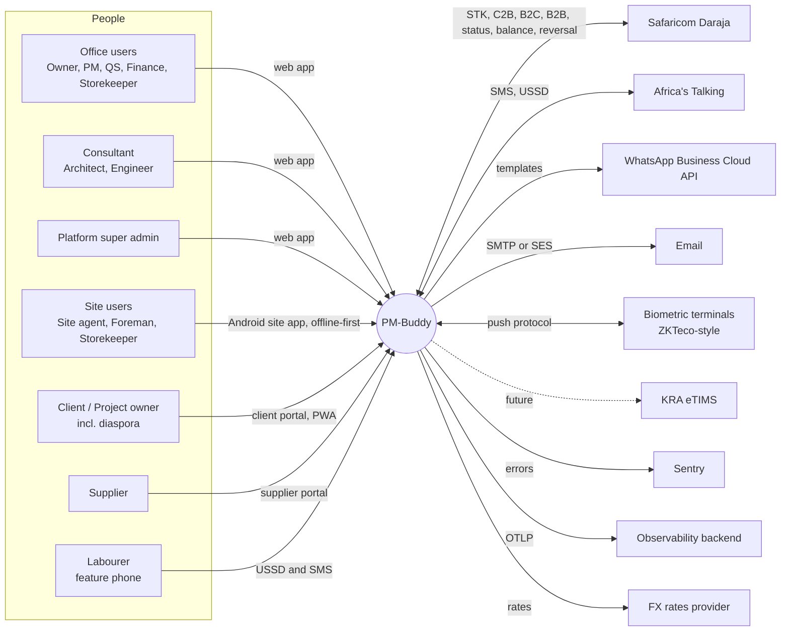
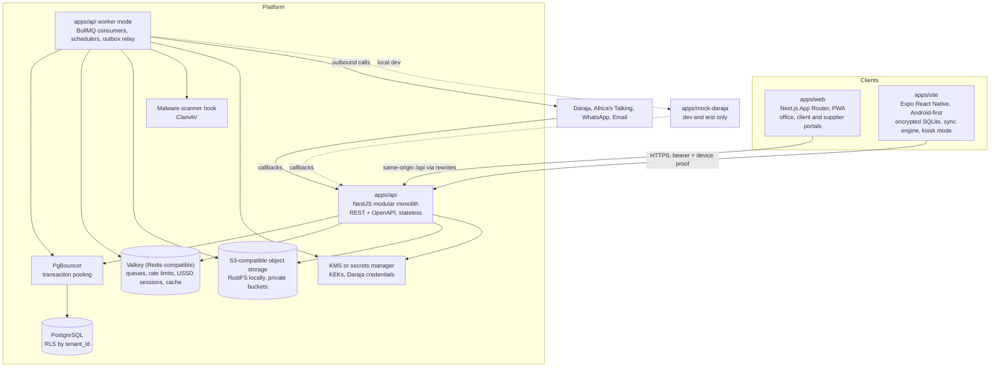
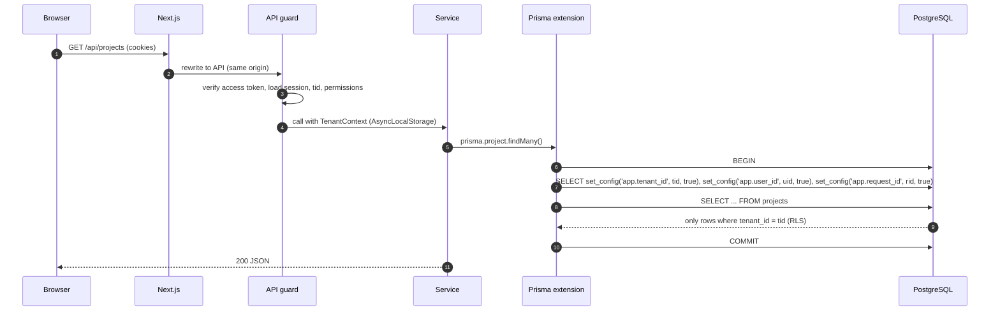
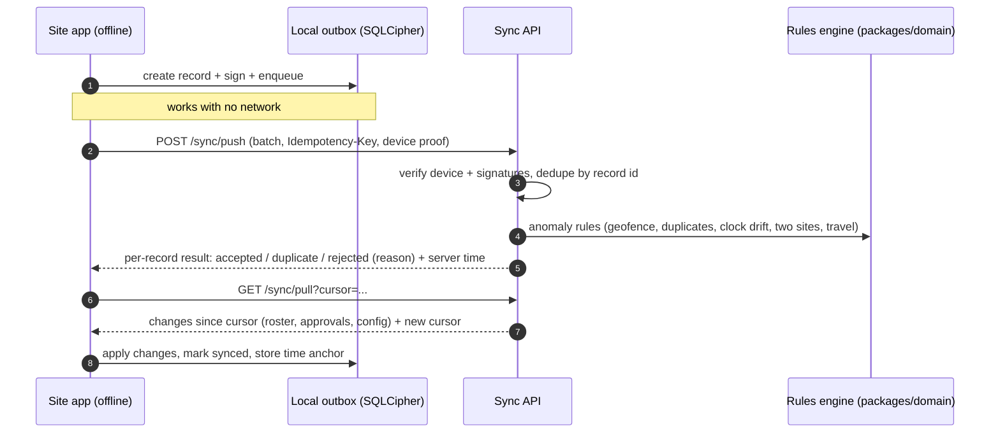
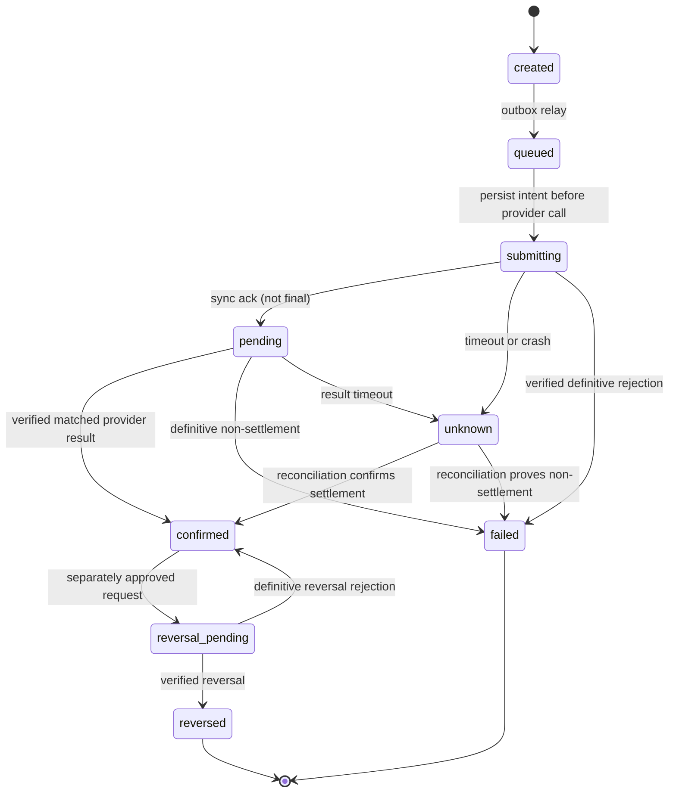
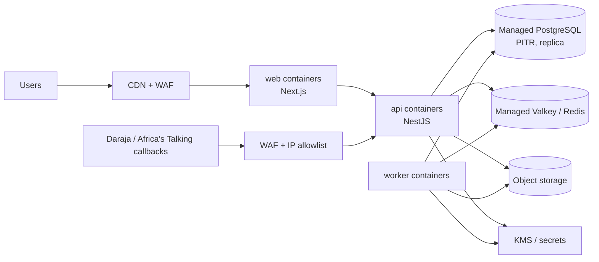

# PM-Buddy: Architecture

> **Status:** Phase 0 draft for approval. This is a living document. Decisions are tracked in §22, open items in [QUESTIONS.md](./QUESTIONS.md), and compliance items in [COMPLIANCE_TODO.md](./COMPLIANCE_TODO.md).
>
> Related: [ROADMAP](./ROADMAP.md) · [ERD](./ERD.md) · [OpenAPI outline](./api/openapi-outline.yaml) · [Threat model](./THREAT_MODEL.md) · [DPIA template](./DPIA_TEMPLATE.md) · [Configuration register](./CONFIGURATION.md)
>
> The [brief §15 safeguards](./PROJECT_BRIEF.md#15-mandatory-safeguards-pm-buddy-additions) take precedence. Detailed contracts: [workflows](./WORKFLOWS.md), [invariants](./INVARIANTS.md), [financial model](./FINANCIAL_MODEL.md), [offline sync](./OFFLINE_SYNC.md), [operations](./OPERATIONS.md), [release plan](./RELEASE_PLAN.md). These are design requirements, not a claim that the target architecture is implemented; see [implementation status](./IMPLEMENTATION_STATUS.md).

---

## 1. Goals and quality attributes

| Attribute | What it means for PM-Buddy | Main design responses |
|---|---|---|
| **Trust and integrity** | Money moves and biometrics are involved; diaspora clients rely on verifiable progress | Snapshot-bound maker-checker, step-up MFA, append-only redacted audit, evidence provenance/limitations, signed offline records |
| **Tenant isolation** | One contractor must never see another's data | `tenant_id` everywhere, PostgreSQL RLS (fail-closed), composite tenant foreign keys, automated isolation tests |
| **Offline-first on site** | Poor connectivity, low-to-mid Android phones | Expo app with encrypted SQLite, local outbox, push/pull sync, clock-drift detection |
| **Configurability** | Tax, statutory, M-Pesa and overtime rules change | Effective-dated, scoped, versioned configuration with `COMPLIANCE-REVIEW` status; payroll snapshots the rule versions it used |
| **Kenyan context** | KES, M-Pesa, EN/SW, feature phones, `2547…`/`2541…` numbers | Daraja behind `PaymentProvider`, USSD/SMS self-service, shared i18n catalogues, phone normalisation in `packages/domain` |
| **Reliability** | M-Pesa, SMS and WhatsApp can be slow or down | Outbox pattern, BullMQ with retries and backoff, idempotency keys, async state machines, reconciliation |
| **Scalability** | Thousands of workers and tens of thousands of transactions per tenant | Stateless API, horizontal scaling, queues, connection pooling, partitioned append-only tables, read models |
| **Operability** | Small team, cloud-agnostic for now | Modular monolith, Docker everywhere, OpenTelemetry, pino JSON logs, Sentry, IaC in Phase 9 |

---

## 2. System context



---

## 3. Containers



**Why a modular monolith?** Payroll, payments, the cost ledger and audit must commit atomically, and the team is small. A single deployable NestJS codebase with strict module boundaries gives that consistency with simple operations. The **worker** is the same codebase started in worker mode (`main.worker.ts`), so it scales independently from the HTTP API. Modules can be extracted into services later if load or team structure requires it (§22, D-01).

---

## 4. Backend modules (bounded contexts)

| Module | Owns (main tables, see [ERD](./ERD.md)) | Notes |
|---|---|---|
| `identity` | users, credentials, sessions, refresh tokens, MFA factors, passkeys, devices | Auth, MFA, step-up, device binding |
| `tenancy` | tenants, memberships, roles, permissions, project memberships, invitations | RBAC and project scoping |
| `audit` | audit_log | Append-only, hash-chained |
| `config-rules` | config_rules, statutory_rules (+ bands), overtime_rules, public_holidays, mpesa_tariffs | Effective-dated resolution |
| `projects` | projects, sites, geofences, wbs_nodes, milestones | |
| `bq` | bqs, bq_versions, bq_bills, bq_sections, bq_items, rate_buildups, instructions, variation_orders, bq_import_jobs | Excel import pipeline |
| `schedule` | schedule_activities, dependencies, baselines, delay_events | Gantt |
| `progress` | progress_measurements, valuations, payment_certificates, retentions | Earned value, certificates |
| `labour` | labourers, trades, skill_levels, accreditations, gangs, gang_assignments, labour_rates, consents | Field-level encryption |
| `attendance` | attendance_devices, attendance_events, anomalies, timesheets, timesheet_lines | Capture-method plugins |
| `biometrics` | biometric_enrolments, biometric_templates | **Separate key hierarchy**, restricted service account |
| `payroll` | pay_periods, payroll_batches, payroll_lines, payroll_line_items, advances, piece_rate_jobs | Pure calculations live in `packages/domain` |
| `payments` | payments, payment_channels, payment_provider_requests, payment_callbacks, reconciliations, recon_items | Daraja behind `PaymentProvider` |
| `procurement` | materials, units, unit_conversions, suppliers, requisitions, rfqs, quotations, lpos, grns, supplier_invoices, three_way_matches | |
| `stores` | stores, stock_ledger_entries, stock_issues, stock_transfers, stock_takes | Append-only ledger |
| `finance` | cost_entries, budgets, petty_cash_floats, expenses, cash_flow_items | Every shilling is tagged |
| `site-ops` | site_diaries, photos, inspections, test_results, snags, safety (incidents, toolbox talks, PPE), plant, fuel | |
| `documents` | documents, document_versions, compliance_items | Expiry reminders |
| `notifications` | notification_templates, notifications, notification_preferences | Provider interface per channel |
| `ussd` | ussd_sessions (Redis), labourer_pins | Africa's Talking |
| `sync` | sync_changes (change log), device_sync_state | Site app push/pull |
| `files` | files | Pre-signed URLs, scanning |
| `reports` | materialised views, export_jobs | PDF and Excel |
| `platform` | (cross-tenant) tenant admin, billing, platform config | Uses a separate, audited DB role |

**Boundary rules**

1. A module reads and writes only its own tables. Other modules go through its exported application service. This is enforced with `dependency-cruiser` rules in CI.
2. Side effects across modules (for example, "payroll approved" → create payment requests) use **domain events** written to an `outbox_events` table in the same transaction, then relayed to BullMQ.
3. **Pure domain logic** (payroll maths, statutory deductions, EVM, valuations, BQ totals, unit conversions, theoretical consumption, geofence maths, anomaly rules, M-Pesa SMS parser, phone normalisation) lives in `packages/domain`. It has no I/O, is heavily unit-tested, and is shared with the site app where useful (for example, offline geofence checks).

---

## 5. Folder structure

```text
pm-buddy/
├─ apps/
│  ├─ web/                 # Next.js (App Router): office app, client portal, supplier portal, PWA
│  │  └─ src/
│  │     ├─ app/
│  │     │  ├─ (auth)/      # sign-in, sign-up, MFA
│  │     │  ├─ (office)/    # office app shell + modules
│  │     │  ├─ (client)/    # client portal
│  │     │  ├─ (supplier)/  # supplier portal (D7.2)
│  │     │  └─ site/        # D0 only: web mock-ups of the site app
│  │     ├─ components/     # app components (ui/ = shadcn primitives until D1.2)
│  │     ├─ i18n/           # next-intl request config
│  │     ├─ lib/            # formatters, API client, utils
│  │     └─ mocks/          # D0 prototype data (removed as real APIs land)
│  ├─ api/                 # NestJS modular monolith (D1.1)
│  │  ├─ prisma/            # schema, migrations, RLS SQL, seed
│  │  ├─ test/              # e2e suite against the compose services (pmb_test database)
│  │  └─ src/
│  │     ├─ main.ts         # HTTP entrypoint (app.setup.ts holds the shared pipeline)
│  │     ├─ telemetry.ts    # OpenTelemetry preload, active when OTEL_EXPORTER_OTLP_ENDPOINT is set
│  │     ├─ main.worker.ts  # worker entrypoint (BullMQ, schedulers, outbox relay)
│  │     ├─ config/         # validated environment (schema in packages/validation)
│  │     ├─ common/         # guards, interceptors, tenant context, problem+json, idempotency, logging
│  │     ├─ infra/          # Prisma, Valkey and object-storage clients
│  │     └─ modules/<module>/{api,application,domain,infra}/
│  ├─ site/                # Expo React Native site app (D3.2)
│  └─ mock-daraja/         # Daraja simulator for dev and tests (D4.2)
├─ packages/
│  ├─ types/               # shared TS types, permission catalogue, enums
│  ├─ validation/          # Zod schemas shared by web, site and api
│  ├─ domain/              # pure calculation engines (no I/O)
│  ├─ i18n/                # EN/SW ICU message catalogues (web, site, SMS/USSD)
│  ├─ ui-tokens/           # design tokens shared by web and site app
│  ├─ api-client/          # generated from OpenAPI (openapi-typescript + openapi-fetch)
│  └─ config/              # shared tsconfig presets (lint rules: root .oxlintrc.json, D-25)
├─ infra/
│  ├─ docker/              # docker-compose: postgres, valkey, rustfs, mailpit (pgbouncer, clamav later)
│  └─ terraform/           # IaC modules (Phase 9, once the cloud is chosen)
├─ tests/
│  ├─ e2e/                 # Playwright (web)
│  └─ load/                # k6 scripts
├─ docs/                   # this documentation, demos, ADRs
├─ .github/                # CI workflows and Dependabot
├─ .pnpmfile.mjs           # keeps pnpm-lock.yaml registry-agnostic (D-26)
├─ package.json            # root scripts (turbo)
├─ pnpm-workspace.yaml
└─ turbo.json
```

> **D1.1 note:** the workspace, `apps/web` (prototype plus the live `/status` page), `apps/api` (health module only), `packages/{types,validation,domain,config}`, `infra/docker` and `.github/` exist so far. Everything else arrives in the deliverable named in [ROADMAP](./ROADMAP.md).

---

## 6. Multi-tenancy and data isolation

**Model:** shared database and shared schema. Every tenant-owned table has `tenant_id uuid NOT NULL`.

### 6.1 Defence in depth

| Layer | Control |
|---|---|
| API | The tenant comes **only** from the authenticated session (the `tid` claim), never from request bodies or headers. Project access is checked by the policy guard. |
| Application | A tenant context (AsyncLocalStorage) is required by every repository call. A missing context throws. |
| Database: RLS | `ENABLE` and `FORCE ROW LEVEL SECURITY` on every tenant table. The policy is `USING (tenant_id = current_setting('app.tenant_id', true)::uuid) WITH CHECK (…)`. If no setting is present the result is `NULL`, so the policy **fails closed**. |
| Database: foreign keys | **Composite tenant FKs.** Each parent exposes `UNIQUE (tenant_id, id)` and children reference `(tenant_id, parent_id)`. A row can never point at another tenant's row, even through a bug. |
| Database: roles | `pmb_migrator` owns the schema (DDL). `pmb_app` has DML only, no `BYPASSRLS`, and only `INSERT`/`SELECT` on `audit_log`. `pmb_reporting` is read-only with RLS. `pmb_platform` can bypass RLS but is used only by audited platform jobs. |
| CI | A migration check fails the build if any table with `tenant_id` lacks RLS enabled, forced and with a policy. The tenant-isolation suite is generated from the Prisma model list, so new tables are covered automatically. |

### 6.2 Request flow



`set_config(..., true)` is transaction-local, so it is safe with PgBouncer in transaction-pooling mode. Wrapping every query in a transaction costs a little latency, which is acceptable for this workload. Hot read paths can batch queries in one transaction.

### 6.3 Project scoping

Project-level access (who can see or act on project X) is enforced in the application layer through `ProjectMembership` and the policy guard, and covered by tests. RLS stays at tenant level, as the brief requires. Client and supplier principals are external memberships limited to specific projects or suppliers.

---

## 7. Identity, authentication and sessions

| Concern | Design |
|---|---|
| Identifiers | Email and/or phone. Phones are normalised to `2547XXXXXXXX` / `2541XXXXXXXX` by `packages/domain/phone`. |
| Passwords | **Argon2id** (`@node-rs/argon2`) with OWASP-recommended parameters, tuned during D1.3. Minimum 12 characters, maximum 128. No composition rules. Common and breached passwords are blocked (local list, with an optional k-anonymity lookup). |
| OTP | SMS or WhatsApp via `NotificationProvider`. Six digits, five-minute expiry, stored hashed, rate-limited per identifier, IP and device. Used for verification and recovery. Low-privilege roles may also use it as a second factor. |
| MFA | **TOTP** (RFC 6238, `otpauth`), **passkeys** (WebAuthn, `@simplewebauthn/server`) and hashed one-time recovery codes. **Mandatory for Owner/Director, Finance and Admin roles**, enforced at role assignment and at login. |
| Access token | JWT signed with EdDSA or ES256 (`jose`), **10-minute TTL**. Claims: `sub`, `tid` (active tenant), `sid` (session), `amr`, `auth_time`, `mfa_at`. Sent in the `__Host-pmb_at` cookie (httpOnly, Secure, SameSite=Lax, Path=/). |
| Refresh token | Opaque 256-bit random value, stored as a **SHA-256 hash** with a family ID. **Rotated on every use.** If a used token is presented again, the whole family is revoked and the user is alerted. Sent in the `__Secure-pmb_rt` cookie with Path=/api/v1/auth (the versioned API base path). Idle and absolute lifetimes are configurable and shorter for privileged roles. |
| Step-up MFA | Sensitive actions (payment approval, payout, changing a payee's phone number, changing statutory rules) require `mfa_at` within N minutes (configurable). Otherwise the API returns `401` with problem type `step-up-required`. `POST /auth/step-up` returns a short-lived step-up token, sent back in the `X-Step-Up-Token` header. The token is **bound to the action**: it carries a hash of the approval ID and amount, a lightweight form of transaction signing. |
| CSRF | SameSite cookies, a same-origin API (Next.js rewrites), a double-submit `X-CSRF-Token` header on state-changing requests, and Origin/Referer checks. |
| Site app | Bearer access token held in memory. Refresh token in SecureStore (Android Keystore). **Device binding:** on enrolment the device generates a key pair, and each refresh or sync request carries a proof-of-possession signature over a server nonce. |
| Kiosk tablets | Device principal registered to a site. A supervisor unlocks with PIN plus Android BiometricPrompt. **BiometricPrompt is never used to identify labourers** (brief §5.5). |
| Labourers (USSD) | National ID plus a 4–6 digit PIN (Argon2id), with lockout after N failures. PIN reset is supervisor-assisted with an OTP to the registered phone. |
| Sessions UI | Users can see and revoke active sessions and devices. Admins can force sign-out. |

**Library choice (D-03):** the auth module is built on vetted primitives: `@node-rs/argon2`, `jose`, `otpauth`, `@simplewebauthn/*`, and the Node `crypto` CSPRNG. **No cryptography is hand-rolled.** An external IdP was considered (Keycloak, managed identity providers) and so was Better Auth. They were set aside for now because of phone-first login, USSD PIN auth, device binding and action-bound step-up. See [QUESTIONS.md](./QUESTIONS.md), Q-A3.

---

## 8. Authorisation: RBAC with project scope

- **Permission catalogue.** Granular strings such as `projects.create`, `bq.edit`, `bq.approve_variation`, `attendance.override`, `payroll.prepare`, `payroll.review`, `payments.approve`, `payments.disburse`, `labour.view_sensitive` and `config.manage_statutory`. They are defined in `packages/types` and seeded.
- **Roles.** Bundles of permissions. The system roles come from the brief's table (§3). Tenants can create custom roles later.
- **Assignments.**
  - A `Membership` (user ↔ tenant) holds tenant-wide roles.
  - A `ProjectMembership` (user ↔ project) holds project roles.
  - **Approval limits** are attributes on an assignment, for example `payments.approve ≤ KES 2,000,000`.
- **Evaluation.** `@RequirePermission('payments.approve', { project: 'params.projectId' })` resolves to `can(user, permission, scope)`. Results are cached per request.
- **Maker-checker.** The person who prepared a batch cannot review or approve it. This is enforced in the domain service and with a DB `CHECK` / trigger on approval rows.
- **Sensitive fields.** For example, the do-not-rehire reason, full ID numbers and bank details are returned only with `labour.view_sensitive` or `finance.view_sensitive`. Everyone else sees masked values.

---

## 9. Data architecture

| Topic | Decision |
|---|---|
| Primary keys | **UUIDv7** (time-ordered, index-friendly), generated by the database or the app |
| Money | **Integer minor units** (`bigint` cents) plus a `currency` column. Never floats. The API sends `{ "amountMinor": 125000000, "currency": "KES" }`, which is safe up to 2^53−1 cents. |
| Quantities and rates | `numeric(20,4)` in the database, **decimal strings** in the API, and `decimal.js` in `packages/domain`. Rounding mode is configurable (default half-up to cents). |
| Time | `timestamptz` stored in UTC and displayed in **Africa/Nairobi**. Business dates (attendance day, pay period) are `date` values in Nairobi local time. |
| Standard columns | `tenant_id`, `created_at`, `created_by`, `updated_at`, `updated_by`. `deleted_at` where soft delete applies. `version` for optimistic locking on editable aggregates. |
| Append-only | `audit_log`, `attendance_events` (corrections are new events), `stock_ledger_entries`, `payment_callbacks`, `cost_entries`. Corrections are always reversing or adjusting entries. |
| Partitioning | Monthly declarative partitions for `audit_log`, `attendance_events`, `payment_callbacks` and `notifications` once volumes warrant |
| Search | Full-text search plus `pg_trgm` for names. Encrypted fields are searched through **blind indexes** (HMAC-SHA-256 with a separate key). |
| Reporting | Materialised views refreshed by jobs feed dashboards. Heavy reports run on a read replica (Phase 9). |

---

## 10. Field-level encryption and key management

- **Encrypted fields:** national ID, alien ID or passport number, KRA PIN, phone numbers, bank account details, NSSF and SHA numbers, next-of-kin contacts and **biometric templates**.
- **Envelope encryption:** each tenant has a data encryption key (DEK) wrapped by a key-encryption key (KEK) held in a KMS or secrets manager. The algorithm is AES-256-GCM through a vetted library. Associated data binds each ciphertext to `(tenant_id, table, column, row_id)`. Ciphertext carries the key version.
- **Biometric templates use a separate KEK.** Only the `biometrics` module's service identity can unwrap it. Templates are never logged, exported or sent to analytics.
- **Blind indexes** (HMAC with a separate key) allow exact-match lookups, such as "is this ID already registered?" and USSD login, without decrypting.
- **Rotation:** KEKs rotate in the KMS. DEKs are re-wrapped. A background job re-encrypts data lazily.
- **Deployment note (threat model OR-01).** In a single codebase this separation is only logical. Before biometrics go live (D3.4), the biometrics module runs as a separately deployed worker with its own identity, and only that identity may unwrap the biometric KEK.
- **Provider (D-07):** behind a `KeyManagementProvider` interface. Locally it uses OpenBao/Vault transit or a dev-only static KEK from `.env`. In the cloud it uses the chosen KMS. This is finalised in D1.3, the first deliverable that stores encrypted phone numbers.

---

## 11. Configuration and rules (effective-dated)

The brief forbids hardcoding statutory rates, M-Pesa limits and fees, overtime rules and holidays. Every such value is a **configuration rule**:

```text
config_rules(id, key, scope[platform|tenant|project], scope_id, value jsonb,
             effective_from date, effective_to date null, version int,
             source_reference text, compliance_status[draft|needs_review|approved],
             approved_by, approved_at, created_*, updated_*)
```

- **Typed values.** Each `key` has a Zod schema in `packages/validation/config`, for example `payroll.paye.bands`, `payroll.shif`, `mpesa.b2c.limits`, `attendance.overtime`, `bq.vat.rate` and `procurement.min_quotes`.
- **Resolution.** `resolve(key, { tenantId, projectId }, onDate)` returns the most specific active version (project, then tenant, then platform).
- **Reproducibility.** Payroll lines, valuations and certificates store the IDs of the rule versions they used. Changing a rule never changes an approved record.
- **Governance.** Statutory changes need the `config.manage_statutory` permission and maker-checker approval. Every change is audited. Rules with `compliance_status ≠ approved` show a warning banner wherever they are used.
- **Register.** [CONFIGURATION.md](./CONFIGURATION.md) lists every key with its seed value, source and review status.

---

## 12. Offline-first site app and sync

### 12.1 Stack

- **Core:** Expo (latest SDK) with Expo Router and TypeScript (strict).
- **Local data:** SQLite encrypted with SQLCipher, through `expo-sqlite` (SQLCipher option) or `op-sqlite`, chosen in D3.2.
- **State:** TanStack Query for online data and Zustand for UI state.
- **Device capabilities:**
  - `expo-camera` for photos and QR scanning
  - `expo-location`
  - `expo-secure-store` (Android Keystore)
  - `react-native-nfc-manager`
- **Biometrics:** native modules for USB/OTG fingerprint scanners.

### 12.2 Records created offline

Attendance events, diary entries, GRNs, stock issues, progress measurements, photos and safety incidents can all be created offline. Each record carries:

- a client-generated UUIDv7, `device_id` and a monotonic `device_seq`;
- the device wall-clock time and Android `elapsedRealtime` plus `bootId`;
- a GPS fix (lat, lon, accuracy, GNSS time, mock-location flag);
- an **Ed25519 signature** over the canonical payload, made with the device key held in the Keystore-backed secure store.

### 12.3 Protocol



### 12.4 Conflict rules (from the brief)

Approved or locked records are immutable: reject attempted edits with a reason while preserving unsynced evidence for correction/review. Attendance, stock and financial events are append-only with linked corrections. Editable drafts use optimistic version checks; consequential conflicts preserve both versions for review, never silent last-write-wins. See [OFFLINE_SYNC.md](./OFFLINE_SYNC.md).

### 12.5 Clock integrity

On each successful sync the device stores an anchor `(serverTime, elapsedRealtime, bootId)`. For an offline record made on the same boot:

`expected = anchor.serverTime + (event.elapsedRealtime − anchor.elapsedRealtime)`

If `|deviceTime − expected|` is greater than the configured threshold, the record is flagged `CLOCK_DRIFT`. If the device rebooted with no new anchor, GNSS time from the location fix is used where available. Otherwise the record is flagged `TIME_UNVERIFIED`.

### 12.6 Device registration and kiosk mode

A PM provisions the device by QR code. Each device is registered to exactly one site, and lost devices can be revoked remotely. Full kiosk lock-down uses Android lock-task mode, which may need MDM or device-owner provisioning (Q-S2).

### 12.7 Photos

Photos are kept in app-private storage and uploaded separately through pre-signed URLs with a SHA-256 content hash. The server checks the hash, extracts EXIF data and records the server receipt time.

### 12.8 Visible sync status

The app always shows the number of pending records, the last sync time and any errors. Records are never dropped silently.

---

## 13. Attendance capture methods

```text
interface CaptureMethod {
  id: 'qr_card_photo' | 'nfc_card_photo' | 'face_kiosk' | 'fingerprint_usb' | 'terminal_push';
  requiresBiometricConsent: boolean;
  enrol?(worker): Promise<EnrolmentResult>;            // biometric methods only
  capture(ctx: { siteId; rosterIds; deviceId }): Promise<CaptureResult>;
}
CaptureResult = { workerId | null, confidence, liveness?, evidencePhotoId?, method, raw? }
```

- **Fallback (mandatory, built first in D3.3).** A QR or NFC worker card, a live photo and supervisor confirmation. It always works offline.
- **Biometric methods (D3.4, one first).**
  - **Face kiosk:** 1:N matching against **this site's roster only**, with liveness detection.
  - **USB/OTG fingerprint:** vendor SDK behind a native module.
  - **Terminal push:** server-side `AttendanceDeviceAdapter` for ZKTeco-style push protocols.
- **Matching threshold.** Configurable. Below the threshold, the app falls back to card + photo + supervisor.
- **Server-side anomaly rules** (`packages/domain/attendance`):
  - duplicate within a window
  - outside the geofence (point-in-polygon or radius)
  - same worker on two sites
  - impossible travel
  - clock drift
  - mock location
  - device not registered to the site
  - low confidence
  - missing check-out
  - manual override (reason required; always flagged)
- **Timesheets.** Built from events using the configured rules: normal hours, breaks, lateness grace, half-day, absence, and overtime multipliers for weekdays, rest days and public holidays. Timesheets lock once payroll is approved.

---

## 14. Payments architecture (Safaricom Daraja)

### 14.1 Interfaces and configuration

```text
interface PaymentProvider {
  stkPush(req), stkQuery(req), registerC2BUrls(req),
  b2c(req), b2b(req), transactionStatus(req), accountBalance(req), reversal(req),
  parseCallback(kind, rawBody): ParsedCallback
}
```

- **Per-tenant `PaymentChannel`:**
  - environment (sandbox or production) and shortcodes (Paybill, Till, B2C)
  - references to secrets: consumer key and secret, STK passkey, initiator name and password, and Safaricom's public certificate
  - **Secrets live in the KMS or secrets manager, never in the database in plain text, in code or in logs.**
  - `SecurityCredential` is generated at call time with Node `crypto.publicEncrypt` and the Safaricom certificate.
- **OAuth tokens** are cached per channel in Redis with TTL `expires_in − margin`. A single-flight lock prevents refresh stampedes.

### 14.2 Payment state machine



**An attempt becomes `confirmed` only from verified provider evidence matched by identifiers, amount, currency and direction.** Acceptance is not settlement. An uncertain attempt retains its reservation and blocks resubmission until reconciled; internal idempotency is not proof of external exactly-once delivery. Obligations, attempts, provider transactions, allocations and journal postings remain separate.

### 14.3 Payroll payout sequence (B2C)

```mermaid
sequenceDiagram
  autonumber
  participant Dir as Director (web)
  participant API as API
  participant DB as PostgreSQL
  participant W as Worker (BullMQ)
  participant M as Daraja
  Dir->>API: approve immutable versioned snapshot (fresh step-up MFA)
  API->>DB: TX: identity-based maker-checker + approval + obligations + outbox
  W->>M: Account Balance (float check)
  M-->>API: balance result callback
  API->>DB: store raw callback, enqueue
  W->>W: advisory balance check; reserve authorised internal funding
  loop each payroll line, rate-limited
    W->>DB: persist submitting intent; enforce outstanding balance and payout pause
    W->>M: B2C SalaryPayment (OriginatorConversationID = our request id)
    M-->>W: sync ack (ConversationID)
    W->>DB: state pending or unknown; store protected redacted evidence
  end
  M-->>API: result callback per line (unique URL token)
  API->>DB: commit durable inbox before 200; process later if queue unavailable
  W->>DB: verify ids/amount/currency/direction; atomic allocation + balanced journal
  W->>W: timeout/crash means unknown; reconcile before another provider call
  W->>API: notify payslip SMS (EN/SW)
```

### 14.4 Callback hardening

Verify current official provider callback authentication/status-query capabilities before implementation; do not assume signatures exist. Callback protections are layered and are not independently proof of settlement:

1. **HTTPS only.** The callback URL is `/webhooks/mpesa/{channelToken}/{kind}/{requestToken}`, with an unguessable per-channel token **and** a per-request token.
2. **Configurable IP allowlist** of Safaricom ranges (a config rule, not code).
3. **Persist durable inbox, then acknowledge.** Protected/redacted evidence is committed before `200`; return non-success if persistence fails. Process repeatably even if the queue was unavailable at intake.
4. **Match to a stored request** by supported identifiers, amount, currency and direction. **Never match by phone number**, which may be masked. Quarantine unknown/mismatched callbacks and alert; do not apply them.
5. **Idempotency.**
   - Provider receipt uniqueness is scoped to tenant/provider account; allocations and journal postings cannot repeat.
   - Explicit transition guards prevent regression; contradictory results open a dispute rather than being silently ignored.
   - Keys bind tenant, operation and payload fingerprint; changed payloads conflict. Define key retention and residual external duplicate risk.
6. **C2B validation URL.** Must answer synchronously and fast (accept or reject) against open invoice and project codes and configured limits.

### 14.5 Other payment rules

| Rule | Design |
|---|---|
| Recipient verification | Verify details independently before approval using supported procedures; changes invalidate approval. Names returned after payout are detection evidence only, not pre-payment verification. |
| Reconciliation | A daily job matches records against the M-Pesa statement, uploaded as CSV from the M-Pesa organisation portal or pulled if an API is available. Results are matched, unmatched or disputed. |
| Charges | A tariff table (effective-dated config) estimates charges before payout. Actual charges from results or statements are booked as project `cost_entries`. |
| Limits | Per-transaction, daily and per-recipient limits are configurable and checked before submission. |
| Unusual payouts | Rules flag a new recipient with a large amount, many payouts to one number, or payouts outside business hours. Flagged payouts need extra approval. |
| Cash and bank | Recorded as `payments` with an evidence photo or signature, a reason and the approver. Cash always needs a reason. |
| Retries | Bounded/provider-specific; reconcile unknown outcomes before a new attempt. Notification failure retries only the notification. A payout pause preserves queued obligations. |

> Endpoint versions (for example, B2C v1 vs v3) and field names are verified against the current Daraja documentation in D4.2. The mock server in `apps/mock-daraja` mirrors them for tests.

---

## 15. Notifications and messaging

- **Providers.** Each channel sits behind a `NotificationProvider`:
  - SMS and USSD: Africa's Talking
  - WhatsApp Business Cloud API
  - Email: SMTP or SES
  - Push: Expo / FCM
- **Templates** are versioned, **EN/SW** and in ICU message format, stored in `packages/i18n` with overrides in the database. WhatsApp templates must be pre-approved by Meta. SMS templates are checked against segment length.
- **Dispatch** goes outbox → queue → provider, with delivery receipts via callbacks, retries with backoff and an optional fallback (WhatsApp → SMS).
- **Preferences** are per user per event. Critical security notifications always go out.

---

## 16. USSD and SMS self-service (labourers)

- `POST /webhooks/africastalking/ussd` receives form-encoded `sessionId`, `serviceCode`, `phoneNumber` and `text`, and responds with `CON …` or `END …` within the provider's timeout.
- The menu engine is stateless: it reads the `text` path and keeps session state in Redis.
- The labourer chooses a language (EN/SW) and authenticates with ID number + PIN, with lockout.
- The menu shows days worked this period, amount earned, payments received and advances outstanding. Responses are short and **contain only the worker's own data**.

---

## 17. Files and media

1. The client requests a **pre-signed PUT**, constrained by content type, maximum size and SHA-256.
2. The file lands under `quarantine/`, which emits `file.uploaded`.
3. The worker:
   - sniffs the type from magic bytes;
   - runs the `MalwareScanner` hook (ClamAV);
   - extracts EXIF data (GPS and time);
   - creates thumbnails;
   - strips metadata from shared variants while keeping the original metadata in the database;
   - promotes the file to `private/`.
4. Downloads use **short-lived pre-signed GET URLs**, issued only after an authorisation check. Buckets are private.
5. **"Verified" photo badge.** A photo gets the badge only if its EXIF GPS is inside the site geofence, its EXIF time matches the device time and the server receipt time within a threshold, and its hash matches the uploaded content.
6. **Reused photos.** A perceptual hash (pHash) is stored for every photo. A near-duplicate of an earlier photo, submitted as new progress or delivery evidence, is flagged (threat model A-13).
7. **Exports.** Every CSV or Excel cell that starts with `=`, `+`, `-`, `@`, a tab or a carriage return is escaped, to stop formula injection when a user opens the file. PDFs are rendered from server-side templates only. The renderer has no network access and runs JavaScript only from our own templates, which blocks SSRF (threat model T-15, T-20).

---

## 18. Web application

| Concern | Choice |
|---|---|
| Framework | Next.js App Router (latest stable). React Server Components for read-heavy pages; client components plus TanStack Query for interactive tables and forms. |
| Routing | Route groups: `(auth)`, `(office)`, `(client)` and `(supplier)`, each with its own layout and access rules. |
| API access | Same-origin `/api/*` rewrites to the API (D-16), so cookies stay first-party. Typed client generated from OpenAPI (`packages/api-client`). |
| UI | Tailwind CSS, shadcn/ui (Radix primitives), lucide icons. **Recharts** through shadcn charts (D-09). TanStack Table for dense tables. Leaflet for maps (D-10). Gantt library chosen in D6.2 (D-14). |
| Forms | React Hook Form with Zod schemas from `packages/validation`, shared with the API |
| i18n | `next-intl`, with the locale taken from the user preference or a cookie. Catalogues come from `packages/i18n` (D-11). Formats: `KES 1,250,000`, `DD/MM/YYYY`, Africa/Nairobi. |
| Theming | Neutral base with a **royal blue** accent. Light and dark mode through `next-themes`. High-contrast tokens for sunlight use on mobile. |
| PWA | Serwist service worker: installable and caches the shell. Offline-first is the site app's job. |
| Security headers | Strict CSP with nonces, HSTS, `frame-ancestors 'none'`, `Referrer-Policy: strict-origin-when-cross-origin`, `Permissions-Policy`. No secrets in client bundles. |
| Performance | Route-level JS budgets. Client and portal pages are interactive in under ~3 s on a mid-range Android on 3G (measured with Lighthouse CI in D9.2). |
| Accessibility | WCAG 2.2 AA: axe checks in Playwright, keyboard paths, visible focus, 44 px touch targets on mobile |

---

## 19. Observability

- **Logs.** pino JSON with `requestId`, `tenantId`, a pseudonymous `userId` and `deviceId`. **Redaction paths** cover passwords, tokens, cookies, Daraja credentials, phone and ID numbers, and every biometric field.
- **Traces and metrics.** OpenTelemetry SDK with HTTP, Prisma, BullMQ and Redis/Valkey instrumentation, exported over OTLP to a collector. The backend is chosen with the cloud.
- **Errors.** Sentry for web, API and site app, with PII scrubbing and release tracking.
- **Health.**
  - `GET /api/v1/health/live` reports on the process.
  - `GET /api/v1/health/ready` checks the database, Valkey and object storage (the queue backlog threshold joins in D4.2). It answers 503 when anything is down; error details are hidden in production.
  - The web `/status` page shows the readiness report live (D1.1).
- **Business signals.** Payouts pending or failed, unmatched callbacks, sync backlog per device, anomaly rates, OTP send failures and queue depth all feed alerts.

---

## 20. Deployment (cloud-agnostic until the Phase 9 decision)



| Topic | Plan |
|---|---|
| Environments | `local` (docker-compose and mock Daraja), `staging` (Daraja sandbox), `production`. Preview environments per PR are optional. |
| Abstractions | `StorageProvider` (S3 API, with an Azure Blob adapter if needed), `KeyManagementProvider`, `SecretsProvider`, `NotificationProvider`, `PaymentProvider`, `MalwareScanner`. These keep us cloud-agnostic. |
| Data residency | **COMPLIANCE-REVIEW.** The Data Protection Act 2019 (Part VI) and its regulations govern cross-border transfers and may restrict some processing to Kenya. Phase 9 compares in-country hosting (Kenyan data centres or colocation) with an offshore hyperscaler region plus documented safeguards. See CR-DP-05 in [COMPLIANCE_TODO](./COMPLIANCE_TODO.md). |
| Backups | Target **RPO ≤ 15 min**, **RTO ≤ 4 h** for acknowledged server data; prove by coherent DB/object/config/key restore from the first relevant phase. Pause payouts and reconcile provider outcomes before workers resume; never blindly replay restored outbox. Unsynced device records are outside server RPO. Final rehearsal in D9.3, then quarterly. |
| CI/CD | GitHub Actions with required checks on a protected `main`. Images get an SBOM (syft), are scanned (Trivy) and signed (cosign). Deployments use GitHub Environments with manual approval for production. |

---

## 21. Testing strategy

| Level | Tooling | Scope |
|---|---|---|
| Unit | Vitest | `packages/domain` (payroll, statutory boundaries, EVM, valuations, conversions, anomaly rules, SMS parser) at ≥ 90 % line and branch coverage; formatters; validation |
| Integration | Vitest + supertest against the docker compose services (PostgreSQL, Valkey, RustFS), using a separate `pmb_test` database that the suite migrates itself | API modules, **RLS and tenant-isolation suite**, outbox, queues |
| Contract | OpenAPI response validation in tests; generated client compile check | API ↔ web and site |
| Payments | `apps/mock-daraja` scenarios: success, failure, timeout, duplicate, out-of-order, unknown callback; nightly sandbox smoke tests | D4.x |
| E2E | Playwright (web); **Maestro** for the site app (D-12) | Payroll → M-Pesa payout; material request → delivery → payment; BQ import → valuation |
| Accessibility | axe-core in Playwright | Every new screen |
| Load | k6 | Payroll payout and attendance sync (D9.2) |
| Security | CodeQL, gitleaks, dependency review, OSV-Scanner, Trivy, ZAP baseline against staging | CI from D1.1, ZAP in D9.1 |

---

## 22. Decision log

| ID | Decision | Status | Rationale / alternatives |
|---|---|---|---|
| D-01 | NestJS **modular monolith** plus a separate worker process from the same codebase | Accepted | Atomic financial workflows and a small team. Microservices are premature. Boundaries are enforced so modules can be extracted later. |
| D-02 | Shared-schema multi-tenancy with **RLS + composite tenant FKs** | Accepted | Required by the brief. Schema-per-tenant was rejected because of migration and operations cost at many tenants. |
| D-03 | Auth built on **vetted primitives** (argon2, jose, otpauth, SimpleWebAuthn) inside NestJS | Proposed | Phone-first login, USSD PIN, device binding and action-bound step-up don't fit off-the-shelf IdPs well. Alternatives: Better Auth, Keycloak, managed IdP (Q-A3). |
| D-04 | **Prisma** with a transaction-scoped `set_config` extension for RLS; RLS policies in raw SQL migrations | Accepted | Required by the brief. The cost is one transaction per request. Hot paths batch their queries. |
| D-05 | Money as **integer minor units**; quantities and rates as `numeric` / decimal strings | Accepted | Avoids float errors (brief §10) |
| D-06 | **UUIDv7** identifiers | Accepted | Time-ordered (good for indexes), and the site app can generate them offline |
| D-07 | **Envelope encryption** behind `KeyManagementProvider`; provider chosen with the cloud | Proposed | Cloud-agnostic now. OpenBao/Vault transit locally. Separate KEK for biometrics. |
| D-08 | **Custom push/pull sync** with signed records | Proposed | Needs signature checks, clock-drift detection and anomaly rules at ingest. Alternatives: PowerSync, ElectricSQL (re-check in D3.2). |
| D-09 | **Recharts** (through shadcn/ui charts) | Accepted (prototype) | Matches the design system. ECharts stays an option for heavy charts. |
| D-10 | **Leaflet**; OSM tiles in dev, production tile provider TBD | Proposed | OSM's tile usage policy limits production use (Q-T4). |
| D-11 | `next-intl` (web) and `use-intl` (site) over **shared ICU catalogues** in `packages/i18n`; server templates use the same catalogues | Accepted | One source of truth for EN/SW |
| D-12 | Vitest, Testcontainers, Playwright, and **Maestro** for mobile E2E | Proposed | Maestro is simpler with Expo than Detox |
| D-13 | Excel parsing: **SheetJS CE** (official CDN tarball) or ExcelJS, decided in D2.2, run in a sandboxed worker with size limits | Proposed | The SheetJS build on npm is outdated |
| D-14 | Gantt: an MIT-licensed component, chosen in D6.2 | Proposed | Avoids GPL and commercial licence risk |
| D-15 | PDF: HTML → PDF with headless Chromium in the worker, or `@react-pdf`, decided in D2.2 | Proposed | Certificates need print-quality layout |
| D-16 | Web calls the API through **same-origin rewrites** | Accepted | First-party cookies and simpler CSRF |
| D-17 | **On-device 1:N face matching** on kiosks, with encrypted roster templates | Proposed | Needed for offline use. Must be covered in the DPIA. Server-side matching is the alternative when online (Q-B1). |
| D-18 | **Cloud-agnostic** until before Phase 9 | Accepted (your decision) | Provider abstractions in §20 |
| D-19 | Product name **PM-Buddy**; royal blue accent on a neutral base | Accepted (your decision) | |
| D-20 | **TypeScript 5.9** pinned for the web app | Accepted (D0), narrowed in D1.1 | typescript-eslint supports TS < 6.1, so `apps/web` stays on 5.9 with ESLint (`eslint-config-next`). The API and shared packages moved to TS 6 (D-25). TS 7 (native compiler) waits for tooling support. Re-checked at each phase. |
| D-21 | Next.js 16 **Cache Components off** in the D0 prototype | Accepted (D0) | The locale cookie is read on every request. Revisit in D1.2 with real data fetching. |
| D-22 | **pnpm 12** with dependency build scripts allow-listed in `pnpm-workspace.yaml` (`allowBuilds`) | Accepted (D0) | Supply-chain hardening: no install scripts run unless approved. |
| D-23 | shadcn/ui **radix-nova** style with Radix primitives and the `cn` helper | Accepted (D0) | Current shadcn default. Components live in `apps/web` until they move to a shared package in D1.2. |
| D-24 | Local services: **PostgreSQL 18.6, Valkey 8.1, RustFS 1.0.4, Mailpit**; new dependencies may not use AGPL, GPL or SSPL licences | Accepted (D1.1) | Valkey (BSD-3) is Redis-compatible without Redis 8's AGPL/SSPL licensing. MinIO no longer publishes community images, so RustFS (Apache-2.0, S3-compatible) stands in; the app only uses the S3 API (§20), so any S3 service works. PostgreSQL 19 is not released yet. Dependency review in CI blocks copyleft licences that would bind the SaaS or the distributed site app. |
| D-25 | API and shared packages use **TypeScript 6.0, oxlint (type-aware) and Vitest 4**; the web app keeps ESLint (D-20) | Accepted (D1.1) | This is what NestJS 12's CLI generates. oxlint is much faster and needs no TS-version-bound plugin. `@nestjs/core` 12 is ESM-only, so the API is ESM with `.js` import suffixes. Shared packages build to `dist/` and are marked `sideEffects: false`. |
| D-26 | **Supply-chain controls in CI**: registry-agnostic lockfile with sha512 integrity, actions pinned by commit SHA, images pinned by digest, Dependabot with a 7-day cooldown, gitleaks, CodeQL and dependency review | Accepted (D1.1) | `.pnpmfile.mjs` strips registry-mirror tarball URLs (for example a corporate npm proxy) before the lockfile is written, so CI and contributors install from their own registry. Turborepo runs in strict env mode: runtime settings are listed in `globalPassThroughEnv`, and build inputs such as `API_INTERNAL_URL` are part of the cache key. |

---

## 23. Glossary

| Term | Meaning |
|---|---|
| BQ / BoQ | Bill of Quantities, prepared by the Quantity Surveyor (QS) |
| AI / EI | Architect's / Engineer's Instruction |
| VO | Variation Order |
| PC sum | Prime Cost sum |
| Prov. sum | Provisional sum |
| IPC | Interim Payment Certificate |
| DLP | Defects Liability Period |
| EVM | Earned Value Management: PV (planned value), EV (earned value), AC (actual cost), CPI = EV/AC, SPI = EV/PV |
| LPO | Local Purchase Order |
| GRN | Goods Received Note |
| RFQ | Request for Quotation |
| Muster roll | Daily attendance register |
| Kibarua (pl. vibarua) | Casual labourer |
| Fundi | Skilled tradesperson |
| STK Push | M-Pesa Express payment prompt on the payer's phone |
| C2B / B2C / B2B | Customer-to-business / business-to-customer / business-to-business M-Pesa flows |
| Paybill / Till | M-Pesa business shortcodes (account-based / buy goods) |
| eTIMS | KRA electronic Tax Invoice Management System |
| NCA | National Construction Authority |
| NSSF / SHIF / AHL / NITA | Pension fund / Social Health Insurance Fund / Affordable Housing Levy / National Industrial Training Authority levy |
| ODPC | Office of the Data Protection Commissioner |
| DPIA | Data Protection Impact Assessment |
| WIBA / OSHA | Work Injury Benefits Act / Occupational Safety and Health Act |
