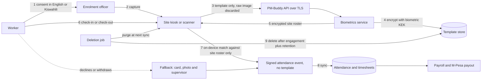

# PM-Buddy: DPIA Template for Biometric Attendance and Labourer Personal Data

> **Status:** Phase 0 template (D0). **Each tenant, as data controller, completes, approves and keeps its own DPIA.** Biometric capture stays **disabled** for a tenant until its DPIA is approved in-app (the D3.4 gate, see §12).
>
> Related: [Threat model](./THREAT_MODEL.md) · [ARCHITECTURE](./ARCHITECTURE.md) · [ERD](./ERD.md) · [ROADMAP](./ROADMAP.md) · [Compliance TODO](./COMPLIANCE_TODO.md) · [Questions](./QUESTIONS.md)

## How to use this template

- **Pre-filled text** describes what the PM-Buddy design already determines. Review it. If you change or remove it, record why in the version history.
- **`[TO COMPLETE: …]`** marks facts only the tenant can supply.
- **`COMPLIANCE-REVIEW`** marks legal points that a qualified Kenyan data protection adviser must confirm. Timelines and retention periods are **configuration keys**, not fixed text, so they can change without a software release. Keys marked *proposed* must be added to the configuration register.
- **Legal anchors.** Section 31 of the Data Protection Act, 2019 (the Act) requires a DPIA where processing is likely to result in a high risk to the rights and freedoms of data subjects. Biometric data is sensitive personal data (brief §6). The ODPC has issued guidance on DPIAs and on processing biometric data; confirm the current versions before use. `COMPLIANCE-REVIEW`
- "§13" on its own means a section of this document. "ARCHITECTURE §10" refers to [ARCHITECTURE.md](./ARCHITECTURE.md). `T-xx`, `A-xx` and `OR-xx` are IDs in the [threat model](./THREAT_MODEL.md).
- This template is not legal advice.

---

## 1. Document control

| Field | Value |
|---|---|
| DPIA reference | `DPIA-[TO COMPLETE: tenant code]-BIO-[NNN]` |
| Version and status | `0.1` template. Status: Draft / In review / Approved / Rejected / Superseded |
| Data controller (tenant) | [TO COMPLETE: legal name, KRA PIN, physical and postal address] |
| Controller ODPC registration number | [TO COMPLETE] (`COMPLIANCE-REVIEW`: confirm category and renewal date) |
| Data processor (PM-Buddy operator) | [TO COMPLETE: operator legal name and address] |
| Processor ODPC registration number | [TO COMPLETE] |
| Data processing agreement | [TO COMPLETE: reference and date signed] |
| Data Protection Officer or responsible person | [TO COMPLETE: name, phone, email] |
| DPIA owner and assessors | [TO COMPLETE: names and roles] |
| Projects and sites in scope | [TO COMPLETE] |
| Capture methods in scope | ☐ Face kiosk ☐ USB/OTG fingerprint scanner ☐ Biometric terminal ☑ Non-biometric fallback (always on) |
| Biometric vendor, SDK or terminal model and version | [TO COMPLETE] |
| Hosting region | [TO COMPLETE] (see §11) |
| Dates | Started: [TO COMPLETE] · Approved: [TO COMPLETE] · Next review: [TO COMPLETE: within `dp.dpia_review_interval_months` (*proposed*)] |

**Version history**

| Version | Date | Author | Summary of changes |
|---|---|---|---|
| 0.1 | [TO COMPLETE] | PM-Buddy (template) | Pre-filled from the Phase 0 design |

**Sign-off summary** (the detailed opinion and decision are in §12)

| Role | Name | Decision | Date | In-app approval reference |
|---|---|---|---|---|
| Data Protection Officer | [TO COMPLETE] | | | |
| Controller: Owner or Director | [TO COMPLETE] | | | |
| Processor: PM-Buddy security lead | [TO COMPLETE] | | | |
| Site operations representative | [TO COMPLETE] | | | |
| Worker representative (acknowledges consultation) | [TO COMPLETE] | | | |

---

## 2. Description of the processing

### 2.1 Nature of the processing

1. **Enrolment.** After the worker gives consent (§7), a trained enrolment officer captures the worker's face or fingerprint on a site-registered kiosk, scanner or terminal. The device extracts a **template**. Raw images are discarded straight away and are **never stored or uploaded** (ARCHITECTURE §13).
2. **Storage.** The template is encrypted with a **biometric-only key-encryption key** (ARCHITECTURE §10). It is stored as a `BiometricTemplate`, linked to a `BiometricEnrolment` and to the `Consent` that authorises it.
3. **Identification.** At check-in and check-out, the kiosk compares a live capture with the encrypted templates of **that site's roster only** (1:N matching on the device, with liveness detection, decision D-17). The result is a worker ID, a match confidence and a liveness score. **No template is written to the attendance record.**
4. **Attendance.** Each `AttendanceEvent` records the worker, method, confidence, device, GPS position and geofence result, device and server time, and a device signature (ARCHITECTURE §12.2). Timesheets are built from events by configured rules and feed payroll.
5. **Fallback.** A QR or NFC worker card, a live photo and supervisor confirmation are **always available**, also offline (ARCHITECTURE §13).
6. **Deletion.** Templates are deleted after the engagement ends plus a configured retention period, on consent withdrawal, or on request. Devices purge their copies at the next sync (§8).
7. **Automated decisions.** A match creates an attendance record that feeds pay. A non-match never leads to a penalty: it routes the worker to the fallback, and anomalies are reviewed by a person. Whether any step counts as an automated decision with legal or similarly significant effects: `COMPLIANCE-REVIEW`.

### 2.2 Scope: categories of data

| Category | Data items | Source | Sensitive? | Where it is held | Who can see it |
|---|---|---|---|---|---|
| **Biometric template** | Face embedding or fingerprint template, algorithm and version, quality score, key version | Enrolment device | **Yes**, sensitive personal data | `BiometricTemplate` (encrypted with the separate KEK); encrypted site roster on the kiosk; terminal memory if terminals are used | No human user. Only the biometrics service can decrypt. There is no export. |
| **Photos** | Registration photo; live evidence photo for fallback and flagged events | Site app camera | Personal data. Whether a face photo becomes biometric data in this context: `COMPLIANCE-REVIEW` | Private object storage, `Photo`, `File` | Supervisors on the worker's site, managers |
| **Identity document** | ID type and number (national ID, alien ID or passport), ID photo | Worker | Personal, encrypted | `Labourer.id_number_enc` plus blind index | Masked. Full value only with `labour.view_sensitive` |
| **Phone and contacts** | M-Pesa phone number, next of kin | Worker | Personal, encrypted | `Labourer.phone_enc`, `next_of_kin_enc` | Masked. Payroll and HR |
| **Location** | Latitude, longitude, accuracy, inside-geofence flag, mock-location flag, **only at check-in and check-out** | Device | Personal | `AttendanceEvent` | Supervisors, managers |
| **Attendance timestamps** | Event kind, device time, monotonic time, boot ID, server receipt time | Device, server | Personal | `AttendanceEvent`, `TimesheetLine` | Supervisors, payroll |
| **Device identifiers** | Site device ID, terminal serial number, device sequence number, signature | Device | Personal once linked to a worker's event | `Device`, `AttendanceDevice`, `AttendanceEvent` | Administrators, security |
| **Match and review data** | Match confidence, liveness score, anomaly flags and review notes | Device, server | Personal | `AttendanceEvent`, `AttendanceAnomaly` | Supervisors, managers |
| **Consent records** | Kind, notice version, language, method, witness, timestamps, withdrawal | Enrolment officer | Personal | `Consent` | HR, DPO |
| **Registration demographics** | Date of birth (registration blocked under 18), gender | Worker | Personal | `Labourer` | HR |

**Scale:** [TO COMPLETE: number of workers, number of sites, counties]. Expect about two attendance events per worker per working day.

### 2.3 Context

- **Data subjects** are casual labourers (vibarua), skilled fundis and foremen, usually engaged and paid daily or weekly through M-Pesa or cash.
- **Power imbalance.** Hiring is often informal and day-to-day. Workers may fear that refusing biometrics means no work. This is the main reason the fallback must carry **no penalty** (§3.1).
- **Literacy and language.** Literacy varies. Notices are in English and Kiswahili and are read aloud. [TO COMPLETE: other languages needed on this tenant's sites]
- **Technology.** Many workers have feature phones, not smartphones. Self-service is by USSD and SMS (ARCHITECTURE §16).
- **Physical factors.** Manual work with cement and abrasive materials can wear fingerprints. Dust, strong sunlight and PPE such as helmets and masks affect face capture.
- **Reasonable expectations.** Workers may not expect templates to be kept after they leave. They may worry about sharing with the police, other employers or lenders.
- **Vulnerable groups.** Under-18s cannot be registered. [TO COMPLETE: other vulnerable groups, for example refugees using alien IDs]
- **Tenant context.** [TO COMPLETE: union presence, collective agreements, current attendance practice, past complaints or incidents]

### 2.4 Purposes

| Purpose | Data used |
|---|---|
| 1. Record attendance accurately, so that workers are paid correctly for the days and hours they work | Templates (identification), attendance events, timesheets |
| 2. Prevent fraud: ghost workers and buddy punching (threat model A-01, A-02) | Match results, anomaly flags, evidence photos for flagged events |
| 3. [TO COMPLETE: optional, for example an emergency headcount of who is on site] | Attendance events only, never templates |

**Not used for** (purpose limitation commitments):

- identifying anyone outside the site roster, or searching across sites, tenants or any external database;
- performance monitoring, discipline beyond attendance, or "do not rehire" decisions;
- sharing with other employers, lenders or marketers;
- training the vendor's or PM-Buddy's algorithms;
- disclosure to authorities, except where the law requires it. Every request is recorded and reviewed by the DPO. `COMPLIANCE-REVIEW`

### 2.5 Data flows

### 2.6 Systems involved

| Component | Role in this processing | Location | Key controls |
|---|---|---|---|
| Kiosk tablet or USB/OTG scanner | Enrolment and on-device matching | Site | Kiosk lock-down, encrypted roster, liveness (ARCHITECTURE §12.6, §13) |
| Biometric terminal (if used) | Enrolment, matching, push to the API | Site | Vendor assessment; local export disabled (ARCHITECTURE §13) |
| Site app | Fallback capture, supervisor confirmation, sync | Supervisor's phone | Device binding, encrypted SQLite, signed records (ARCHITECTURE §7, §12) |
| PM-Buddy API and biometrics service | Template storage, roster distribution, attendance ingest | [TO COMPLETE: region] | Row-level security, separate KEK, audit (ARCHITECTURE §6, §10) |
| PostgreSQL and backups | Encrypted templates, attendance, consent | [TO COMPLETE] | Encryption at rest plus field-level encryption (ARCHITECTURE §9, §10) |
| Object storage | Photos | [TO COMPLETE] | Private buckets, short-lived signed URLs (ARCHITECTURE §17) |
| KMS or secrets manager | Key custody | [TO COMPLETE] | Biometric KEK separate from tenant KEKs (ARCHITECTURE §10) |
| SMS and USSD provider | Consent confirmations, self-service | [TO COMPLETE: provider processing locations] | Minimal content (ARCHITECTURE §15, §16) |

### 2.7 Retention

Templates are kept only while the worker is engaged, plus a short configured period. See the schedule in §8.

---

## 3. Necessity and proportionality

### 3.1 Lawful basis

| Processing | Data | Proposed lawful basis | Notes |
|---|---|---|---|
| Biometric enrolment and identification | Templates, match results | **Explicit consent** of the worker, because biometric data is sensitive personal data | **Risk:** consent from workers may not be "freely given", because the employer controls hiring and daily pay. Hence a **mandatory non-biometric alternative with no penalty**, separate consent per modality, withdrawal at any time, consent taken by someone other than the worker's own foreman where possible, and monitoring of refusal rates (§7). `COMPLIANCE-REVIEW` |
| Attendance by any method | Timestamps, location at check-in and check-out, device IDs, evidence photos | Not consent. Candidates: performance of the employment contract, a legal obligation to keep attendance and wage records, legitimate interests. `COMPLIANCE-REVIEW` | Needed to pay wages, whichever capture method is used |
| Payroll and statutory deductions | ID number, KRA PIN, NSSF and SHA numbers, pay | Legal obligation and contract. `COMPLIANCE-REVIEW` | Outside the biometric scope; listed for completeness |
| Fraud-detection rules | Anomaly flags, match metadata | Legitimate interests, subject to a balancing test: [TO COMPLETE]. `COMPLIANCE-REVIEW` | Flags are reviewed by people. Nobody is penalised automatically. |
| SMS and USSD self-service | Phone number, pay summary | Contract. `COMPLIANCE-REVIEW` | The worker's own data only |

### 3.2 Necessity and alternatives considered

| Option | Fraud resistance | Intrusiveness | Position |
|---|---|---|---|
| Paper muster roll | Low: ghost workers and buddy punching | Low | Rejected as the main method |
| Card + live photo + supervisor confirmation | Medium | Low | **Always available.** The default for anyone who declines. |
| 1:1 verification: tap a card, then match only that worker's template | High | Medium | [TO COMPLETE: preferred where cards are issued? See threat model OR-15] |
| 1:N identification against the site roster | High | Medium to high | Design default (brief §5.5), limited to the current site roster |
| Server-side matching | High | Higher: templates and live captures cross the network | Alternative when online (decision D-17) |

**Necessity statement:** [TO COMPLETE: evidence of the problem on this tenant's sites, such as past losses to ghost workers or buddy punching, and why the fallback alone is not enough]

### 3.3 Data minimisation

- **Templates only.** Raw face and fingerprint images are never stored or uploaded. Capture buffers are discarded once the template is extracted (ARCHITECTURE §10, §13).
- **Narrowest search.** 1:N matching runs only against the current site roster. There is no cross-site, cross-tenant or external search. Duplicate-person checks use the ID-number blind index, not biometrics (ARCHITECTURE §10).
- **No evidence photo for clean biometric matches** by default (*proposed* key `attendance.store_evidence_photo_on_biometric_match`, default `false`). Photos are kept for fallback and flagged events only. [TO COMPLETE: tenant choice]
- **Location only at check-in and check-out**, on site-owned devices. No continuous tracking, and workers' personal phones are never used.
- **Nothing biometric in logs, traces, error reports or analytics** (ARCHITECTURE §10, §19).
- The on-device roster holds only what the site needs to match a worker and show a name.

### 3.4 Accuracy

- An enrolment quality score, with re-capture when it is below the threshold.
- A configurable match threshold. Below it, the worker uses the fallback with no penalty (ARCHITECTURE §13).
- **Before go-live, measure false non-match and false match rates on a representative sample of the tenant's workforce**, including by gender, age group and skin tone, and for workers with worn fingerprints. Results: [TO COMPLETE]
- Corrections are recorded as new events, never as overwrites (ARCHITECTURE §9). Disputes go through the appeal process (M-09).
- Re-enrolment after repeated non-matches.

### 3.5 Storage limitation, transparency and rights

- **Storage limitation.** Templates are deleted automatically a configured number of days after the engagement ends (`biometrics.retention_days_after_engagement`) and promptly after consent is withdrawn. Other data follows the schedule in §8.
- **Transparency.** The notice (§7) is read aloud in the worker's chosen language before enrolment. The worker gets a printed copy and an SMS confirmation, and a poster is displayed on site. Material changes to the notice require fresh consent.
- **Rights.** See §9. Workers can use a supervisor, the site agent, USSD or a phone call, so a smartphone is never needed.

### 3.6 Processors and sub-processors

The PM-Buddy operator processes data on the tenant's behalf under a data processing agreement. Sub-processors: [TO COMPLETE: hosting, KMS, SMS and USSD, WhatsApp, email, error monitoring, biometric vendor support (expected: none)]. The biometric SDK must work **offline, with no telemetry** (threat model OR-03).

---

## 4. Consultation

| Stakeholder | Suggested method | Date | Main views | How addressed |
|---|---|---|---|---|
| Workers across trades | Small group sessions in Kiswahili on site, **without foremen present** | [TO COMPLETE] | [TO COMPLETE] | [TO COMPLETE] |
| Worker representatives or union, if any | Meeting; share this draft | [TO COMPLETE] | [TO COMPLETE] | [TO COMPLETE] |
| Foremen and site agents | Interviews on workflow, the fallback and disputes | [TO COMPLETE] | [TO COMPLETE] | [TO COMPLETE] |
| Data Protection Officer | Review of this DPIA | [TO COMPLETE] | [TO COMPLETE] | [TO COMPLETE] |
| Security (PM-Buddy) | Threat model review: T-41 to T-47, A-20 | [TO COMPLETE] | [TO COMPLETE] | [TO COMPLETE] |
| HR and payroll | Retention, disputes, payslips | [TO COMPLETE] | [TO COMPLETE] | [TO COMPLETE] |
| Biometric vendor | Due-diligence questionnaire (M-10) | [TO COMPLETE] | [TO COMPLETE] | [TO COMPLETE] |
| ODPC | Prior consultation if a high residual risk remains. `COMPLIANCE-REVIEW` | [TO COMPLETE] | [TO COMPLETE] | [TO COMPLETE] |

---

## 5. Risk register

**Scoring.** Likelihood: 1 remote, 2 possible, 3 probable. Severity: 1 minimal, 2 significant, 3 severe. Score = likelihood × severity: **1–2 Low, 3–4 Medium, 6–9 High**. *Inherent* is before the measures; *residual* is after the measures in §6. Pre-filled scores are the designers' starting view; the assessors must confirm them for the tenant's sites.

| ID | Risk to data subjects | Inherent | Measures (§6 and ARCHITECTURE) | Residual |
|---|---|---|---|---|
| R-01 | **Template breach.** Templates stolen from the server, backups or logs and misused for impersonation or tracking. Unlike a password, a face or fingerprint cannot be changed. | 2×3 = 6 High | M-01, M-02, M-05, M-06, M-15; separate KEK and no logging (ARCHITECTURE §10, §19) | 1×3 = 3 Medium |
| R-02 | **Function creep.** Biometric or attendance data used for surveillance or blacklisting, or shared with other employers, lenders or authorities. | 2×3 = 6 High | M-05, M-06, M-14; no export API; site-only matching (ARCHITECTURE §13) | 1×3 = 3 Medium |
| R-03 | **Discrimination and false non-matches.** Higher error rates for some groups (skin tone, age, gender) or for worn fingerprints, leading to refused check-ins, humiliation or lost pay. | 3×2 = 6 High | M-04, M-08, M-09, M-13; configurable threshold (ARCHITECTURE §13) | 2×1 = 2 Low |
| R-04 | **Coercion to consent.** Workers feel they must agree in order to get work. | 3×2 = 6 High | M-08, M-11, M-12; consent taken by someone other than the foreman; refusal-rate monitoring (§7) | 2×2 = 4 Medium |
| R-05 | **Unauthorised access by supervisors or staff.** Viewing other workers' data, enrolling without consent, or using the kiosk to look people up. | 2×2 = 4 Medium | M-05, M-06, M-12; enrolment blocked without a consent record; the kiosk shows only a name and worker number (ARCHITECTURE §8) | 1×2 = 2 Low |
| R-06 | **Cross-border transfer without adequate safeguards** through hosting, sub-processors or remote support. | 2×3 = 6 High | M-22; hosting decision and safeguards in §11. `COMPLIANCE-REVIEW` | [TO COMPLETE after the hosting decision] |
| R-07 | **Retention beyond need.** Templates kept after workers leave. | 3×2 = 6 High | M-07; deletion log and a quarterly retention check (§8) | 1×2 = 2 Low |
| R-08 | **Device loss with local templates.** A kiosk, scanner or terminal is stolen. | 2×3 = 6 High | M-03, M-16; encrypted roster with a Keystore-held key; remote revoke (ARCHITECTURE §10, §12.6) | 1×3 = 3 Medium |
| R-09 | **Rights cannot be exercised** because of feature phones, low literacy, language or fear. | 3×2 = 6 High | M-11, M-18; requests through a supervisor, the site agent, USSD or phone; read-aloud notice; no-retaliation commitment (§9) | 1×2 = 2 Low |
| R-10 | **Re-identification through logs or telemetry** that combine worker IDs, places and times. | 2×2 = 4 Medium | M-15; pseudonymous IDs and redaction (ARCHITECTURE §19); log retention limits | 1×2 = 2 Low |
| R-11 | **The vendor SDK sends data externally** (telemetry or cloud matching), possibly abroad. | 2×3 = 6 High | M-10, M-22; offline-only SDK; network egress blocked on kiosks and tested (threat model §8, D3.4) | 1×3 = 3 Medium |
| R-12 | **Inaccurate attendance causes wage loss** through false non-matches, clock-drift flags, sync failures or wrongly rejected events. | 3×3 = 9 High | M-04, M-08, M-09; records are never dropped silently (ARCHITECTURE §12.8); anomalies are reviewed by people; the payslip SMS lets workers check their days | 1×2 = 2 Low |
| R-13 | **Location tracking beyond the purpose.** | 2×2 = 4 Medium | M-17; location only at check-in and check-out, on site devices (ARCHITECTURE §12.2) | 1×1 = 1 Low |
| R-14 | **False match or impersonation.** Another person is credited with a worker's attendance, or a worker is wrongly accused. | 2×2 = 4 Medium | M-04, M-09; liveness and threshold; evidence photo for flagged events (ARCHITECTURE §13) | 1×2 = 2 Low |
| R-15 | **A minor is enrolled** using a false date of birth or someone else's ID. | 2×3 = 6 High | M-21; under-18 block and ID check; immediate deletion and incident review if discovered | 1×3 = 3 Medium |
| R-16 | **Consent cannot be proven**, which makes the processing unlawful. | 2×2 = 4 Medium | M-12; versioned `Consent` records with method and witness; enrolment blocked without one | 1×1 = 1 Low |

[TO COMPLETE: add tenant-specific risks, for example a site-specific practice or a terminal model with known weaknesses]

---

## 6. Measures

| ID | Measure | Type | Risks | Where delivered |
|---|---|---|---|---|
| M-01 | **Template-only storage.** Raw images are never stored or uploaded. Only templates leave the capture step. | Technical | R-01, R-11 | ARCHITECTURE §13; D3.4 |
| M-02 | **Encryption with a separate KEK.** AES-256-GCM envelope encryption. Only the biometrics service identity can unwrap the biometric KEK, and keys rotate. | Technical | R-01, R-08 | ARCHITECTURE §10; D3.4; threat model OR-01 |
| M-03 | **On-device matching with an encrypted roster** for this site only, purged when the roster changes or the device is revoked | Technical | R-01, R-02, R-08 | ARCHITECTURE §13, D-17; D3.4 |
| M-04 | **Liveness detection and a configurable match threshold.** Below the threshold, the fallback is used. | Technical | R-03, R-12, R-14 | ARCHITECTURE §13; D3.4 |
| M-05 | **Access restriction.** RBAC with project scope, masking, no human access to templates, no export API | Technical | R-01, R-02, R-05 | ARCHITECTURE §6, §8 |
| M-06 | **Audit.** Enrolments, deletions, consent changes, overrides and template access go to the append-only, hash-chained audit log. KMS unwrap logs are kept. | Technical | R-01, R-02, R-05 | ARCHITECTURE §9; D1.4 |
| M-07 | **Automatic deletion** after the engagement ends plus `biometrics.retention_days_after_engagement`; prompt deletion on withdrawal; device purge at next sync; deletion log | Technical | R-07, R-08 | §8; D3.4 |
| M-08 | **Mandatory non-biometric fallback with no penalty** on every site, also offline | Technical and organisational | R-03, R-04, R-12 | ARCHITECTURE §13; D3.3 |
| M-09 | **Appeal process for disputed attendance.** Raised through a supervisor, USSD or phone; reviewed within `attendance.dispute_response_days` (*proposed*); corrected by a new event; back-pay in the next payroll; the worker is told by SMS; escalation to HR or the DPO. | Organisational and technical | R-03, R-12, R-14 | D3.3, D7.3 |
| M-10 | **Vendor due diligence.** Offline-only operation, no telemetry, encrypted template storage, independent presentation-attack testing, contract terms. SDK network egress is blocked and tested. | Organisational and technical | R-11 | Threat model OR-03; D3.4 |
| M-11 | **Staff training** for enrolment officers and supervisors: consent, the fallback, non-retaliation, data handling. Refreshed yearly. | Organisational | R-04, R-05, R-09 | Tenant: [TO COMPLETE] |
| M-12 | **Consent capture** as specified in §7 | Technical and organisational | R-04, R-05, R-16 | D3.1 |
| M-13 | **Accuracy testing and monitoring** by demographic group before go-live, then quarterly | Organisational | R-03 | D3.4 |
| M-14 | **Purpose limitation.** No cross-site or cross-tenant search; "do not rehire" never uses biometrics; disclosure requests go through the DPO. | Organisational and technical | R-02 | §2.4 |
| M-15 | **Log redaction and pseudonymisation**, and scrubbing of error reports | Technical | R-01, R-10 | ARCHITECTURE §19; D1.1 |
| M-16 | **Kiosk lock-down, device binding and remote revoke** | Technical | R-08 | ARCHITECTURE §7, §12.6; D3.2 |
| M-17 | **Location minimisation:** check-in and check-out only | Technical | R-13 | ARCHITECTURE §12.2, §13 |
| M-18 | **Rights workflow.** Every request is logged as a `DataSubjectRequest` with a due date. | Technical and organisational | R-09 | §9 |
| M-19 | **Breach response runbook** | Organisational | R-01, R-08 | §10; D9.3 |
| M-20 | **DPIA gate.** Biometric capture stays disabled until this DPIA is approved in-app. | Technical | All | §12; D3.4 |
| M-21 | **Under-18 block** and ID verification at registration | Technical and organisational | R-15 | D3.1 |
| M-22 | **Data processing agreement and sub-processor list**, including transfer safeguards | Organisational | R-06, R-11 | §3.6, §11 |

---

## 7. Consent capture

### 7.1 Capture specification

| Aspect | Specification |
|---|---|
| **When** | Before any biometric enrolment. The enrolment API refuses to enrol without an active `Consent` of the matching kind (`biometric_face` or `biometric_fingerprint`). |
| **Separate and specific** | Biometric consent is separate from the employment terms and from the general privacy notice. One consent per modality. |
| **Who takes it** | A trained enrolment officer, preferably not the worker's own foreman. A witness is present for read-aloud consent. |
| **Language and format** | The worker chooses English or Kiswahili. The notice is read aloud from the screen, or played as recorded audio [TO COMPLETE: audio available?]. A printed copy is offered. Reading takes about 90 seconds. |
| **What is recorded** (ERD `Consent`) | `kind`, `text_version`, `language`, `method` (`signed` or `read_aloud_witnessed`), `granted`, `captured_at`, `captured_by`, `witness_name`, `withdrawn_at`, `evidence_file_id` |
| **Evidence** | A photo of the signed form or of a witnessed mark. **Do not use inked thumbprints on the form**: a photo of a thumbprint is a raw fingerprint image. |
| **Refusal** | Recorded as `granted = false`, with no reason asked. The worker gets a card for the fallback method. Hiring, rate, gang and shifts are not affected. |
| **Confirmation** | An SMS in the worker's language confirms the choice and how to change it (§7.4). |
| **Withdrawal** | At any time, through a supervisor, the site agent, USSD (D7.3, [TO CONFIRM]) or the DPO's phone number. Recorded in `withdrawn_at`. The enrolment is revoked, templates are deleted within `biometrics.withdrawal_deletion_hours` (*proposed*), and the worker moves to the fallback immediately. |
| **Re-consent** | Required when the notice changes materially or a new modality is introduced. |
| **Monitoring** | Monthly refusal and withdrawal rates per site and per foreman are sent to the DPO. A spike, or a refusal rate of exactly zero on a large site, triggers a review, because either can signal pressure on workers. |

### 7.2 Draft notice: English

> **DRAFT — requires legal review and professional Kiswahili review before use (COMPLIANCE-REVIEW)**
>
> Notice version `bio-consent-en-0.1`. The app fills the `{placeholders}` from tenant settings and shows only the modality being enrolled ("face" or "fingerprint").

**Using your face or fingerprint to record your attendance**

1. **Who we are.** {company} keeps your work records. We use a system called PM-Buddy.
2. **What we ask.** We would like a machine to read your [face / fingerprint]. The machine makes a secret code from it. We keep only the code, not a picture of your [face / finger].
3. **Why.** So the records show exactly who came to work each day. You get paid for every day you work, and nobody can sign in for you.
4. **You can say no.** It is your choice. If you say no, you will sign in with your worker card, a photo and your supervisor. You will not lose work, pay or anything else.
5. **Where the code is kept.** The code is locked and used only at {company} sites where you work. We do not sell it. We do not give it to other employers, lenders or anyone else, unless the law requires it.
6. **How long.** We delete the code {retentionDays} days after your work with {company} ends, or sooner if you ask.
7. **Changing your mind.** You can stop at any time. Tell your supervisor or the site agent, dial {ussdCode}, or call or SMS {contactPhone}. We will delete the code, and you will use your worker card instead.
8. **Your rights.** You can ask to see, correct or delete your information. If an attendance record is wrong, tell us. We will check it and correct your pay.
9. **Questions or complaints.** Contact {dpoName} on {contactPhone}. You can also complain to the Office of the Data Protection Commissioner (ODPC).

**Question:** Do you agree to use your [face / fingerprint] to record your attendance? **Yes / No**

### 7.3 Draft notice: Kiswahili

> **DRAFT — requires legal review and professional Kiswahili review before use (COMPLIANCE-REVIEW)**
>
> Notice version `bio-consent-sw-0.1`. Same placeholders and modality rule as the English text.

**Kutumia uso au alama ya kidole kurekodi mahudhurio yako**

1. **Sisi ni nani.** {company} inahifadhi kumbukumbu za kazi yako. Tunatumia mfumo unaoitwa PM-Buddy.
2. **Tunachoomba.** Tungependa mashine maalum isome [uso wako / alama ya kidole chako]. Mashine hiyo hutengeneza msimbo wa siri kutokana na usomaji huo. Tunahifadhi msimbo huo tu, si picha ya [uso wako / kidole chako].
3. **Kwa nini.** Ili kumbukumbu zionyeshe kwa usahihi nani alifika kazini kila siku. Utalipwa kwa kila siku uliyofanya kazi, na hakuna mtu atakayeweza kujiandikisha kwa niaba yako.
4. **Unaweza kukataa.** Ni uamuzi wako. Ukikataa, utajiandikisha kwa kadi yako ya mfanyakazi, picha na uthibitisho wa msimamizi wako. Hutapoteza kazi, malipo wala kitu kingine chochote.
5. **Msimbo unahifadhiwa wapi.** Msimbo umefungwa kwa usalama na unatumika tu kwenye maeneo ya kazi ya {company} unakofanya kazi. Hatuuzi msimbo huo. Hatuutoi kwa waajiri wengine, wakopeshaji wala mtu mwingine yeyote, isipokuwa pale sheria inapotutaka kufanya hivyo.
6. **Kwa muda gani.** Tutafuta msimbo huo siku {retentionDays} baada ya kazi yako na {company} kuisha, au mapema zaidi ukiomba.
7. **Ukibadilisha nia.** Unaweza kusitisha wakati wowote. Mwambie msimamizi wako au meneja wa eneo la kazi, piga {ussdCode}, au piga simu au tuma SMS kwa {contactPhone}. Tutafuta msimbo huo, na utatumia kadi yako ya mfanyakazi badala yake.
8. **Haki zako.** Unaweza kuomba kuona, kurekebisha au kufuta taarifa zako. Kama kumbukumbu ya mahudhurio si sahihi, tuambie. Tutaikagua na kurekebisha malipo yako.
9. **Maswali au malalamiko.** Wasiliana na {dpoName} kupitia {contactPhone}. Unaweza pia kuwasilisha malalamiko kwa Ofisi ya Kamishna wa Ulinzi wa Data (ODPC).

**Swali:** Je, unakubali kutumia [uso wako / alama ya kidole chako] kurekodi mahudhurio yako? **Ndiyo / Hapana**

### 7.4 Draft SMS confirmation

> **DRAFT — requires legal review and professional Kiswahili review before use (COMPLIANCE-REVIEW).** Must fit one SMS segment once the placeholders are filled.

- **EN:** `{company}: On {date} you said {YES/NO} to using your {face/fingerprint} for attendance. To change this, dial {ussdCode} or call {contactPhone}.`
- **SW:** `{company}: Tarehe {date} ulisema {NDIYO/HAPANA} kuhusu kutumia {uso/alama ya kidole} kwa mahudhurio. Kubadilisha, piga {ussdCode} au simu {contactPhone}.`

---

## 8. Retention and deletion schedule

Periods are **effective-dated configuration** (ARCHITECTURE §11), set per tenant, so they can change without a release. `biometrics.retention_days_after_engagement` is the design key from brief §6. Keys marked *proposed* must be added to the configuration register. **Every period below is `COMPLIANCE-REVIEW`.**

| Data item | Retention trigger | Period (configuration key) | Deletion method | Evidence |
|---|---|---|---|---|
| Biometric template (server) | Engagement ends: the latest `ProjectEngagement.end_date` in the tenant, with no new engagement | `biometrics.retention_days_after_engagement` = [TO COMPLETE] | A daily job hard-deletes `BiometricTemplate` rows once `BiometricEnrolment.delete_after` is reached and marks the enrolment `deleted` | Deletion log entry (who, what, when, never template content) and audit event |
| Biometric template (server) | Consent withdrawn, or a deletion request approved | `biometrics.withdrawal_deletion_hours` (*proposed*) = [TO COMPLETE] | The same job, triggered immediately | Deletion log; `Consent.withdrawn_at`; `DataSubjectRequest` closed |
| Template copy in a kiosk or scanner roster | Worker removed from the site roster, deleted on the server, or device revoked | Next sync, at most `biometrics.device_purge_max_hours` (*proposed*) | The device deletes its copy and acknowledges through the sync protocol | Acknowledgement per device; unacknowledged devices raise an alert |
| Templates held by a biometric terminal | As above | Next push session | Delete command through the `AttendanceDeviceAdapter`; daily reconciliation of the terminal's user list | Command confirmation and reconciliation report |
| Raw capture images (enrolment and matching) | Template extracted or match completed | **Not retained**: memory only | Buffers discarded on the device | Design review and D3.4 tests |
| Evidence photos at check-in (fallback and flagged events) | Capture date | `attendance.evidence_photo_retention_days` (*proposed*), aligned with the wage-dispute window | Object deleted; `File` marked deleted | Deletion job report |
| GPS coordinates in attendance events | Payroll approved for the period | `attendance.gps_retention_days` (*proposed*). Afterwards only the inside-geofence flag is kept. | Coordinates set to null | Job report |
| Attendance events and timesheets | End of the pay period | `attendance.records_retention_years` (*proposed*), subject to employment and tax record-keeping rules | Deletion or anonymisation job | Job report |
| Consent records | Consent withdrawn, or enrolment deleted | `dp.consent_record_retention_years` (*proposed*), kept as proof that processing was lawful | Deletion job | Audit event |
| Registration data (ID, phone, photo, next of kin) | Worker inactive with no engagement | `labour.inactive_worker_retention_days` (*proposed*). Keep only what payroll law requires. | Encrypted fields deleted or anonymised | Job report |
| Rights request records | Request closed | `dp.dsr_record_retention_years` (*proposed*) | Deletion job | Audit event |
| Backups | Backup date | `backup.retention_days` (*proposed*) | Backups expire. **After any restore, the deletion log is replayed before the system goes live**, so deleted templates never come back. | Restore drill record (D9.3) |

Audit log entries never contain template data. The DPO reviews deletion reports, unacknowledged devices and overdue deletions every quarter.

---

## 9. Data subject rights

**Channels.** A supervisor or the site agent (who logs the request in the app), the USSD menu (D7.3, [TO CONFIRM]), or a call or SMS to the DPO. A worker never needs a smartphone or email.

**Procedure**

1. **Log** every request, including verbal ones, as a `DataSubjectRequest` with `kind`, `received_on`, `due_on` (calculated from configuration) and `status`.
2. **Verify identity** proportionately: in person with the ID document, or with the ID number and USSD PIN. Ask for no more data than needed.
3. **Act** as set out below. The DPO, or a named delegate, approves the outcome.
4. **Respond** in the worker's language through the channel they choose: SMS, printed, or read aloud in person.
5. **Track** due dates. Requests close to their due date raise an alert.
6. **No retaliation, and no charge.** Whether any fee is ever permitted: `COMPLIANCE-REVIEW`.

| Right | What happens | Response time |
|---|---|---|
| Be informed | Notice before enrolment (§7), site poster, SMS confirmation | Before enrolment |
| Access | A plain-language summary of the data held: registration details, attendance, pay, consent status and enrolment dates. A template is not human-readable, so we confirm that it exists, when it was created and which algorithm made it. | `dp.dsr_response_days.access` (*proposed*). `COMPLIANCE-REVIEW` |
| Correction | Registration data corrected, with an audit trail. Attendance is corrected through the appeal process (M-09) by a new event, never by overwriting. | `dp.dsr_response_days.correction` (*proposed*). `COMPLIANCE-REVIEW` |
| Deletion | Templates deleted as on withdrawal (§8). Other data deleted unless the law requires it to be kept, for example payroll records. The worker is told what is kept and why. | `dp.dsr_response_days.deletion` (*proposed*). `COMPLIANCE-REVIEW` |
| Objection | An objection to biometrics is handled as a withdrawal. An objection to processing based on legitimate interests, such as fraud rules, is assessed by the DPO and the outcome explained. | `dp.dsr_response_days.objection` (*proposed*). `COMPLIANCE-REVIEW` |
| Withdraw consent | Immediate switch to the fallback, then template deletion (§7.1) | `biometrics.withdrawal_deletion_hours` (*proposed*) |
| Complain | Workers are told they can complain to the ODPC (§7) | n/a |

Day-to-day attendance disputes use the appeal process (M-09) rather than a formal rights request, unless the worker asks for one.

---

## 10. Breach response summary

The full runbook is written in D9.3. In summary:

1. **Detect and record.** Sources include security alerts (unusual KMS unwraps, unusual exports, device revocations), staff reports and vendor or processor notices. Every suspected breach goes into a breach register, including those not notified, with the reasons.
2. **Contain.** Revoke affected devices. Rotate keys, including the biometric KEK, and re-wrap DEKs. If needed, disable biometric capture for the tenant; the fallback keeps attendance running. Preserve evidence.
3. **Assess** the data categories, the number of workers and the likely consequences. **A breach involving biometric templates is treated as high risk by default.**
4. **Processor to controller.** The PM-Buddy operator notifies the tenant without undue delay, within the period agreed in the data processing agreement and set in `dp.processor_breach_notification_hours` (*proposed*). `COMPLIANCE-REVIEW`: confirm the statutory duty and period for processors.
5. **Controller to the ODPC.** Notify the ODPC **within 72 hours** of becoming aware of the breach, per s.43 of the Act. `COMPLIANCE-REVIEW`. The value is configurable as `dp.breach_notification_hours` (seed `72`) and drives the countdown and alerts in the incident workflow. Which breaches must be notified, and what to do if notification is late: `COMPLIANCE-REVIEW`. Suggested content: what happened, the data and number of workers affected, likely consequences, measures taken or proposed, and the DPO's contact details. Confirm against the Act and ODPC forms.
6. **Notify workers** where the breach is likely to result in a high risk to them: in their language, by SMS and in person on site, explaining what happened, what we are doing, what they can do and whom to contact. Timing and any exemptions: `COMPLIANCE-REVIEW`.
7. **Learn.** Find the root cause, then update this DPIA (§13) and the [threat model](./THREAT_MODEL.md).

---

## 11. Cross-border transfer considerations

**Status: hosting is undecided.** PM-Buddy stays cloud-agnostic until the Phase 9 decision (ARCHITECTURE §20, decision D-18). This is tracked as CR-DP-05 in [COMPLIANCE_TODO](./COMPLIANCE_TODO.md) and as OR-09 in the threat model.

**Legal frame.** Part VI of the Act (sections 48 to 50) and the Data Protection (General) Regulations, 2021 set conditions and safeguards for transferring personal data outside Kenya. The conditions are stricter for sensitive personal data such as biometrics, and some processing may have to take place in Kenya. How they apply to PM-Buddy's hosting, sub-processors and remote support: `COMPLIANCE-REVIEW`.

| Flow | Personal data involved | Location | Safeguard |
|---|---|---|---|
| Primary database, object storage and backups | All categories, including encrypted templates | [TO COMPLETE] | [TO COMPLETE] |
| KMS or secrets manager | Keys protecting templates and PII | [TO COMPLETE] | [TO COMPLETE] |
| Error monitoring and observability | Pseudonymous IDs only; no biometric data (ARCHITECTURE §19) | [TO COMPLETE] | [TO COMPLETE] |
| SMS and USSD provider | Phone numbers, message content | [TO COMPLETE] | [TO COMPLETE] |
| WhatsApp and email providers | Phone numbers or email addresses, message content | [TO COMPLETE] | [TO COMPLETE] |
| Operator remote access (support, on-call) | Potentially any, under break-glass rules (threat model T-66) | [TO COMPLETE] | [TO COMPLETE] |
| Biometric vendor | **None expected**: offline SDK, no telemetry (M-10) | n/a | Contract clause |

**Options for the Phase 9 decision**

1. All personal data hosted in Kenya, in local data centres or colocation.
2. Biometric templates, their keys and attendance data hosted in Kenya; other data in an offshore region with documented safeguards.
3. An offshore hyperscaler region, with documented safeguards for everything.

Options 1 and 2 keep the most sensitive data and its keys in the country, which lowers R-06. Whether option 3 is lawful for biometric data: `COMPLIANCE-REVIEW`.

**Decision for this tenant:** [TO COMPLETE]

---

## 12. Outcome and sign-off

### 12.1 Residual risk summary

[TO COMPLETE: list every residual risk still rated Medium or High in §5, and why it is acceptable]. If a high residual risk remains, consider prior consultation with the ODPC before processing starts. `COMPLIANCE-REVIEW`

### 12.2 DPO opinion and controller decision

| Decision | Options | Opinion or reasons | Name, role and date |
|---|---|---|---|
| DPO opinion | ☐ Approve · ☐ Approve with conditions · ☐ Reject | [TO COMPLETE] | [TO COMPLETE] |
| Controller decision | ☐ Proceed · ☐ Proceed with conditions · ☐ Do not proceed | [TO COMPLETE: reasons, especially where the DPO's advice is not followed] | [TO COMPLETE] |

### 12.3 Conditions before go-live (pre-filled: confirm or amend)

- [ ] The fallback method works on every site in scope (M-08).
- [ ] Accuracy results by demographic group are acceptable (M-13).
- [ ] Vendor due diligence is complete and SDK network egress is blocked (M-10).
- [ ] The English and Kiswahili notices have passed legal review and professional Kiswahili review (§7).
- [ ] Enrolment officers and supervisors are trained (M-11).
- [ ] Retention values are set and approved (§8).
- [ ] The hosting and transfer decision is recorded (§11).
- [ ] Controller and processor ODPC registrations are current (§1).
- [ ] The next review date is set (§13).

### 12.4 In-app approval: the D3.4 gate

**Biometric capture stays disabled for the tenant until this DPIA is approved in-app (D3.4 gate).** In practice:

1. The tenant uploads the signed DPIA and records the DPO's opinion and the controller's decision. Approval requires step-up MFA (ARCHITECTURE §7) and is written to the audit log.
2. Only then can the Owner enable biometric capture methods, site by site, and only for the methods and sites this DPIA covers.
3. The non-biometric fallback stays available on every site, whatever the DPIA status.
4. If the DPIA is withdrawn, rejected, or passes its review date without renewal, **new enrolments are blocked automatically**. Whether matching continues during a grace period or switches to the fallback: [TO COMPLETE] `COMPLIANCE-REVIEW`.
5. **ERD note for D3.4:** add a `DpiaRecord` entity, or allow `Approval.entity_type = dpia`, to store the approved version, scope, decision and review date.

---

## 13. Review triggers

Review this DPIA at least every `dp.dpia_review_interval_months` (*proposed*, `COMPLIANCE-REVIEW`), and also whenever:

- a capture method, biometric vendor, SDK major version or matching algorithm changes;
- attendance or biometric data is used for a new purpose, or the matching scope changes (for example from 1:N to 1:1, or beyond the site roster);
- the hosting region, a sub-processor or a cross-border transfer changes;
- a retention value changes;
- a security incident, breach or pen-test finding affects personal data in scope;
- complaints rise, refusal or withdrawal rates look abnormal, or accuracy is poor for any group;
- the tenant adds many new sites or counties, or new categories of workers;
- the ODPC issues new guidance or the law changes;
- a threat model refresh changes the biometric threats (T-41 to T-47, A-20).

---

## 14. Annex: injury and health data (D8.2 health and safety)

The health and safety module (ARCHITECTURE §4.9, decisions D-70 and D-74) processes data about workers and visitors who are injured, involved in or witness an incident, or treated with first aid. Data about health is **sensitive personal data** under the Data Protection Act 2019. This annex records the design so the tenant can include it in its DPIA; it does not replace that assessment (`COMPLIANCE-REVIEW`, CR-HS-02 and CR-DP-06).

| Category | Data items | Source | Where it is held | Who can see it |
|---|---|---|---|---|
| **People in an incident** | Role (injured, involved, witness); a labourer **reference** (registry number and name shown, never ID number, phone or payment details), a staff member, or a **name only** (≤ 120 characters) for anyone else | The reporter (site team) | `safety_incident_people` | Names: `safety.manage` holders on the project only. Other safety readers see counts by role and "restricted" |
| **Injury** | Coded injury type (cut, bruise, fracture, sprain, burn, eye injury, crush, electric shock, other) and body part; **no diagnosis, no free-text medical notes, no medical documents** | The reporter | `safety_incident_people` | `safety.manage` only |
| **First-aid treatment** | When, who was treated (labourer reference or name), coded injury, coded treatment, referral (none, clinic, hospital), the first-aider | The first-aider or site team | `first_aid_treatments` | Who was treated, injury and treatment: `safety.manage` only; others see the code number, time, site and referral |
| **Inductions and PPE** | That a labourer, staff member or visitor (name, optional organisation) was inducted, by whom and on which topics; PPE items issued to a labourer | Site team | `safety_inductions`, `ppe_issues` | Safety readers on the project (owner, project manager, site agent, foreman) |
| **First-aiders** | A labourer or staff member named as a first-aider, certificate expiry and reference | Site team | `first_aiders` | Safety readers on the project |

- **Purposes.** Managing the response to an incident and preventing a recurrence (investigation, corrective actions), evidence of what was done for the employer's duties under OSHA 2007 and WIBA 2007, and keeping site induction, PPE and first-aid provision in order. **Not used** for discipline, performance, pay deductions or "do not rehire" decisions.
- **Lawful basis.** Expected to be the employer's legal obligations under OSHA 2007 and WIBA 2007 and, for health data, the employment and social-protection exception: `COMPLIANCE-REVIEW` (to confirm with the adviser, with CR-HS-01/02).
- **Minimisation (D-74).** References instead of copies of registry data; coded injuries only; the description field is labelled "no names or medical details" in both languages; witnesses are a name only; a near miss cannot list an injured person.
- **Access.** Reading any safety record needs `projects.view` plus a site or project permission; clients, suppliers, labourers and office roles (QS, finance, consultants, storekeepers) are refused. Within the site team only `safety.manage` holders see names and injuries. Forced RLS isolates companies.
- **Audit and logs.** Audit metadata carries IDs, codes, counts and statuses only; names, injury codes, descriptions, notes and reasons are never written to the audit log (tested in `safety.e2e-spec.ts`).
- **Integrity.** Closed incidents and their people cannot be changed or deleted by anyone (THREAT_MODEL A-50); corrections before closing are audited.
- **Retention.** Not yet applied: incidents, treatments and inductions are kept for the life of the tenant's data. The period must balance WIBA claim and OSHA register requirements against storage limitation (`COMPLIANCE-REVIEW` CR-HS-02, CR-DP-06). Deletion or anonymisation of names after the period is a later deliverable.
- **Rights.** An injured worker's access request covers incident people rows and treatments that reference them (by labourer ID or by name); correction before closing is a `safety.manage` change; after closing, a correction is a follow-up incident. The process is part of the D9 data-subject-request work (CR-DP-07).
- **Risks.** Exposure of injury details to people who do not need them (THREAT_MODEL A-52), covering up an incident (A-50) and closing it on paper (A-51); controls as listed there.
