# PM-Buddy: Entity Relationship Diagrams

> Phase 0 draft, refined from brief §10. The diagrams are split by domain so they stay readable. Each one shows **key attributes only**. The full column set lives in the Prisma schema from D1.1 onwards. Related: [ARCHITECTURE](./ARCHITECTURE.md) · [OpenAPI outline](./api/openapi-outline.yaml)

## Conventions (apply to every tenant-owned table)

| Convention | Rule |
|---|---|
| Standard columns | `tenant_id`, `created_at`, `created_by`, `updated_at`, `updated_by`, plus `deleted_at` where soft delete applies and `version` on editable aggregates. **They are left out of the diagrams below.** |
| Tenant isolation | RLS on `tenant_id`. Parents expose `UNIQUE (tenant_id, id)`, and child FKs are composite `(tenant_id, parent_id)` (ARCHITECTURE §6). |
| IDs | UUIDv7 (`uuid`) |
| Money | `*_minor` = `bigint` cents, with a `currency` column where it can differ from KES |
| Quantities and rates | `numeric(20,4)` |
| Encrypted fields | `*_enc` = envelope-encrypted `bytea`. `*_bidx` = blind index for exact lookup. |
| Append-only | Marked "append-only": no `UPDATE` or `DELETE` granted to the app role; corrections are new rows |
| Effective dating | Configuration tables carry `effective_from`, `effective_to`, `version`, `source_reference` and `compliance_status` |

Immutable event/journal/audit records have creation metadata and linked corrections, not mutable update/soft-delete semantics. Retention and deletion follow a reviewed data-class/legal-hold policy. The runtime Prisma schema and migrations, not these draft diagrams, prove implementation.

## Domain map

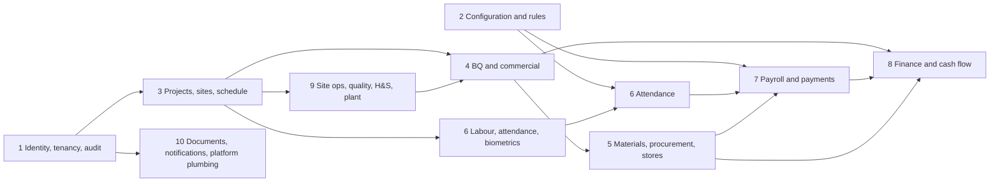

---

## 1. Identity, tenancy and audit

```mermaid
erDiagram
  Tenant ||--o{ Membership : "has members"
  Tenant ||--o{ Role : "defines custom"
  Tenant ||--o{ Device : "registers"
  Tenant ||--o{ AuditLog : "records"
  Tenant ||--o| Subscription : "billed by"
  User ||--o{ Membership : "belongs to"
  User ||--o{ Credential : "authenticates with"
  User ||--o{ MfaFactor : "enrols"
  User ||--o{ Session : "opens"
  Session ||--o{ RefreshToken : "rotates"
  Session }o--o| Device : "bound to"
  Membership ||--o{ MembershipRole : "granted"
  Role ||--o{ MembershipRole : "assigned via"
  Role ||--o{ RolePermission : "bundles"
  Permission ||--o{ RolePermission : "included in"
  User ||--o{ ProjectMembership : "works on"
  Role ||--o{ ProjectMembership : "as role"
  Tenant ||--o{ Invitation : "sends"

  Tenant {
    uuid id PK
    text name
    text legal_name
    bytea kra_pin_enc
    text nca_registration_no
    text default_locale "en or sw"
    text status "active, suspended"
  }
  Subscription {
    uuid tenant_id PK, FK
    text plan
    text status
    date current_period_end
  }
  User {
    uuid id PK
    text email UK "nullable"
    bytea phone_enc
    text phone_bidx UK "2547XXXXXXXX normalised"
    text display_name
    text locale
    bool mfa_required "true for Owner, Finance, Admin"
    text status
  }
  Credential {
    uuid id PK
    uuid user_id FK
    text kind "password"
    text argon2id_hash
    timestamptz changed_at
  }
  MfaFactor {
    uuid id PK
    uuid user_id FK
    text kind "totp, passkey, recovery_code"
    bytea secret_enc "TOTP secret"
    text credential_id "passkey"
    bytea public_key "passkey"
    timestamptz last_used_at
  }
  Session {
    uuid id PK
    uuid user_id FK
    uuid active_tenant_id FK
    uuid device_id FK
    text ip
    text user_agent
    timestamptz mfa_at "for step-up"
    timestamptz last_seen_at
    timestamptz revoked_at
  }
  RefreshToken {
    uuid id PK
    uuid session_id FK
    uuid family_id
    text token_sha256 UK
    timestamptz expires_at
    timestamptz used_at "reuse revokes family"
  }
  Device {
    uuid id PK
    text kind "browser, site_app, kiosk, terminal"
    bytea public_key "Ed25519 for signed sync"
    uuid site_id FK "kiosk and terminal"
    text status "active, revoked"
    timestamptz last_seen_at
  }
  Membership {
    uuid id PK
    uuid tenant_id FK
    uuid user_id FK
    text kind "staff, client, supplier, consultant"
    text status
  }
  Role {
    uuid id PK
    uuid tenant_id FK "null for system roles"
    text key "owner, pm, site_agent, foreman, qs, storekeeper, finance, client, consultant, supplier"
    bool is_system
  }
  Permission {
    text key PK "e.g. payments.approve"
    text module
    text description
  }
  RolePermission {
    uuid role_id PK, FK
    text permission_key PK, FK
  }
  MembershipRole {
    uuid membership_id PK, FK
    uuid role_id PK, FK
    bigint approval_limit_minor "nullable"
  }
  ProjectMembership {
    uuid id PK
    uuid project_id FK
    uuid user_id FK
    uuid role_id FK
    bigint approval_limit_minor
  }
  Invitation {
    uuid id PK
    text email_or_phone
    uuid role_id FK
    uuid project_id FK "optional"
    text token_sha256
    timestamptz expires_at
    timestamptz accepted_at
  }
  AuditLog {
    uuid id PK "append-only, monthly partitions"
    timestamptz occurred_at
    uuid actor_user_id
    uuid actor_device_id
    text ip
    text request_id
    text action "create, update, delete, approve, login, export"
    text entity_type
    uuid entity_id
    jsonb before
    jsonb after
    bytea prev_hash
    bytea hash "hash chain per tenant"
  }
```

> **Implemented in D1.4 (differs from the target model above):** system roles and their permissions are code constants (`packages/types` `SYSTEM_ROLE_PERMISSIONS`), not `Role` rows. Company custom roles are `tenant_roles (tenant_id, id, name citext, permissions text[], tenant_wide)` with forced RLS. `memberships` and `invitations` hold `role` (a system key, or `custom`) plus `custom_role_id`, referencing `tenant_roles` through the composite key `(tenant_id, custom_role_id)`. Permission keys are checked by database CHECK constraints rather than a `Permission` table. `ProjectMembership.permissions` holds the project assignment (effective = role ∩ assignment). See [ARCHITECTURE §8](./ARCHITECTURE.md#8-authorisation-rbac-with-project-scope).

## 2. Configuration and rules (effective-dated)

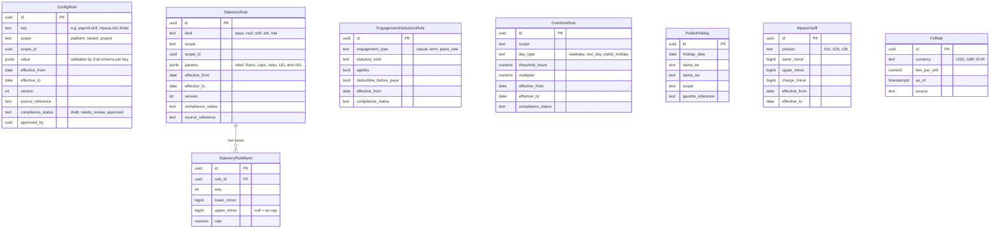

## 3. Projects, sites and schedule

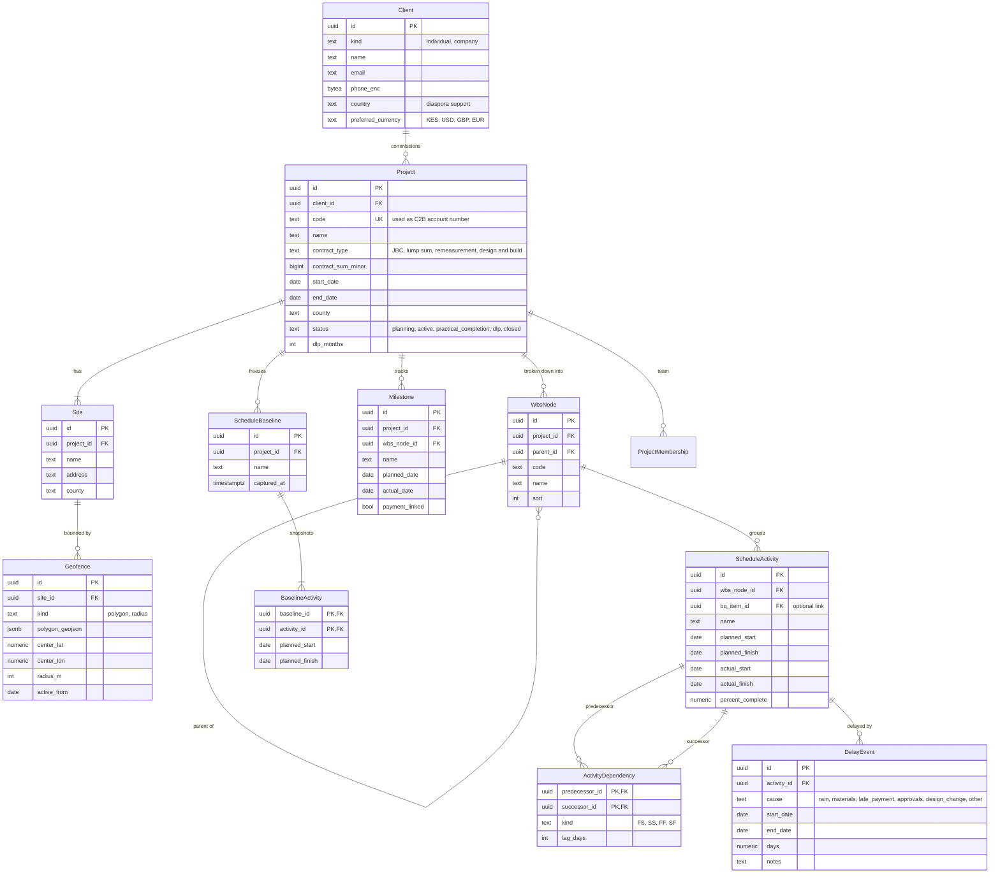

**Implemented in D2.1** (migration `20261110100000_projects_sites_geofences`; [ARCHITECTURE §4.1](./ARCHITECTURE.md#41-projects-module-d21)). The model above remains the target; the implemented tables differ as follows.

| Entity | Implemented as | Difference from the target model |
|---|---|---|
| Client | Not yet a table | `projects.client_name`, `client_email`, `client_phone` hold a simple contact until the client portal (D7.1) introduces `Client` and `client_id`. |
| Project | `projects` | `code` is unique per company (`PRJ-001…` assigned when omitted; existing rows were backfilled). `status` is `planning, active, on_hold, completed, closed, cancelled` with transitions in `app.guard_project`; practical completion and the defects liability period (`dlp_months`) join with valuations and retentions (D6.x). `contract_type` is `lump_sum, remeasurement, design_and_build, cost_plus, labour_only` (JBC is a standard form, not a pricing basis). Adds `description`, `town`, optional `latitude`/`longitude`, `currency` (KES only), `version` (optimistic concurrency), `created_by`, `updated_at`. |
| ProjectStatusChange | `project_status_changes` | New: append-only history of transitions (`from_status`, `to_status`, `reason`, `changed_by`, `changed_at`). |
| Site | `sites` | `name` (unique per project), `address` (address or landmark) and `version`; the county stays on the project. Sites cannot be deleted yet (attendance will reference them). |
| Geofence | `site_geofences` | One row per **version** (`version`, `effective_from timestamptz` set by the database, strictly increasing per site) instead of `active_from date`, so the version in force at a capture time is exact. A polygon is a jsonb array of `{lat,lng}` vertices (open ring) rather than GeoJSON; a radius is `center_lat`/`center_lng`/`radius_m`. `area_m2` and `perimeter_m` are stored. Rows are never updated or deleted. |
| WbsNode | `wbs_nodes` | Adds `weight_basis_points` (share of the parent, 10,000 = 100 %), `sort_order` (for `sort`) and `version`; the parent is referenced through `(tenant_id, project_id, parent_id)`. Codes are unique per project. |
| Milestone | `milestones` | `due_date` (for `planned_date`), `status` (`planned, in_progress, achieved, cancelled`), `actual_date`, `status_reason`, `version`; names are unique per project. `payment_linked` waits for valuations (D6.x). |
| ProjectMembership | `project_memberships` | `project_permissions_check` widened to the project-scoped catalogue (`PROJECT_ASSIGNABLE_PERMISSIONS`). |

**Implemented in D6.2** (migration `20261119090000_schedule`; [ARCHITECTURE §4.6](./ARCHITECTURE.md#46-schedule-d62)). Differences from the target model above:

| Entity | Implemented as | Difference from the target model |
|---|---|---|
| ScheduleActivity | `schedule_activities` | Per project (`project_id`) with an optional `wbs_node_id` (composite FK to the project's WBS) and an optional BQ link by **lineage** (`bq_version_id` + `bq_item_lineage_id`, composite FK to `bq_items`; the version must be an approved version of the same project). `kind` is `task` or `milestone`: a milestone row only puts an existing `milestones` row into the network (`milestone_id`, unique per project, zero duration, no name or dates of its own, created on its first dependency). Tasks have `code` (unique per project), `name`, `duration_days` (working days, 1–1,000), `start_no_earlier_than`, `actual_start`/`actual_finish`, and progress with a declared basis: `progress_basis` `physical` (whole `percent_complete`) or `quantity` (`quantity_done`/`quantity_total`/`quantity_unit`, percent stored as done ÷ total rounded down). **Planned start and finish are not stored**: they are computed (CPM) on every read. `version`, `created_by`, `updated_by`. |
| ActivityDependency | `schedule_dependencies` | Own `id` and `version`; `type` FS/SS/FF/SF; `lag_days` −60…365; one dependency per ordered pair; no cycles (trigger); ends fixed for life. |
| ScheduleBaseline | `schedule_baselines` | Adds `baseline_no` (per project, in order), `reason`, `data_date`, `start_date`, `project_finish`, the calendar used (`working_weekdays`, `include_public_holidays`), `item_count`, `created_by`; `created_at` stamped by the database. Append-only; the newest is current (no stored "current" flag). |
| BaselineActivity | `schedule_baseline_items` | Snapshot of tasks **and milestones** (`kind`, `ref_id` = activity or milestone ID, no foreign key so later deletions never touch a baseline), with `code`, `name`, `wbs_node_id`, `start_date`, `finish_date`, `duration_days`, `total_float_days`, `critical`. Append-only; written only in the baseline's transaction. |
| DelayEvent | `schedule_delays` + `schedule_delay_activities` | Per project rather than per activity: a delay names any number of tasks (join table). Versioned append-only rows (`delay_id` = the first version, `delay_no`, `version_no`, `supersedes_id` unique, `status` `recorded`/`withdrawn`, `change_reason`). `cause` is `weather, client_instruction, design_information, supplier_material, labour, plant, statutory_permits, site_conditions, late_payment, other`; `working_days_lost` in half days; `end_date` null while ongoing; optional `site_diary_id` (same project); `claim_flag` `not_assessed, non_excusable, excusable, compensable` (the company's position, not a legal determination). |
| — | `schedule_settings` | New: the project's working calendar (`working_weekdays`, `include_public_holidays`; the company's `public_holidays` from D3.3), `version`. |

## 4. BQ, variations, valuations and subcontracts

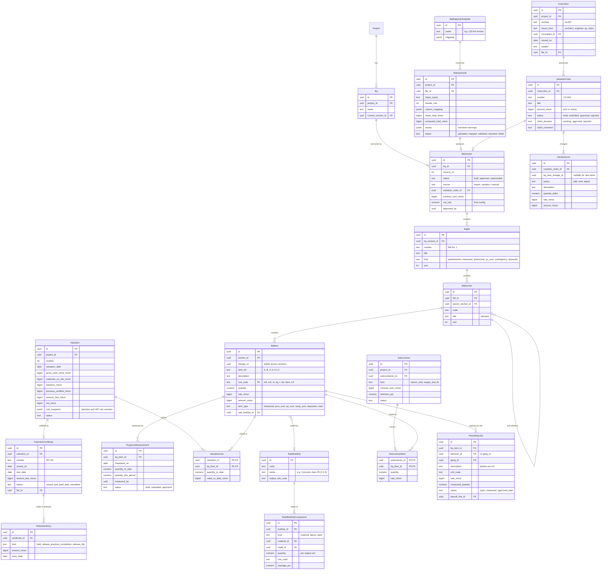

**Implemented in D2.2 and D2.3** (migrations `20261110110000_bq_import` and `20261110130000_bq_variations`; [ARCHITECTURE §4.2](./ARCHITECTURE.md#42-bq-module-and-excel-import-d22) and [§4.3](./ARCHITECTURE.md#43-bq-versions-variations-and-rate-build-ups-d23)). The BQ, its versions, the import pipeline, instructions, variations and the rate build-up library exist; valuations, certificates, progress measurements, subcontracts and piece-rate jobs come later (D6.3 and after). Every table has `tenant_id`, forced RLS with `WITH CHECK` on `app.current_tenant_id()`, and composite `(tenant_id, …)` foreign keys, including to the project, BQ, version, bill, section and item.

| Entity | Implemented as | Difference from the target model |
|---|---|---|
| Bq | `bqs` | One per project (unique `(tenant_id, project_id)`); `name` defaults to "Bill of Quantities". No `current_version_id`: the current version is the newest approved version (or the draft version 1 before baseline approval), derived from `bq_versions`. |
| BqVersion | `bq_versions` | Carries `project_id` (composite key to the project). `status` is `draft` or `approved` (`superseded` is allowed by the CHECK but unused: an approved version never changes, and "current" is derived). `source` is `import` (version 1, no parent) or `variation` (D2.3; `manual` is allowed but unused); `bq_versions_lineage_check` enforces the pairing. D2.3 adds `parent_version_id` (composite FK to the same BQ; unique per company, so the history is linear), `variation_id` (composite FK `(tenant_id, bq_id, variation_id)` to the producing variation; unique), `approved_by`, `approved_at` (`bq_versions_approval_check`: both or neither, and the approver is neither `created_by` nor `updated_by`). Instead of `contract_sum_minor` it stores the totals snapshot: `vat_rate_percent numeric(7,4)` with `vat_rule_key` and `vat_rule_status` (the configuration snapshot, copied from the parent for variation versions), `rounding` (`half_up_line`), `subtotal_minor`, `vat_minor`, `grand_total_minor`, `bill_count`, `item_count`, plus `version` (optimistic concurrency) and `updated_by/at`. A CHECK enforces `grand = subtotal + vat` and `vat = round(subtotal × rate / 100)`; a deferred constraint trigger re-adds items, sections and bills at commit. Content can change only while the version is a draft; `app.guard_bq_version` inserts versions as drafts, keeps approved versions unchanged, and requires a variation version to follow its approved parent (`version_no + 1`) with a submitted variation on that parent. The runtime role cannot DELETE versions. |
| BqBill | `bq_bills` | `kind` is `preliminaries, measured, provisional, dayworks, contingency` (PC and provisional sums share `provisional`); adds `total_minor` (sum of its items), `sheet_total_minor` (the sheet's own bill total, for reconciliation only), `source_sheet` and (D2.3) `lineage_id`, copied into every version (unique per version). `sort_order` for `sort`. |
| BqSection | `bq_sections` | No `parent_section_id` yet: sections are one level (nested elements are flattened in order). `code` and `title` are optional (items before the first heading sit in an untitled section); adds `notes` (unpriced explanatory text), `total_minor` and (D2.3) `lineage_id`, unique per version. |
| BqItem | `bq_items` | `ref`, `description`, `unit` (normalised code: `m3, m2, m, kg, t, nr, item, ls, pct, hr, day, week, month, l, set, pair, other`) with `unit_raw` (original spelling) instead of a unit FK; **`quantity` and `rate` are `numeric(20,4)`** (the rate is an exact decimal, not `rate_minor`); `amount_minor` is the computed line amount and `sheet_amount_minor` the sheet's own amount; `amount_source` is `computed, percentage, lump_sum, sheet_override`, and from D2.3 `fixed` (an amount added by a variation, no rate) and `omitted` (quantity 0 or none, amount 0, kept for history); `override_reason` is required for an override; `kind` is `measured, preliminary, provisional_sum, pc_sum, pc_attendance, pc_profit, contingency, daywork`; adds `notes`, `source_sheet`/`source_row` (nullable together since D2.3: items added by a variation have no sheet row), `has_formula`, `lineage_id` (stable across versions, unique per version) and `bill_id`. A CHECK enforces the amount rule per `amount_source`. Instead of `rate_buildup_id`, links live in `bq_item_rate_links` (below), keyed by item lineage. |
| RateBuildUp | `rate_buildups` | Per company: `code` (unique per company), `name`, `unit` (output unit, one of the normalised BQ units except `pct` and `other`), `current_version_no`, `version` (optimistic concurrency), `created_by/at`, `updated_by/at`. A deferred trigger checks that `current_version_no` names the newest version and that the name and unit match it. |
| (new) RateBuildUpVersion | `rate_buildup_versions` | One row per edit, never updated or deleted by `pmb_app` (privileges revoked): `version_no` (unique per build-up), `name`, `unit`, `assumptions` (conversions, densities, waste notes), `rate_minor` (null while any line is unpriced), `priced_minor`, `unpriced_lines`, `line_count`, `rounding` (`half_up_line`), `created_by/at` (`created_at` is the effective-from). A CHECK ties `rate_minor` to `priced_minor` and `unpriced_lines`; a deferred trigger re-adds the lines. |
| RateBuildUpComponent | `rate_buildup_lines` | Belongs to a build-up *version* (composite FK `(tenant_id, version_id)`), append-only. `kind` (`material, labour, plant`), `resource_name` and `unit` as written (no material or trade FK until the procurement and labour modules exist), `quantity numeric(15,6)` per output unit, `waste_percent numeric(7,4)` 0–100 (optional), `unit_cost_minor` (optional) and `amount_minor` = `round(quantity × (1 + waste/100) × unit_cost)` (CHECK). |
| (new) BqItemRateLink | `bq_item_rate_links` | Links an item lineage of an approved version (`version_id`, composite FK `(tenant_id, version_id, item_lineage_id)` to `bq_items`) to a specific build-up version (composite FK `(tenant_id, buildup_id, buildup_version_id)`), with `project_id`, `bq_id`, `linked_by/at` and `unlinked_by/at`. Never deleted; at most one active link per item (partial unique index `bq_item_rate_links_one_active`); `app.guard_bq_item_rate_link` allows only the unlink stamp to change. |
| Instruction | `instructions` | `number` (unique per project; letters, digits, space and `./_-`), `issued_on`, `issuer_name` and `issuer_role` (`architect, engineer, quantity_surveyor, client, project_manager, other`) instead of a consultant FK, `subject`, `description`, `attachments` (jsonb metadata, at most 10; no `file_id` until the files module), `status` (`open, closed`), `version`, `created_by/at`, `updated_by/at`. |
| VariationOrder | `variation_orders` | Adds `project_id`, `bq_id`, `base_version_id` (composite FK `(tenant_id, bq_id, base_version_id)`) and composite FKs to the project's instruction and BQ. `number` (`VO-001`…, unique per project), `title`, `description`; totals `additions_minor`, `omissions_minor`, `net_minor` (CHECK `net = additions − omissions`), `line_count`; `snapshot_digest` (SHA-256 at submission), `submitted_by/at`, `decided_by/at`, `decision_reason` (rejection), `cancel_reason`, `version`. `status` is `draft, submitted, approved, rejected, cancelled`; the client-decision fields wait for the client portal. `variation_orders_state_check` ties each state to its fields and refuses a decider who created or submitted the variation; `app.guard_variation_order` enforces the transitions. |
| VariationLine | `variation_lines` | Belongs to the variation and its base through `(tenant_id, variation_id, base_version_id)` (`ON UPDATE CASCADE`, so a rebase moves the lines). `line_no`, `action` (`adjust, omit, add`), `item_lineage_id` (composite FK to the base version's item), `bill_lineage_id`/`section_lineage_id` (composite FKs to the base version's bill and section) or `new_section_code`/`new_section_title`, `new_lineage_id` for an added item; the proposed `ref`, `description`, `unit`, `unit_raw`, `kind`, `quantity`, `rate` or `amount_minor`, `note`; the priced `base_amount_minor`, `new_amount_minor` and `delta_minor` (CHECK `delta = new − base`). Instead of `quantity_delta` a line states the new quantity. Changes only while the variation is a draft (`app.guard_variation_line`). |
| (new) VariationStatusChange | `variation_status_changes` | Append-only status history: `from_status`, `to_status`, `action` (`create, submit, approve, reject, reopen, cancel, rebase`), `reason`, `snapshot_digest`, `changed_by/at`. Reasons are kept here, never in the audit log. |
| BqImportJob | `bq_imports` | Named `bq_imports`. Keeps the source and its checks rather than a `file_id` (the files module does not exist yet): `file_name` (sanitised), `file_type` (`xlsx, xls`), `file_size_bytes`, `file_sha256`, `source_key` and `parsed_key` (private bucket keys, format CHECKed, never user-supplied), `scan_status`, `scan_engine`, `scanned_at`, `uploaded_by`. One import covers the whole workbook: `sheets` (summaries and the detection), `mapping` (per-sheet columns, header and data rows, bill number and name, included sheets, template used), `resolutions` (row actions and accepted warnings with reasons), `report` and `report_digest` (the stored validation report), `failure_code`, `bq_version_id`, `committed_by/at`, `version`. `status` is `uploaded, parsed, mapped, validated, committed, superseded, failed, abandoned` with transitions and immutable source columns enforced by `app.guard_bq_import`. Rows are never deleted by the runtime role. |
| BqMappingTemplate | `bq_mapping_templates` | Per company: `name` (unique per company), `signature` (normalised header texts), `columns` (field → column offsets relative to the first mapped column), `data_offset` (first data row below the header), `created_by`. Imports record the template used inside `mapping` rather than through a foreign key, so deleting a template does not touch import history. |

**Implemented in D5.3** (migration `20261118090000_stores`; [ARCHITECTURE §4.6](./ARCHITECTURE.md#46-stores-d53)), the minimum the consumption variance needs; D6.3 extends both:

| Entity | Implemented as | Difference from the target model |
|---|---|---|
| ProgressMeasurement | `progress_measurements` | Keyed by the BQ item **lineage** of an approved version (`project_id`, `bq_id`, `version_id`, `item_lineage_id`, composite FK to `bq_items`) rather than an item row, so a measurement survives later BQ versions. `measured_on` (not in the future, Africa/Nairobi), `quantity_to_date numeric(20,4)` in the item's unit, `note`, `measured_by`, `recorded_at`, `status` (`recorded` only; D6.3 adds submission and approval). No `quantity_this_period` (derived from successive measurements). **Append-only**: a correction is a new row with `corrects_id` (unique) and a `correction_reason`; the latest uncorrected measurement counts. |
| (new) RateBuildUpLineMaterial | `rate_buildup_line_materials` | Maps a material line of a build-up version (`buildup_id`, `buildup_version_id`, `line_id`; the line itself stays free text and immutable) to a catalogue `material_id`, the catalogue `unit` the line's quantity is in, the material's `base_unit`, `base_per_unit` (exact ratio "n/d") and the conversion steps. One active mapping per line; re-mapping stamps `unmapped_by/at` on the previous one. |

**Implemented in D6.3 part A** (migration `20261125090000_valuations`; [ARCHITECTURE §4.10](./ARCHITECTURE.md#410-measurement-valuations-and-earned-value-d63-part-a)). Money is `bigint` KES minor units, quantities `numeric(20,4)`, percentages `numeric(5,2)`. Every table has `tenant_id`, forced RLS with `WITH CHECK` and composite `(tenant_id, …)` foreign keys; `PaymentCertificate` and `RetentionEntry` are not separate tables: a certificate is a certified valuation and retention movements are derived from the certified sequence.

| Entity | Implemented as | Difference from the target model |
|---|---|---|
| ProgressMeasurement | `progress_measurements` (extended) | Adds `basis` (`quantity`, `percent`; null for D5.3 rows = quantity), `over_measure_reason` (required exactly when the quantity exceeds the BQ quantity), `idempotency_key` (unique per company) and `request_digest` (offline contract), and a unique `(tenant_id, project_id, id)` for composite FKs. Still append-only with `status` `recorded`; there is no `quantity_this_period` (derived) and no draft/submitted/approved status: the state is derived from the review and corrections (`pending`, `approved`, `rejected`, `withdrawn`, `superseded`). `recorded_at` is stamped with `clock_timestamp()` |
| (new) ProgressMeasurementPhoto | `progress_measurement_photos` | `(measurement_id, photo_id)` primary key, composite FKs to the project's measurement and site photo (D6.1 increment 2), `added_by`, `added_at` (database clock). Insert only while the measurement waits for review, at most six; never updated or deleted |
| (new) ProgressMeasurementReview | `progress_measurement_reviews` | One per measurement (unique): `decision` (`approved`, `rejected`), `reason` (required to reject), `decided_by` (≠ the measurer), `decided_at` (database clock). Approval needs a photo; never updated or deleted |
| (new) ContractSettings | `contract_settings` | Per project, append-only versions (`version` 1, 2, …; primary key `(tenant_id, project_id, version)`): `retention_percent` (0–20), `retention_cap_percent` (0–100 of the original contract sum, null = no limit), `vat_percent` (0–30), `materials_percent` (0–100), `practical_release_percent` (0–100), `created_by/at`. No row = the defaults (10, 5, 16, 100, 50) |
| Valuation | `valuations` | `number` (VAL-NNNN, unique per project), `certificate_number` (IPC-NNNN, unique per project, set at certification; one sequence for interims and releases), `kind` (`interim`, `retention_release`), `release_stage` (`practical`, `final`), `status` (`draft`, `submitted`, `certified`, `cancelled`), `valuation_date`, `notes`, `materials_from_stores`, `revision` (submissions). Frozen at submission (null in drafts): `bq_version_id`, `settings_version`, `rule_version` (`KE-VAL-1`) and the five percentages, `original/revised_contract_sum_minor`, `work_done_minor`, `materials_gross_minor`, `materials_minor`, `gross_minor`, `retention_stage`, `retention_cap_minor`, `retention_computed_minor`, `retention_held_minor`, `adjustments_minor`, `adjustments_to_date_minor`, `net_to_date_minor`, `previous_certified_minor`, `amount_due_minor`, `vat_minor`, `total_minor`, `line_count`, `digest`; `contributors` (uuid[]), created/updated/submitted/certified/cancelled by and at (database clock), `cancel_reason`, `return_reason`, `version`. The `valuations_check` CHECK re-computes every KE-VAL-1 figure; partial unique indexes allow one open (draft or submitted) valuation per project and one live release per stage. Replaces `PaymentCertificate` (certified = issued) and `RetentionEntry` (derived) |
| ValuationLine | `valuation_lines` | Primary key `(tenant_id, valuation_id, revision, line_no)`: one set per submission. `kind` `item` (BQ version and item lineage, bill, item kind, ref, description, unit, basis, item quantity, rate, item amount, measurement in force, measured date, quantity to date, % complete, over-measured flag, previous certified value, value to date), `materials` (`source` `stores` with store and material, or `manual` with the item, quantity, reference; amount at cost) or `adjustment` (`adjustment_kind`, signed amount). Written only in the submitting transaction, never changed |
| (new) ValuationMaterial | `valuation_materials` | Draft input: materials on site entered against a measured BQ item of the BQ in force (`bq_version_id`, `bq_item_lineage_id`), description, unit, quantity (> 0), `amount_minor` at cost (> 0), reference, created by/at. Insert or delete while the interim is a draft; never updated |
| (new) ValuationAdjustment | `valuation_adjustments` | Draft input: `kind` (`advance` > 0, `advance_recovery` < 0, `contra_charge` < 0, `other` ≠ 0), description, signed `amount_minor`, created by/at. Insert or delete while the interim is a draft; never updated |
| Subcontract, SubcontractItem, PieceRateJob | — | Not in D6.3 part A (part B) |

## 5. Materials, procurement and stores

**Implemented in D5.1** (migration `20261115090000_procurement_catalogue`; [ARCHITECTURE §4.4](./ARCHITECTURE.md#44-catalogue-and-suppliers-d51)). Units, materials, conversions, prices and suppliers with payout details exist; requisitions, RFQs, quotations, LPOs, GRNs, supplier invoices and three-way matching came with D5.2 (below); stores come with D5.3. Every table has `tenant_id`, forced RLS with `WITH CHECK` on `app.current_tenant_id()`, and composite `(tenant_id, …)` foreign keys.

| Entity | Implemented as | Difference from the target model |
|---|---|---|
| Unit | `units` (company units only) + standard units in code | The standard units (kg, g, t, `bag_50kg`, `bag_25kg`, mm, m, ft, m2, m3, l, nr, pair, trip, bag, sheet, roll, bundle, packet, box, drum, tin, set) live in `packages/domain` and `app.standard_unit_dimension`, not in rows. `units` holds a company's own units: `code` (lower-case, unique per company, not a standard code), `name`, `name_sw`, `dimension` (`mass, length, area, volume, count, trip, package`), `equals_quantity numeric(20,6)` + `equals_unit` (the size in a standard unit of the same dimension, required for sized dimensions and refused otherwise), `status` (`active, archived`), `version`. The definition never changes (`app.guard_unit`). No `lump` dimension: lump sums stay a BQ concept. |
| UnitConversion | `unit_conversions` | Always material-scoped, optionally per supplier (`supplier_id`). The factor is stored as two exact quantities (`from_quantity`, `to_quantity`, `numeric(20,6)`: "1 trip = 7 t") rather than a rounded factor; `pair_key` (the sorted unit-class pair, computed by the trigger), `effective_from`, `effective_to` (end-exclusive), `note`, `created_by/at`, `ended_by/at`. No overlapping factors per material, supplier and pair; only the end may be set; never deleted (`app.guard_unit_conversion`). Same-dimension factors between sized units are refused. Standard factors and attribute formulas (steel d²/162, piece length, cover width, timber section, mesh sheet/roll) are computed, not stored. |
| Material | `materials` | `code` (`MAT-NNNN`, fixed), `name` (citext, unique per company), `name_sw`, `category` (`cement, aggregates, blocks_stones, steel, brc_mesh, timber, roofing, plumbing, electrical, finishes, other`), `base_unit` (fixed once the material has prices), `spec`, `attributes` jsonb (bar diameter, piece length, gauge, cover width, timber section, mesh type and sheet/roll sizes, checked per category) instead of `kg_per_unit`, `notes`, `status` (`active, archived`), `version`. |
| Supplier | `suppliers` | `code` (`SUP-NNNN`), `legal_name`, `trading_name`; `kra_pin_enc` + `kra_pin_bidx` (unique per company) + `kra_pin_masked`; `etims_status` + `etims_checked_on`; `status` (`active, on_hold, blocked`) + `status_reason`; `credit_days`, `credit_limit_minor`, `notes`, `version`. Payout details moved to `supplier_payout_versions`; contacts to `supplier_contacts`. No `rating` (arrives with invoices and deliveries, D5.2). |
| (new) SupplierContact | `supplier_contacts` | `name`, `role`, `phone_enc` + `phone_bidx` + `phone_masked`, `phone_changed_by/at` (stamped by the trigger), `email`, `is_primary` (at most one per supplier, partial unique index), `sort_order`. |
| (new) SupplierPhoneChange | `supplier_phone_changes` | Append-only log written by `app.record_contact_phone_change`: `contact_id`, `action` (`set, cleared, removed`), `changed_by`, `changed_at`. Feeds the payout contributors (30-day window). |
| (new) SupplierPayoutVersion | `supplier_payout_versions` | One immutable row per version: `version_no`, `status` (`pending, verified, rejected, superseded`), `mpesa_kind` (`paybill, till, none`) with `paybill_number` + `account_reference` or `till_number`, optional bank (`bank_name`, `bank_branch`, `account_name`, `account_number_enc` + `account_number_masked`), `proposed_by/at`, `contributors uuid[]`, `contact_change_warning`, `verified_by/at`, `verification_method`, `verification_note`, `rejected_by/at`, `rejection_reason`, `superseded_by/at`. `supplier_payout_versions_channel_check`, `supplier_payout_versions_state_check` (no contributor decides) and `app.guard_payout_version` (transitions, immutability, decider = signed-in user); one current (pending or verified) version per supplier (partial unique index). |
| MaterialPrice | `material_prices` | Append-only (no UPDATE/DELETE for `pmb_app`): `unit`, `unit_price_minor` + `currency` (KES), `vat_treatment` (`inclusive, exclusive, not_applicable`), `vat_rate_percent` + `vat_rule_status` (snapshot of `bq.vat.rate`), `net_unit_price_minor`, `gross_unit_price_minor`, `effective_on` (for `observed_on`), `source` (`manual, quotation, invoice`), `source_reference`, `note`, `comparable_unit` + `comparable_unit_price_minor numeric(30,6)` + `conversion_snapshot` jsonb (the steps used), `previous_price_id`, `change_percent numeric(14,4)`, `alert_state` (`first_price, within_threshold, above_threshold, not_comparable`), `alert_threshold_percent`, `corrects_price_id` (unique) + `correction_reason`, `recorded_by/at`. |
| (new) ProcurementSettings | `procurement_settings` | One row per company once saved: `price_change_alert_percent numeric(8,4)` (default 10 when absent), `version`, `updated_by/at`. D5.2 adds `min_quotes` (default 3), `qty_tolerance_percent` and `price_tolerance_percent` (`numeric(7,4)`, default 0) and `block_payment_without_etims` (default true). |

**Implemented in D5.2** (migration `20261115100000_procure_to_pay`; [ARCHITECTURE §4.5](./ARCHITECTURE.md#45-procure-to-pay-d52)): `requisitions` + `requisition_lines`, `rfqs` + `rfq_requisitions` + `rfq_suppliers`, `quotations` + `quotation_lines`, `lpos` + `lpo_lines` (supplier snapshot: names, masked KRA PIN, eTIMS status, terms), `grns` + `grn_lines` (client-supplied ID, idempotency key and request digest, vehicle registration with a Kenyan-format flag, GPS fix and geofence result), `supplier_invoices` + `supplier_invoice_lines` (normalised invoice-number key unique per supplier, eTIMS number and format flag, content version), `three_way_matches` (append-only evidence: inputs, tolerances, GRN and prior-invoice sets, per-line results, reasons, exception), `invoice_payables` (approval bound to one match and one verified payout version), `invoice_settlements` (append-only, idempotency key, reference unique per method) and `procurement_documents` (quotation and invoice documents, GRN photos). Lines store the quantity as entered plus the base-unit quantity and the net price per base unit; amounts are KES minor units. Same tenancy rules as D5.1 (tenant_id, forced RLS with `WITH CHECK`, composite foreign keys); lifecycle, contributor, award, match and settlement rules are repeated by `app.guard_*` triggers and `app.invoice_match_violations`. Stores (`StockLedger`, issues, stock takes) remain D5.3.

**Implemented in D5.3** (migration `20261118090000_stores`; [ARCHITECTURE §4.6](./ARCHITECTURE.md#46-stores-d53)). Same tenancy rules (tenant_id, forced RLS with `WITH CHECK`, composite foreign keys, runtime-role grants without DELETE on history); `procurement_settings` gains `consumption_variance_percent numeric(7,4)` (default 10).

| Entity | Implemented as | Difference from the target model |
|---|---|---|
| Store | `stores` | Adds `project_id` (composite FK with the site), `version`, `created_by/at`, `updated_by/at`; one store per site (unique `(tenant_id, site_id)`); `storekeeper_user_id` optional (a company member). |
| (new) StockBalance | `stock_balances` | One row per (store, material): `quantity`, `value_minor numeric(30,6)`, `last_seq`, `last_entry_at`. Changed only by `app.apply_stock_entry` to the running balance of the next ledger entry; locked (`FOR UPDATE`) by every movement. |
| StockLedgerEntry | `stock_ledger_entries` | Append-only. Adds `project_id`, `base_unit`, `seq` (per store and material), `value_minor` and `unit_cost_minor` as `numeric(30,6)` (six decimals of a minor unit), `balance_quantity`, `balance_value_minor`, `business_date`, `recorded_by/at`. The source is one of `grn_id`+`grn_line_id`, `movement_id`+`movement_line_id`, `transfer_id`+`transfer_line_id`, `stock_take_id`+`stock_take_line_id` (CHECK: exactly one, matching the kind) instead of `ref_type`/`ref_id`; BQ item by `bq_version_id`+`bq_item_lineage_id`; `reverses_entry_id` (unique) for corrections. No `device_id` yet (site app sync, D3.2). |
| (new) StockMovement | `stock_movements` + `stock_movement_lines` | Issues, returns and wastage (`kind`), numbered `ISS-`/`RTN-`/`WST-NNNN`; `status` `posted` or `reversed` (`reversed_by/at`, `reversal_reason`); issue target (`bq_version_id`, `bq_item_lineage_id`, `gang_id`, `issued_to_name`), `return_of_id`, `wastage_reason`; offline fields `idempotency_key` (unique per company), `request_digest`, `captured_at`, `source`. Lines keep the quantity and unit as entered, `base_quantity`, the conversion and (returns) `return_of_line_id`. |
| StockTransfer | `stock_transfers` + `stock_transfer_lines` | `number` (`TRF-NNNN`), both projects and stores, `status` (`dispatched, received, disputed, resolved, cancelled`), dispatch, receipt (own idempotency key and digest), resolution and cancellation stamps, `version`. Lines: quantity as entered, `base_quantity`, `unit_cost_minor`, `dispatched_value_minor`, `received_base_quantity`, `difference_reason`. |
| StockTake | `stock_takes` | `number` (`STK-NNNN`), `project_id`, `status` (`draft, submitted, approved, cancelled`), `contributors uuid[]` (creator, counters, submitters; never the approver), submission, approval, return and cancellation stamps, `version`. No `counted_on` (each count has its time). One open stock take per store (partial unique index). |
| StockTakeLine | `stock_take_lines` + `stock_take_counts` | Lines: `snapshot_quantity` and `snapshot_seq` at start, then the latest `counted_quantity`, `expected_quantity` (system quantity when counted) and `counted_seq`, `counted_by/at`, `count_id`; the variance is derived (counted − expected). `stock_take_counts` is the append-only count evidence with client ID, idempotency key, digest and capture time. |
| (new) StockReorderLevel | `stock_reorder_levels` | Per (store, material): `reorder_level` in the base unit, `updated_by/at`. |

**Implemented in D7.2 (supplier portal)** (migration `20261127090000_supplier_portal`; [ARCHITECTURE §4.12](./ARCHITECTURE.md#412-supplier-portal-d72)). Three tables, each with `tenant_id`, forced RLS with `WITH CHECK` on `app.current_tenant_id()`, composite `(tenant_id, …)` foreign keys, database-stamped times and `pmb_app` privileges without DELETE or TRUNCATE (and without UPDATE on the two append-only tables). A supplier-role member is also limited by **restrictive** RLS policies on `suppliers`, `supplier_contacts`, `supplier_phone_changes`, `supplier_payout_versions`, `material_prices`, `unit_conversions`, `rfq_suppliers`, `quotations` + lines, `lpos` + lines, `grns` + lines, `supplier_invoices` + lines, `three_way_matches`, `invoice_payables`, `invoice_settlements`, `procurement_documents` and the new tables: only rows of the supplier its active binding names; and on `requisitions` + lines, `rfqs`, `rfq_requisitions`, `cost_entries`, `cost_journal_lines`, `petty_cash_expenses` and `plant_items`: no rows at all. `lpos` and `supplier_invoices` gain a unique `(tenant_id, supplier_id, id)` so the new tables can reference "an LPO / invoice **of this supplier**".

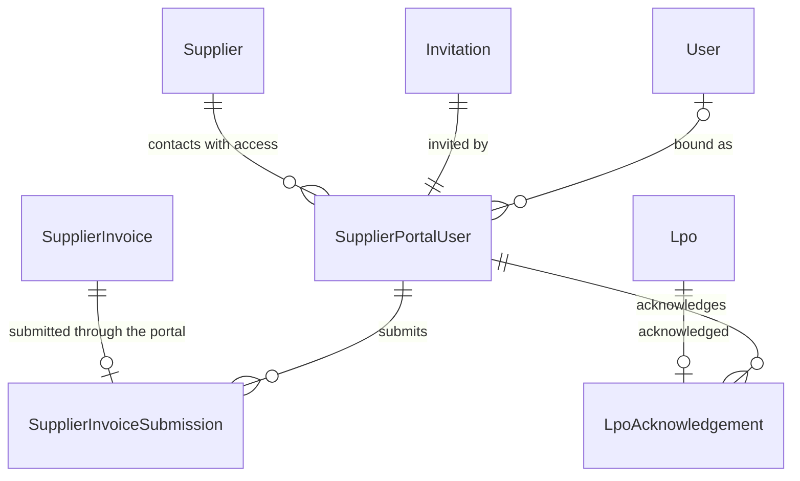

| Entity | Implemented as | Notes |
|---|---|---|
| (new) SupplierPortalUser | `supplier_portal_users` | `supplier_id` (composite FK), `invitation_id` (composite FK, unique), `identifier` (email or normalised phone invited), `contact_name`, `user_id` (set on activation; no FK so the history survives an account's removal), `status` (`invited, active, revoked`), `version`, `invited_by/at`, `activated_at`, `revoked_by/at`, `revoke_cause` (`revoked, membership_ended, superseded` — a new invitation replaced one nobody accepted), `revoke_reason` (3–500, required when staff revoke). Partial unique indexes: one `active` row per (tenant, user); one `invited`/`active` row per (tenant, supplier, identifier). Unique `(tenant_id, supplier_id, id)` for same-supplier references. Never deleted |
| (new) SupplierInvoiceSubmission | `supplier_invoice_submissions` | Append-only: `invoice_id` (unique; composite FK `(tenant_id, supplier_id, invoice_id)` → an invoice of the same supplier), `supplier_id`, `portal_user_id` (composite FK `(tenant_id, supplier_id, portal_user_id)`), `submitted_by`, `idempotency_key` (unique per company), `request_digest` (SHA-256 hex), `submitted_at`. Its existence is the invoice's `source = supplier_portal` |
| (new) LpoAcknowledgement | `lpo_acknowledgements` | Append-only, one per LPO (unique `lpo_id`; composite FK `(tenant_id, supplier_id, lpo_id)`), `portal_user_id` (same-supplier composite FK), `acknowledged_by`, `acknowledged_at`. Never changes the LPO |

D7.2 also adds `procurement_documents.uploaded_by_supplier` (boolean, stamped by the database from the uploader's role; documents stay append-only), which labels a document as the supplier's and counts it against the supplier's limit of 3 per invoice.

Statements and payment status are computed from `supplier_invoices` and `invoice_settlements` (no table): see `supplierStatement()` in `packages/domain`.

## 6. Labour, attendance and biometrics

```mermaid
erDiagram
  Trade ||--o{ Labourer : "primary trade"
  Labourer ||--o{ Accreditation : "holds"
  Labourer ||--o{ ProjectEngagement : "engaged on"
  Project ||--o{ ProjectEngagement : "engages"
  Project ||--o{ LabourRate : "sets default rates"
  Trade ||--o{ LabourRate : "rate for"
  Project ||--o{ Gang : "organises"
  Gang ||--o{ GangAssignment : "daily roster"
  Labourer ||--o{ GangAssignment : "assigned"
  Labourer ||--o{ Consent : "gives or withdraws"
  Labourer ||--o{ BiometricEnrolment : "enrolled"
  Consent ||--o{ BiometricEnrolment : "authorises"
  BiometricEnrolment ||--o{ BiometricTemplate : "stores"
  Site ||--o{ AttendanceDevice : "registers"
  AttendanceDevice ||--o{ AttendanceEvent : "captures"
  Labourer ||--o{ AttendanceEvent : "checks in or out"
  AttendanceEvent ||--o{ AttendanceAnomaly : "flagged by"
  Labourer ||--o{ Timesheet : "per pay period"
  Timesheet ||--|{ TimesheetLine : "per day"
  Labourer ||--o{ DataSubjectRequest : "exercises rights"
  DpiaRecord ||--o{ BiometricEnrolment : "permits"

  Trade {
    uuid id PK
    text key "mason, carpenter, steel_fixer, kibarua"
    text name_en
    text name_sw
  }
  Labourer {
    uuid id PK
    text worker_no UK
    text full_name
    text id_type "national_id, alien_id, passport"
    bytea id_number_enc
    text id_number_bidx UK "duplicate and ghost-worker check"
    date date_of_birth "registration blocked if under 18"
    text gender
    bytea phone_enc "M-Pesa number"
    text phone_bidx
    uuid photo_file_id FK
    uuid trade_id FK
    text skill_level "skilled, semi_skilled, unskilled"
    text engagement_type "casual, term, piece_rate"
    text rate_basis "hourly, daily, piece"
    bigint default_rate_minor
    bytea next_of_kin_enc
    text home_county
    bytea nssf_no_enc
    bytea sha_no_enc
    bytea kra_pin_enc
    date induction_date
    bool do_not_rehire "managers only"
    bytea do_not_rehire_reason_enc
    text status "active, inactive, left"
  }
  Accreditation {
    uuid id PK
    uuid labourer_id FK
    text kind "nca_skilled, nca_supervisor, welding, working_at_heights"
    text card_no
    date issued_on
    date expires_on "alert before expiry"
    uuid file_id FK
  }
  ProjectEngagement {
    uuid id PK
    uuid project_id FK
    uuid labourer_id FK
    date start_date
    date end_date
    bigint rate_override_minor
    int continuous_days "casual-to-term warning"
  }
  LabourRate {
    uuid id PK
    uuid project_id FK
    uuid trade_id FK
    text skill_level
    text basis
    bigint rate_minor
    date effective_from
    date effective_to
  }
  Gang {
    uuid id PK
    uuid project_id FK
    text name
    uuid foreman_labourer_id FK
  }
  GangAssignment {
    uuid id PK
    uuid gang_id FK
    uuid labourer_id FK
    date work_date
    uuid site_id FK
    uuid bq_item_id FK "activity"
  }
  Consent {
    uuid id PK
    uuid labourer_id FK
    text kind "biometric_face, biometric_fingerprint, data_processing, photo"
    text text_version
    text language "en, sw"
    text method "signed, read_aloud_witnessed"
    bool granted
    timestamptz captured_at
    uuid captured_by
    text witness_name
    timestamptz withdrawn_at
    uuid evidence_file_id FK
  }
  DpiaRecord {
    uuid id PK "biometrics stay off until an approved record exists (D3.4 gate)"
    text processing "biometric_attendance"
    text capture_method "face_kiosk, fingerprint_usb, terminal_push"
    int version
    text status "draft, dpo_reviewed, approved, expired"
    uuid document_id FK "signed DPIA"
    uuid approved_by
    date approved_on
    date review_due
  }
  BiometricEnrolment {
    uuid id PK
    uuid labourer_id FK
    uuid consent_id FK
    uuid dpia_record_id FK
    text modality "face, fingerprint"
    text status "active, revoked, deleted"
    uuid device_id FK
    date delete_after "engagement end + retention period"
  }
  BiometricTemplate {
    uuid id PK
    uuid enrolment_id FK
    bytea template_enc "separate KEK, never raw images"
    text algorithm
    text algorithm_version
    numeric quality_score
    int key_version
  }
  AttendanceDevice {
    uuid id PK
    uuid site_id FK
    uuid device_id FK
    text kind "kiosk_tablet, phone, terminal"
    text serial_no
    jsonb capture_methods "qr_card_photo, face_kiosk"
    text status
  }
  AttendanceEvent {
    uuid id PK "client-generated, append-only"
    uuid site_id FK
    uuid labourer_id FK
    text kind "check_in, check_out"
    text method "qr_card_photo, nfc_card_photo, face_kiosk, fingerprint_usb, terminal_push, manual_override"
    numeric match_confidence
    numeric liveness_score
    uuid attendance_device_id FK
    bigint device_seq
    timestamptz device_time
    bigint elapsed_realtime_ms
    text boot_id
    timestamptz server_received_at
    numeric lat
    numeric lon
    numeric accuracy_m
    bool inside_geofence
    bool mock_location
    uuid photo_id FK
    uuid confirmed_by_user_id
    text override_reason
    bytea signature "Ed25519 by device key"
    uuid supersedes_event_id FK
  }
  AttendanceAnomaly {
    uuid id PK
    uuid event_id FK
    text kind "duplicate, outside_geofence, two_sites, impossible_travel, clock_drift, time_unverified, mock_location, unregistered_device, low_confidence, manual_override, missing_checkout"
    text severity
    jsonb details
    text status "open, accepted, rejected"
    uuid reviewed_by
    text review_note
  }
  Timesheet {
    uuid id PK
    uuid labourer_id FK
    uuid pay_period_id FK
    text status "draft, approved, locked"
  }
  TimesheetLine {
    uuid id PK
    uuid timesheet_id FK
    date work_date
    text day_type "weekday, rest_day, public_holiday"
    text day_status "present, half_day, absent, leave"
    numeric normal_hours
    numeric overtime_hours
    int late_minutes
    jsonb source_event_ids
  }
  DataSubjectRequest {
    uuid id PK
    uuid labourer_id FK
    text kind "access, correction, deletion, objection"
    date received_on
    date due_on
    text status
  }
```

**Implemented in D3.1** (migration `20261111090000_labour_registry`; [ARCHITECTURE §4.3](./ARCHITECTURE.md#43-labour-module-d31)). Biometrics and data subject requests are not built yet; the web slice of attendance and timesheets (D3.3) follows this table. Every table below has forced RLS with `WITH CHECK`, composite `(tenant_id, …)` foreign keys (so no row can reference another company's labourer, project, site, trade or gang) and runtime-role grants without TRUNCATE, REFERENCES or TRIGGER. The implemented tables differ from the target model as follows.

| Entity | Implemented as | Difference from the target model |
|---|---|---|
| Trade | `trades` | Per company (`key` unique per company, `name_en`/`name_sw`, `active`, `sort_order`, `version`); never deleted, deactivated instead. |
| (skill level) | `skill_levels` | New table instead of a text column: company-configurable, EN/SW names, `nca_category` (`skilled, semi_skilled, unskilled, supervisor`) and `accreditation_expected`. |
| (settings) | `labour_settings` | One optional row per company: `accreditation_alert_days` (1–365; 30 when absent). |
| Labourer | `labourers` | `worker_no` (`WRK-0001`, unique per company); `trade_id` and `skill_level_id` references; `registered_on` set by the database to today in Africa/Nairobi and immutable; `labourers_minimum_age_check` (`date_of_birth <= registered_on - interval '18 years'`). Encrypted columns `id_number_enc`, `phone_enc`, `kra_pin_enc`, `nssf_number_enc`, `sha_number_enc`, `next_of_kin_enc` (`bytea`, envelope format checked by `app.is_field_ciphertext`); blind indexes `id_number_bidx` (unique per company; computed over the number without its document type and, for all-digit numbers, without leading zeros, so uniqueness holds across ID types), `phone_bidx` (not unique: shared phones are warned about) and `kra_pin_bidx` (unique). `do_not_rehire` with `do_not_rehire_at`/`_by`; the reason lives encrypted in `do_not_rehire_events`. No `photo_file_id`, `default_rate_minor` or `induction_date` yet (photos with attendance evidence; rates in `labour_rates`). `worker_no`, `registered_on` and the creator never change (trigger); identifiers can be corrected by a labour manager (re-encrypted, re-indexed, audited by field name only); labourers are never deleted. |
| ProjectEngagement | `labour_engagements` | `start_date`, `end_date`, `end_reason`, `ended_by`/`ended_at`; one open engagement per labourer and project; the trigger requires 18 or older on the start date, active consent, an active labourer and, for a flagged person, a do-not-rehire override event in the same transaction. `rate_override_minor` became a labourer-scoped `labour_rates` row; `continuous_days` waits for attendance (CR-PAY-10). |
| Accreditation | `labourer_accreditations` | `category` (`nca_skilled_worker`, `nca_site_supervisor`), `card_number`, `issued_on`, `expires_on`, `version`; no evidence file yet. Expiry state is computed on read (no stored status). |
| Consent | `labourer_consents` | `kind` is `registration_data` only (biometric kinds are the D3.4 extension point); `notice_version` and `notice_digest` (SHA-256 of the EN/SW text shown), `language`, `method` (`signed`, `witnessed_verbal`), `witness_name`, `granted`; `captured_at` set by the database; withdrawal (`withdrawn_at` from the database clock, `withdrawn_by`, `withdrawal_method`, `withdrawal_witness`) can be recorded once and nothing else changes. A deferred constraint trigger refuses any labourer without a consent row. |
| (do-not-rehire history) | `do_not_rehire_events` | New append-only table (`action` set/clear/override, `context` registration/engagement/reactivation/manual, optional `project_id` and `related_labourer_id`, encrypted `reason_enc`, `actor_id`, database `created_at`); a labourer's flag can only change together with a matching event. |
| LabourRate | `labour_rates` | Scope by shape: company (no project), project, or one labourer on one project; `trade_id` and optional `skill_level_id`; `basis` daily/hourly; `rate_minor` (KES minor units); `effective_from` only (the end is the day before the next row of the same `scope_key` starts); unique per `(tenant_id, scope_key, effective_from)`; rows are never updated, cannot start before today, and only rates that have not started can be deleted. |
| Gang | `gangs` | `site_id` (optional, a site of the same project), `leader_labourer_id` (a current member, enforced by trigger), `status` active/archived, `version`; names unique per project. |
| GangAssignment | `gang_memberships` | Membership history (`joined_on`, `left_on`) instead of a daily roster; the daily site/BQ-activity assignment arrives with attendance (D3.2–D3.3). One open gang per labourer and project; joining needs an engagement on that date. |
| (saved views) | `labour_saved_views` | New: per user and company (`name`, `filters` jsonb, at most 20); RLS lets a user read and change only their own. `filters` never holds search text (`labour_saved_views_check`), so no identifier is stored in plaintext. |

**Implemented in D3.3, web-only slice** (migrations `20261112090000_attendance_timesheets` and the review-fix follow-up `20261112120000_attendance_review_fixes`; [ARCHITECTURE §4.4](./ARCHITECTURE.md#44-attendance-and-timesheets-module-d33-web-slice)). The site-app event model above (`AttendanceDevice`, signed `AttendanceEvent`s, offline sequence numbers, clock drift) is **not** built; the web slice records one muster entry per labourer, site and day instead, with the capture method and evidence columns reserved so the D3.3 site app and D3.4 biometrics can write the same rows. Every table has `tenant_id`, forced RLS with `WITH CHECK`, composite `(tenant_id, …)` foreign keys and no TRUNCATE/REFERENCES/TRIGGER for `pmb_app`; UPDATE is revoked on `timesheet_rule_versions`, `public_holidays`, `timesheet_lines`, `idempotency_records` and `outbox_events`, and DELETE on everything except scheduled rule versions and unlocked holidays. Database timestamps (`created_at`, `submitted_at`, `confirmed_at`, `approved_at`, `decided_at`, `reviewed_at`) are set by triggers, not by the client.

| Target entity | Implemented table | Differences and rules |
|---|---|---|
| (period settings) | `attendance_settings` | New: one row per company (`frequency` weekly only, `week_ends_on`, `cutoff_minutes`, `payday_weekday`, `version`); no row means the Q-C4 defaults (Thursday 18:00, Friday). Existing periods keep their dates when it changes. |
| (rule versions) | `timesheet_rule_versions` | New, replaces the single `attendance.*` keys: company default (`project_id` null) or project override; `scope_key` set by the trigger; one version per scope and `effective_from`; values in integer minutes, `rest_days smallint[]` (ISO weekdays), multipliers `numeric(4,2)` between 1.00 and 5.00, `compliance_status` (`unverified`, `approved`), `source_reference`. Insert-only; a version cannot start inside a submitted or approved period of its scope; only versions that have not started can be deleted. |
| PublicHoliday | `public_holidays` | Per company (`holiday_date` unique), `name_en`/`name_sw`, `kind` (`statutory`, `gazetted`, `observed`, `company`), `source`, `compliance_status`. Insert/delete only, and not inside a submitted or approved period. |
| PayPeriod (attendance side) | `timesheet_periods` | Per project: `start_date`–`end_date` (no overlaps, exclusion by trigger), `cutoff_at` (Africa/Nairobi), `status` `open → submitted → approved`, or `submitted → rejected → open`; `submitted_digest` (SHA-256 of the computed lines) binds approval to what was submitted; `approved_by <> submitted_by` and, while rejected, `rejected_by <> submitted_by` (CHECK; after a reopen the person who rejected may submit again, and the last rejection stays on the row as history). Approval requires `approved_at = now()` lines inserted in the same transaction. Payroll's `PayPeriod` (D4.1) will reference approved periods. |
| (muster sheet) | `attendance_days` | New: one per site and `work_date` (`period_id` of the project's period). `draft → submitted → confirmed`, or `submitted → draft` (returned with a reason); the confirmer is neither the submitter nor anyone who created or updated a record of the day (trigger). Records change only while the day is a draft in an open or rejected period. |
| AttendanceEvent | `attendance_records` | One per labourer, site and date (unique `(tenant_id, site_id, work_date, labourer_id)`); `status` (`present`, `half_day`, `absent`, `leave`, `sick`); `check_in_minutes`/`check_out_minutes` (minutes after midnight), `overnight` (shift ends the next morning), `break_minutes` (null = rule default), `notes`, `corrected`. `capture_method` (`web_manual` now; `qr_card`, `face`, `fingerprint`, `terminal` reserved) with nullable evidence columns `device_id`, `device_time`, `server_received_at`, `latitude`/`longitude`/`accuracy_m`, `geofence_result`, `geofence_version`, `match_confidence`, `photo_file_id`, `client_event_id` (all null for `web_manual`, CHECK). The trigger requires an engagement on the project that day; inactive or do-not-rehire labourers are recorded but flagged. |
| (correction) | `attendance_corrections` | New: a change to a submitted or confirmed day (`proposed`/`previous` values, `reason`), decided by someone other than the requester (`decided_by <> requested_by` CHECK); approval applies the values to the record in the same transaction (`corrected = true`), and only while the day is still submitted or confirmed and the record still holds `previous` (trigger, review fix 4); a day cannot be returned to draft while a correction is pending. One pending correction per day and labourer. |
| AttendanceAnomaly | `attendance_anomalies` | Per record: `kind` (`two_sites`, `overlapping_times`, `excess_hours`, `not_engaged`, `labourer_inactive`, `do_not_rehire`, `accreditation_invalid`, `manual_override`, `locked_share_changed`), `severity`, `details` (jsonb, no personal data), `status` (`open`, `resolved`, `dismissed`, `cleared`); `open_marker` keeps one open anomaly per record and kind. Reviewers cannot be the record's creator or last editor. Open anomalies block period approval. `locked_share_changed` (review fix 3) sits on the day's records in open periods when a locked share no longer matches the recomputed day, and clears itself once the proposed adjustment is approved. |
| Timesheet / TimesheetLine | `timesheet_lines` | **The payroll contract.** Written once, when a period is approved: one row per labourer and `line_key` (`attendance`, or `adjustment:<id>` for an approved adjustment landing in the period), with `half_days`, `worked_minutes`, `normal_minutes`, `ot_weekday_minutes`, `ot_rest_day_minutes`, `ot_holiday_minutes`, `late_minutes`, status counts, `rule_version_ids uuid[]`, `record_ids uuid[]` and per-day detail in `days` (jsonb: date, day type, rule version, totals, record ids). Insert-only and never deleted. Hours are integer minutes; days are half-day units. |
| (adjustment) | `timesheet_adjustments` | New: a change to an approved period (`original_period_id`), with a reason, decided by someone other than the requester; on approval `delta` (jsonb totals, after − before) and `target_period_id` (the project's next open period) are fixed and the approved period is never touched (INVARIANTS: closed periods are adjusted, not mutated). The new share (`delta.after`) is the record's share of the whole day recomputed with nothing locked. When another record of the day changes after approval, the system proposes one with `proposed = previous` and the reason `AUTOMATIC_ADJUSTMENT_REASON` (review fix 3). |
| (infrastructure) | `idempotency_records`, `outbox_events` | New: `Idempotency-Key` replays (key, operation, user, request fingerprint, stored response) and the transactional outbox (`attendance.day_confirmed`, `timesheet.period_approved`, `timesheet.adjustment_approved`), written in the same transaction as the change. |

## 7. Payroll and payments

The original draft diagram below is retained for context. Its combined `Payment` and `PaymentProviderRequest` model and status labels are superseded by **§7.1**, [WORKFLOWS.md](./WORKFLOWS.md) and [FINANCIAL_MODEL.md](./FINANCIAL_MODEL.md). Do not implement the draft's one-payment-per-payroll-line assumption or use its flags as independent settlement truth.

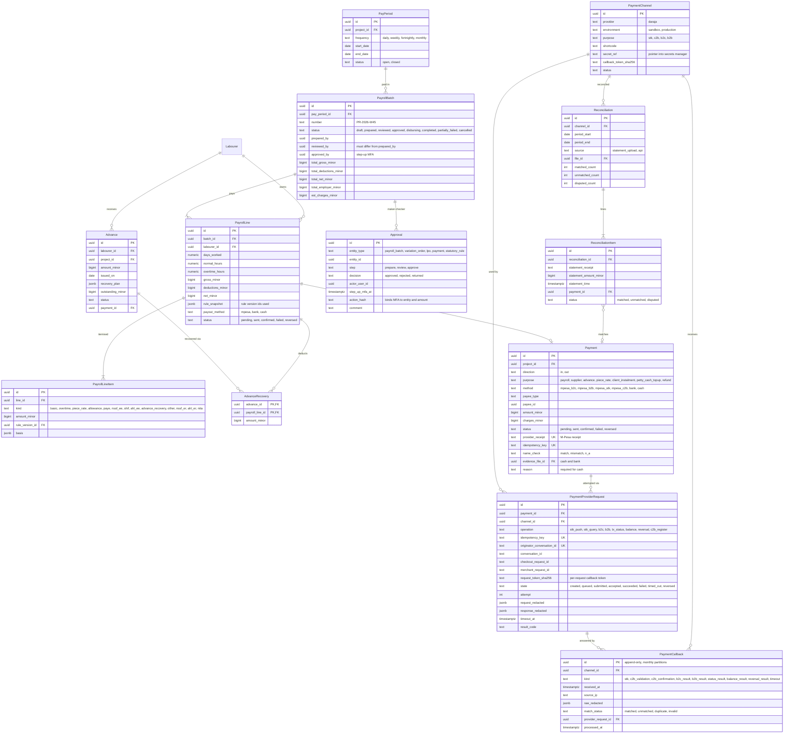

### 7.1 Canonical obligation, attempt, allocation and journal boundaries

Conceptual design for Phase 4; not implemented by foundation migrations.

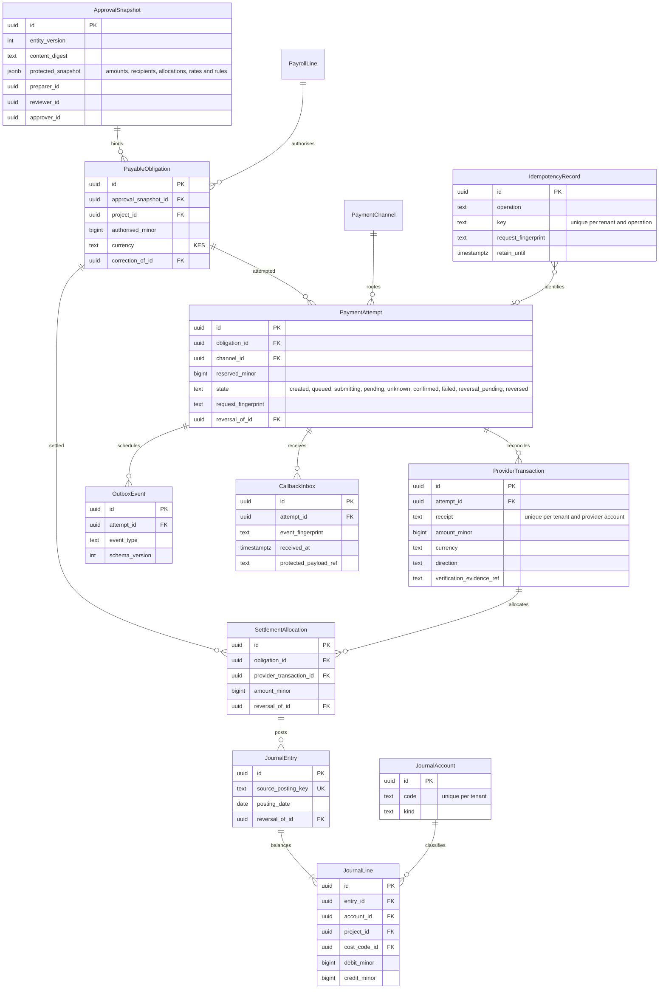

Every tenant-owned relation uses tenant-consistent foreign keys and runtime-role RLS. Settlement/reservation transactions lock the obligation; total allocations cannot exceed authorised outstanding. Each journal balances exactly, remains immutable and retains project/cost-code lineage. Inbox intake is durable before callback acknowledgement; queue processing state lives separately from append-only evidence. Unknown attempts retain reservations and require reconciliation before a new payout.

## 8. Finance: costs, budgets, petty cash and cash flow

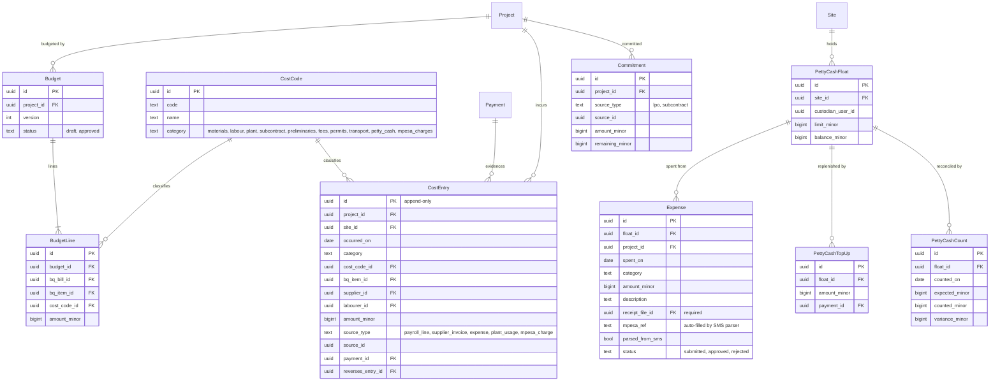

> **Cash-flow forecast** is a read model (`cash_flow_forecast_v`), not a table. It combines upcoming payroll (open pay periods × rates), approved LPOs not yet paid (`Commitment`), issued payment certificates not yet paid, and client instalment schedules.

**Implemented in D5.4** (migration `20261123090000_spending`; [ARCHITECTURE §4.8](./ARCHITECTURE.md#48-spending-and-cash-flow-d54)). Every table has `tenant_id`, forced RLS with `WITH CHECK` on `app.current_tenant_id()`, composite `(tenant_id, …)` foreign keys (project, site, BQ item lineage on its version, cost code, supplier, invoice, settlement, float, expense, count, journal line) and runtime-role grants without TRUNCATE, REFERENCES or TRIGGER; UPDATE and DELETE are revoked on the ledgers. Money is `bigint` KES minor units. Differences from the target model above:

| Entity | Implemented as | Difference from the target model |
|---|---|---|
| (new) SpendingSettings | `spending_settings` | One row per company: `budget_alert_percent`, `unusual_spend_multiplier numeric(7,2)`, `unusual_spend_min_samples`, `duplicate_window_days`, `forecast_weeks`, `opening_cash_minor` + `opening_cash_on` (both or neither), `version`; defaults apply until the first save (CONFIGURATION "Spending"). |
| CostCode | `cost_codes` | `code` unique per company (uppercase letters, digits, hyphens), `name`, `category` (the nine categories; M-Pesa charges are category `fees`), `active` (deactivated, never deleted), `version`. |
| Budget | `budgets` | `version_no` per project, `name`, `notes`, `status` (`draft, submitted, approved, cancelled`), `bq_version_id` (the BQ the item lines refer to), `total_minor` and `line_count` kept by statement-level triggers and checked at commit, `contributors uuid[]` (never the approver), SHA-256 `digest` at submission, submit/approve/return/cancel stamps, `version`. One draft or submitted version per project (partial unique index); an approved version never changes; the newest approved one is in force. |
| BudgetLine | `budget_lines` | A BQ item **lineage** on the budget's BQ version (no bill column: the bill comes from the item) **or** a cost code (CHECK: exactly one); `category` (from the code, optional for items), `description`, `amount_minor ≥ 0`; unique per item and per code within a version; editable only while the budget is a draft. |
| CostEntry | `cost_entries` | Append-only (UPDATE/DELETE/TRUNCATE refused by triggers and revoked). Adds `measure` (`accrued`, `paid`), `purpose` (`accrual, payment, charge_accrual, charge_payment, variance_accrual, variance_payment, journal, reversal`), `counterparty_kind` + `counterparty_name`, `payment_reference`, `business_date` and `recorded_at` (database-stamped). `source` is one of `supplier_invoice`, `invoice_settlement`, `petty_cash_expense`, `petty_cash_count`, `cost_journal` with one typed FK per source (CHECK: exactly the one matching the source) instead of `source_type` + `source_id`; payroll lines, plant usage and Daraja payments are not sources yet (no approved/paid payroll state exists before D4.3). `labourer_id` and `payment_id` are not columns yet. Posted once per source and purpose (partial unique indexes); `reverses_entry_id` unique (an entry is reversed at most once). |
| Commitment | — (read model) | Not a table: D5.2's `GET procurement/commitments` computes approved LPOs not yet invoiced (net of VAT) per requisition-line BQ bucket (`projectCommitments`), and the spending report reuses it. |
| (new) CostJournal | `cost_journals` + `cost_journal_lines` | `number` (`JNL-NNNN`), `kind` (`adjustment`, `reversal`), `reason`, `status` (`submitted, approved, rejected`), proposer and decider (never the same), `version`; lines carry the full cost tags, `reverses_entry_id` and, once approved, `posted_entry_id`. Lines are written in the proposing transaction only; approval posts every line. |
| PettyCashFloat | `petty_cash_floats` | Adds `project_id`, `name`, `status` (`active`, `closed`), `last_seq`, `version`; one float per site; `balance_minor ≥ 0` (CHECK) changed only to the balance of the next ledger entry (`app.guard_petty_cash_float`). |
| (new) PettyCashEntry | `petty_cash_entries` | The float's append-only ledger: `seq`, `kind` (`top_up, expense, expense_rejected, count_adjustment`), signed `amount_minor`, `balance_minor`, one source FK (top-up, expense or count), recorded by/at, business date; posted by `app.post_float_entry` with the float row locked; once per source. |
| Expense | `petty_cash_expenses` | Adds `number` (`EXP-NNNN`), `site_id`, `charge_minor` (M-Pesa charge), `cost_code_id` **or** `bq_version_id` + `bq_item_lineage_id`, `counterparty_kind`, `supplier_id`, `payee_name`, `payee_account`, `payee_phone_masked` (never the full number), `payment_method` (`cash`, `mpesa`), `mpesa_code` (unique among expenses not rejected), `parsed_from_sms` + `sms_kind` (the SMS text is not stored), `source`, `captured_at`, idempotency key and request digest, decision stamps. Receipts are `petty_cash_receipts` rows (private object key, content type, size, SHA-256, scan status; at most three), not one `receipt_file_id`. |
| PettyCashTopUp | `petty_cash_top_ups` | `number` (`TOP-NNNN`), `reason`, `status` (`requested, approved, paid, rejected, cancelled`), requester, approver (not the requester), payer (not the approver), `paid_on`, `method` and `reference` (unique per method) instead of a `payment_id` (Daraja payments are D4.2/D4.3). |
| PettyCashCount | `petty_cash_counts` | `number` (`CNT-NNNN`), `book_minor` + `book_seq` (snapshot at the count), `counted_minor`, `variance_minor` (counted − book), `note`, `status` (`submitted, approved, returned`), counter and decider (neither the counter nor the custodian); one open count per float. |
| CashFlowItem | `cash_flow_items` | Manual lines only: `direction` (`in`, `out`), `description`, `expected_on`, `amount_minor`, `status` (`expected, received, cancelled`), `received_on` + `received_minor`, `reference`, `version`. The forecast itself stays a read model (computed by `CashFlowService`, not a database view). |

## 9. Site operations: diary, photos, quality, H&S, plant

**Implemented in D6.1 (quality)** (migrations `20261122090000_diary_workforce` and `20261122100000_quality`; [ARCHITECTURE §4.7](./ARCHITECTURE.md#47-quality-d61)). Every table has `tenant_id`, forced RLS with `WITH CHECK` on `app.current_tenant_id()`, composite `(tenant_id, …)` foreign keys (to the project, site, template, inspection, snag, cube set and `site_photos`) and `pmb_app` privileges without DELETE (except unlinking a photo from a draft inspection's item) or TRUNCATE, and without UPDATE on the append-only tables (templates and their items, cube results, slump tests, snag photos). Differences from the target model above:

| Entity | Implemented as | Difference from the target model |
|---|---|---|
| SiteDiary (workforce) | `site_diaries` columns `workforce_source` (`manual`/`attendance`), `workforce_by_trade` (jsonb array: trade ID, key, EN/SW names, headcount, half days), `workforce_muster_status` (`none`, `draft`, `submitted`, `confirmed`), `workforce_snapshot_at` | No `DiaryLine` rows for workforce: the snapshot is one jsonb value recomputed by `app.diary_attendance_workforce` and verified by `app.guard_site_diary`; frozen with the content while submitted and after approval. |
| ChecklistTemplate | `checklist_templates` + `checklist_template_items` | Versioned: `lineage_id` (version 1's ID), `version`, `name`, `category` (12 categories), `description`, `retired`, `item_count`; items by `position` (1–60, text ≤ 300). Append-only: revising or retiring appends the next version. |
| Inspection | `inspections` | Per project **and site**, `number` (INS-NNNN), the template version used, `category`, `location`, `inspector_type` (`internal`, `consultant`, `county`; target `kind`) and `inspector_name`, `inspected_on`, optional `wbs_node_id`, `schedule_activity_id`, BQ item by lineage (`bq_version_id` + `bq_item_lineage_id`), `notes`; `status` `draft`/`submitted`/`signed_off`; `result` `pass`/`fail` (no `conditional`: a failed item raises a snag instead); submitter, signer and returner with times and the return reason; `version`. |
| InspectionResult | `inspection_items` + `inspection_item_photos` | The item text is **copied** from the template (checked at the same position); `result` `pending`/`pass`/`fail`/`na`, `note`; photos are links to `site_photos` of the same project (≤ 6 per item), not a single `photo_id`. |
| TestResult | `cube_sets` + `cube_results`; `slump_tests` | Split by test. **Cube sets** (`CUBE-NNNN`): site, `element`, `concrete_class` (C10–C50), `specified_strength` (f_cu), `cast_on`, `cubes_per_age` (1–6), `batch_reference`, `status` `active`/`void` (+ reason). **Cube results**: `age_days` (7 or 28), `tested_on`, `strengths` (decimal(4,1)[] per cube, N/mm²), `mean_strength`, `min_strength`, `outcome` (`pass`, `fail`, `indicative_ok`, `indicative_low`), `rule_version` (`KE-CUBE-1`), laboratory and report reference. **Slump tests** (`SLP-NNNN`): `target_mm`, `tolerance_mm`, `measured_mm`, `outcome`, `rule_version` (`KE-SLUMP-1`), optional class and cube set. All append-only with `supersedes_id` (unique) + `correction_reason`. No BQ item or lab file link yet. |
| Snag | `snags` + `snag_photos` | Per project and site, `number` (SNG-NNNN), `location`, `description`, `severity` (`critical`, `major`, `minor`), `responsible_kind` (`gang`, `subcontractor`, `supplier`, `other`) + `responsible_name` (free text until subcontracts exist), `due_on`, `phase` (`construction`/`dlp`), optional failed `inspection_item_id`; `status` `open`/`fixed`/`closed` (target `verified` and `closed` are one state: closing is the verification); fixer, closer, `fix_note`, `reopen_count`, `last_reopen_reason`. Photos have a `stage` (`raised`, `fixed`). |
| — | `project_completions` | New: practical and final completion certificates (`kind`, `status` `proposed`/`certified`/`withdrawn`, `completion_date`, `dlp_months` and `dlp_ends_on` for practical, the open and open-critical snag counts at proposal, `exception_reason`, `notes`, proposer/certifier/withdrawer with times and reason). One live certificate per kind. |
| — | `quality_settings` | New: one row per company: `dlp_months` (default 6, 1–24) and `cube_overdue_grace_days` (default 2, 0–14), `version`. |

**Implemented in D8.2 (health and safety)** (migration `20261124090000_health_safety`; [ARCHITECTURE §4.9](./ARCHITECTURE.md#49-health-and-safety-d82)). Every table has `tenant_id`, forced RLS with `WITH CHECK` on `app.current_tenant_id()`, composite `(tenant_id, …)` foreign keys (to the project, site, labourer, gang, user, incident, inspection, talk, kit and `site_photos`) and `pmb_app` privileges without TRUNCATE and without DELETE (except removing a draft talk's attendees and an open incident's people), and without UPDATE on kit checks, talk attendees, incident people and incident photos (rows are added or removed, never rewritten). Guard triggers enforce the lifecycles, locking, maker-checker, numbering order and read-only closed/cancelled projects. Differences from the target model above:

| Entity | Implemented as | Difference from the target model |
|---|---|---|
| SafetyIncident | `safety_incidents` + `safety_incident_people` + `safety_incident_photos` | Per project and site, `number` (INC-NNNN); `kind` `injury`/`near_miss`/`property_damage`/`environmental`/`dangerous_occurrence` (first aid is its own record, below); `severity` `minor`/`moderate`/`serious`/`fatal` (a near miss records its potential); `occurred_at`, `location`, `description`, `immediate_actions`, `first_aid_given`; `status` `reported`/`investigated`/`closed`/`voided`; investigation (`root_cause_category`, `root_cause`, `contributing_factors`, by/at); **regulator decision** (`notified` with `regulator_notified_on` and reference, or `not_notifiable` with a reason; replaces the target `wiba_reportable` flag, COMPLIANCE-REVIEW CR-HS-01); closure (by/at, note, `no_action_reason`), void (by/at, reason), `follow_up_of_id`, `version`. People: `role` `injured`/`involved`/`witness`, exactly one of `labourer_id`, `user_id` or `name` (≤ 120), and for the injured `injury_type` and `body_part` codes (no free-text medical detail). Photos: links to `site_photos` of the same site with `purpose = 'safety_incident'` (≤ 6). D8.2 adds `site_photos.purpose` (`general`, `safety_incident`; an incident photo is never on a diary). |
| CorrectiveAction | `corrective_actions` | Per project, `number` (CA-NNNN); `source` `incident`/`inspection`/`toolbox_talk`/`other` with the matching optional FK (exactly one for the first three); `description`, `owner_id`, `due_on`; `status` `open`/`done`/`verified`/`cancelled`; done (by/at, note), verified (by/at), `reject_count` + `last_reject_reason`, cancelled (by/at, reason), raised by/at, `version`. |
| ToolboxTalk | `toolbox_talks` | `number` (TBT-NNNN), site, `held_on`, `topic`, `notes`, `duration_minutes`, `presenter_id` (target `conducted_by`), optional `photo_id` (site photo of the same site), `other_attendees` (count of people not in the registry), `status` `draft`/`confirmed`/`cancelled`, confirmed and cancelled by/at, `cancel_reason`, `version`. |
| ToolboxTalkAttendance | `toolbox_talk_attendees` | Key `(tenant_id, talk_id, labourer_id)`; `via_gang_id` when the labourer came with a gang; added by/at. Changes only while the talk is a draft. |
| InductionRecord | `safety_inductions` | Per project and site, `number` (IND-NNNN); `person_kind` `labourer`/`staff`/`visitor` with exactly one of `labourer_id`, `user_id` or `visitor_name` (+ optional `visitor_organisation`); `inducted_on`, `inductor_id`, `topics` (jsonb keys covered) and `topics_total`, `acknowledgement` `signed`/`thumbprint`/`verbal`, `notes`; `status` `recorded`/`voided` (by/at, reason). Induction status and flags are derived on read from attendance (not stored). |
| PpeIssue | `ppe_issues` | Per project and site: labourer, `item` (helmet, safety boots, reflective vest, gloves, harness, goggles, ear protection, dust mask, overalls), `size`, `quantity` (1–20), `issued_on`, `replacement_days` and `replacement_due_on` (fixed at issue), `replaces_issue_id`; `status` `issued`/`returned`/`replaced`/`voided`; return (date, `good`/`damaged`/`lost`, by/at); void (by/at, reason); `version`. No stock ledger link (decision D-72). |
| — | `first_aid_kits` + `first_aid_kit_checks` | New: kits per site (`label` unique per site, `location`, `status` `active`/`retired` + reason); append-only checks (`checked_on`, `outcome` `complete`/`restocked`/`incomplete`, `expires_on` of the contents, `notes`). |
| — | `first_aiders` | New: per site, a labourer or a staff member, `certificate_expires_on`, `certificate_reference`, `status` `active`/`removed` (+ reason). |
| — | `first_aid_treatments` | New: per project and site, `number` (FA-NNNN), `treated_at`, a labourer or `person_name`, coded `injury_type`, `treatment`, `referral` (`none`, `clinic`, `hospital`), optional `first_aider_id` and `incident_id`; `status` `recorded`/`voided` (+ reason). |
| — | `safety_settings` | New: one row per company: `induction_topics` (jsonb `[{key, label}]`), `induction_validity_days` (null = no expiry), `induction_lookback_days` (14), `kit_check_interval_days` (30), `ppe_replacement_days` (jsonb per item), `version`. |

**Implemented in D8.3 (plant and equipment)** (migration `20261126090000_plant`; [ARCHITECTURE §4.11](./ARCHITECTURE.md#411-plant-and-equipment-d83)). Every table has `tenant_id`, forced RLS with `WITH CHECK` on `app.current_tenant_id()`, composite `(tenant_id, …)` foreign keys (to suppliers, LPOs, projects, sites (`(tenant_id, project_id, site_id)`), labourers, BQ items by lineage, cost codes, the item and the corrected row) and `pmb_app` privileges without DELETE or TRUNCATE on any plant table and without UPDATE on `plant_moves`, `plant_meter_resets`, `plant_usage_logs` and `plant_fuel_issues` (append-only). Guard triggers (`app.guard_plant_*`) repeat the API's rules; `app.check_plant_reading` keeps meters monotonic and `app.check_plant_state` (deferred) ties the status to moves, breakdowns and closure. Quantities: readings `numeric(8,1)`, litres `numeric(5,1)`, standard consumption `numeric(5,2)`, service interval `numeric(6,1)` (decision D-95). Differences from the target model above:

| Entity | Implemented as | Difference from the target model |
|---|---|---|
| Plant | `plant_items` | Company register: `code` (unique per company), `name`, `category` (13 keys incl. `scaffolding`, `formwork`), `quantity`, `make_model`, `registration`, `ownership` with hire terms when hired (`supplier_id`, optional `lpo_id`, `hire_rate_minor`, `hire_rate_unit` `day`/`hour`/`month` (target basis also had `week`), `hire_start_on`, `hire_end_on`), `meter_type` `hours`/`km`/`none`, `fuel_type` `diesel`/`petrol`/`none`, `standard_consumption`, `opening_on` + `opening_reading`, `service_every` (meter) and `service_every_days`, `status` `available`/`on_site`/`under_repair`/`off_hire`/`disposed` with `status_reason` and `closed_on`, the current `project_id` + `site_id` (null in the yard), `notes`, `version`. |
| — | `plant_moves` | New: append-only site history (`seq` per item, `moved_on`, from and to project/site, null = yard, `reason`, `moved_by`). The only way to change an item's site. |
| — | `plant_operators` | New: `kind` `labourer`/`staff` with `labourer_id` (engaged on the project) or `user_id` (a member), `project_id`, `from_on`/`to_on`, `certificate_ref` + `certificate_expires_on`, assigned and ended by/at, `version`. No overlap per person and item; ended once. |
| PlantUsage | `plant_usage_logs` | Per item, project, site and Nairobi day: `day_status` `working`/`idle`/`breakdown`, `start_reading`/`end_reading` (target `hours` is derived), operator as `operator_labourer_id` **or** `operator_user_id`, a BQ item by lineage (`bq_version_id` + `bq_item_lineage_id`) **or** `cost_code_id`, `notes`; append-only corrections (`corrects_id` unique, `correction_reason`, `is_void`); offline-ready `idempotency_key` (unique per company) + `request_digest` + `captured_at`; `recorded_by`/`recorded_at`. One original per item and day (partial unique index). |
| FuelIssue | `plant_fuel_issues` | `issued_at` (a moment; target `issued_on`), `litres`, `meter_reading`, `tank_filled`, `fuel_type`, `standard_consumption` (snapshot of the item's standard), `source` `site_store`/`fuel_station`/`bowser`/`other` + `reference`, receiver (labourer or user), `notes`; corrections and offline fields as for usage. **No `unit_cost_minor` and no `stock_ledger_entry_id`**: the fuel log posts nothing to the stores or cost ledgers (decision D-93). |
| — | `plant_meter_resets` | New: append-only `reset_at`, `old_reading`, `new_reading`, `reason` (`meter_replaced`, `meter_reset`, `rollover`, `other`), `note`; starts a new meter epoch (decision D-92). |
| PlantMaintenance | `plant_breakdowns` + `plant_services` | Split. **Breakdowns** (`BRK-NNNN` per company): site, `reported_at`, `severity` `minor`/`major`/`unsafe`, `description`, `status` `open`/`repaired`/`off_hire`/`written_off`, resolution date, note, `repaired_by`, `cost_reference`, by/at, `version`. **Services**: `kind` `service`/`repair`/`inspection`, `serviced_at`, `meter_reading`, `description`, `done_by`, `cost_reference`, the site at the time (null in the yard), `status` `recorded`/`voided` (+ reason). No `cost_minor`: costs enter through invoices and petty cash (D-53); the references are text. |
| — | `plant_settings` | New: one row per company: `fuel_variance_percent` (15), `fuel_min_hours` (10), `fuel_min_km` (100), `idle_hire_days` (3), `hire_ending_days` (7), `service_due_soon_percent` (10), `certificate_categories`, `version`. |
| CostEntry `plant_usage` source | — | Not implemented: plant usage never posts to the cost ledger (D-93, D-97). |

## 10. Documents, compliance, notifications and platform plumbing

**Implemented in D8.1 (dashboards and reports)** (migration `20261129090000_reports`; [ARCHITECTURE §4.14](./ARCHITECTURE.md#414-dashboards-and-reports-d81)). Reports and the dashboard are read models over the other modules' tables (no report tables, views or export jobs, D-129); the migration adds two tables for scheduled emails and three indexes the bounded report queries use (`audit_events (tenant_id, created_at)`, `cost_entries (tenant_id, project_id, occurred_on)`, `stock_ledger_entries (tenant_id, project_id, business_date)`). Both tables have `tenant_id`, forced RLS with `WITH CHECK` on `app.current_tenant_id()`, database-stamped times and `pmb_app` privileges without DELETE or TRUNCATE (and without UPDATE on the runs).

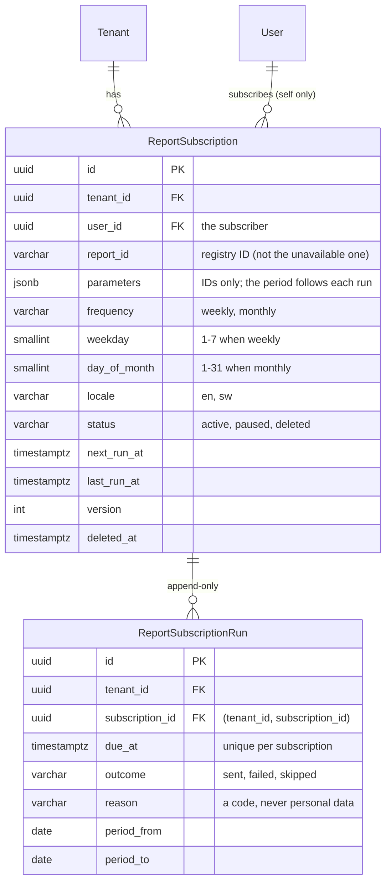

| Entity | Table | Notes |
|---|---|---|
| ReportSubscription | `report_subscriptions` | A user's own scheduled report: `report_id`, `parameters` (JSON object of IDs, ≤ 2,000 bytes), `frequency` with `weekday` **or** `day_of_month`, `locale`, `status` `active ⇄ paused`, either → `deleted` (final; `deleted_at`, `next_run_at` cleared), `next_run_at` (required while active), `last_run_at` (only forward), `version` (moves exactly on a status change). `app.guard_report_subscription`: created only by the signed-in user for themselves as a member, starting active at version 1; changed only by the subscriber; report, parameters, schedule, language and creation time never change. Partial index `report_subscriptions_due_idx (next_run_at) WHERE status = 'active'`; partial unique `report_subscriptions_live_key (tenant_id, user_id, report_id, parameters, frequency, weekday, day_of_month) WHERE status <> 'deleted'` (409 `subscription-exists`). Both partial indexes live in the migration only (Prisma does not model them). The scheduler reads due rows across companies only through `app.due_report_subscriptions(limit)` (SECURITY DEFINER; company, ID and due time; a `report_subscriptions_due_scan` policy limited to the schema owner). |
| ReportSubscriptionRun | `report_subscription_runs` | One row per subscription and due time (unique), recorded as the subscriber of an active subscription and never before it is due: `outcome` `sent`; `skipped` with `permission-lost`, `membership-ended`, `report-unavailable` or `no-email-address`; `failed` with `delivery-failed`; the period reported on (range reports). Append-only for every role (`app.guard_report_subscription_run`, TRUNCATE refused). No report data. |

---

## Coverage: brief §10 entities → model

| Brief entity | Modelled as | Brief entity | Modelled as |
|---|---|---|---|
| Tenant | `Tenant` (+ `Subscription`) | Store | `Store` |
| User | `User`, `Credential`, `MfaFactor`, `Session`, `RefreshToken` | StockLedgerEntry | `StockLedgerEntry` (append-only) |
| Role / Permission | `Role`, `Permission`, `RolePermission`, `MembershipRole` | StockTake | `StockTake`, `StockTakeLine` |
| ProjectMembership | `ProjectMembership` | Labourer | `Labourer`, `ProjectEngagement` |
| Project / Site / Geofence | `Project`, `Site`, `Geofence`, `Client` | Trade / SkillLevel | `Trade`, `Labourer.skill_level` enum |
| Phase/WBS / Milestone | `WbsNode`, `Milestone` | Accreditation | `Accreditation` |
| ScheduleActivity | `ScheduleActivity`, `ActivityDependency`, `ScheduleBaseline`, `DelayEvent` | Gang / GangAssignment | `Gang`, `GangAssignment` |
| BQ / BQVersion | `Bq`, `BqVersion`, `BqImportJob` (implemented as `bq_imports`), `BqMappingTemplate` | BiometricEnrolment | `BiometricEnrolment`, `BiometricTemplate` |
| BQBill / BQSection / BQItem | `BqBill`, `BqSection`, `BqItem` | Consent | `Consent` |
| RateBuildUp | `RateBuildUp`, `RateBuildUpComponent` | AttendanceDevice / AttendanceEvent | `AttendanceDevice`, `AttendanceEvent`, `AttendanceAnomaly` |
| VariationOrder / Instruction | `VariationOrder`, `VariationLine`, `Instruction`, `Consultant` | Timesheet | `Timesheet`, `TimesheetLine` |
| ProgressMeasurement | `ProgressMeasurement` | OvertimeRule / PublicHoliday | `OvertimeRule`, `PublicHoliday` |
| Valuation / PaymentCertificate | `Valuation`, `ValuationLine`, `PaymentCertificate` | PayPeriod / PayrollBatch / PayrollLine | `PayPeriod`, `PayrollBatch`, `PayrollLine`, `PayrollLineItem`, `Approval` |
| Retention | `RetentionEntry` | StatutoryRule | `StatutoryRule`, `StatutoryRuleBand`, `EngagementDeductionRule` |
| Material / Unit / UnitConversion | `Material`, `Unit`, `UnitConversion`, `MaterialPrice` | Advance | `Advance`, `AdvanceRecovery` |
| Supplier | `Supplier`, `SupplierUser` | PieceRateJob / Subcontract | `PieceRateJob`, `Subcontract`, `SubcontractItem`, `Subcontractor` |
| Requisition / RFQ / Quotation | `Requisition`, `Rfq`, `Quotation` (+ lines) | Payment / PaymentProviderRequest / PaymentCallback | `Payment`, `PaymentChannel`, `PaymentProviderRequest`, `PaymentCallback` |
| LPO | `Lpo`, `LpoLine` | Reconciliation | `Reconciliation`, `ReconciliationItem` |
| GoodsReceivedNote | `Grn`, `GrnLine`, `GrnPhoto` | Expense / PettyCashFloat | `Expense`, `PettyCashFloat`, `PettyCashTopUp`, `PettyCashCount`, `CostEntry`, `Budget`, `Commitment` |
| SupplierInvoice | `SupplierInvoice`, `SupplierInvoiceLine`, `ThreeWayMatch` | SiteDiary / Photo | `SiteDiary`, `DiaryLine`, `Photo` |
| Inspection / Snag | `Inspection`, `ChecklistTemplate`, `InspectionResult`, `TestResult`, `Snag` | Document / ComplianceItem | `Document`, `DocumentVersion`, `File`, `ComplianceItem` |
| SafetyIncident / ToolboxTalk / PPEIssue | `SafetyIncident`, `CorrectiveAction`, `ToolboxTalk`, `InductionRecord`, `PpeIssue` | Plant / PlantUsage / FuelIssue | `Plant`, `PlantUsage`, `FuelIssue`, `PlantMaintenance` |
| Notification | `Notification`, `NotificationTemplate`, `NotificationPreference`, `Alert` | AuditLog | `AuditLog` (hash-chained, append-only) |

**Added beyond the brief:**
- `Client`, `Consultant` and `Subcontractor` as parties.
- `ConfigRule`, `EngagementDeductionRule`, `MpesaTariff` and `FxRate` for configurability.
- `OutboxEvent`, `IdempotencyRecord`, `SyncChange` and `DeviceSyncState` for reliability and offline sync.
- `DataSubjectRequest` for Data Protection Act rights, and `DpiaRecord` for the biometric go-live gate.
- `Alert` as one inbox for anomalies and thresholds.
