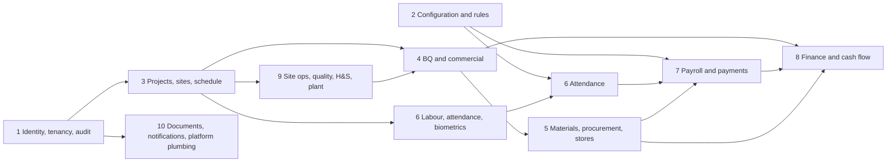
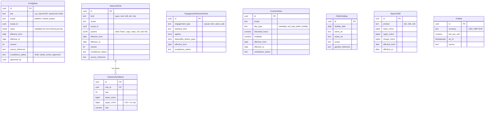
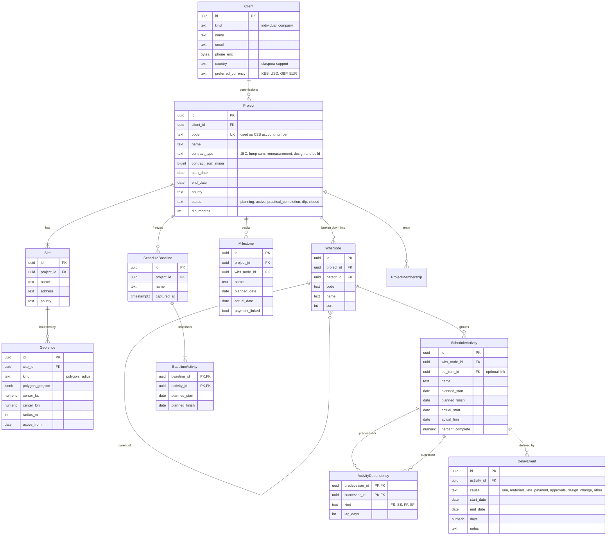
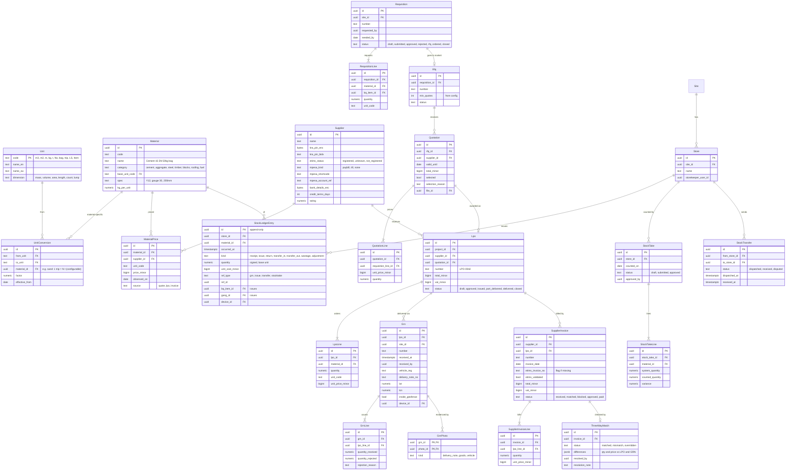
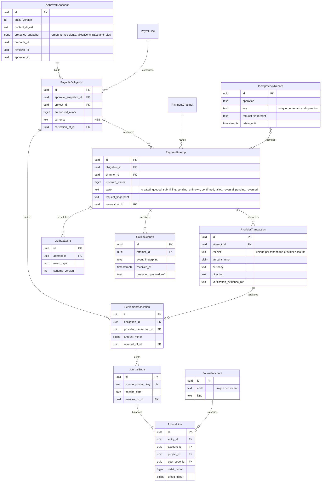

# PM-Buddy: Entity Relationship Diagrams

> Phase 0 draft, refined from brief §10. The diagrams are split by domain so they stay readable. Each one shows **key attributes only**. The full column set lives in the Prisma schema from D1.1 onwards. Related: [ARCHITECTURE](./ARCHITECTURE.md) · [OpenAPI outline](./api/openapi-outline.yaml)

## Conventions (apply to every tenant-owned table)

| Convention | Rule |
|---|---|
| Standard columns | `tenant_id`, `created_at`, `created_by`, `updated_at`, `updated_by`, plus `deleted_at` where soft delete applies and `version` on editable aggregates. **They are left out of the diagrams below.** |
| Tenant isolation | RLS on `tenant_id`. Parents expose `UNIQUE (tenant_id, id)`, and child FKs are composite `(tenant_id, parent_id)` (ARCHITECTURE §6). |
| IDs | UUIDv7 (`uuid`) |
| Money | `*_minor` = `bigint` cents, with a `currency` column where it can differ from KES |
| Quantities and rates | `numeric(20,4)` |
| Encrypted fields | `*_enc` = envelope-encrypted `bytea`. `*_bidx` = blind index for exact lookup. |
| Append-only | Marked "append-only": no `UPDATE` or `DELETE` granted to the app role; corrections are new rows |
| Effective dating | Configuration tables carry `effective_from`, `effective_to`, `version`, `source_reference` and `compliance_status` |

Immutable event/journal/audit records have creation metadata and linked corrections, not mutable update/soft-delete semantics. Retention and deletion follow a reviewed data-class/legal-hold policy. The runtime Prisma schema and migrations, not these draft diagrams, prove implementation.

## Domain map

---

## 1. Identity, tenancy and audit

> **Implemented in D1.4 (differs from the target model above):** system roles and their permissions are code constants (`packages/types` `SYSTEM_ROLE_PERMISSIONS`), not `Role` rows. Company custom roles are `tenant_roles (tenant_id, id, name citext, permissions text[], tenant_wide)` with forced RLS. `memberships` and `invitations` hold `role` (a system key, or `custom`) plus `custom_role_id`, referencing `tenant_roles` through the composite key `(tenant_id, custom_role_id)`. Permission keys are checked by database CHECK constraints rather than a `Permission` table. `ProjectMembership.permissions` holds the project assignment (effective = role ∩ assignment). See [ARCHITECTURE §8](./ARCHITECTURE.md#8-authorisation-rbac-with-project-scope).

## 2. Configuration and rules (effective-dated)

## 3. Projects, sites and schedule

**Implemented in D2.1** (migration `20261110100000_projects_sites_geofences`; [ARCHITECTURE §4.1](./ARCHITECTURE.md#41-projects-module-d21)). The model above remains the target; the implemented tables differ as follows.

| Entity | Implemented as | Difference from the target model |
|---|---|---|
| Client | Not yet a table | `projects.client_name`, `client_email`, `client_phone` hold a simple contact until the client portal (D7.1) introduces `Client` and `client_id`. |
| Project | `projects` | `code` is unique per company (`PRJ-001…` assigned when omitted; existing rows were backfilled). `status` is `planning, active, on_hold, completed, closed, cancelled` with transitions in `app.guard_project`; practical completion and the defects liability period (`dlp_months`) join with valuations and retentions (D6.x). `contract_type` is `lump_sum, remeasurement, design_and_build, cost_plus, labour_only` (JBC is a standard form, not a pricing basis). Adds `description`, `town`, optional `latitude`/`longitude`, `currency` (KES only), `version` (optimistic concurrency), `created_by`, `updated_at`. |
| ProjectStatusChange | `project_status_changes` | New: append-only history of transitions (`from_status`, `to_status`, `reason`, `changed_by`, `changed_at`). |
| Site | `sites` | `name` (unique per project), `address` (address or landmark) and `version`; the county stays on the project. Sites cannot be deleted yet (attendance will reference them). |
| Geofence | `site_geofences` | One row per **version** (`version`, `effective_from timestamptz` set by the database, strictly increasing per site) instead of `active_from date`, so the version in force at a capture time is exact. A polygon is a jsonb array of `{lat,lng}` vertices (open ring) rather than GeoJSON; a radius is `center_lat`/`center_lng`/`radius_m`. `area_m2` and `perimeter_m` are stored. Rows are never updated or deleted. |
| WbsNode | `wbs_nodes` | Adds `weight_basis_points` (share of the parent, 10,000 = 100 %), `sort_order` (for `sort`) and `version`; the parent is referenced through `(tenant_id, project_id, parent_id)`. Codes are unique per project. |
| Milestone | `milestones` | `due_date` (for `planned_date`), `status` (`planned, in_progress, achieved, cancelled`), `actual_date`, `status_reason`, `version`; names are unique per project. `payment_linked` waits for valuations (D6.x). |
| ProjectMembership | `project_memberships` | `project_permissions_check` widened to the project-scoped catalogue (`PROJECT_ASSIGNABLE_PERMISSIONS`). |

## 4. BQ, variations, valuations and subcontracts

## 5. Materials, procurement and stores

## 6. Labour, attendance and biometrics

## 7. Payroll and payments

The original draft diagram below is retained for context. Its combined `Payment` and `PaymentProviderRequest` model and status labels are superseded by **§7.1**, [WORKFLOWS.md](./WORKFLOWS.md) and [FINANCIAL_MODEL.md](./FINANCIAL_MODEL.md). Do not implement the draft's one-payment-per-payroll-line assumption or use its flags as independent settlement truth.

### 7.1 Canonical obligation, attempt, allocation and journal boundaries

Conceptual design for Phase 4; not implemented by foundation migrations.

Every tenant-owned relation uses tenant-consistent foreign keys and runtime-role RLS. Settlement/reservation transactions lock the obligation; total allocations cannot exceed authorised outstanding. Each journal balances exactly, remains immutable and retains project/cost-code lineage. Inbox intake is durable before callback acknowledgement; queue processing state lives separately from append-only evidence. Unknown attempts retain reservations and require reconciliation before a new payout.

## 8. Finance: costs, budgets, petty cash and cash flow

> **Cash-flow forecast** is a read model (`cash_flow_forecast_v`), not a table. It combines upcoming payroll (open pay periods × rates), approved LPOs not yet paid (`Commitment`), issued payment certificates not yet paid, and client instalment schedules.

## 9. Site operations: diary, photos, quality, H&S, plant

```mermaid
erDiagram
  Site ||--o{ SiteDiary : "daily"
  SiteDiary ||--o{ DiaryLine : "records"
  Site ||--o{ Photo : "evidence"
  Photo }o--o| BqItem : "tagged to"
  Project ||--o{ Inspection : "inspected"
  ChecklistTemplate ||--o{ Inspection : "uses"
  Inspection ||--o{ InspectionResult : "items"
  Project ||--o{ TestResult : "tests"
  Project ||--o{ Snag : "defects"
  Site ||--o{ SafetyIncident : "reports"
  SafetyIncident ||--o{ CorrectiveAction : "requires"
  Site ||--o{ ToolboxTalk : "holds"
  ToolboxTalk ||--o{ ToolboxTalkAttendance : "attended by"
  Labourer ||--o{ InductionRecord : "inducted"
  Labourer ||--o{ PpeIssue : "issued"
  Plant ||--o{ PlantUsage : "used"
  Plant ||--o{ FuelIssue : "fuelled"
  Plant ||--o{ PlantMaintenance : "maintained"

  SiteDiary {
    uuid id PK
    uuid site_id FK
    date diary_date UK "one per site per day"
    jsonb weather
    jsonb workforce_by_trade "auto-filled from attendance"
    text status "draft, submitted, approved, locked"
    uuid submitted_by
    uuid approved_by
    bytea signature
  }
  DiaryLine {
    uuid id PK
    uuid diary_id FK
    text kind "work_done, material_received, material_used, plant, visitor, instruction, delay, incident"
    text ref_type
    uuid ref_id
    text description
    numeric quantity
    text unit_code
  }
  Photo {
    uuid id PK
    uuid file_id FK
    uuid site_id FK
    uuid bq_item_id FK
    timestamptz device_time
    timestamptz exif_time
    timestamptz server_received_at
    numeric lat
    numeric lon
    bool inside_geofence
    bool verified "server-verified badge"
    jsonb verification_reasons
    text sha256
    text location_label "Block A, 2nd floor"
    uuid device_id FK
  }
  ChecklistTemplate {
    uuid id PK
    text name "setting out, foundation, slab, roofing"
    jsonb items
  }
  Inspection {
    uuid id PK
    uuid project_id FK
    uuid template_id FK
    text kind "internal, county, consultant"
    date inspected_on
    text result "pass, fail, conditional"
    uuid signed_off_by
  }
  InspectionResult {
    uuid id PK
    uuid inspection_id FK
    text item_key
    text result
    uuid photo_id FK
  }
  TestResult {
    uuid id PK
    uuid project_id FK
    text kind "cube_7d, cube_28d, slump"
    text sample_ref
    uuid bq_item_id FK
    date cast_on
    date tested_on
    numeric value
    numeric spec_min
    bool pass
    uuid file_id FK
  }
  Snag {
    uuid id PK
    uuid project_id FK
    text location
    text description
    uuid assigned_to
    date due_date
    text status "open, fixed, verified, closed"
  }
  SafetyIncident {
    uuid id PK
    uuid site_id FK
    timestamptz occurred_at
    text kind "incident, near_miss, first_aid"
    text severity
    text description
    bool wiba_reportable "COMPLIANCE-REVIEW"
    text status
  }
  CorrectiveAction {
    uuid id PK
    uuid incident_id FK
    text description
    uuid owner_user_id
    date due_date
    text status
  }
  ToolboxTalk {
    uuid id PK
    uuid site_id FK
    date held_on
    text topic
    uuid conducted_by
  }
  ToolboxTalkAttendance {
    uuid talk_id PK, FK
    uuid labourer_id PK, FK
  }
  InductionRecord {
    uuid id PK
    uuid labourer_id FK
    uuid site_id FK
    date inducted_on
    uuid inducted_by
  }
  PpeIssue {
    uuid id PK
    uuid labourer_id FK
    text item "helmet, boots, vest, gloves, harness, goggles"
    date issued_on
    int quantity
    date returned_on
  }
  Plant {
    uuid id PK
    text code
    text name "concrete mixer, poker vibrator, excavator"
    text ownership "owned, hired"
    uuid supplier_id FK "hire company"
    bigint hire_rate_minor
    text hire_rate_basis "hour, day, week, month"
    text status
  }
  PlantUsage {
    uuid id PK
    uuid plant_id FK
    uuid site_id FK
    date used_on
    numeric hours
    uuid operator_labourer_id FK
    uuid bq_item_id FK
  }
  FuelIssue {
    uuid id PK
    uuid plant_id FK
    uuid site_id FK
    date issued_on
    numeric litres
    bigint unit_cost_minor
    numeric meter_reading
    uuid stock_ledger_entry_id FK
  }
  PlantMaintenance {
    uuid id PK
    uuid plant_id FK
    text kind "breakdown, service, repair"
    timestamptz start_at
    timestamptz end_at
    bigint cost_minor
  }
```

## 10. Documents, compliance, notifications and platform plumbing

```mermaid
erDiagram
  Project ||--o{ Document : "stores"
  Document ||--|{ DocumentVersion : "versions"
  File ||--o{ DocumentVersion : "content"
  Project ||--o{ ComplianceItem : "registers"
  Document ||--o{ ComplianceItem : "evidences"
  NotificationTemplate ||--o{ Notification : "renders"
  User ||--o{ NotificationPreference : "sets"
  User ||--o{ Notification : "receives"
  Project ||--o{ Alert : "raises"
  Consultant ||--o{ Instruction : "issues"
  Subcontractor ||--o{ Subcontract : "holds"
  Supplier ||--o{ SupplierUser : "portal users"
  User ||--o{ SupplierUser : "acts for"
  Device ||--o| DeviceSyncState : "sync cursor"

  File {
    uuid id PK
    text bucket
    text object_key
    text content_type "sniffed from magic bytes"
    bigint size_bytes
    text sha256
    text status "quarantine, clean, infected, rejected"
    jsonb exif
    uuid uploaded_by
  }
  Document {
    uuid id PK
    uuid project_id FK
    text category "drawing, contract, bq, permit, certificate, insurance, other"
    text title
    uuid current_version_id FK
  }
  DocumentVersion {
    uuid id PK
    uuid document_id FK
    int version_no
    uuid file_id FK
    text notes
  }
  ComplianceItem {
    uuid id PK
    uuid project_id FK "null = company-level"
    text kind "county_approval, nca_project_registration, nca_contractor_registration, nca_levy, nema_licence, car_insurance, wiba_insurance, osh_registration, site_signboard"
    text reference_no
    date issued_on
    date expires_on
    uuid document_id FK
    jsonb reminder_days "e.g. 60, 30, 7"
    text status "valid, expiring, expired, missing"
  }
  NotificationTemplate {
    uuid id PK
    text event_key "payment.sent, approval.pending, stock.low"
    text channel "sms, whatsapp, email, push"
    text locale "en, sw"
    int version
    text body_icu
    text whatsapp_template_name
  }
  Notification {
    uuid id PK
    uuid recipient_user_id FK
    bytea recipient_phone_enc "labourers without accounts"
    text channel
    text event_key
    uuid template_id FK
    jsonb payload
    text status "queued, sent, delivered, failed"
    text provider_message_id
    int attempts
  }
  NotificationPreference {
    uuid user_id PK, FK
    text event_key PK
    text channel PK
    bool enabled
  }
  Alert {
    uuid id PK
    uuid project_id FK
    text kind "budget_threshold, unusual_spend, duplicate_payment, missing_documents, material_variance, low_stock, attendance_anomaly, accreditation_expiry, document_expiry, casual_conversion, unusual_payout, unmatched_callback, price_change, name_mismatch"
    text severity "info, warning, critical"
    text ref_type
    uuid ref_id
    jsonb details
    text status "open, acknowledged, resolved"
    uuid assigned_to
  }
  Consultant {
    uuid id PK
    text name
    text discipline "architect, structural, qs, services"
    text firm
    text email
  }
  Subcontractor {
    uuid id PK
    text name
    bytea kra_pin_enc
    text nca_category
    text mpesa_kind
    text mpesa_shortcode
    bytea bank_details_enc
  }
  SupplierUser {
    uuid supplier_id PK, FK
    uuid user_id PK, FK
  }
  OutboxEvent {
    uuid id PK
    text aggregate_type
    uuid aggregate_id
    text event_type
    jsonb payload
    timestamptz published_at
    int attempts
  }
  IdempotencyRecord {
    text key PK
    uuid user_id
    text request_sha256
    int status_code
    jsonb response
    timestamptz expires_at
  }
  SyncChange {
    bigint seq PK "per tenant change log"
    uuid site_id FK
    text entity_type
    uuid entity_id
    text op "upsert, delete"
    timestamptz changed_at
  }
  DeviceSyncState {
    uuid device_id PK, FK
    bigint last_pull_seq
    timestamptz last_push_at
    timestamptz anchor_server_time
    bigint anchor_elapsed_ms
    text anchor_boot_id
  }
```

---

## Coverage: brief §10 entities → model

| Brief entity | Modelled as | Brief entity | Modelled as |
|---|---|---|---|
| Tenant | `Tenant` (+ `Subscription`) | Store | `Store` |
| User | `User`, `Credential`, `MfaFactor`, `Session`, `RefreshToken` | StockLedgerEntry | `StockLedgerEntry` (append-only) |
| Role / Permission | `Role`, `Permission`, `RolePermission`, `MembershipRole` | StockTake | `StockTake`, `StockTakeLine` |
| ProjectMembership | `ProjectMembership` | Labourer | `Labourer`, `ProjectEngagement` |
| Project / Site / Geofence | `Project`, `Site`, `Geofence`, `Client` | Trade / SkillLevel | `Trade`, `Labourer.skill_level` enum |
| Phase/WBS / Milestone | `WbsNode`, `Milestone` | Accreditation | `Accreditation` |
| ScheduleActivity | `ScheduleActivity`, `ActivityDependency`, `ScheduleBaseline`, `DelayEvent` | Gang / GangAssignment | `Gang`, `GangAssignment` |
| BQ / BQVersion | `Bq`, `BqVersion`, `BqImportJob`, `BqMappingTemplate` | BiometricEnrolment | `BiometricEnrolment`, `BiometricTemplate` |
| BQBill / BQSection / BQItem | `BqBill`, `BqSection`, `BqItem` | Consent | `Consent` |
| RateBuildUp | `RateBuildUp`, `RateBuildUpComponent` | AttendanceDevice / AttendanceEvent | `AttendanceDevice`, `AttendanceEvent`, `AttendanceAnomaly` |
| VariationOrder / Instruction | `VariationOrder`, `VariationLine`, `Instruction`, `Consultant` | Timesheet | `Timesheet`, `TimesheetLine` |
| ProgressMeasurement | `ProgressMeasurement` | OvertimeRule / PublicHoliday | `OvertimeRule`, `PublicHoliday` |
| Valuation / PaymentCertificate | `Valuation`, `ValuationLine`, `PaymentCertificate` | PayPeriod / PayrollBatch / PayrollLine | `PayPeriod`, `PayrollBatch`, `PayrollLine`, `PayrollLineItem`, `Approval` |
| Retention | `RetentionEntry` | StatutoryRule | `StatutoryRule`, `StatutoryRuleBand`, `EngagementDeductionRule` |
| Material / Unit / UnitConversion | `Material`, `Unit`, `UnitConversion`, `MaterialPrice` | Advance | `Advance`, `AdvanceRecovery` |
| Supplier | `Supplier`, `SupplierUser` | PieceRateJob / Subcontract | `PieceRateJob`, `Subcontract`, `SubcontractItem`, `Subcontractor` |
| Requisition / RFQ / Quotation | `Requisition`, `Rfq`, `Quotation` (+ lines) | Payment / PaymentProviderRequest / PaymentCallback | `Payment`, `PaymentChannel`, `PaymentProviderRequest`, `PaymentCallback` |
| LPO | `Lpo`, `LpoLine` | Reconciliation | `Reconciliation`, `ReconciliationItem` |
| GoodsReceivedNote | `Grn`, `GrnLine`, `GrnPhoto` | Expense / PettyCashFloat | `Expense`, `PettyCashFloat`, `PettyCashTopUp`, `PettyCashCount`, `CostEntry`, `Budget`, `Commitment` |
| SupplierInvoice | `SupplierInvoice`, `SupplierInvoiceLine`, `ThreeWayMatch` | SiteDiary / Photo | `SiteDiary`, `DiaryLine`, `Photo` |
| Inspection / Snag | `Inspection`, `ChecklistTemplate`, `InspectionResult`, `TestResult`, `Snag` | Document / ComplianceItem | `Document`, `DocumentVersion`, `File`, `ComplianceItem` |
| SafetyIncident / ToolboxTalk / PPEIssue | `SafetyIncident`, `CorrectiveAction`, `ToolboxTalk`, `InductionRecord`, `PpeIssue` | Plant / PlantUsage / FuelIssue | `Plant`, `PlantUsage`, `FuelIssue`, `PlantMaintenance` |
| Notification | `Notification`, `NotificationTemplate`, `NotificationPreference`, `Alert` | AuditLog | `AuditLog` (hash-chained, append-only) |

**Added beyond the brief:**
- `Client`, `Consultant` and `Subcontractor` as parties.
- `ConfigRule`, `EngagementDeductionRule`, `MpesaTariff` and `FxRate` for configurability.
- `OutboxEvent`, `IdempotencyRecord`, `SyncChange` and `DeviceSyncState` for reliability and offline sync.
- `DataSubjectRequest` for Data Protection Act rights, and `DpiaRecord` for the biometric go-live gate.
- `Alert` as one inbox for anomalies and thresholds.
