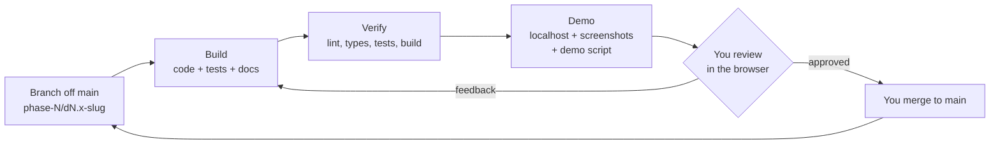

# PM-Buddy: Delivery Roadmap

This is the end-to-end delivery plan for [PROJECT_BRIEF.md](./PROJECT_BRIEF.md). The brief's ten phases (0–9) are split into **32 small deliverables**. Each one is built and reviewed on its own, and each ends with a frontend you can click through and approve.

> Status legend: ⏳ in progress · 🔎 in review · ✅ approved · ⬜ not started

---

## 1. How each deliverable works

1. **Branch.** Every deliverable gets its own branch off `main`, named like `phase-1/d1.3-auth-mfa`. Commits follow [Conventional Commits](https://www.conventionalcommits.org/), for example `feat(auth): add TOTP enrolment`.
2. **Build.** Code, unit and integration tests, docs, and `.env.example` all get updated together. Seed data grows with each deliverable.
3. **Verify.** Lint, type checks, tests and the build must all pass locally (and in CI from D1.1 onwards).
4. **Demo.**
   - The app runs at **http://localhost:3000** (web). The API runs at http://localhost:4000 from D1.1.
   - I share screenshots of each new screen in English and Kiswahili, light and dark.
   - I add a step-by-step script in `docs/demos/phase-N.md`.
5. **Review.** You click through the screens and reply **"approved"** or give feedback. Feedback gets fixed on the same branch.
6. **Merge.** You merge the branch, and the next deliverable branches off the updated `main`.

### What you get at every review gate

- A list of the new screens and flows to try, with direct URLs.
- A summary of what was built, the assumptions I made and any open questions.
- New configuration values, recorded in [CONFIGURATION.md](./CONFIGURATION.md) and flagged `COMPLIANCE-REVIEW` where relevant.
- Updates to [COMPLIANCE_TODO.md](./COMPLIANCE_TODO.md) and [QUESTIONS.md](./QUESTIONS.md).

### Definition of done (every deliverable)

- [ ] Code, tests and docs are updated, and the checks are green (CI from D1.1).
- [ ] No secrets are committed, and `.env.example` is up to date.
- [ ] New configuration values are documented with their source and `COMPLIANCE-REVIEW` status.
- [ ] All new UI strings exist in **English and Kiswahili** (`pnpm --filter @pm-buddy/web i18n:check` passes). Money is shown as `KES 1,250,000`, dates as `DD/MM/YYYY`, in the `Africa/Nairobi` timezone.
- [ ] The UI works in light and dark mode, is keyboard accessible, and targets WCAG 2.2 AA.
- [ ] The demo script is updated in `docs/demos/phase-N.md`.
- [ ] Tenant isolation tests cover every new table (from D1.4).

---

## 2. Deliverables

Size is relative effort (S < M < L < XL). It's not a calendar estimate.

### Phase 0: Design

| ID | Deliverable | What you'll review in the browser | Done when | Size | Status |
|---|---|---|---|---|---|
| **D0** | Design pack: [architecture](./ARCHITECTURE.md), [ERD](./ERD.md), [OpenAPI outline](./api/openapi-outline.yaml), [threat model](./THREAT_MODEL.md), [DPIA template](./DPIA_TEMPLATE.md), [compliance TODO](./COMPLIANCE_TODO.md), [configuration register](./CONFIGURATION.md), [questions](./QUESTIONS.md), plus a **clickable UI prototype** (mock data only) | Sign-in + MFA, app shell, owner dashboard, project overview, BQ + import mapping, labour registry, attendance muster roll, payroll approval with M-Pesa statuses, client portal with STK Push, site-app phone mockups, EN/SW toggle, dark mode | You approve the docs and the look and feel | L | ✅ |

### Phase 1: Foundation

| ID | Deliverable | What you'll review | Done when | Size | Status |
|---|---|---|---|---|---|
| D1.1 | **Workspace, tooling and CI**: • pnpm + Turborepo packages: `types`, `validation`, `domain`, `config` • NestJS API skeleton with health/readiness, OpenAPI docs, pino logging and OpenTelemetry hooks • Prisma base migration, database roles for row-level security • docker-compose with PostgreSQL 18, Valkey, RustFS (S3-compatible) and Mailpit (D-24) • GitHub Actions: lint, types, tests, build, e2e, CodeQL, gitleaks, dependency review; Dependabot | Live `/status` page (the first screen on the real API); API docs at `/api/docs`; health endpoints; prototype still runs | `pnpm dev` starts everything; CI is green on a PR | M | 🔎 |
| D1.2 | **Design system and i18n**: • Tokens and components extracted from the prototype • Shared EN/SW catalogues in an `i18n` package • KES, date and phone formatters with tests • Accessibility baseline (axe in Playwright) • PWA manifest | `/design-system` component gallery; app shell; language and theme switch | Gallery approved; formatter and a11y tests pass | M | ⬜ |
| D1.3 | **Authentication and MFA**: • Sign-up by email or phone; verification • Argon2id passwords • Short-lived access token + rotating refresh token in httpOnly cookies • TOTP and passkeys; OTP by SMS/WhatsApp (dev mock provider) • Step-up MFA; lockout and rate limits • Password reset; active sessions list | Sign-up, login, MFA enrolment, step-up dialog, sessions page | Users can sign up and log in with MFA; auth tests pass | L | ⬜ |
| D1.4 | **Tenancy, RBAC and audit**: • Create a company • Invite users • Roles and granular permissions, with project-scoped membership • Create a project • PostgreSQL RLS by `tenant_id` • Append-only, hash-chained audit log | Company onboarding, team and roles, project creation, audit log viewer | **Phase 1 acceptance:** users can sign up, log in with MFA, and create a company and project; tenant isolation tests pass | L | ⬜ |

### Phase 2: Projects and BQ

| ID | Deliverable | What you'll review | Done when | Size | Status |
|---|---|---|---|---|---|
| D2.1 | **Projects, sites and geofences**: polygon or radius geofences drawn on a map; WBS/phases; milestones; team assignment by role; project dashboard shell | Project list and detail, site map editor, team tab | Projects and sites with geofences persist and are tenant-isolated | M | ⬜ |
| D2.2 | **BQ import**: • `.xlsx` upload; sheet and header detection; column-mapping screen; saved mapping templates • Bill → Section → Item hierarchy • Preliminaries, provisional sums, PC sums, contingencies, dayworks and VAT • Totals reconciliation; BQ viewer; Excel and PDF export | Import wizard, BQ tree table, totals check | **A real Excel BQ imports correctly and totals match** | L | ⬜ |
| D2.3 | **BQ versions and variations**: Architect's/Engineer's Instructions; Variation Orders with an approval workflow; original vs revised contract sum; rate build-up library | VO list and approval, version compare, rate build-up editor | **Phase 2 acceptance** | M | ⬜ |

### Phase 3: Labour and attendance

| ID | Deliverable | What you'll review | Done when | Size | Status |
|---|---|---|---|---|---|
| D3.1 | **Labourer registry**: • Registration that blocks anyone under 18 • Field-level encryption for IDs, PINs and phone numbers • Trades, skill levels and rates • NCA accreditation with expiry alerts • Gangs • Consent capture (EN/SW) • Do-not-rehire flag | Registry table with saved views, worker side panel, registration form, consent screen | Registry works; encryption and under-18 tests pass | L | ⬜ |
| D3.2 | **Site app foundation (Expo, Android-first)**: login with device binding; kiosk mode; encrypted SQLite; push/pull sync engine; sync status UI | Expo app on your Android phone (Expo Go) or an emulator, plus a web preview | The app works offline and syncs when back online | L | ⬜ |
| D3.3 | **Attendance, fallback method first**: • QR/NFC worker card + photo + supervisor confirmation • Geofence checks; signed offline records; clock-drift detection • Anomaly rules: duplicates, two sites, impossible travel • Override workflow • Timesheet rules and public holidays • Muster roll in the web app | Kiosk check-in on the device, muster roll with flags, anomaly review | A foreman records attendance offline; it syncs correctly and anomalies are flagged | L | ⬜ |
| D3.4 | **Attendance, first biometric method** (chosen in [QUESTIONS.md](./QUESTIONS.md)): • Uses the `CaptureMethod` interface • Gated per tenant behind a signed-off DPIA • Template-only encrypted storage • Retention and deletion jobs | Enrolment and identification on the kiosk, consent and DPIA gate, deletion log | **Phase 3 acceptance** | XL | ⬜ |

### Phase 4: Payroll and M-Pesa

| ID | Deliverable | What you'll review | Done when | Size | Status |
|---|---|---|---|---|---|
| D4.1 | **Payroll engine**: • Daily, weekly, fortnightly or monthly pay periods • Gross pay from attendance, overtime, piece-rate output and allowances • Versioned statutory rules (PAYE, NSSF, SHIF, Housing Levy, NITA) • Advances with automatic recovery • Payslip preview; statutory export CSVs | Payroll batch builder, payslip preview, rule versions screen | Unit tests cover every rule boundary; seed rules are flagged `COMPLIANCE-REVIEW` | L | ⬜ |
| D4.2 | **Daraja integration**: • `PaymentProvider` interface with `DarajaProvider`: OAuth, STK Push + query, C2B, B2C, B2B, transaction status, account balance, reversal • Per-tenant credentials • Outbox + BullMQ • Callback hardening • Local mock Daraja server for success, failure, timeout, duplicate and out-of-order callbacks | Payments console: requests, callbacks, state timeline, unknown-callback alerts | Mock and sandbox flows pass the integration suite | XL | ⬜ |
| D4.3 | **Approvals and payouts**: • Maker-checker with step-up MFA and approval limits • Float check, then bulk B2C payout with per-worker status • Recipient name check • SMS payslips • Daily reconciliation and statement upload • M-Pesa charges booked as cost • Cash and bank payments; unusual-payout alerts | Approval flow, live payout statuses, reconciliation screen | **Phase 4 acceptance:** a weekly payroll for 40 workers pays out in sandbox with every callback reconciled; failed and duplicate cases are handled | L | ⬜ |

### Phase 5: Materials, stores and spending

| ID | Deliverable | What you'll review | Done when | Size | Status |
|---|---|---|---|---|---|
| D5.1 | **Catalogue and suppliers**: • Materials with Kenyan units and conversions (bags, tonnes, lorry trips, steel by length/kg) • Suppliers: KRA PIN, eTIMS, Paybill/Till, bank details, terms • Price history | Catalogue, unit conversions, supplier profile | Conversions are unit-tested | M | ⬜ |
| D5.2 | **Procure-to-pay**: • Requisition → approval → RFQ and quote comparison → LPO • Goods Received Note in the site app (offline, photos, GPS, vehicle reg) • Supplier invoice with eTIMS • Three-way match; B2B or bank payment | End-to-end procurement flow; match screen | **The three-way match blocks bad payments** | XL | ⬜ |
| D5.3 | **Stores**: stock ledger per site; issues to a BQ item or gang; returns and transfers; stock takes; wastage; low stock; theoretical vs actual consumption variance alerts | Stock ledger, stock take, variance alerts | **A variance alert fires on test data** | L | ⬜ |
| D5.4 | **Spending and cash flow** (brief §5.8): • Cost tagging • Petty cash floats; expenses with receipts • M-Pesa SMS parser • Budget vs actual vs committed; cash-flow forecast; spend alerts | Petty cash, expense capture, budget and cash-flow views | **Phase 5 acceptance** | M | ⬜ |

### Phase 6: Progress and valuations

| ID | Deliverable | What you'll review | Done when | Size | Status |
|---|---|---|---|---|---|
| D6.1 | **Site diary and quality**: • Daily diary with workforce auto-filled from attendance; sign-off and locking • Geotagged photos with server verification • Inspections and checklists; cube and slump tests • Snags; practical completion and defects liability period | Diary (site app and web), photo timeline, inspections, snags | A diary is locked after approval; photo metadata is verified | L | ⬜ |
| D6.2 | **Schedule**: Gantt with dependencies, milestones, baseline vs actual, delay log with causes | Gantt view, delay log | The baseline is frozen and variance is shown | M | ⬜ |
| D6.3 | **Measurement and valuations**: • Progress measured against BQ items, with photos • Earned value (PV, EV, AC, CPI, SPI) and S-curve • Interim valuations and payment certificates; retention and its release • Subcontracts and piece-rate links (brief §5.14) • Cost to complete | Measurement entry, EVM dashboard, valuation and certificate PDF | **Phase 6 acceptance:** an interim payment certificate generates correctly from measured progress | XL | ⬜ |

### Phase 7: Portals and self-service

| ID | Deliverable | What you'll review | Done when | Size | Status |
|---|---|---|---|---|---|
| D7.1 | **Client portal**: • Progress, S-curve and verified photo timeline; diary summaries • Certificates and statements; **pay via STK Push**; C2B Paybill instructions • Variation approvals • FX display (USD/GBP/EUR) | Client portal on mobile and desktop | A client can view progress and pay (sandbox) | L | ⬜ |
| D7.2 | **Supplier portal**: LPOs, deliveries, invoices with eTIMS, payment status, statements | Supplier portal | A supplier can see an LPO and submit an invoice | M | ⬜ |
| D7.3 | **Labourer USSD/SMS and notifications**: • Africa's Talking USSD menu (EN/SW) with ID + PIN • Notification centre: templates (EN/SW), preferences, WhatsApp | USSD simulator, notification settings and templates | **Phase 7 acceptance:** a labourer can check pay via USSD | M | ⬜ |

### Phase 8: Reports, H&S, plant and compliance

| ID | Deliverable | What you'll review | Done when | Size | Status |
|---|---|---|---|---|---|
| D8.1 | **Dashboards and reports**: owner dashboard; standard reports (muster roll, payroll, ledgers, stock, valuations, cost, reconciliation, audit); PDF/Excel export; scheduled emails | Reports centre, exports | All reports export | L | ⬜ |
| D8.2 | **Health and safety**: inductions, toolbox talks, PPE register, incidents and near misses, first aid, corrective actions | H&S module (site app and web) | Incident to corrective action flow works | M | ⬜ |
| D8.3 | **Plant and equipment**: owned and hired plant, usage, fuel issues and consumption, breakdowns, maintenance, operators | Plant register, fuel log | Fuel variance flagged | M | ⬜ |
| D8.4 | **Documents and compliance register**: versioned document repository; compliance items with expiry reminders; consultant instructions log | Documents, compliance register | **Phase 8 acceptance:** all reports export to PDF and Excel | M | ⬜ |

### Phase 9: Hardening and launch readiness

| ID | Deliverable | What you'll review | Done when | Size | Status |
|---|---|---|---|---|---|
| D9.1 | **Security**: OWASP ASVS L2 checklist; threat model refresh; header and CSP review; key rotation drill; pen-test preparation | Security checklist report | The checklist passes | L | ⬜ |
| D9.2 | **Performance and reliability**: k6 load tests (payroll payout, attendance sync); index and query tuning; degradation drills (M-Pesa, SMS down) | Load test report | Performance budget met | M | ⬜ |
| D9.3 | **Operations**: Terraform for the chosen cloud; backups with point-in-time recovery; **restore drill**; observability dashboards and alerts; deployment, incident and breach runbooks | Runbooks, dashboards | **Phase 9 acceptance:** restore drill documented | L | ⬜ |

---

## 3. Where each brief section lands

Some brief sections (§5.8, §5.14, §5.15) aren't assigned to a phase in the brief's phase table. This map places them.

| Brief section | Deliverables |
|---|---|
| §5.1 Projects and sites | D1.4 (create project), D2.1 |
| §5.2 Bill of Quantities | D2.2, D2.3, D6.3 |
| §5.3 Materials, procurement and stores | D5.1–D5.3 |
| §5.4 Labour management | D3.1 (productivity and ledger finished in D4.1/D6.3) |
| §5.5 Attendance and biometrics | D3.2–D3.4 |
| §5.6 Payroll | D4.1, D4.3 |
| §5.7 M-Pesa and payments | D4.2, D4.3, D7.1 (STK/C2B for clients), D5.2 (B2B for suppliers) |
| §5.8 Spending, budget and cash flow | D5.4 |
| §5.9 Progress and site diary | D6.1–D6.3 |
| §5.10 Client portal | D7.1 |
| §5.11 Documents and compliance register | D8.4 |
| §5.12 Health and safety | D8.2 |
| §5.13 Plant and equipment | D8.3 |
| §5.14 Subcontractors and piece-rate | D4.1 (piece-rate pay), D6.3 (subcontracts, retention) |
| §5.15 Notifications | Provider interface in D1.3 (OTP); events added in each deliverable; centre and preferences in D7.3 |
| §5.16 USSD and SMS | D7.3 |
| §5.17 Reports and dashboards | KPIs grow with each phase; full reports in D8.1 |
| §6 Kenyan compliance | Config register from D1.1; rules land with their modules; DPIA gate in D3.4 |
| §7 Security | Continuous; formal review in D9.1 |
| §8 Reliability and scalability | Continuous; formal tests in D9.2 |
| §11 Seed and demo data | Grows per deliverable: company/users (D1.4) → projects/BQ (D2) → 40 labourers + 2 months of attendance (D3) → payroll + sandbox transactions (D4) → suppliers/deliveries (D5) |

---

## 4. Go-live gates (outside the build)

These have legal or commercial lead times, so they should start early:

| Gate | Needed before | Owner |
|---|---|---|
| ODPC registration as data controller/processor | Any real personal data in production | Company |
| Signed DPIA per tenant | Turning on biometric attendance (D3.4) | Tenant + DPO |
| Safaricom Daraja production go-live (per tenant shortcode; B2C needs a bulk disbursement account) | Real M-Pesa payouts (D4.3) | Each tenant + Safaricom |
| Africa's Talking USSD code and SMS sender ID | USSD/SMS in production (D7.3) | Company |
| WhatsApp Business account and approved templates | WhatsApp notifications | Company |
| Legal and tax review of every `COMPLIANCE-REVIEW` item | Payroll in production | Company + advisers |
| Security review (subset of D9.1) | **Any real money moving**, even in a pilot | Engineering |

> **Pilot option:** a limited pilot with one contractor is possible after Phase 4, covering labour, attendance, payroll and M-Pesa. It would need the D9.1 security subset and the gates above first. See [QUESTIONS.md](./QUESTIONS.md).

---

## 5. Branches

| Deliverable | Branch |
|---|---|
| D0 | `phase-0/design-pack` |
| D1.1 | `phase-1/d1.1-workspace-ci` |
| D1.2 | `phase-1/d1.2-design-system-i18n` |
| D1.3 | `phase-1/d1.3-auth-mfa` |
| D1.4 | `phase-1/d1.4-tenancy-rbac-audit` |
| … | `phase-N/dN.x-<slug>` |
