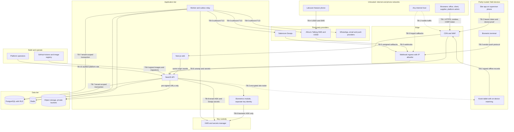

# PM-Buddy: Threat Model

> **Status:** Phase 0 draft for approval (D0). This is a living document. It is refreshed at the end of every deliverable and formally reviewed in **D9.1**.
>
> Related: [ARCHITECTURE](./ARCHITECTURE.md) · [ERD](./ERD.md) · [ROADMAP](./ROADMAP.md) · [DPIA template](./DPIA_TEMPLATE.md) · [Questions](./QUESTIONS.md) · [Compliance TODO](./COMPLIANCE_TODO.md)
>
> **Conventions.** "§14.4" means section 14.4 of [ARCHITECTURE.md](./ARCHITECTURE.md). "D4.2" is a deliverable in [ROADMAP.md](./ROADMAP.md). Entity names such as `AttendanceEvent` come from [ERD.md](./ERD.md). Configuration keys marked *proposed* are not yet in the configuration register and must be added there when the control is built.

---

## 1. Scope, method and maintenance

### 1.1 Scope

**In scope**

- Every container in §3: web app, API, worker and outbox relay, PostgreSQL behind PgBouncer, Redis, object storage, KMS or secrets manager, and the malware scanner hook.
- Field devices: the offline-first site app on supervisor phones, shared kiosk tablets, and biometric terminals (§12, §13).
- Integrations: Safaricom Daraja (§14), Africa's Talking USSD and SMS (§16), and WhatsApp, email and push (§15).
- CI/CD and the software supply chain (§20, §21), and platform administration (§4 `platform` module, §6.1 `pmb_platform` role).
- **Business processes where fraud is the main threat** (brief §2): muster roll, payroll, payouts, procurement and stores, petty cash, and progress and valuations.

**Out of scope for now** (revisit when decided): the chosen cloud provider's shared-responsibility controls (Phase 9), physical security of offices and sites, the internal security of Safaricom and Africa's Talking, and the future KRA eTIMS integration.

### 1.2 Method

1. **STRIDE per element.** For each element in the trust-boundary diagram (§4 of this document), we consider **S**poofing, **T**ampering, **R**epudiation, **I**nformation disclosure, **D**enial of service and **E**levation of privilege. Only credible, material threats are listed. Generic hygiene is covered by the ASVS mapping in §7.
2. **Domain abuse cases.** Misuse by legitimate insiders, and collusion between them, that STRIDE tends to miss: ghost workers, buddy punching, material theft and unrecorded cash. Each abuse case lists prevention, detection and the evidence the system keeps.
3. **Residual risk** is the risk that remains once the listed mitigations are built:

| Rating | Meaning | Required action |
|---|---|---|
| **L** | Unlikely, or limited impact | Accept and monitor |
| **M** | Plausible with material impact. Mitigations depend on detection, process or a pending decision | Track and review each phase |
| **H** | Plausible with severe impact (money, biometrics, cross-tenant data) and not yet adequately mitigated by the design | Reduce, or get explicit owner acceptance, before the relevant go-live gate |

IDs are stable. Threats are `T-xx`, abuse cases are `A-xx`, actors are `TA-xx`, trust boundaries are `TB-x` and open risks are `OR-xx`. Retired IDs are marked "retired" and never reused.

### 1.3 How to maintain this document

- **Every deliverable** (part of the definition of done): review the rows touched by new tables, endpoints, offline record types, roles, permissions or integrations. Add new IDs and update the residual rating and phase columns.
- **Out-of-cycle review** is triggered by: a new external integration or provider, a new capture method or biometric vendor, a new category of personal data, a change of hosting region, a security incident or near miss, a pen-test finding, or a change in Kenyan law or ODPC guidance.
- **Formal review in D9.1**, alongside the ASVS Level 2 checklist and pen-test preparation. The output is version 1.0, signed off by the product owner.
- **A mitigation counts as implemented only when it has a test** (see §8). Until then it is "designed".
- **Owner:** the engineering lead, until a security lead is appointed.

---

## 2. Assets (ranked)

| Rank | Asset | Why it matters | Where it lives | Main threats |
|---|---|---|---|---|
| 1 | **Money and payout integrity** | Direct loss. B2C and B2B payouts are effectively irreversible. | `PayrollBatch`, `Payment`, `PaymentProviderRequest`, the tenant's M-Pesa float | Float drain, duplicate payouts, payee swaps, forged callbacks |
| 2 | **M-Pesa (Daraja) credentials** | Whoever holds the consumer key and secret plus the initiator credential can pay out from a tenant's float **outside PM-Buddy** | KMS or secrets manager (`PaymentChannel.secret_ref`); OAuth tokens in Redis | Secret leakage, insiders, CI compromise |
| 3 | **Biometric templates** | Sensitive personal data that cannot be changed once leaked | `BiometricTemplate` (separate KEK), encrypted kiosk roster, terminals | Theft, function creep, vendor SDK exfiltration |
| 4 | **PII**: ID numbers, phones, KRA PINs, bank details, NSSF and SHA numbers, next of kin | Identity theft, SIM-swap targeting, loan-app fraud | `*_enc` columns and blind indexes, exports, notifications | Insider export, IDOR, backups |
| 5 | **Payroll data** | Wages, deductions and advances: both confidentiality and integrity | `PayrollLine`, `Timesheet`, `Advance` | Padding, disclosure, tampering |
| 6 | **Audit log integrity** | Evidence for disputes, fraud investigations and the ODPC | `AuditLog` (append-only, hash-chained) | Deletion, rewriting, gaps |
| 7 | **BQ and valuation integrity** | Decides what clients pay. Diaspora clients depend on it. | `BqVersion`, `ProgressMeasurement`, `Valuation`, `PaymentCertificate` | Manipulation, unapproved edits |
| 8 | **Photo and document evidence integrity** | Proof of delivery, progress and cash payments | Object storage, `Photo`, `File`, `GrnPhoto` | Reuse, substitution, EXIF forgery |
| 9 | **Availability of site sync** | Attendance and GRNs must never be lost, because wages depend on them | Device outbox, `/sync` API, queues | Device loss, sync storms, outages |
| 10 | **Tenant isolation** | A cross-tenant breach would end the platform's credibility | RLS, composite FKs, cache keys, storage paths | IDOR, RLS gaps, cache key mix-ups |

> Tenant isolation is ranked last only because its controls are structural (§6). Any isolation failure multiplies the impact on every other asset.
>
> **Supporting assets:** session and refresh tokens, device keys (Ed25519), KEKs and DEKs, blind-index keys, effective-dated statutory and payment configuration (§11), and USSD PINs.

---

## 3. Threat actors

| ID | Actor | Motivation | Access and capability | Assets at risk |
|---|---|---|---|---|
| TA-01 | **External attacker** | Money, data for resale, extortion | Internet only: credential stuffing, phishing, scanning, known CVEs | 1, 2, 4, 10 |
| TA-02 | **Malicious or compromised tenant user** | Personal gain, covering up mistakes | A valid account with some permissions in one tenant | 1, 5, 6, 7 |
| TA-03 | **Colluding foreman and workers** | Pay for days not worked, splitting ghost wages | Runs the muster roll and holds the site devices | 1, 5 |
| TA-04 | **Dishonest storekeeper colluding with a supplier** | Resell materials, bill for goods never delivered | Records GRNs and stock movements on a site device | 1, 7, 8 |
| TA-05 | **Insider finance clerk** | Divert payouts, hide cash | Prepares payroll, edits payee records, reconciles | 1, 4, 5 |
| TA-06 | **Compromised or lost site device** | Opportunistic thief or a rogue holder | Physical access, possibly a rooted phone | 3, 4, 9 |
| TA-07 | **Malicious other tenant** | Competitive intelligence, poaching workers, fraud | A valid account in a different tenant | 4, 10 |
| TA-08 | **Platform insider** (operator staff or contractor) | Curiosity, bribery, resale | Infrastructure, platform admin, CI | 2, 3, 4, 6 |
| TA-09 | **SIM-swap attacker** | Take over a victim's phone number | Social engineering of, or collusion with, mobile operator agents | 1, 4 |
| TA-10 | **Fake callback sender** | Make unpaid look paid, trigger releases | Can reach webhook URLs; knows Daraja payload formats | 1 |

---

## 4. Trust boundaries

| Boundary | What crosses it | Key controls |
|---|---|---|
| **TB-1** Internet → edge, web and API | Browser sessions, credentials, uploads | TLS, WAF, authentication, MFA and CSRF (§7), security headers (§18), rate limits |
| **TB-2** Field devices ↔ API | Sync batches, photos and signed offline records up; rosters, approvals and configuration down | Device binding (§7), Ed25519 record signatures (§12.2), verification and dedupe (§12.3), clock checks (§12.5) |
| **TB-3** Biometric terminal → webhook ingress | Punches in the vendor's push protocol | `AttendanceDeviceAdapter`, device registry and anomaly rules (§13) |
| **TB-4** Labourer phone → Africa's Talking | USSD input including ID and PIN; SMS | Menu design and PIN lockout (§7, §16) |
| **TB-5** Providers and the internet → webhook ingress | Daraja callbacks; Africa's Talking USSD, SMS and delivery webhooks; WhatsApp webhooks | Callback hardening (§14.4), WAF and IP allowlist (§20), USSD handling (§16) |
| **TB-6** Worker → providers | Payout instructions, message content | Secrets by reference (§14.1), provider interfaces (§15), outbox (§4) |
| **TB-7** Application tier → data tier | SQL with tenant context, cache entries, objects | RLS and database roles (§6.1), data rules (§9), file pipeline (§17) |
| **TB-8** Application tier → key custody | DEK unwrap, Daraja secrets | Envelope encryption and a separate biometric KEK (§10), per-tenant channels (§14.1) |
| **TB-9** CI/CD → runtime | Container images, migrations, mobile builds | SBOM, Trivy, cosign and manual production approval (§20) |
| **TB-10** Platform operators → tenant data | Platform admin actions, `pmb_platform` jobs | Database roles (§6.1), `platform` module (§4), audit (§9) |

---

## 5. STRIDE analysis per element

Columns: **ID**, **element**, **STRIDE** category, **threat**, **mitigation** (with ARCHITECTURE references), **residual** risk (L/M/H, see §1.2) and the **phase** (ROADMAP deliverable) that delivers the control. Where a control is not yet in ARCHITECTURE it is marked **Gap** and must be added in the named deliverable.

### 5.1 Web app (`apps/web`: office, client and supplier portals)

| ID | Element | STRIDE | Threat | Mitigation | Residual | Phase |
|---|---|---|---|---|---|---|
| T-01 | Web app | S | Credential stuffing or phishing of Owner and Finance accounts in order to approve payouts | Argon2id, breached-password blocklist, lockout and rate limits; mandatory TOTP or passkey MFA for Owner, Finance and Admin; step-up for approvals; session list with revoke (§7) | M: TOTP can be phished; prefer passkeys for approvers (OR-16) | D1.3 |
| T-02 | Web app | T, E | Stored XSS from imported or user text (BQ descriptions from Excel, diary notes, supplier names) used to act as the victim | React output encoding; lint ban on raw HTML injection; strict nonce-based CSP; httpOnly cookies so tokens cannot be read by script; Zod validation (§7, §18) | L | D1.2, D2.2 |
| T-03 | Web app | T | CSRF against state-changing calls (approve payroll, change a payee) | SameSite cookies, same-origin rewrites (D-16), double-submit `X-CSRF-Token`, Origin and Referer checks (§7) | L | D1.3 |
| T-04 | Web app | T | Clickjacking of approval screens | `frame-ancestors 'none'`; the approval dialog re-fetches amount and payee count from the server (§18) | L | D1.2 |
| T-05 | Web app | I | Payslips or PII left on shared or cyber-café computers (browser cache, PWA cache, downloaded exports) | Service worker caches the app shell only; `Cache-Control: no-store` on personal-data responses; masked fields by default (§8); shorter sessions for privileged roles (§7); exports through short-lived URLs (§17) | M | D1.2, D1.3 |
| T-06 | Web app | E | Client or supplier portal user reaches office functions by URL or direct API calls | Route groups are presentation only; every API call passes the policy guard with external-membership scope (§6.3, §8) | L | D1.4, D7.1, D7.2 |
| T-07 | Web app | I | A third-party script (analytics, chat widget, CDN library) reads page data | No third-party scripts on authenticated pages; self-hosted assets; nonce CSP (§18); dependency review (§21) | L | D1.2 |

### 5.2 API (`apps/api`, NestJS)

| ID | Element | STRIDE | Threat | Mitigation | Residual | Phase |
|---|---|---|---|---|---|---|
| T-08 | API | E | Broken object-level authorisation (IDOR): reading or changing another project's or tenant's records by ID | Tenant only from the session `tid`; project policy guard; fail-closed RLS; composite tenant FKs; generated tenant-isolation suite (§6.1, §6.3, §8) | L | D1.4 |
| T-09 | API | E | Mass assignment or property-level authorisation gaps: a client sets `status`, `approved_by`, `tenant_id` or a rate, or reads masked fields | Strict Zod schemas that reject unknown keys; state changes only through domain commands; response DTOs mask sensitive fields without `*.view_sensitive` (§6.1, §8) | L | D1.4 |
| T-10 | API | S | Forged or replayed access token | `jose` with pinned EdDSA/ES256; 10-minute TTL; `sid` checked against revoked sessions; rotating refresh tokens with reuse detection (§7) | L | D1.3 |
| T-11 | API | D | Resource and cost exhaustion: OTP SMS pumping, expensive exports, huge BQ imports, unbounded lists | Redis rate limits per identifier, IP and device; OTP quotas (§7); heavy work queued (§3); size and page caps; SMS spend alerts (§19) | M: SMS pumping costs real money | D1.3, D2.2, D9.2 |
| T-12 | API | R | An approver denies approving a payroll or changing a payee | Append-only, hash-chained audit with actor, IP, device and before/after (§9); `Approval.action_hash` binds step-up MFA to the entity and amount (§7) | L | D1.4, D4.3 |
| T-13 | API | T | Replayed or double-submitted financial requests create duplicates | `Idempotency-Key` required on financial endpoints and stored with the request hash in `IdempotencyRecord` (§14.4) | L | D4.2 |
| T-14 | API | I | Stack traces, SQL errors or PII in responses and logs | Problem+JSON without internals; pino redaction paths for phones, IDs, tokens and biometric fields; Sentry scrubbing (§19) | L | D1.1 |
| T-15 | API | T | Formula injection in CSV and Excel exports (statutory CSVs, reports) opened by Finance | Escape cells that start with `=`, `+`, `-`, `@`, tab or carriage return. **Gap:** add to §17 in D2.2 | L once added | D2.2, D8.1 |

### 5.3 Worker and queues (BullMQ, schedulers, outbox relay)

| ID | Element | STRIDE | Threat | Mitigation | Residual | Phase |
|---|---|---|---|---|---|---|
| T-16 | Worker/queues | T | A forged or altered job in Redis triggers a payout | Jobs carry IDs only. Before any payout the worker re-reads PostgreSQL and re-checks the approval chain, state machine and limits (§4 rule 2, §14.2, §14.3) | L | D4.2 |
| T-17 | Worker/queues | T | At-least-once delivery runs a payout job twice | Unique `OriginatorConversationID` and idempotency key per provider request; monotonic transitions; retries only after Transaction Status confirms "not processed" (§14.4, §14.5) | L | D4.2 |
| T-18 | Worker/queues | E | A job runs without tenant context and writes across tenants | Jobs carry `tenant_id` and set `app.tenant_id` per transaction; the worker uses `pmb_app`, so RLS applies; `pmb_platform` only for named, audited jobs (§6.1) | L | D1.4 |
| T-19 | Worker/queues | E | A malicious upload exploits a parser (Excel zip bomb, image decoder bug) | Quarantine, magic-byte sniffing, ClamAV hook, size limits (§17); sandboxed Excel parsing (D-13); thumbnails made in a low-privilege process | M | D2.2, D6.1 |
| T-20 | Worker/queues | I | SSRF from HTML-to-PDF rendering in headless Chromium reaches cloud metadata or internal services | Render trusted templates only, JavaScript off, block every network request except bundled assets, no user-supplied URLs. **Gap:** record in ARCHITECTURE when D-15 is decided | M until decided | D2.2 |
| T-21 | Worker/queues | D | Backlog (sync storm after connectivity returns, callback bursts, report jobs) delays payouts and OTPs | Separate queues and concurrency per priority (payments, OTP, sync, reports); backlog in readiness checks; queue-depth alerts (§19) | M | D9.2 |

### 5.4 PostgreSQL

| ID | Element | STRIDE | Threat | Mitigation | Residual | Phase |
|---|---|---|---|---|---|---|
| T-22 | PostgreSQL | E | RLS bypass through a new table without a policy, a view owned by the table owner, a `SECURITY DEFINER` function or a privileged connection | `ENABLE` and `FORCE` RLS; CI migration check; isolation suite generated from the model list; `pmb_app` without `BYPASSRLS` (§6.1); views created with `security_invoker`; definer functions only after review | L | D1.4 |
| T-23 | PostgreSQL | T | Audit log or append-only ledgers altered, or rows deleted | `pmb_app` has `INSERT`/`SELECT` only on `audit_log` and no `UPDATE`/`DELETE` on append-only tables (§6.1, §9); per-tenant hash chain verified on a schedule; chain heads exported to write-once storage (OR-07) | M: whoever holds `pmb_migrator` could still rewrite history | D1.4, D9.1 |
| T-24 | PostgreSQL | I | Backups, replicas or ad-hoc dumps expose PII and payroll | Sensitive fields are ciphertext in every copy (§10); encrypted backups with restricted access; restore drills use the same controls (§20); no production dumps on laptops | M | D9.3 |
| T-25 | PostgreSQL | T | SQL injection through raw SQL (reports, RLS helpers, search) | Prisma parameterised queries; raw SQL only through tagged templates; CodeQL (§21) | L | D1.1 |
| T-26 | PostgreSQL | D | Connection exhaustion or slow report queries starve financial transactions | PgBouncer transaction pooling (§3); statement timeouts per role; heavy reports on a read replica (§9) | M | D9.2 |

### 5.5 Object storage

| ID | Element | STRIDE | Threat | Mitigation | Residual | Phase |
|---|---|---|---|---|---|---|
| T-27 | Object storage | I | ID photos, worker photos or receipts exposed by a public bucket or a long-lived link | Private buckets; short-lived pre-signed GET only after an authorisation check (§17); tenant-prefixed object keys; bucket policy checked in IaC | L | D1.1, D3.1 |
| T-28 | Object storage | T | Malware, polyglot or oversized upload; spoofed content type | Pre-signed PUT constrained by type, size and SHA-256; quarantine; magic-byte sniffing; ClamAV hook (§17) | L | D3.1 |
| T-29 | Object storage | T, R | An evidence photo (GRN, progress, cash receipt) is swapped after approval | Objects are immutable (new evidence means a new object); SHA-256 kept in `File` and `Photo` and re-checked (§12.7, §17); object lock or versioning on evidence buckets (OR-07) | M | D6.1, D9.3 |
| T-30 | Object storage | I | EXIF GPS in shared photos reveals workers' or clients' locations | Metadata stripped from shared variants; original metadata kept in the database only (§17) | L | D6.1 |

### 5.6 Redis

| ID | Element | STRIDE | Threat | Mitigation | Residual | Phase |
|---|---|---|---|---|---|---|
| T-31 | Redis | I, T | Exposed Redis lets an attacker read USSD sessions or Daraja OAuth tokens, or tamper with queues and rate-limit counters | Private network only, AUTH and TLS (§3); no PII beyond the session minimum (§16); OAuth tokens short-lived (§14.1); payout jobs re-validated against PostgreSQL (T-16) | M | D1.1, D9.3 |
| T-32 | Redis | D | Redis outage or eviction resets rate limits and loses queued jobs | The outbox in PostgreSQL is the source of truth (§4); `noeviction` and persistence for queues; authentication endpoints fail closed if the limiter is unavailable | M | D9.2 |
| T-33 | Redis | I | Cache entries shared across tenants because a key lacks `tenant_id` | A cache wrapper that requires tenant-prefixed keys; authorisation results cached per request only (§8) | L | D1.4 |

### 5.7 Site app and device (supervisor phones)

| ID | Element | STRIDE | Threat | Mitigation | Residual | Phase |
|---|---|---|---|---|---|---|
| T-34 | Site app & device | S | A stolen or borrowed supervisor phone is used to submit attendance, GRNs or stock issues | Device binding with a Keystore key and proof-of-possession; refresh token in SecureStore; app unlock with PIN or BiometricPrompt (§7); remote revoke (§12.6) | M | D3.2 |
| T-35 | Site app & device | T | Offline records edited in local storage before sync, on a rooted phone | SQLCipher (§12.1); Ed25519 signature per record with the device key (§12.2); server verifies signatures and `device_seq` continuity (§12.3) | M: keys can be extracted from rooted phones without hardware-backed storage | D3.2 |
| T-36 | Site app & device | S | GPS spoofing with a mock-location app | Mock-location flag recorded and flagged (§12.2); server-side geofence and impossible-travel rules (§13); device attestation (OR-10) | M | D3.3 |
| T-37 | Site app & device | T | Device clock changed to back-date or forward-date records | Anchors `(serverTime, elapsedRealtime, bootId)` and GNSS time; `CLOCK_DRIFT` and `TIME_UNVERIFIED` flags; server receipt time always stored (§12.5) | L | D3.3 |
| T-38 | Site app & device | I | A lost device leaks roster PII and photos | Encrypted SQLite (§12.1); app-private photo storage (§12.7); roster limited to the fields the site needs; local data purged on revoke at next contact (§12.6) | M | D3.2 |
| T-39 | Site app & device | R | A supervisor denies confirming a check-in or an override | `AttendanceEvent.confirmed_by_user_id`, device signature, mandatory override reason, audit (§12.2, §13) | L | D3.3 |
| T-40 | Site app & device | S | A fake or repackaged site app (sideloaded APK) harvests credentials | Signed builds distributed through Play or MDM; device enrolment only by a PM-provisioned QR code (§12.6); app attestation (OR-10) | M | D3.2 |

### 5.8 Kiosk tablet (shared, on-device matching)

| ID | Element | STRIDE | Threat | Mitigation | Residual | Phase |
|---|---|---|---|---|---|---|
| T-41 | Kiosk tablet | S | Presentation attack (photo, video or mask) to clock in absent workers | Liveness detection; configurable match threshold; below it, card + photo + supervisor; `low_confidence` anomaly (§13) | M: depends on the SDK's liveness quality (OR-03) | D3.4 |
| T-42 | Kiosk tablet | E | Escape from kiosk mode to settings or other apps; sideloading tools | Android lock-task mode with device-owner or MDM (§12.6, OR-02); USB debugging disabled; supervisor unlock with PIN plus BiometricPrompt (§7) | M until the MDM decision | D3.2 |
| T-43 | Kiosk tablet | I | Encrypted roster templates extracted from a stolen tablet | Templates encrypted on the device with a Keystore-held key; only this site's roster present; purged on roster change, revoke or deletion (D-17, §10, §13) | M | D3.4 |
| T-44 | Kiosk tablet | D | Tablet broken, stolen or flat, blocking check-in and causing wage disputes | Mandatory fallback method on any supervisor phone (§13); offline queue and visible sync status (§12.8) | L | D3.3 |

### 5.9 Biometric terminals (ZKTeco-style push)

| ID | Element | STRIDE | Threat | Mitigation | Residual | Phase |
|---|---|---|---|---|---|---|
| T-45 | Biometric terminals | S | A spoofed terminal posts punches. Vendor push protocols often identify devices by serial number only, sometimes over plain HTTP | Terminal registered as a `Device` bound to one site; per-device secret in the push URL; TLS-terminating gateway; per-site IP allowlist where possible; anomaly rules on every punch (§12.6, §13) | **H** until the vendor protocol is assessed (OR-03) | D3.4 |
| T-46 | Biometric terminals | E | Terminal admin menu misused: default password, local enrolment of extra people, template export over USB | Vendor due diligence; admin password rotated; local enrolment and USB export disabled; terminal user list reconciled with the roster daily (§13) | M | D3.4 |
| T-47 | Biometric terminals | I | Templates kept on the terminal in vendor format, possibly unencrypted | Vendor assessment recorded in the DPIA; prefer devices with encrypted storage; deletions pushed to terminals and confirmed (§13) | M | D3.4 |

### 5.10 USSD and SMS (Africa's Talking)

| ID | Element | STRIDE | Threat | Mitigation | Residual | Phase |
|---|---|---|---|---|---|---|
| T-48 | USSD/SMS | S | Direct calls to the USSD webhook with a forged `phoneNumber` to probe accounts or guess PINs | Path token and IP allowlist on the webhook (§20); ID + PIN required whatever the phone number; lockout (§16) | M | D7.3 |
| T-49 | USSD/SMS | S | Distributed PIN guessing across many ID numbers | Argon2id PIN hashes; lockout per labourer and per MSISDN; weak PINs refused; supervisor-assisted reset with OTP (§7, §16) | M | D7.3 |
| T-50 | USSD/SMS | I | Pay details seen on shared handsets or by bystanders | Minimal content; no ID numbers in SMS; only the worker's own data (§16); worker chooses the language (§15) | M | D7.3 |
| T-51 | USSD/SMS | D | Toll fraud or SMS pumping through OTP or USSD-triggered messages | Rate limits per number and per tenant (§7); daily SMS budget per tenant with alerts (§19) | M | D1.3, D7.3 |

### 5.11 Daraja callbacks and outbound calls

| ID | Element | STRIDE | Threat | Mitigation | Residual | Phase |
|---|---|---|---|---|---|---|
| T-52 | Daraja | S | A forged result callback marks an unpaid payout as paid, or a client STK payment as received | Unguessable channel and per-request URL tokens; IP allowlist; matching to a stored pending request only; unknown callbacks stored as `unmatched` and alerted; amount and shortcode compared with the request (§14.2, §14.4) | L | D4.2 |
| T-53 | Daraja | T | A genuine callback replayed or delivered out of order | Unique M-Pesa receipt constraint; monotonic state transitions; duplicates recorded as `duplicate` (§14.4) | L | D4.2 |
| T-54 | Daraja | I | Leaked consumer key and secret, initiator password or passkey let someone pay out from the float outside PM-Buddy | Secrets only in the KMS or secrets manager, by reference; write-only in the UI; `SecurityCredential` built at call time (§14.1); redaction (§19); statement lines with no PM-Buddy request raise a critical alert (A-08) | M | D4.2, D4.3 |
| T-55 | Daraja | D | Daraja slow or down; timeouts leave payouts in limbo | Outbox, retries with backoff, timeout followed by Transaction Status, visible status (§14.2, §14.3) | L | D4.2, D9.2 |
| T-56 | Daraja | T | C2B payments against guessed or closed account references | The validation URL checks open invoice and project codes and limits (§14.4 item 6) | L | D7.1 |
| T-57 | Daraja | R | A worker or supplier disputes receiving a payout | Raw callbacks kept (redacted), receipt numbers, name check, daily reconciliation, SMS payslip with the M-Pesa reference (§14.3, §14.5) | L | D4.3 |

### 5.12 Notification providers (WhatsApp, email, push, SMS delivery)

| ID | Element | STRIDE | Threat | Mitigation | Residual | Phase |
|---|---|---|---|---|---|---|
| T-58 | Notification providers | S | Spoofed delivery-receipt or WhatsApp webhook calls | WhatsApp webhook signatures verified with the app secret; path token and IP allowlist for Africa's Talking; receipts only change notification status (§15) | L | D7.3 |
| T-59 | Notification providers | I | Personal data exposed through message content held by providers | Minimal templates with no ID numbers, KRA PINs or full bank details; data-processing terms with each provider; providers listed in the DPIA (§15) | M | D7.3 |
| T-60 | Notification providers | S | Phishing SMS or WhatsApp messages that imitate PM-Buddy ("approve payment here") | Registered sender ID; no login or approval links in SMS; approvals only inside the app with step-up; passkeys for approvers (§7, §15) | M | D7.3, D9.1 |
| T-61 | Notification providers | S | OTP intercepted through SIM swap, SS7 abuse or a shared phone | OTP is never the only second factor for Owner, Finance or Admin; six digits, five-minute expiry, hashed and rate-limited (§7); see A-22 | M | D1.3 |

### 5.13 CI/CD and supply chain

| ID | Element | STRIDE | Threat | Mitigation | Residual | Phase |
|---|---|---|---|---|---|---|
| T-62 | CI/CD & supply chain | T | Malicious or typosquatted npm package, or a compromised native biometric SDK | Lockfile, dependency review, OSV-Scanner, CodeQL, SBOM (syft), Trivy (§20, §21); native SDKs pinned by checksum and reviewed before upgrade | M | D1.1, D3.4 |
| T-63 | CI/CD & supply chain | I | Secrets committed to the repo or printed in CI logs | gitleaks; `.env.example` only; masked CI secrets; OIDC federation to the cloud instead of long-lived keys, confirmed with the cloud choice (§20, §21) | L | D1.1 |
| T-64 | CI/CD & supply chain | E | A compromised workflow (unpinned action, `pull_request_target` misuse) ships a malicious image | Protected `main` with required checks; actions pinned by commit SHA; least-privilege `GITHUB_TOKEN`; cosign-signed images verified at deploy; manual approval for production (§20) | M | D1.1, D9.3 |
| T-65 | CI/CD & supply chain | E | Dev-only components reach production: `apps/mock-daraja`, the static dev KEK, sandbox credentials | Production images exclude mock apps; a startup guard refuses a static KEK or mock provider in production (§10, §20); environment-scoped secrets | L | D1.1, D4.2 |

### 5.14 Platform admin

| ID | Element | STRIDE | Threat | Mitigation | Residual | Phase |
|---|---|---|---|---|---|---|
| T-66 | Platform admin | E | An operator uses `pmb_platform` (bypasses RLS) to read tenant PII or payroll | No generic data browser in the `platform` module (§4); `pmb_platform` used only by named, audited jobs (§6.1); break-glass access time-boxed, dual-approved and visible to the tenant; the biometric KEK is not usable by platform identities (§10) | M | D1.4, D9.1 |
| T-67 | Platform admin | S | Takeover of a platform super-admin account | Mandatory passkey or TOTP; short sessions (§7); admin access from allowlisted networks (to decide in D9.1) | M | D1.3 |
| T-68 | Platform admin | T | Platform-level configuration (Safaricom IP allowlist, statutory seed rules) changed silently | Configuration changes need a permission plus maker-checker and are audited; rules that are not approved show warnings (§11) | L | D1.4, D4.1 |
| T-69 | Platform admin | I | A "log in as tenant user" support feature is abused | Not built by default. If needed: granted by the tenant, time-limited, read-only, bannered and audited (OR-08) | M | D9.1 |

---

## 6. Domain abuse cases

These are misuse cases by people with legitimate access, often colluding. The design goal from brief §2 is to make them **hard to do and visible when tried**. Detections raise an `Alert` (one inbox, ERD §10) or an `AttendanceAnomaly`. "Evidence" lists what the system keeps to support an investigation or dispute.

| ID | Abuse case (actors) | Prevention | Detection | Evidence kept | Phase |
|---|---|---|---|---|---|
| A-01 | **Ghost workers**: fictitious or departed workers kept on the roll, with wages sent to accomplices (TA-03, TA-05) | One record per ID number per tenant via `Labourer.id_number_bidx`; ID photo and live photo at registration; under-18 block; the registrar cannot prepare payroll; pay only from attendance with capture evidence (§10, §13) | Several workers sharing one M-Pesa number (`phone_bidx`); a worker's number matching a staff member's; B2C receiver-name mismatch (§14.5); workers never seen by biometric or photo capture; surprise headcounts against the muster roll | `Labourer`, `Consent`, `AttendanceEvent.photo_id`, `Payment.name_check`, `Alert` | D3.1, D3.3, D4.3 |
| A-02 | **Buddy punching**: workers or the foreman clock in absent colleagues (TA-03) | Card + live photo + supervisor confirmation; face kiosk with liveness where the worker consented; one event per worker per window; site-registered devices only (§13) | Sampled photo review; duplicate rule; bursts of check-ins on one device; low-confidence and liveness flags; anomaly rate per foreman | `AttendanceEvent` (`match_confidence`, `liveness_score`, `confirmed_by_user_id`), `AttendanceAnomaly` | D3.3, D3.4 |
| A-03 | **Payroll padding**: extra days or overtime (TA-03, TA-05) | Timesheets derived from events by configured rules only; overrides need a reason and are always flagged; timesheets lock at approval (§13); maker-checker (§8); rules effective-dated (§11) | Overtime outliers against gang and site norms; overrides per supervisor; site diary workforce vs attendance; payroll lines without source events | `TimesheetLine.source_event_ids`, `Approval`, audit before/after values | D3.3, D4.1, D4.3 |
| A-04 | **Worker's M-Pesa number changed just before payout** (TA-05, TA-02, TA-09) | Payee change needs step-up MFA (§7) and a second approver; worker present with card and photo; SMS to the old and new numbers; hold before the first payout to a new number (*proposed* `payments.payee_change_hold_hours`) | "New recipient + large amount" rule (§14.5); changes shortly before a payout; many changes by one user; name check on the first payout | Audit (blind-index values only, never plaintext), `Approval`, `Notification` | D3.1, D4.3 |
| A-05 | **Duplicate payouts** through a bug, retry, re-approval or the same worker in two batches | Idempotency keys and unique provider IDs; monotonic state machine; retries only after Transaction Status (§14.2, §14.4, §14.5); one payroll line per worker per pay period; a work date can be paid only once across projects | `duplicate_payment` alert; daily reconciliation; the same worker and date in two batches | `PaymentProviderRequest`, `PaymentCallback`, `ReconciliationItem` | D4.2, D4.3 |
| A-06 | **Callback spoofing or replay** (TA-10) | All §14.4 layers: URL tokens, IP allowlist, matching to a pending request, unique receipt, monotonic states; amount and shortcode checked against the request | Unmatched callbacks alerted; non-allowlisted source IPs; amount mismatches; reconciliation | `PaymentCallback` (`source_ip`, `raw_redacted`, `match_status`) | D4.2 |
| A-07 | **STK phone masking**: the payer uses another phone, the callback MSISDN is masked, or someone claims another person's payment | Never key on the phone number; match on `CheckoutRequestID` and `MerchantRequestID`; amount and account reference must match; client-side "paid" ignored (§14.2, §14.4) | STK Query for stale requests; statement reconciliation; amount mismatches | `PaymentProviderRequest`, `PaymentCallback` | D4.2, D7.1 |
| A-08 | **Float drain** through stolen credentials or insider payouts (TA-01, TA-05, TA-08) | Daraja secrets only in the KMS, write-only (§14.1); B2C only for approved batches, re-checked by the worker; per-transaction, daily and per-recipient limits; step-up; unusual-payout rules (§14.5); just-in-time float top-ups (tenant policy) | Balance falls faster than expected outflow; **B2C results or statement lines with no PM-Buddy request mean a payout was made outside the system**: critical alert | `Reconciliation`, unmatched `PaymentCallback`, `Alert` | D4.2, D4.3 |
| A-09 | **Inflated GRN or short delivery** (TA-04) | Line-by-line count; photos of delivery note, goods and vehicle; GPS and time; quantity capped at the LPO unless approved; three-way match before payment (brief §5.3, §17). **D5.2:** GRN lines counted and rejected per line; over-delivery accepted but flagged (and never billable beyond the order: the match caps cumulative billing at ordered and at accepted, with the configured tolerance); delivery-note and goods photos (`evidenceComplete`); browser GPS with accuracy against the geofence in force (flag, not refusal); vehicle registration normalised, non-Kenyan formats flagged; idempotent recording; GRNs immutable, void only with a reason and never under an approved invoice; an invoice cannot be approved while billing exceeds what was accepted, in the API and in SQL. *Gaps:* photos come from the browser (no in-app capture or EXIF verification yet), and a storekeeper who also holds `procurement.requisition` can record GRNs for their own requisition | Theoretical vs actual consumption variance; stock-take variance; GRNs outside the geofence or working hours; the same delivery-note photo hash reused | `Grn`, `GrnLine`, `GrnPhoto`, `ThreeWayMatch`, `StockTakeLine` | D5.2, D5.3 |
| A-10 | **Supplier and storekeeper collusion**: invoices for goods never delivered, split orders, fake competing quotes, inflated prices (TA-04) | Minimum number of quotes (`procurement.min_quotes`) with a selection reason; storekeepers cannot approve LPOs or invoices; approval limits; supplier payee changes controlled as in A-25. **D5.2:** award needs the minimum complete, valid quotations or a single-source exception approved by someone who did not prepare the RFQ; quotations feed the price history (alerts); LPO and invoice approval by non-contributors with step-up; the match refuses prices above the LPO (tolerance) and double billing across invoices; duplicate supplier invoice numbers refused. *Not yet:* approval limits by amount, split-order detection, a selection reason when the lowest quote is not awarded | Price-change alerts against price history; one supplier always wins; quoting suppliers sharing a phone, KRA PIN or bank blind index; orders just under approval limits | `Rfq`, `Quotation`, `MaterialPrice`, `Alert` | D5.1, D5.2, D5.3 |
| A-11 | **Fake receipts and petty-cash abuse** | Receipt photo required; the M-Pesa SMS parser fills in the reference; approver is not the custodian; float limits; periodic cash counts | The same receipt hash or M-Pesa reference on two expenses; amounts just under thresholds; count variances | `Expense` (`receipt_file_id`, `mpesa_ref`), `File.sha256`, `PettyCashCount` | D5.4 |
| A-12 | **Unrecorded or fictitious cash payments** | Cash needs a reason, a photo or signature and an approver (§14.5); the worker gets an SMS acknowledgement with a way to dispute; per-worker cash cap (*proposed* `payments.cash.max_per_worker_period`, OR-06) | Cash share by site and foreman; workers with attendance but no payment; repeated cash to one worker; disputes through USSD or SMS | `Payment` (`method = cash`, `evidence_file_id`, `reason`), `Approval`, `Notification` | D4.3, D7.3 |
| A-13 | **Old or reused progress photos** | The verified badge needs in-app capture, EXIF GPS inside the geofence, EXIF time consistent with device and server time, and a matching hash (§12.7, §17) | Duplicate SHA-256; perceptual-hash similarity to earlier photos (**Gap:** add in D6.1); gallery imports shown as unverified | `Photo` (`verified`, `verification_reasons`, `sha256`) | D6.1 |
| A-14 | **GPS spoofing or mock location** | Mock-location flag (§12.2); server-side geofence check; kiosks fixed to one site (§12.6); device attestation (OR-10) | `mock_location` and `impossible_travel` anomalies; implausibly constant accuracy values | `AttendanceEvent` (`mock_location`, `accuracy_m`), `AttendanceAnomaly` | D3.3 |
| A-15 | **Device clock tampering** | Monotonic anchors and GNSS time; server receipt time always stored (§12.5) | `clock_drift` and `time_unverified` anomalies; gaps in `device_seq` | `AttendanceEvent` (`device_time`, `elapsed_realtime_ms`, `boot_id`), `DeviceSyncState` | D3.3 |
| A-16 | **Maker-checker bypass by role stacking**: one person, or one shared login, holds prepare, review and approve | One user cannot act at two steps of the same entity (DB trigger, §8); role assignment blocks conflicting permissions on the same project unless the Owner accepts with a reason (OR-04); MFA bound to a personal factor | Segregation-of-duties report; different users approving from the same device or session fingerprint minutes apart | `Approval`, `MembershipRole`, `Session`, audit | D1.4, D4.3 |
| A-17 | **Approval by a compromised account** | Step-up MFA bound to the approval ID and amount (§7); passkeys preferred for approvers (OR-16); approval limits (§8); the Owner is notified of every payout approval | Approvals from a new device or IP, from abroad, or outside business hours; refresh-token reuse; unusual-payout rules (§14.5) | `Approval` (`step_up_mfa_at`, `action_hash`), `Session`, audit | D1.3, D4.3 |
| A-18 | **Insider PII export**: lists of IDs and phone numbers sold to loan apps or SIM-swap gangs | Masked by default; unmasking needs `labour.view_sensitive`, step-up and a reason (§8); exports exclude full ID numbers unless explicitly permitted; volume limits; watermarked files | Audit of `export` and reveal events; alerts on volume or off-hours activity | `AuditLog` (`action = export`), export jobs | D3.1, D8.1 |
| A-19 | **Tenant data leakage through IDOR** (TA-07) | Defence in depth (§6.1); authorisation never relies on unguessable IDs (UUIDv7 is time-ordered); signed URLs only after authorisation (§17) | Isolation suite in CI; spikes of 403/404 per user; RLS `WITH CHECK` violations alerted | Test reports, logs, audit | D1.4 onwards |
| A-20 | **Biometric template theft or misuse** (TA-08, TA-06, vendor) | Separate KEK that only the biometrics identity can unwrap (§10, OR-01); no export API; encrypted on-device roster (D-17); SDK network egress blocked; deletion after engagement ends (§13) | KMS unwrap audit and volume alerts; template access logs; device revocations | KMS logs, `AuditLog`, deletion log | D3.4 |
| A-21 | **USSD PIN brute force** | Argon2id PINs; lockout after a configurable number of failures; per-ID and per-MSISDN throttles; weak PINs refused (§7, §16) | Failure-rate alerts; one MSISDN trying many IDs | USSD authentication events in the audit log | D7.3 |
| A-29 | **Web portal PIN guessing and PIN-hash leaks** (labourer phone + six-digit PIN) | Five-failure lockout; per-number and per-address limits (`TRUST_PROXY` required in production); 30 wrong PINs per number per day, then an SMS reset; a platform-wide hourly budget of wrong PINs (every address counts) that, once spent, allows each number one wrong PIN an hour, with earlier typos not counted; every attempt reserves its place in these budgets atomically before the PIN is checked, so parallel guesses get no extra tries; PIN sessions limited to roles holding only `portal.worker`; PINs peppered with a secrets-manager key before Argon2id | `pin_failure_budget_exceeded` alert in the logs; `pin-reset-required` and `pin-temporarily-limited` responses | Sign-in and reset events | Portals (11/11/2026); hardening 13/11/2026 |
| A-22 | **OTP interception or SIM swap** (TA-09) | OTP is never enough for privileged roles; their recovery needs recovery codes or an assisted check (§7); payouts go only to the registered number and every B2C result is name-checked (§14.5); operator SIM-swap check if available (OR-12) | Name mismatches; worker disputes; login from a new device soon after a recovery | `Payment.name_check`, `Session`, audit | D1.3, D4.3 |
| A-23 | **BQ or valuation manipulation** | Approved BQ versions are immutable; changes only by VO linked to an instruction and approved; measurements need photos and approval; quantity to date capped at BQ plus approved VOs (D6.3: above the BQ only with a recorded reason, A-60); valuations snapshot rule versions (§11). **D6.3 part A:** see A-60–A-64 | Measured progress vs material consumption and labour-hours; jumps in % complete; version diff report; the client sees verified evidence | `BqVersion`, `VariationOrder`, `ProgressMeasurement`, `Valuation.rule_snapshot` | D2.2, D2.3, D6.3 |
| A-24 | **Deleting or rewriting the audit trail** | App role can only insert and select (§6.1); hash chain (§9); chain heads exported to write-once storage (OR-07); DDL on audit partitions only by the migrator under dual control | Scheduled chain verification; sequence gaps; alerts on DDL against audit tables | Chain verification reports | D1.4, D9.1 |
| A-25 | **Supplier payee details changed** (Paybill, Till or bank) before an invoice is paid, including the variant where an insider first changes the supplier's "known" contact phone and then "verifies" by calling it | **D5.1:** payout details are immutable versions; a change supersedes the current version at once and is **not usable for payment until verified** by someone with company-wide `payments.approve` and step-up who did not make or contribute to it; anyone who changed a contact phone of that supplier in the previous 30 days (or while the change is pending) is a contributor; the verification method, note, verifier and time are recorded. Enforced again in the database (`supplier_payout_versions_state_check`, `app.guard_payout_version`, `app.record_contact_phone_change`). Bank account numbers are encrypted and revealed only with `finance.view_sensitive`. **D5.2:** invoice approval binds to the verified payout version; if the details change afterwards, settlement is refused (`payee-changed`) and the invoice needs an independent re-approval against the new verified version (API and `app.guard_invoice_settlement`). *Still to come:* hold period before the first payment to new details (D4.3, OR-05) | Pending versions and the contact-change warning on the supplier profile; payment to recently changed details (D5.2); change notifications in the supplier portal (D7.x) | `supplier_payout_versions` (all versions kept), `supplier_phone_changes`, audit `supplier.payout_proposed/verified/rejected` | D5.1, D5.2 |
| A-26 | **Fuel and plant theft**: fuel issued beyond use, hire days inflated | Fuel issues tied to a plant item with a meter-reading photo; hire days from usage logs | Consumption per hour against norms; fuel issued while plant was idle | `FuelIssue`, `PlantUsage` | D8.3 |
| A-27 | **Advance abuse**: advances to ghost or departing workers that are never recovered | Advances go through maker-checker with per-worker limits and a recovery plan | Outstanding advances on inactive workers; repeated advances | `Advance`, `AdvanceRecovery` | D4.1, D4.3 |
| A-28 | **Identifier enumeration through exact-match lookups**: probing which KRA PINs or phone numbers are on file as suppliers (or harvesting them by repeated reveals) | **D5.1:** lookups by KRA PIN or phone need reveal permission (`procurement.manage_suppliers` or company-wide `finance.view_sensitive`), go through a per-company blind index (the same identifier in another company has an unrelated index), are limited to 30 per user per 10 minutes and audited (`supplier.lookup`, no values); reveals are limited to 20 per user per 10 minutes and audited (`supplier.revealed`, field name only); lists and profiles show masks | Lookup and reveal volume in the audit log (alerting with D8.x) | Audit `supplier.lookup`, `supplier.revealed` | D5.1 |
| A-30 | **Schedule and delay-claim manipulation**: moving the baseline after the fact, rewriting a delay record, or back- or forward-dating actual progress to support or defeat an extension-of-time or cost claim (TA-05, TA-04, a disputing party) | **D6.2:** baselines append-only (no UPDATE/DELETE privilege, triggers for every role, items only in the baseline's transaction, item count at commit); `created_at` and `recorded_at` stamped by the database clock; re-baselining needs a reason and keeps the old baselines; the delay log is versioned and append-only with a reason per change; actual dates and delays cannot be in the future (Nairobi business date, API and triggers); every change audited (IDs, codes, field names); changes need `projects.manage` on an open project; the delay log is readable only by the contractor's staff and the schedule not by portal-only roles. *Gaps:* actual dates and progress are editable records (a correction overwrites the previous value; the audit keeps field names, not values); no maker-checker on progress or delays; the claim flag is the company's own position, not an independent assessment; a baseline's `data_date` may be earlier than its creation (the API always uses today; the demo seed back-dates one) | Re-baselining frequency and reasons; amended and withdrawn delays; progress changes shortly before a valuation or claim (with D6.3 and the client portal) | `schedule_baselines`, `schedule_delays` (all versions), audit `schedule.*` | D6.2 |
| A-31 | **Material leakage from site stores**: materials issued "to the works" but taken off site, quietly written off as wastage, sent between sites and short-received, or covered by an unrecorded stock-take adjustment (TA-04) | **D5.3:** append-only ledger in base units with a locked running balance (no edits; corrections are reversing entries naming the original); negative stock never allowed, so missing deliveries cannot be hidden by over-issuing; issues name an approved-BQ item and/or a gang and who took them; returns capped at what is outstanding; wastage needs a reason and a note; transfers stay in transit until counted in, and any difference needs a reason and is resolved by someone who neither sent nor received it; stock takes are approved only by someone who did not create, count or submit them, and the variance is computed against the system quantity when counted | **Consumption variance alerts** per BQ item (issued − returned against measured quantity × build-up allowance × (1 + waste %); company threshold), shown as estimates with every input, never as a theft verdict; transit losses valued per transfer; wastage by reason; stock-take variances and their value; low stock | `stock_ledger_entries`, `stock_movements`, `stock_transfers`, `stock_takes` + `stock_take_counts`, `progress_measurements`, audit (`stock.*`, `stock_take.*`) | D5.3 |
| A-32 | **Petty-cash padding and fake receipts**: invented or inflated expenses, one receipt reused for several expenses, a custodian approving their own spending (TA-03, TA-05) | **D5.4:** expenses recorded only by the float's custodian (`finance.petty_cash`), tagged to a BQ item or cost code; approval needs at least one receipt photo (private storage, SHA-256, malware hook) and someone who neither recorded the expense nor holds the float, repeated by `app.guard_petty_cash_expense`; rejection puts the cash back on the custodian's book | Unusual-spend alert (amount above the multiplier × the float's median); missing-document alert; receipt SHA-256 kept for reuse checks (a cross-expense duplicate-receipt rule is not built yet) | Expense with recorder, custodian, approver and times; receipt objects with SHA-256; float ledger entries; audit events | 5 (D5.4) |
| A-33 | **Pasted or forged M-Pesa SMS used as proof**, and the same M-Pesa transaction claimed twice (TA-03, TA-05) | **D5.4:** the parser returns a draft labelled "does not confirm the payment" (`confirmsSettlement: false`); the text is never stored and the phone is masked; one M-Pesa code is one expense among those not rejected (unique index, 409 `mpesa-code-duplicate`) and the parser names records already holding the code (expenses, settlements, top-ups); the expense still needs a receipt and an independent approval | Duplicate-payment alert (same code or reference, critical; same counterparty and amount within the window, warning); reconciliation against the M-Pesa statement is D4.3 | `parsed_from_sms` and the message kind on the expense (not the text); the M-Pesa code; the duplicate lookup result shown to the custodian | 5 (D5.4) |
| A-34 | **Float drain and overdraft**: spending more than the float holds, two phones spending the last cash at once, top-ups approved and paid by the same person, a custodian handing over a short float (TA-03, TA-05, TA-08) | **D5.4:** the float's own append-only ledger, the float row locked per movement (`app.post_float_entry`), balance never below zero and top-ups never above the limit (database and API); top-ups asked → approved (`payments.approve`, not the requester, step-up) → paid (`payments.disburse`, not the requester nor the approver, step-up, reference unique per method), the float's custodian never approving nor paying its own top-ups (API, CHECK and trigger); custodian changes only after an approved count with nothing moved since; counts approved by someone independent post the variance | Count variances in the cost ledger (category petty cash); open top-ups and waiting expenses on the floats list; `Promise.all` overdraft test | Float ledger with running balances; top-ups with requester, approver, payer, method and reference; counts with book snapshot and variance | 5 (D5.4) |
| A-35 | **Cost-ledger manipulation**: editing or deleting a posted cost, posting the same invoice twice, hiding material cost by issuing stock as "new" cost, or burying a correction (TA-05, TA-08) | **D5.4:** `cost_entries` append-only (triggers + revoked privileges), posted by the database once per source and purpose; settlements post only the cost part of the cash; stock issues never post cost (D-53); corrections only by reversal journals approved by a second finance manager with step-up; budgets approved on a digest by someone who did not prepare them | Ledger totals reconcile to invoices and settlements (e2e); journals list with proposer and approver; audit events carry IDs and statuses only | Append-only cost entries with source, purpose, recorder and business date; journals with lines, proposer, decider and reason; budget digests | 5 (D5.4) |
| A-36 | **Financial data exposure to outside parties**: a client, supplier or consultant reading budgets, margins, petty cash or the company's cash position (TA-06) | **D5.4:** explicit reader sets (`SPENDING_READ_PERMISSIONS`, `PETTY_CASH_READ_PERMISSIONS`) that portal roles never hold; settings and cost codes need a spending permission; the opening cash only for company-wide finance roles; site agents see their floats but not budgets or the ledger | API e2e: client and supplier refused on every spending route, another company sees nothing (RLS) | Audit events of reads are not kept; refusals are 403/404 problem responses in the access log | 5 (D5.4) |
| A-40 | **Inflated or invented diary workforce**: a diary claims more people on site than attended, to support a claim, a valuation or padded labour costs (TA-03, TA-05) | **D6.1:** an attendance-sourced workforce is computed by the server and recomputed by `app.guard_site_diary` from attendance (a forged count is refused); the snapshot time is the database clock; it is refreshed at submission and frozen at approval; a typed-in count is always labelled "typed in" | Diaries with typed-in counts on days with a muster sheet; attendance-vs-diary differences (later reports) | `site_diaries` workforce columns, attendance records, audit `diary.*` | D6.1 |
| A-41 | **Self-certified quality**: the person who did or recorded the work signs off its inspection, closes their own snag fix or certifies a completion they proposed (TA-05, collusion with a subcontractor) | **D6.1:** sign-off/return refused for the inspection's creator or submitter; snag close/reopen refused for whoever recorded the fix; certification refused for the proposer; each checked in the API and again in the guard triggers. *Gap:* two colluding `quality.manage` holders can still pass each other's work | Sign-offs and closures concentrated in one pair of users; snags closed within minutes of the fix | `inspections` (creator, submitter, signer), `snags` (fixer, closer, reopen count), `project_completions`, audit `quality.*` | D6.1 |
| A-42 | **Hiding defects to reach practical completion**: downgrading critical snags, closing them unverified or certifying with criticals open, to start the DLP and release retention early (TA-05, contractor vs client) | **D6.1:** severity changes need `quality.manage` and are audited (field names); practical completion refused while critical snags are not closed unless an exception reason is recorded; certification re-checks the snags; the counts at proposal and the exception are stored on the locked certificate; DLP defects are flagged automatically after certification | Exceptions on certificates; severity changes shortly before a completion proposal; DLP defects reported soon after completion | `snags`, `project_completions` (counts, exception reason), audit `quality.snag_updated`, `quality.completion_*` | D6.1 |
| A-43 | **Rewriting concrete test results**: changing a failed cube or slump result after the fact, back-dating a test or deleting a failing set (TA-04, TA-05) | **D6.1:** results append-only for every role; the database re-computes the mean, minimum and KE-CUBE-1 outcome; corrections are new rows superseding the original once, with a reason, by `quality.manage`; void sets keep their results and need a reason; tested-on dates not before casting or in the future; overdue results flagged | Corrections that turn a fail into a pass; voided sets with results; overdue results never recorded | `cube_sets`, `cube_results` and `slump_tests` (all versions), audit `quality.cube_*`, `quality.slump_*` | D6.1 |
| A-44 | **Leaking internal quality records to the client or a supplier** (failed inspections, snags, test failures) before the contractor has dealt with them | **D6.1:** reading needs `projects.view` plus one of `QUALITY_READ_PERMISSIONS`; client and supplier roles hold none and get 403; RLS isolates companies; audit events carry IDs and outcomes, not notes. A client-facing subset (for example certified completion) is deliberately deferred to the client portal (D7.1) | 403s from portal-only accounts on quality endpoints | Audit, access logs | D6.1 |
| A-50 | **Covering up an incident after the fact**: rewriting the description, removing an injured person or a witness, deleting photos, or reopening and editing a closed incident before an inspector, insurer or WIBA claim sees it (TA-05, contractor vs injured worker) | **D8.2:** a closed or voided incident, its people, photos, corrective actions and linked treatments are locked by triggers for every role (including the schema owner); no DELETE privilege on incidents, photos or actions; people can be removed only while the incident is open (and only as the parent's own change, never from another trigger); corrections before closing need `safety.manage` and are audited (field names); a later finding is a follow-up incident referring to the original | Incidents corrected shortly before closing; voided incidents (reason kept); follow-ups | `safety_incidents`, `safety_incident_people`, `safety_incident_photos`, audit `safety.incident_*` | D8.2 |
| A-51 | **Closing an incident on paper**: corrective actions marked done but never done, verified by the person who did them, or the incident closed with actions outstanding, without an investigation or without deciding on notifying the regulator (TA-05) | **D8.2:** done only by the action's owner; verify/send back only by a `safety.manage` holder who is neither the owner nor whoever marked it done (API and `app.guard_corrective_action`); closing refused with outstanding actions, no investigation, no verified action without a reason, or no regulator decision for serious/fatal injuries and dangerous occurrences (API and `app.guard_safety_incident`). *Gap:* two colluding `safety.manage` holders can still verify each other's actions; the regulator decision records a claim of notification, not proof | Overdue actions (listed first); actions verified within minutes of being done; send-backs; closures with a no-action reason; `not_notifiable` decisions on serious injuries | `corrective_actions` (owner, done by, verified by, reject count), `safety_incidents` (regulator decision, closer), audit `safety.action_*`, `safety.incident_closed` | D8.2 |
| A-52 | **Exposing injury and health details**: names of injured workers, injury types or treatments seen by people who do not need them (office staff, the client, a supplier, other labourers) or leaked through logs and exports (TA-02, TA-05, curious insiders) | **D8.2 (D-74):** reading needs `projects.view` + `SAFETY_READ_PERMISSIONS`; clients, suppliers, labourers, QS, finance, consultants and storekeepers get 403; within the site team only `safety.manage` holders see names, injury and body-part codes and who was treated (others get counts or `restricted`); injuries are coded with no free-text medical field; incident photos are `safety_incident` site photos, out of the project photo list and opened only by safety readers (QS/finance/consultant 403, tested); audit metadata is IDs, codes and counts (tested); RLS isolates companies | 403s on safety endpoints from portal or office accounts; unusual reads of incident detail | Access logs; audit (no personal data) | D8.2 |
| A-53 | **Hiding uninducted workers or PPE gaps**: putting people to work without an induction or with expired PPE and back-filling the records before an inspection (TA-05) | **D8.2:** induction flags are derived from attendance on read (no stored flag to clear); an induction's date cannot be in the future, its recording time is the database clock, and it stays fixed once recorded (voiding needs `safety.manage` and a reason); the flag for days worked before a later induction stays visible within the look-back window; PPE replacement dates are fixed at issue; toolbox talks lock on confirmation. *Gap:* a recorder can back-date an induction to before the days worked, which clears those flags (the recording time shows it) | Flagged labourers per site; inductions recorded the day after a flag; PPE due counts; voided inductions | `safety_inductions` (recorded at, voided), attendance records, `ppe_issues`, audit `safety.induction_*`, `safety.ppe_*` | D8.2 |
| A-54 | **Padding toolbox-talk attendance**: adding labourers who were not there (or a whole gang that was elsewhere) to show training that did not happen (TA-05) | **D8.2:** attendees are labourers engaged on the project (gangs expanded to the members on the day); the talk is locked once confirmed; the presenter must be able to record; an optional photo must be one of the site's photos. *Gap:* no cross-check yet against that day's attendance at the site | Talks whose attendees were absent that day (later report); talks confirmed long after the date | `toolbox_talks`, `toolbox_talk_attendees` (via gang, added by), audit `safety.talk_*` | D8.2 |
| A-60 | **Inflated or self-approved measurement**: a site agent or QS records more work than was done, back-dates it, reuses an old photo, or approves their own figure to bring a payment forward (TA-03, TA-05, contractor vs client) | **D6.3:** measurements are append-only; the basis follows the item; percent ≤ 100; above the BQ quantity only with a reason shown to the approver and flagged on the certificate; dates not in the future (Nairobi); approval by a `bq.edit` holder who is **not the measurer** (API and `app.guard_measurement_review`) and **only with a site photo** (D6.1 verification badge shown); corrections are new rows of the same item and date with a reason; recording times stamped by the database | Over-measure flags on the approval queue and certificate; the photo's verified badge; the item's history (who measured, who approved, corrections); EV vs AC (CPI) and the stores consumption variance (D5.3) | `progress_measurements`, `progress_measurement_photos`, `progress_measurement_reviews`, audit `progress.measured/measurement_approved/rejected` | D6.3 |
| A-61 | **Certificate manipulation**: certifying one's own valuation, editing a certified IPC, certifying figures different from those reviewed, or slipping a measurement in after review (TA-05, TA-08) | **D6.3:** certification needs `finance.manage` + step-up and is refused to every contributor (creator, editor, input creator, submitter; API and `app.guard_valuation`); the certifier quotes the digest of the frozen figures, which must equal a fresh recomputation (409 `valuation-stale`); certified rows and their lines never change for any role (triggers + revoked privileges); KE-VAL-1 figures re-verified by `valuations_check`, the lines by `app.check_valuation_lines` at commit | `valuation.*` audit trail (IDs and codes only); the digest on the PDF and screen; numbered IPC sequence without gaps for certified certificates | `valuations` (digest, contributors, frozen figures), `valuation_lines` | D6.3 |
| A-62 | **Double billing of materials on site and advance games**: claiming materials on site that are already built in (and so in measured work), claiming the same materials from stores and by hand, or recovering less than the advance paid (or recovering it twice) (TA-04, TA-05) | **D6.3:** cumulative valuations (materials built in drop out of materials on site); entered materials + work done ≤ the item's BQ amount (API and deferred trigger); stores at weighted average cost from the ledger, not typed in; the screen warns not to combine stores and hand entry; adjustments signed by kind and recoveries ≤ advances (API and trigger) | Materials lines with source, item and reference on the certificate; CR-VAL-03 review | `valuation_materials`, `valuation_lines` (kind `materials`) | D6.3 |
| A-63 | **Early or excessive retention release**: releasing retention before practical or final completion, releasing more than is held, or releasing twice (contractor vs client, TA-05) | **D6.3:** a release needs D6.1's certified completion of its stage (itself independently certified with the snag checks of A-42), releases at most what is held, one live release per stage (partial unique index), certified like any certificate (maker-checker + step-up) | Retention ledger (held, movements, completions) on the screen and PDF | `valuations` (kind `retention_release`), `project_completions` | D6.3 |
| A-64 | **Commercial data exposure**: a client, consultant, supplier or site agent reading margins (CPI, EAC, VAC), costs or draft certificates (TA-06) | **D6.3:** explicit reader sets: certificates need `bq.edit`, `finance.view` or `finance.manage`; earned value and cost to complete `finance.view`/`finance.manage`; measurements no longer readable with `bq.view` alone; responses carry `permissions` from the same rules; exports rate-limited and audited; tenant isolation by forced RLS and composite FKs | 404/403 refusals in the e2e permission matrix; `valuation.exported` audit | — | D6.3 |
| A-70 | **Fuel theft**: diesel drawn for plant but siphoned, sold or put into a private vehicle, hidden by recording more fuel than the machine burned or by part-filling and claiming a full tank (TA-05, storekeeper, operator or site staff colluding with a fuel supplier) | **D8.3 (D-93, D-94):** every issue names the item, site, moment, litres, meter reading and whether the tank was filled, recorded by the signed-in user with the database clock; the standard consumption in force is copied on (the database refuses another value); issues are append-only (corrections are new rows with a reason); fuel is accepted only where the item was that day and only for plant that uses that fuel. *Gap:* the log cannot see fuel that never reaches it (a jerrycan filled from the store is a stores matter, D5.3), and a fill recorded as "full" when it was not shifts litres between windows | **Fuel above the standard** per full-tank window beyond the company tolerance once the minimum sample is covered, and **fuel issued while the meter was not advancing**; both shown as an **estimate for review, never proof of theft** (brief §15 G); corrections and voids visible with who and why | `plant_fuel_issues` (standard snapshot, source, reference, receiver, recorded by/at, corrections), audit `plant.fuel_*` | D8.3 |
| A-71 | **Meter tampering**: winding back or disconnecting an hour meter or odometer, or typing lower readings, to hide private hours, justify fuel or delay a service (TA-05, operator, site agent) | **D8.3 (D-92):** readings can never go backwards in time within an epoch, checked against earlier **and** later readings (a back-dated entry cannot squeeze in) in the API and by `app.check_plant_reading` for every role; a meter replacement or reset needs `plant.manage`, a reason and a note, and must come after every reading; a day is at most 24.0 h or 1,500 km. *Gap:* a disconnected meter shows as idle hours, not as a lower reading | Resets per item (visible in the meter history); fuel issued on a static meter (A-70); days logged `working` with no meter advance; services overdue by meter vs calendar | `plant_meter_resets`, `plant_usage_logs`, audit `plant.meter_reset` | D8.3 |
| A-72 | **Ghost hire days**: hired plant kept on hire while idle, or invoiced for days after it went back, with a share of the hire paid back (TA-05, colluding with the plant-hire supplier) | **D8.3 (D-97):** hire start and end on the item; off hire is final with a date and reason (`plant.manage`); the hire estimate (rate × days on hire) is computed on read from the record, never posted, so the supplier's invoice (D5.2 three-way match) is the only charge. *Gap:* no automatic matching of hire invoices to days on site yet | **Idle on hire** (no working day for the configured days), **hire ending** and **hire overrun** alerts; days on hire and the estimate shown to cost holders to check against the invoice | `plant_items` (hire terms, closed on, reason), `plant_moves`, `plant_usage_logs`, audit `plant.closed` | D8.3 |
| A-73 | **Private jobs with company or hired plant**: an excavator or roller taken to a private site at night or on a Sunday, its hours and fuel hidden or booked to the project (TA-05, operator, site agent) | **D8.3:** moves are append-only and the only way to change site; usage and fuel are accepted only at a site where the item was that day (`app.plant_present`); the meter must be continuous, so hours worked off the record appear as a jump in the next reading. *Gap:* no telematics/GPS (out of D8.3) | A jump between one day's end reading and the next day's start reading (visible in the usage list, not yet flagged automatically); fuel above the standard | `plant_moves`, `plant_usage_logs` (start/end readings), `plant_fuel_issues` | D8.3 |
| A-74 | **Rewriting plant records after a question is asked**: editing hours or litres, deleting a fuel issue, or reporting a breakdown as repaired to put unsafe plant back to work (TA-05) | **D8.3 (D-91, D-98, D-99):** no UPDATE or DELETE on usage, fuel, moves or resets for the runtime role and the triggers refuse them for every role; corrections only on the newest entry of a chain, with a reason, by `plant.manage` or the recorder; a resolved breakdown is final; an **unsafe** breakdown can only be repaired by `plant.manage` and no working day is accepted while it is open; status is derived and checked at commit | Corrected and voided entries listed with reasons; repairs of unsafe breakdowns; certificate flags on operators | `plant_usage_logs`/`plant_fuel_issues` chains, `plant_breakdowns`, audit `plant.usage_*`, `plant.fuel_*`, `plant.breakdown_*` | D8.3 |

---

## 7. Security requirements traceability

### 7.1 OWASP ASVS

The brief targets **ASVS Level 2**. The current major version is **ASVS 5.0**. The exact version (for example 5.0.x) is **pinned in D9.1**, when the requirement-level checklist is produced. Version 5.0 renumbered requirements compared with 4.0.3, so this table maps at chapter level only.

| ASVS 5.0 chapter | PM-Buddy controls | ARCHITECTURE | Related IDs | First verified |
|---|---|---|---|---|
| V1 Encoding and Sanitization | React output encoding, no raw HTML, parameterised SQL, formula escaping in exports | §9, §18 | T-02, T-15, T-25 | D1.2, D2.2 |
| V2 Validation and Business Logic | Shared Zod schemas; state machines; maker-checker; approval limits; anomaly rules; idempotency | §8, §13, §14 | T-09, A-03, A-05, A-16 | D1.4, D3.3, D4.3 |
| V3 Web Frontend Security | Nonce-based CSP, HSTS, `frame-ancestors 'none'`, `__Host-` cookies, SameSite | §7, §18 | T-02, T-04, T-07 | D1.2 |
| V4 API and Web Service | OpenAPI contract, problem+JSON, webhook hardening, `Idempotency-Key` | §14.4, §16, §21 | T-13, T-48, T-52 | D1.1, D4.2 |
| V5 File Handling | Constrained pre-signed uploads, quarantine, magic bytes, malware scan, private buckets | §17 | T-19, T-27, T-28 | D3.1, D6.1 |
| V6 Authentication | Argon2id, breached-password check, TOTP and passkeys, OTP limits, USSD PIN lockout | §7 | T-01, T-49, T-61 | D1.3, D7.3 |
| V7 Session Management | Short access tokens, rotating refresh tokens with reuse detection, session revoke, device binding | §7 | T-10, T-34 | D1.3, D3.2 |
| V8 Authorization | RBAC with project scope, RLS, composite FKs, sensitive-field masking, step-up | §6, §8 | T-08, T-22, A-19 | D1.4 |
| V9 Self-contained Tokens | JWT with pinned algorithms, short TTL, claim checks, action-bound step-up token | §7 | T-10, A-17 | D1.3 |
| V10 OAuth and OIDC | Daraja OAuth client-credential token caching; Google sign-in as an OIDC relying party (code flow, PKCE S256, state and nonce in an encrypted single-use cookie, ID token issuer/audience/expiry/nonce/signature checks, Gmail or matching Workspace `hd` only, linking by stable subject, PM-Buddy MFA unchanged) | §7, §14.1 | T-54 | D4.2; Google sign-in 11/11/2026 |
| V11 Cryptography | AES-256-GCM envelope encryption, KMS-held KEKs, separate biometric KEK, HMAC blind indexes, Ed25519 device signatures, vetted libraries only | §10, §12.2 | T-35, A-20 | D1.3, D3.1, D3.4 |
| V12 Secure Communication | TLS everywhere, including Redis and PostgreSQL connections; HSTS | §18, §20 | T-31 | D1.1, D9.3 |
| V13 Configuration | Secrets manager, no secrets in the repo, production guards, hardened images, governed business configuration | §11, §14.1, §20 | T-63, T-65, T-68 | D1.1, D9.1 |
| V14 Data Protection | Field-level encryption, masking, minimisation, retention and deletion jobs, `no-store` caching, DPIA | §8, §10, §17 | T-05, T-24, A-18 | D3.1, D3.4 |
| V15 Secure Coding and Architecture | Module boundaries (dependency-cruiser), dependency hygiene, SBOM, safe concurrency | §4, §20, §21 | T-17, T-62 | D1.1 |
| V16 Security Logging and Error Handling | Hash-chained audit, log redaction, Sentry scrubbing, security alerts | §9, §19 | T-12, T-14, A-24 | D1.4 |
| V17 WebRTC | Not applicable: no WebRTC is planned | n/a | n/a | n/a |

### 7.2 OWASP API Security Top 10 (2023)

| Item | PM-Buddy controls | Related IDs |
|---|---|---|
| **API1:2023** Broken Object Level Authorization | Tenant only from the session; project policy guard; fail-closed RLS; composite tenant FKs; generated isolation suite (§6) | T-08, T-22, A-19 |
| **API2:2023** Broken Authentication | Argon2id; mandatory MFA for privileged roles; OTP limits; rotating refresh tokens; device proof-of-possession; USSD PIN lockout (§7, §16) | T-01, T-10, T-49 |
| **API3:2023** Broken Object Property Level Authorization | Strict Zod input schemas that reject unknown keys; masked response DTOs without `*.view_sensitive` (§8) | T-09, A-18 |
| **API4:2023** Unrestricted Resource Consumption | Rate limits; page, size and upload caps; heavy work queued; SMS spend alerts (§7, §17, §19) | T-11, T-21, T-51 |
| **API5:2023** Broken Function Level Authorization | `@RequirePermission` on every route, deny by default; authorisation matrix tests generated from the permission catalogue (§8) | T-06, T-09 |
| **API6:2023** Unrestricted Access to Sensitive Business Flows | Maker-checker, step-up and approval limits for payouts; payee-change hold; OTP throttles; STK Push only to the client's verified numbers and rate-limited (*proposed*) (§7, §14.5) | A-04, A-08, A-16 |
| **API7:2023** Server Side Request Forgery | No user-supplied URLs; locked-down PDF rendering; egress allowlist for workers | T-20 |
| **API8:2023** Security Misconfiguration | Security headers and CSP; same-origin API with no permissive CORS; IaC policy checks; production startup guards (§18, §20) | T-04, T-65 |
| **API9:2023** Improper Inventory Management | OpenAPI as the single source of truth; versioned paths; mock and sandbox endpoints never deployed to production; inventory of webhook endpoints (§20, §21) | T-65 |
| **API10:2023** Unsafe Consumption of APIs | Zod validation of Daraja, Africa's Talking, WhatsApp, terminal and FX payloads; timeouts; TLS verification; provider data never trusted for authorisation (§14, §15, §16) | T-45, T-52, T-58 |

---

## 8. Security testing plan per phase

Every mitigation above needs at least one automated test before it counts as implemented. Tooling follows §21.

| Phase | Security tests and gates |
|---|---|
| **D1.1** | CI from day one: CodeQL, gitleaks (pre-commit and CI), dependency review, OSV-Scanner, Trivy image scan, SBOM. Lint bans on raw HTML injection and untagged raw SQL. Unit tests for production guards (no static KEK, no mock provider). |
| **D1.2** | Security-header and CSP snapshot tests; XSS regression tests on free-text fields. |
| **D1.3** | Authentication integration tests: lockout, OTP expiry and rate limits, refresh-token rotation and **reuse revokes the family**, step-up required and **bound to the action hash** (changing the amount after MFA must fail), CSRF rejection without a token or with a foreign Origin. |
| **D1.4** | **Tenant isolation suite** generated from the Prisma model list: cross-tenant read, update and delete through the API and directly as `pmb_app` with a missing or wrong `app.tenant_id` (must fail closed). RLS migration check. Authorisation matrix tests (role × permission × endpoint). Maker-checker trigger tests. Audit hash-chain verification, including tamper detection. |
| **D2.2** | Excel import fuzzing (malformed, oversized, zip bombs, formulas, external links). Formula-injection tests on exports. Upload type and size enforcement. |
| **D3.1** | Field encryption tests: ciphertext at rest, associated data stops a ciphertext being moved to another row, blind-index lookups, masked responses. Under-18 block. No enrolment without consent. |
| **D3.2** | Revoked device rejected; replayed proof-of-possession rejected; SQLCipher enabled. Kiosk lock-down checklist on real hardware. |
| **D3.3** | Sync tests: bad signature, replayed record IDs, `device_seq` gaps. Property-based tests in `packages/domain` for clock drift, mock location, geofence, two sites and impossible travel. |
| **D3.4** | DPIA gate: biometric capture is disabled until the DPIA is approved. **Canary template values must never appear in logs, traces, Sentry or analytics.** KEK separation: a non-biometric identity cannot unwrap. Deletion and withdrawal jobs, including device purge. Presentation-attack tests. False-match and false-non-match rates measured on a representative sample (DPIA R-03). SDK network-egress test. |
| **D4.2** | **Payment callback fuzzing with `apps/mock-daraja`:** success, failure, timeout, duplicate, out-of-order, unknown request, wrong channel token, wrong request token, non-allowlisted IP, amount mismatch, malformed or oversized body, and concurrent duplicate delivery. State-machine property tests. Idempotency under parallel requests. Nightly sandbox smoke tests. |
| **D4.3** | End-to-end maker-checker with role-stacking attempts. Float-check block. Name-mismatch hold. Unusual-payout rules. Payee-change hold. Reconciliation with injected statement lines unknown to PM-Buddy (float-drain detection). |
| **D5.1** | Supplier payout maker-checker at the API **and** as the runtime role (self-verification, decisions recorded for someone else, a contact-phone changer verifying, concurrent verifiers); ciphertext moved to another row unreadable; KRA PIN uniqueness by blind index; reveal and lookup permissions, rate limits and value-free audit; cross-company isolation of the catalogue and suppliers (`procurement.e2e-spec.ts`). |
| **D5.2** | Three-way match bypass attempts in the API and as the runtime role (approving a disputed or stale match, inserting a payable or settlement directly, editing approved LPOs, GRNs and invoices); maker-checker on every decision; idempotent GRN and settlement replays; double billing; eTIMS block; payee change after approval; cross-company isolation and value-free audit (`procure-to-pay.e2e-spec.ts`, 11 tests). |
| **D5.3** | Stock bypass attempts in the API and as the runtime role: two simultaneous issues of the last stock (one must fail), editing or deleting ledger entries or balances, a balance change without a ledger entry, a return above what is outstanding, a stock take approved by its counter, a transfer dispute resolved by its sender or receiver, a GRN void after its goods were used; idempotent replays of issues, transfers and counts; tenant isolation of stores, ledger, measurements and mappings (`stores.e2e-spec.ts`). Variance alerts are labelled estimates (never theft verdicts). |
| **D5.x** | Split-order detection; duplicate receipt detection; supplier payee-change hold. |
| **D6.1** | Photo verification: forged EXIF, reused hash, gallery import, outside the geofence. Quality (A-40–A-44): forged attendance workforce in SQL, self sign-off/verification/certification through the API and in SQL, edits after sign-off or certification, rewritten or forged test results, completion with open critical snags, client and cross-company reads (`quality.e2e-spec.ts`). |
| **D7.x** | Client and supplier portal object-level authorisation; USSD webhook authentication and PIN brute force; STK Push throttles; WhatsApp signature verification. |
| **D8.1** | Export authorisation, masking and watermarking; `export` audit events. |
| **D8.3** | Plant (A-70–A-74): backwards and back-dated meter readings and out-of-order resets through the API and in SQL as the runtime role; UPDATE/DELETE of usage, fuel, moves and resets; forged status or site without a move or breakdown; usage or fuel at a site the item was not at; a fuel issue with another standard; working days on unsafe plant; corrections by someone who neither manages plant nor recorded the entry; portal roles and another company refused; database refusals mapped to problems, never a 500. |
| **D9.1** | ASVS Level 2 checklist (version pinned). **ZAP baseline scan against staging** in CI. Header and CSP review. Key rotation drill (KEKs including the biometric KEK, DEK re-wrap). Threat model v1.0. Pen-test preparation. |
| **D9.2** | Abuse load tests: sync storms, callback bursts, OTP floods. Degradation drills (M-Pesa, SMS down). |
| **D9.3** | Restore drill, with audit-chain verification after the restore. Breach runbook tabletop exercise (with [DPIA](./DPIA_TEMPLATE.md) §10). Secret rotation. |
| **Before any real money moves** | **Independent penetration test** covering web, API, site app, kiosk and terminal, USSD and payment callbacks. This is the "security review" go-live gate in ROADMAP §4 and applies to a pilot too. High findings are fixed and retested. |

**D3.1 status (labour registry, built locally; see [IMPLEMENTATION_STATUS](./IMPLEMENTATION_STATUS.md)).** Automated tests now cover: plaintext identifiers absent from the raw `labourers` columns (queried directly), decryption failing with the wrong key, a tampered byte, a ciphertext moved to another row or company and an unknown key version; blind-index uniqueness for ID numbers and KRA PINs; masked list and detail responses; reveal refused without `labour.view_sensitive` or fresh MFA and audited without the value; audit metadata free of identifiers; the under-18 boundary in the API and directly in the database (insert as `pmb_app`); registration impossible without a consent row; do-not-rehire matches by ID, phone and KRA PIN, with overrides recorded; cross-company reads, writes and composite-key references refused for every new table under the runtime role. Residual risks: the master keys live in configuration rather than a KMS (D-30, OR-09), the blind-index key cannot rotate without recomputing indexes, and a person with `labour.view_sensitive` and MFA can still reveal values one at a time (every reveal is audited with a purpose; rate limits and alerts on bulk reveals are not built yet). A-01 (ghost workers): the ID blind index and the shared-phone warning are implemented; live photos and attendance evidence come with D3.2–D3.3. An independent review found two defects, both fixed with tests: the ID blind index included the document type, so a flagged or duplicate person could re-register with the same digits as a passport or alien ID (now type-independent, D-35); and full identifiers could be stored in saved views and carried in registry URLs (now looked up only through a request body, refused in query strings and never saved, D-36).

**D3.3 web slice status (attendance and timesheets, built locally; see [IMPLEMENTATION_STATUS](./IMPLEMENTATION_STATUS.md#d33-web-attendance-and-timesheets-branch-phase-3d33-web-timesheets)).** Implemented controls for A-02/A-03 (buddy punching, payroll padding) without the site app: maker-checker at every step (day confirmed by someone who neither submitted nor recorded it; corrections, period approval and adjustments decided by someone other than the requester or submitter), each enforced in the API **and** by database CHECKs or triggers under `pmb_app`; step-up MFA for corrections and adjustments (`ATTENDANCE_OVERRIDE_STEP_UP`); version checks and `Idempotency-Key` replays on every command; approval bound to a digest of the submitted lines and locked into immutable `timesheet_lines` (with source record ids and rule version ids, UPDATE/DELETE revoked); approved periods only change through adjustments that land in a later period; a labourer's day computed once across all sites so a two-site day cannot be paid twice; anomaly flags (two sites, overlapping times, excessive hours, not engaged, inactive or do-not-rehire, missing NCA card, manual corrections) that a non-recorder must review before approval; redacted, hash-chained audit events for every command (notes and reasons are not copied into audit metadata); tenant isolation tests for all 12 new tables. T-39 (repudiation) is covered for web entries by `confirmed_by`, `decided_by`, reasons and audit; device signatures, geofence, photo and clock-integrity controls (T-34, A-14, A-15) are **not** built: `web_manual` entries rely on the supervisor's account and the confirmer. An independent review found four defects, fixed with tests: a person who rejected a period could never submit it again after reopening (CHECK scoped to the rejected state); two half days on different sites were counted as one half; an approved project's share was never revisited when a co-record on another project changed later (now a blocking `locked_share_changed` anomaly and an automatic adjustment proposal decided by someone else, so neither overpayment nor underpayment goes unnoticed); and a correction could be approved over a newer value after its day was returned (returning is refused while a correction is pending, and approval checks the day state and the record values, in the API and the database). Residual risks: a recorder and a confirmer who collude can still enter a fictitious day (detections such as surprise headcounts and site-diary comparisons come later); rule versions start `unverified` and only production refuses to approve with them.

---

## 9. Open risks and decisions needed

**Residual risk summary (STRIDE):** 1 High (T-45), 35 Medium, 33 Low across 69 threats. The High item must be reduced or explicitly accepted before D3.4 ships terminal support.

**Gaps found by this model** (now in ARCHITECTURE §17 items 6–7 and §10): formula-injection escaping for exports (T-15, D2.2); locked-down PDF rendering against SSRF (T-20, D2.2); perceptual-hash photo reuse detection (A-13, D6.1); biometric KEK held by a separately deployed worker (OR-01, D3.4).

Each decision below should be logged in [QUESTIONS.md](./QUESTIONS.md). Legal and regulatory items are also tracked in [COMPLIANCE_TODO.md](./COMPLIANCE_TODO.md).

| ID | Risk or decision | Why it matters | Recommendation | Needed by |
|---|---|---|---|---|
| OR-01 | **Biometric key separation inside a modular monolith** | §10 says only the biometrics identity can unwrap the biometric KEK. In one process, that separation is only logical. | Run biometric enrolment and matching in a separate deployment with its own KMS principal | D3.4 |
| OR-02 | **Kiosk lock-down needs device-owner mode or MDM** | Without it, kiosk escape (T-42) stays Medium | Choose an MDM, or device-owner provisioning, and budget for it | D3.2 |
| OR-03 | **Biometric vendor due diligence** | Liveness quality, offline operation, telemetry, template storage and push-protocol security drive T-41, T-45 to T-47 | Criteria: offline-only, no telemetry, encrypted templates, signed SDK, documented push security, independent presentation-attack testing (for example ISO/IEC 30107-3) | D3.4 |
| OR-04 | **Segregation of duties for small tenants** | Some contractors have only one or two office staff (A-16) | Require two distinct people for payouts by default. Allow an Owner waiver with a reason, a visible banner, audit and lower limits. | D4.3 |
| OR-05 | **Payee-change hold and verification** | Fraud protection (A-04, A-25) against urgent-payment friction | Default hold with an Owner override under step-up; confirm the worker in person on site | D4.3 |
| OR-06 | **Cash payment policy** | Unrecorded cash is a top leak (A-12) | Per-tenant cap, or disallow cash for payroll; require worker acknowledgement | D4.3 |
| OR-07 | **Where to anchor audit-chain heads and evidence objects** | Protects against insiders with database or storage admin rights (T-23, T-29, A-24) | Object-lock (WORM) bucket in a separate account, or an external timestamping service | D1.4, D9.1 |
| OR-08 | **Platform support access** | Impersonation is powerful and easy to abuse (T-66, T-69) | No impersonation in v1; break-glass only, dual-approved and tenant-visible | D1.4 |
| OR-09 | **Hosting region and cross-border transfer** | Affects where the KMS, backups and biometric data live (DPIA §11) | Decide before any real personal data reaches production | Before Phase 9, and before any pilot |
| OR-10 | **Device attestation (Play Integrity)** | Raises the bar on mock location and repackaged apps (T-36, T-40), but depends on Google Play services and may fail on some low-end phones | Use the verdict as an anomaly signal, not a hard block | D3.2, D3.3 |
| OR-11 | **Confirming high-value inbound payments** | Defence in depth for STK and C2B receipts (A-06, A-07) | Run Transaction Status before issuing a receipt above a configurable threshold | D7.1 |
| OR-12 | **Operator SIM-swap check** | Reduces payouts diverted by SIM swap (A-22) | Ask Safaricom whether a SIM-swap check is commercially available | D4.3 |
| OR-13 | **Pen-test vendor, scope and timing** | Required before any real money moves (ROADMAP §4) | Book early; include kiosk and terminal hardware and USSD | Before pilot |
| OR-14 | **Vulnerability disclosure** | Researchers need a safe channel | Publish `security.txt` and a disclosure policy | D9.1 |
| OR-15 | **1:1 verification vs 1:N identification** | 1:1 (tap card, then match only that worker's template) is less intrusive and more accurate than 1:N | Evaluate 1:1 as the default where cards are issued; record the choice in the DPIA | D3.4 |
| OR-16 | **Passkeys for approvers** | TOTP can be phished in real time (T-01, A-17) | Require passkeys for payout approval, with TOTP as a fallback only | D1.3, D4.3 |
