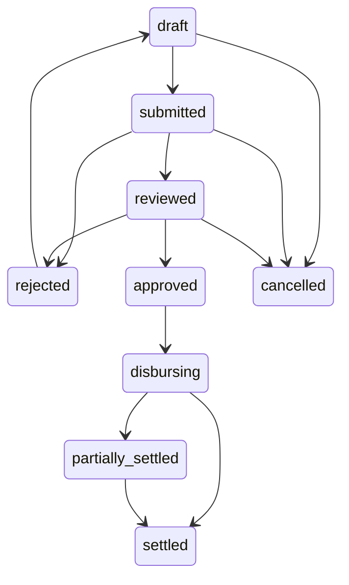
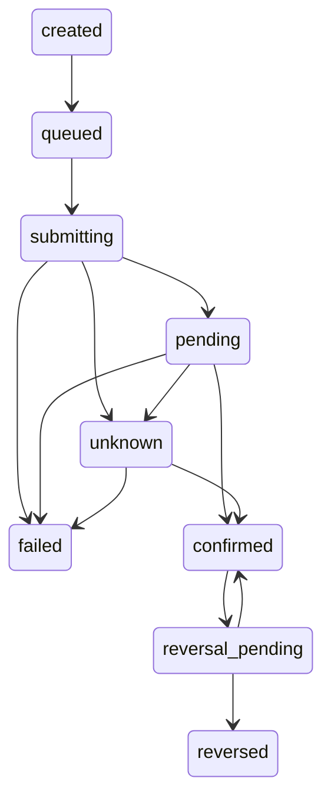
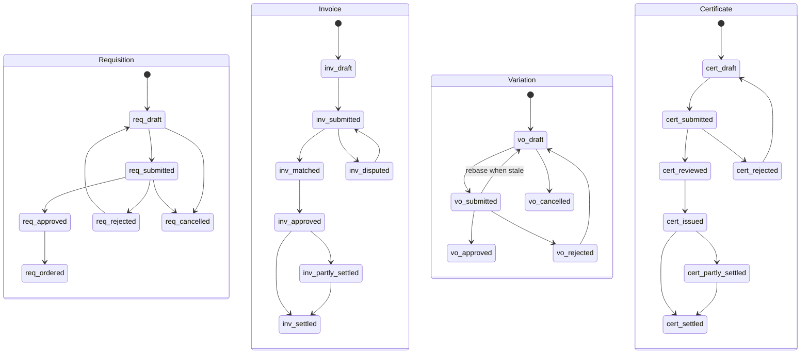

# PM-Buddy: Workflow contracts

Design requirements, not implemented payment/procurement APIs. See [brief §15](./PROJECT_BRIEF.md#15-mandatory-safeguards-pm-buddy-additions) and [acceptance matrix](./ACCEPTANCE_MATRIX.md).

## Shared transition rules

Every command resolves tenant/project membership on the server, checks permission and expected record version, and commits state, redacted audit event and outbox event atomically. Retried commands with the same tenant/operation/idempotency key and payload return the original result; a changed payload conflicts. Competing commands must not both consume the same version or outstanding balance.

Approvals bind an immutable snapshot of recipients, amounts, allocations and effective rules. Preparers cannot review/approve their own submission. Material edits before final approval create a new version and invalidate approvals. Approved financial records are immutable; subsequent corrections are separately approved linked records.

The tables below inherit these scope, audit and retry requirements. A failed precondition returns an explicit conflict/forbidden response without side effects.

## Site diary (D6.1 online foundation)

Implemented locally for the web diary, not the offline site app. The API resolves
tenant/project permission and version for each command; state and a safe-summary
audit event commit together. There are no attachment or external-notification effects
in this increment. Retries conflict on site/day uniqueness or a consumed version;
offline event identity/replay and outbox integration remain future work.

| Transition | Actor / preconditions | Effect / audit |
|---|---|---|
| new → draft | `site.diary`; site belongs to project; day is not future in Nairobi; site/day unused | Version 1; `diary.created`; manual or unknown workforce |
| draft → draft | Original author + `site.diary`; expected version | Replace draft content; `diary.updated` |
| draft → submitted | Original author + `site.diary`; expected version | Freeze content pending review; `diary.submitted` |
| submitted → rejected | Independent `quality.manage` reviewer; expected version; reason 3–500 characters | Store reviewer/time/reason; `diary.rejected` |
| rejected → draft | Original author + `site.diary`; expected version | Clear current sign-off; retain audited transition history; `diary.reopened` |
| submitted → approved | Independent `quality.manage` reviewer; expected version | Store reviewer/time; lock record permanently; `diary.approved` |

Approved diaries have no edit/reopen/delete transition. Database triggers backstop the
lifecycle, author/reviewer identities and lock; RLS and composite foreign keys isolate
company/project/site references. Closed/cancelled projects allow reads but no changes.
Attendance auto-fill, verified photos and quality workflows are not supplied by this
foundation. Financial certificate approval is a separate workflow below.

## Schedule baseline and delay log (D6.2)

Implemented for the web app ([ARCHITECTURE §4.6](./ARCHITECTURE.md#46-schedule-d62)). Every command needs `projects.manage` on an open project (role ∩ assignment, checked by `ProjectAccess.editable`; closed and cancelled projects are read-only in the API and in every schedule trigger), runs in the tenant transaction under the company lock, checks the expected version and writes its audit event in the same transaction. There is no external effect, outbox event or offline capture; a retry after a lost response is refused as a version conflict (or `dependency-exists`) rather than applied twice.

**Activities and dependencies** (editable records, not a state machine). An activity's status follows its actual dates: `not_started → in_progress` (actual start) `→ complete` (actual finish, 100 %); recording progress can also clear them to correct a mistake (audited like any change). Planned dates are never stored: every read runs CPM (`computeSchedule`) at today's data date.

| Command | Preconditions | Effect / audit |
|---|---|---|
| Add activity | Code unique per project; duration 1–1,000 working days; WBS node of the project; BQ item in the newest approved BQ version; at most 500 activities | Version 1, physical basis; `schedule.activity_created` (code, duration, field names) |
| Edit activity | Expected version | Version + 1; `schedule.activity_updated` (field names) |
| Record progress | Expected version; no future actual dates (Nairobi); finish ≥ start; whole percent 0–100 or quantity done ≤ total; 100 % exactly with an actual finish; nothing before an actual start | Version + 1; `schedule.progress_recorded` (status, basis, field names) |
| Delete activity | Expected version; never started; not named by any delay version | Removed with its dependencies (baselines keep their copy); `schedule.activity_deleted` |
| Link | Both items in the project (a task, or a milestone that is not cancelled: its network link is created on first use, `schedule.milestone_linked`); pair not already linked; **no cycle** (API and `app.reject_schedule_cycle`); lag −60…365 | `schedule.dependency_created` (type, lag, kinds) |
| Change / remove link | Expected version (type and lag only; the two ends never change) | `schedule.dependency_updated` / `schedule.dependency_deleted` |
| Change calendar | Expected version (0 the first time); at least one working weekday | `schedule.calendar_updated` (weekdays, holidays on/off) |

**Baseline.** No baseline → baseline 1 → baseline 2 … (append-only; the newest is current).

| Transition | Actor / preconditions | Effect / audit |
|---|---|---|
| freeze (first or re-baseline) | `projects.manage`; name 1–120 characters; reason 3–500 characters; at least one activity or milestone; at most 50 baselines | Computes the schedule at today's data date and copies every task's and non-cancelled milestone's scheduled start, finish, duration, float and critical flag, the calendar, the start and the project finish into a new numbered baseline, written in one transaction (the item count is checked at commit). It becomes current; older ones stay comparable (`GET schedule?baselineId=`). `schedule.baseline_created` (number, item count, `reasonGiven`; the reason itself stays in the baseline row) |
| change or delete a baseline | — | Never possible: no API, no privilege for the runtime role and a trigger refusal for everyone |

Variance compares the current schedule with the chosen baseline in working days of the current calendar (later is positive); items added after the baseline, and every item when there is no baseline, show "unavailable"; items removed since are listed separately.

**Delay log.** `recorded (v1) → recorded (v2 …)` by amendment, `recorded → withdrawn` (final). Each step appends a version that supersedes the previous one exactly once.

| Transition | Actor / preconditions | Effect / audit |
|---|---|---|
| record | `projects.manage`; cause from the fixed list; start not in the future; end (optional while ongoing) between the start and today; working days lost in half days, ≤ the working days in the period (to today while ongoing); affected activities are tasks of the project; site diary of the same project; claim flag | DLY number = next per project; version 1; `schedule.delay_recorded` (number, cause, claim flag, activity count, diary linked, open) |
| amend | Expected version; not withdrawn; the same checks; reason 3–500 characters | Version + 1 with the full new content and the reason; `schedule.delay_amended` (version, changed field names, `reasonGiven`) |
| withdraw | Expected version; not withdrawn; reason | Final version with status `withdrawn` (content kept); `schedule.delay_withdrawn` |

The claim flag (`not_assessed`, `non_excusable`, `excusable`, `compensable`) records the company's position to support a later claim; PM-Buddy makes no legal determination and does not change the schedule from it. Delays do not move dates by themselves: the actual dates and progress do.

## Payroll

| Transition | Actor, scope and preconditions | Side effects and audit event | Retry |
|---|---|---|---|
| draft → submitted | Project payroll preparer; validated earnings, reviewed rules and funding proposal | Freeze submitted snapshot; `payroll.submitted` | Shared command rules |
| submitted → reviewed | Finance reviewer, distinct from preparer; matching snapshot | Record review; `payroll.reviewed` | Expected version |
| submitted/reviewed → rejected | Assigned reviewer/approver; reason required | No payable created; `payroll.rejected` | Expected version |
| rejected → draft | Preparer; increment version | Clear obsolete approvals; `payroll.reopened` | Expected version |
| reviewed → approved | Owner/authorised approver, distinct from preparer and reviewer; fresh MFA, limits and snapshot match | Immutable batch and authorised obligations; `payroll.approved` | Database uniqueness/version guard |
| draft/submitted/reviewed → cancelled | Authorised project manager; reason | Release provisional reservations; `payroll.cancelled` | Expected version |
| approved → disbursing | Payment worker acting for tenant; approved obligations and payout switch enabled | Reserve outstanding amounts; create attempts/outbox; `payroll.disbursing` | Unique attempt/reservation rules |
| disbursing → partially_settled/settled; partially_settled → settled | Settlement processor; derive from confirmed allocations across obligations, not independent flags | Record derived state; `payroll.settlement_updated` | Duplicate allocation prevented |

Failed lines remain outstanding, not automatically resubmittable if any attempt is uncertain. Closed-period attendance routes to an adjustment run referencing the original batch; never mutate settled payroll.

## Payment attempts

| Transition | Actor, scope and preconditions | Side effects and audit event | Retry |
|---|---|---|---|
| created → queued | Tenant payment service; authorised obligation, reservation and immutable recipient snapshot | Outbox work; `attempt.queued` | Unique key/fingerprint |
| queued → submitting | Worker; payout enabled, reservation still valid, no uncertain prior attempt | Persist call intent before external call; `attempt.submitting` | CAS ownership; never blindly repeat call |
| submitting → pending | Worker; provider accepted with expected identifiers | Save protected provider evidence; `attempt.pending` | Persist same result once |
| submitting/pending → unknown | Watchdog/worker; timeout, lost response or expired lease | Hold reservation; reconciliation case; `attempt.unknown` | No automatic resubmission |
| submitting/pending/unknown → failed | Verified definitive non-settlement result, not timeout; authorised reconciler for manual evidence review | Release reservation only when safe; `attempt.failed` | Deduplicate result |
| pending/unknown → confirmed | Durable inbox/reconciler; verified identifiers, amount, KES currency and direction | Allocation and balanced journal in transaction; `attempt.confirmed` | Unique provider receipt/allocation |
| confirmed → reversal_pending | Independent authorised approver; fresh MFA and reversal reason | Separate reversal request; `attempt.reversal_requested` | Reversal has separate idempotency key |
| reversal_pending → reversed/confirmed | Verified reversal success/definitive rejection | Compensating journal only on success; `attempt.reversed`/`attempt.reversal_rejected` | Unknown reversal remains pending review |

Late/out-of-order results never regress confirmed settlement to pending/failed. Conflicting definitive evidence opens a dispute. A callback can be processed after a timeout even if local state is still `submitting`; route through reconciliation with the same verification/atomic settlement controls. New payouts target only demonstrably unpaid outstanding obligations.

## Procurement and certification

| Workflow / transition | Actor, scope and preconditions | Side effects and audit event | Retry |
|---|---|---|---|
| Requisition draft → submitted | Site requester; item/unit/version valid | `requisition.submitted` | Expected version |
| submitted → approved/rejected | Independent project approver; budget/limits or reason | Reserve commitment proposal or record rejection; `requisition.approved/rejected` | Expected version |
| rejected → draft | Requester; new version | Clear approval; `requisition.reopened` | Expected version |
| approved → ordered | Procurement; quote policy and LPO approved | Link LPO and committed cost; `requisition.ordered` | Unique conversion to order |
| draft/submitted → cancelled | Requester/manager; no issued LPO | `requisition.cancelled` | Expected version |
| Invoice draft → submitted | Finance clerk; source invoice and supplier identity verified | `invoice.submitted` | Duplicate supplier reference prevented |
| submitted → matched/disputed | Matching service/reviewer; LPO/GRN tolerance, eTIMS review, approved service exceptions | Matching evidence or dispute; `invoice.matched/disputed` | Expected version |
| disputed → submitted | Clerk; corrected draft version and evidence | Invalidate old match; `invoice.resubmitted` | Expected version |
| matched → approved | Independent Finance approver; limits, snapshot, review complete | Accrue cost and obligation once; `invoice.approved` | Unique accrual source |
| approved → partly_settled/settled; partly_settled → settled | Verified allocation processor | Derived cash/settlement state; `invoice.settlement_updated` | Allocation uniqueness |
| Variation draft → submitted | QS; instruction and BQ baseline/version attached | Freeze proposal; `variation.submitted` | Expected version |
| submitted → approved/rejected | Independent contract-authorised approver; reason/limits | New BQ version only on approval; `variation.approved/rejected` | Unique approved variation version |
| rejected → draft; draft → cancelled | QS; new version or cancellation reason | `variation.reopened/cancelled` | Expected version |
| draft/submitted/rejected → draft (rebase) | QS; base is no longer the newest approved BQ version | Re-point proposal and lines to the newest version, reprice, clear the snapshot; `variation.rebased` | Expected version |
| Certificate draft → submitted | QS; measured work and materials reconciled | Snapshot valuation; `certificate.submitted` | Expected version |
| submitted → reviewed/rejected | Independent reviewer; retention, advance recovery and prior certificates checked | `certificate.reviewed/rejected` | Expected version |
| rejected → draft | QS; new version | Clear approvals; `certificate.reopened` | Expected version |
| reviewed → issued | Contract-authorised issuer; snapshot unchanged | Immutable certificate/receivable; `certificate.issued` | Unique issued version |
| issued → partly_settled/settled; partly_settled → settled | Verified receipts allocation processor | Derived settlement state; `certificate.settlement_updated` | Allocation uniqueness |

Approved invoices, issued LPOs and certificates use linked credits, cancellations or amendments with fresh approval rather than deletion. Detailed cancellation/return policies require QS/accounting review before their implementation.

### Variation as implemented (D2.3)

The Variation workflow is implemented ([ARCHITECTURE §4.3](./ARCHITECTURE.md#43-bq-versions-variations-and-rate-build-ups-d23)); the transition table lives in `packages/domain/src/bq/variation-lifecycle.ts` and is repeated by the `app.guard_variation_order` trigger. Additions to the contract above:

- **Rebase.** When another variation on the same base is approved, this one is stale. Approval is refused (409 `variation-stale`) until someone with `bq.edit` rebases it: from draft, submitted or rejected it returns to draft on the newest approved version, its lines move with it and are repriced, and lines that no longer apply are flagged for correction. Rebase from a non-stale variation is 409 `variation-not-stale`. Draft → draft rebase is not a status change, so only the history row and the audit event record it.
- **Snapshot binding.** Submission stores a SHA-256 digest of the proposal (instruction, base version and its total, VAT rate, every line and the totals). Approve and reject must quote that digest; the server recomputes it and refuses any mismatch with 409 `variation-stale`.
- **Who may decide.** `bq.approve_variation` on the project; approval also needs MFA verified within five minutes (403 `step-up-required`). The decider must be neither the creator nor the submitter (403 `maker-checker`), for rejection as well as approval. Rejection and cancellation need a reason (at least three characters), kept in `variation_status_changes`.
- **Approval side effect.** One transaction, serialised per BQ: the next BQ version is created from the base plus the lines, with totals and VAT recomputed at the base's snapshotted VAT rate. Approval limits by amount are not implemented yet.
- **Baseline.** Before any variation, the imported draft (BQ version 1) is approved as the contract baseline (`bq.approve_variation`, step-up, not the importer); it is then immutable.

### Procure-to-pay as implemented (D5.2)

Requisitions, RFQs, LPOs and supplier invoices are implemented ([ARCHITECTURE §4.5](./ARCHITECTURE.md#45-procure-to-pay-d52)); the transition tables live in `packages/domain/src/procurement/lifecycle.ts` and are repeated by `app.guard_requisition`, `app.guard_rfq`, `app.guard_lpo` and `app.guard_supplier_invoice`. Differences from and additions to the contract above:

- **Requisition.** `reopen` returns a submitted, rejected or approved requisition (not one on an open RFQ) to draft and clears the decision; material edits are only possible in draft. `approved → ordered` happens when its LPO is approved (`ordered → approved` again if that LPO is cancelled before anything was received or invoiced). Approve and reject need `procurement.approve` and someone who is not a contributor (creator, editor, submitter); reject and cancel need a reason. Budget and approval limits by amount are **not** implemented.
- **RFQ** (new): `open → awarded | cancelled`, `awarded → open` when its LPO is cancelled (so it can be reissued). Award needs `procurement.min_quotes` complete, valid quotations or an approved single-source exception (requested with a reason by someone with `procurement.manage_suppliers`, approved by a `procurement.approve` holder who did not contribute to the RFQ).
- **LPO** (new): `draft → submitted → approved`, `submitted → draft` (returned with a reason), `draft | submitted | approved → cancelled` (approved only while nothing was received or invoiced). Approval needs `procurement.approve`, step-up and a non-contributor; an approved LPO never changes (amend = cancel + reissue from the RFQ).
- **GRN** (new, not a state machine): `recorded → voided` with a reason, refused while an approved invoice relies on it. Recording is idempotent (client ID + `Idempotency-Key`).
- **Invoice.** `submitted → matched | disputed` happens in the submission transaction (no separate reviewer step). `matched ↔ disputed` on `rematch`; `disputed → matched` by an **exception** (independent `payments.approve`, step-up, reason; never for a missing eTIMS number, inconsistent totals, an empty invoice or a line not on the order); `disputed | matched → draft` on `reopen` for a corrected version (a new content version; the old match no longer counts). `matched → approved` by an independent `payments.approve` holder with step-up, only while the current match passes and is not stale, binding the match, the content version and the supplier's verified payout version. `approved → partly_settled → settled` follow recorded settlements (`payments.disburse`, step-up, not the approver, amount ≤ outstanding, idempotent). A payee change after approval stops settlement until the invoice is approved again (`approved | partly_settled` re-approval creates a new payable). Anything not yet approved can be cancelled with a reason (e.g. after a credit note); approved invoices are not cancelled in D5.2.
- **Audit events:** `requisition.created/updated/submitted/approved/rejected/reopened/cancelled`, `rfq.created/updated/exception_requested/exception_approved/awarded/cancelled`, `quotation.recorded/withdrawn`, `lpo.created/updated/…` (one per transition), `grn.recorded/voided`, `invoice.recorded/updated/submitted/matched/disputed/match_excepted/approved/reapproved/reopened/cancelled`, `invoice.settlement_recorded`, `procurement.document_added`; metadata carries IDs, statuses, field names and match reason codes, never amounts or free text.

## Stores (D5.3)

Implemented in D5.3 ([ARCHITECTURE §4.6](./ARCHITECTURE.md#46-stores-d53)). The transition tables live in `packages/domain/src/stores/lifecycle.ts` and are repeated by `app.guard_stock_transfer` and `app.guard_stock_take`; stock itself only changes through ledger entries (`app.post_stock_entry`), never by editing a balance.

```mermaid
stateDiagram-v2
  state Transfer {
    [*] --> trf_dispatched : dispatch (stock leaves the source store)
    trf_dispatched --> trf_received : receive, every line as sent
    trf_dispatched --> trf_disputed : receive, a line differs (reason per line)
    trf_disputed --> trf_resolved : resolve (note; not the sender or receiver)
    trf_dispatched --> trf_cancelled : cancel (reason; dispatch reversed)
  }
  state StockTake {
    [*] --> stk_draft : start (system quantities snapshotted)
    stk_draft --> stk_draft : record counts
    stk_draft --> stk_submitted : submit (every line counted)
    stk_submitted --> stk_approved : approve (not a contributor; variances posted)
    stk_submitted --> stk_draft : return for recount (reason)
    stk_draft --> stk_cancelled : cancel (reason)
    stk_submitted --> stk_cancelled : cancel (reason)
  }
```

| Workflow / transition | Actor, scope and preconditions | Side effects and audit event | Retry |
|---|---|---|---|
| Issue / return / wastage recorded | `stores.manage` on the store's project; an issue names an approved-BQ item (lineage) and/or a project gang; a return names a posted issue and ≤ what is outstanding per line; wastage has a reason and a note; never more than on hand | Ledger entries at the average cost (returns at the issue's cost); `stock.issued`, `stock.returned`, `stock.wasted` | Client ID + `Idempotency-Key` (replay returns the original) |
| Movement posted → reversed | `stores.manage`; reason; an issue only after its returns are reversed | Reversing entries naming the originals; `stock.movement_reversed` | Refused once reversed |
| Transfer → dispatched | `stores.manage` on the source store; target is another store the caller can see; ≤ on hand | `transfer_out` entries at the average; in transit on both stores; `stock.transfer_dispatched` | Client ID + `Idempotency-Key` |
| dispatched → received / disputed | `stores.manage` on the destination store; a quantity for every line, a reason for each line that differs | `transfer_in` entries at the dispatch unit cost for what arrived; the shortfall's value is the transit loss; `stock.transfer_received` / `stock.transfer_disputed` | `Idempotency-Key` (replay returns the result) |
| disputed → resolved | `procurement.approve` on either project; neither the sender nor the receiver; note | No stock moves; `stock.transfer_resolved` | Expected version |
| dispatched → cancelled | `stores.manage` on the source store; reason | Dispatch reversed into the source store; `stock.transfer_cancelled` | Expected version |
| Stock take started (draft) | `stores.manage`; one open count per store | Lines snapshot the system quantity of every material held or with a reorder level (at most 300: a larger store is counted in turns, those counted longest ago first, and the response says how many are left); `stock_take.created` | Refused while another is open |
| Counts recorded | `stores.manage`; draft; lines of this count | Each count keeps the system quantity **at the moment it is counted** (snapshot + movements since), so movements during the count are not variances; the counter becomes a contributor; `stock_take.counted` | Count IDs + `Idempotency-Key` |
| draft → submitted | `stores.manage`; every line counted | Submitter becomes a contributor; `stock_take.submitted` | Expected version |
| submitted → approved | `procurement.approve`; **not a contributor** (creator, counters, submitter) | Each variance posted as an `adjustment` at the average cost (refused if a shortfall exceeds what is now on hand); `stock_take.approved` | Expected version |
| submitted → draft (return) | `procurement.approve`; reason | Recount; `stock_take.returned` | Expected version |
| draft / submitted → cancelled | `stores.manage` or `procurement.approve`; reason | Nothing posted, counts kept as evidence; `stock_take.cancelled` | Expected version |

GRNs post to stores as part of their own workflow (D5.2): recording receives the accepted quantities into the site's store; a void reverses them and is refused (`grn-stock-consumed`) when the goods were already issued or moved.

## Spending: petty cash, reconciliation, budgets and journals (D5.4)

Implemented in D5.4 ([ARCHITECTURE §4.7](./ARCHITECTURE.md#47-spending-and-cash-flow-d54)). The transition tables live in `packages/domain/src/spending/lifecycle.ts` and are repeated by the database guards (`app.guard_budget`, `app.guard_petty_cash_top_up`, `app.guard_petty_cash_expense`, `app.guard_petty_cash_count`, `app.guard_cost_journal`). A float's balance only changes through its own ledger entries (`app.post_float_entry`), and cost only through `cost_entries` posted once per source.

```mermaid
stateDiagram-v2
  state Budget {
    [*] --> b_draft : prepare (empty, from the approved BQ, or a copy of the version in force)
    b_draft --> b_draft : add / change / remove lines (preparer becomes a contributor)
    b_draft --> b_submitted : submit (lines fingerprinted)
    b_submitted --> b_approved : approve on the digest (finance.manage + step-up, not a contributor)
    b_submitted --> b_draft : return (reason)
    b_draft --> b_cancelled : cancel (reason)
    b_submitted --> b_cancelled : cancel (reason)
  }
  state TopUp {
    [*] --> t_requested : ask (custodian or finance.manage; within the limit)
    t_requested --> t_approved : approve (payments.approve + step-up, not the requester)
    t_requested --> t_rejected : reject (reason)
    t_approved --> t_paid : pay (payments.disburse + step-up, not the approver; method + reference)
    t_requested --> t_cancelled : cancel (reason)
    t_approved --> t_cancelled : cancel (reason)
  }
  state Expense {
    [*] --> e_submitted : record (custodian; cash leaves the float)
    e_submitted --> e_approved : approve (receipt attached; not the recorder or custodian)
    e_submitted --> e_rejected : reject (reason; cash back on the book)
  }
  state Count {
    [*] --> c_submitted : count (book balance snapshotted)
    c_submitted --> c_approved : approve (not the counter or custodian; variance posted)
    c_submitted --> c_returned : return (reason; count again)
  }
```

| Workflow / transition | Actor, scope and preconditions | Side effects and audit event | Retry |
|---|---|---|---|
| Float opened | `finance.manage` on the site's project; one float per site; the custodian holds `finance.petty_cash` on the project | Float with balance 0 and a limit; `petty_cash.float_created` | Unique per site (409 `float-exists`) |
| Custodian or limit changed; float closed | `finance.manage`; a new custodian only after an **approved count with nothing moved since** (or an empty float); closing needs a zero balance and nothing open | `petty_cash.float_updated` / `petty_cash.float_closed` | Expected version |
| Top-up asked → approved → paid | asked by the custodian or `finance.manage` (balance + amount ≤ limit); approved by `payments.approve` (not the requester); paid by `payments.disburse` (not the approver) with method, reference (unique per method) and a paid-on date between the request and today | Paid: a `top_up` float entry (the float row locked); `petty_cash.top_up_requested/approved/paid/rejected/cancelled` (IDs and statuses only) | Expected version |
| Expense recorded (submitted) | the float's custodian holding `finance.petty_cash`; dated today or within 90 days; tagged with a BQ item of the BQ in force or an active cost code and a category; M-Pesa needs a code (unique among expenses not rejected); amount + charge ≤ book balance | An `expense` float entry for amount + charge (locked; never below zero); `petty_cash.expense_recorded` (no amounts, codes or payees) | Client ID + `Idempotency-Key`: a replay returns the original |
| Expense: pasted SMS | any petty-cash reader | Draft only (`confirmsSettlement: false`): the form is filled and labelled; records already holding the code are named; the text is never stored | Read-only |
| Receipt added | the recorder or `finance.manage`; not rejected; ≤ 3; JPEG/PNG/WebP within the size limit; malware hook | Private object, metadata row; `petty_cash.receipt_added` | Repeatable |
| submitted → approved | `finance.manage` or `procurement.approve` on the project; **not the recorder and not the custodian**; at least one receipt | Cost entries: accrual + payment of the amount (its tags), charge accrual + payment (fees); `petty_cash.expense_approved` | Expected version |
| submitted → rejected | same approvers; reason | An `expense_rejected` float entry restores the book (the custodian owes the cash); `petty_cash.expense_rejected` | Expected version |
| **Reconciliation**: count recorded | the custodian or `finance.manage`; one open count per float | Book balance snapshotted; variance = counted − book; `petty_cash.counted` | One open count (409 `count-open`) |
| count submitted → approved | `finance.manage` or `procurement.approve`; **not the counter and not the custodian** | A `count_adjustment` float entry of the variance; cost entries of the shortage (positive) or overage (negative), category petty cash; `petty_cash.count_approved` | Expected version |
| count submitted → returned | same approvers; reason | Nothing posted; count again; `petty_cash.count_returned` | Expected version |
| **Budget** prepared, lines edited, submitted | `finance.manage` or `bq.edit` on the project; one draft or submitted version per project; a line is a BQ item **or** a cost code, once each | Totals kept by triggers; submit stores the SHA-256 digest of the lines; `budget.created/line_added/line_updated/line_removed/submitted` | Expected version |
| budget submitted → approved | `finance.manage` + step-up; **not a contributor**; quotes the digest (409 `budget-stale` if the lines changed) | The newest approved version is in force; an approved version never changes; `budget.approved` | Expected version + digest |
| budget submitted → draft / cancelled | return: `finance.manage`, reason; cancel: a preparer, reason | `budget.returned` / `budget.cancelled` | Expected version |
| Journal proposed (adjustment or reversal) | company-wide `finance.manage`; each line tagged (BQ item or cost code, category, counterparty, reference, date, non-zero amount); a reversal names one entry not yet reversed and not itself a reversal | Nothing posts yet; `cost_journal.proposed` | — |
| journal submitted → approved / rejected | `finance.manage` + step-up for approval; **never the proposer**; reason to reject | Approved: one cost entry per line (a reversal carries the opposite amount and the original's tags); `cost_journal.approved/rejected` | Expected version |
| Expected receipt or payment (cash-flow line) | `finance.manage` on the project | Shown in the forecast on its expected date until received or cancelled; `cash_flow.item_created/updated/received/cancelled` | Expected version |

Supplier invoices and settlements post to the cost ledger as part of their own workflow (D5.2): approval (matched → approved) posts the accrual net of VAT, each settlement posts the cost part of the cash paid; neither can be posted twice.
