# PM-Buddy: Workflow contracts

Design requirements, not implemented payment/procurement APIs. See [brief §15](./PROJECT_BRIEF.md#15-mandatory-safeguards-pm-buddy-additions) and [acceptance matrix](./ACCEPTANCE_MATRIX.md).

## Shared transition rules

Every command resolves tenant/project membership on the server, checks permission and expected record version, and commits state, redacted audit event and outbox event atomically. Retried commands with the same tenant/operation/idempotency key and payload return the original result; a changed payload conflicts. Competing commands must not both consume the same version or outstanding balance.

Approvals bind an immutable snapshot of recipients, amounts, allocations and effective rules. Preparers cannot review/approve their own submission. Material edits before final approval create a new version and invalidate approvals. Approved financial records are immutable; subsequent corrections are separately approved linked records.

The tables below inherit these scope, audit and retry requirements. A failed precondition returns an explicit conflict/forbidden response without side effects.

## Site diary (D6.1 online foundation)

Implemented locally for the web diary, not the offline site app. The API resolves
tenant/project permission and version for each command; state and a safe-summary
audit event commit together. There are no attachment or external-notification effects
in this increment. Retries conflict on site/day uniqueness or a consumed version;
offline event identity/replay and outbox integration remain future work.

| Transition | Actor / preconditions | Effect / audit |
|---|---|---|
| new → draft | `site.diary`; site belongs to project; day is not future in Nairobi; site/day unused | Version 1; `diary.created`; workforce typed in (may be unknown) or an attendance snapshot (D6.1) |
| draft → draft | Original author + `site.diary`; expected version | Replace draft content; `diary.updated` |
| draft → submitted | Original author + `site.diary`; expected version | An attendance-sourced workforce is re-snapshotted first (version + 2); freeze content pending review; `diary.submitted` |
| submitted → rejected | Independent `quality.manage` reviewer; expected version; reason 3–500 characters | Store reviewer/time/reason; `diary.rejected` |
| rejected → draft | Original author + `site.diary`; expected version | Clear current sign-off; retain audited transition history; `diary.reopened` |
| submitted → approved | Independent `quality.manage` reviewer; expected version | Store reviewer/time; lock record permanently; `diary.approved` |

Approved diaries have no edit/reopen/delete transition. Database triggers backstop the
lifecycle, author/reviewer identities and lock; RLS and composite foreign keys isolate
company/project/site references. Closed/cancelled projects allow reads but no changes.
Verified photos (increment 2) attach to drafts only. Financial certificate approval is a
separate workflow below.

**Workforce provenance (D6.1, ARCHITECTURE §4.7).** `workforce_source` is `manual` (typed in;
null = unknown, 0 = nobody) or `attendance`: a snapshot of attendance on the diary's site and
date by trade (present or half day), with the muster sheet's state and the snapshot time. The
server takes it on create/edit and again on submit; the database recomputes it and refuses a
mismatch, and the snapshot is frozen with the rest of the content while submitted and after
approval, so later attendance corrections never change an approved diary. Switching between
manual and attendance is an ordinary draft edit.

## Quality (D6.1)

Implemented for the web app ([ARCHITECTURE §4.7](./ARCHITECTURE.md#47-quality-d61)). Every command runs in the tenant transaction with the project's permissions (role ∩ assignment), sends the version it read (409 `version-conflict`) and writes a `quality.*` audit event (IDs, codes, counts and outcomes only) in the same transaction. Closed and cancelled projects are read-only in the API and in every trigger. "Independent" means a different user from the one named; the database checks it again. "Reason" is 3–500 characters.

**Inspection** (`inspections`, items and item photos)

| Transition | Actor / preconditions | Effect / audit |
|---|---|---|
| new → draft | `site.diary` or `quality.manage`; site of the project; current, non-retired template version; date not in the future (Nairobi); optional WBS item, schedule task, approved-BQ item | `INS-NNNN`; items copied from the template as `pending`; `quality.inspection_created` |
| draft → draft | The author; items answered `pass`/`fail`/`na`, notes, up to 6 site photos per item | `quality.inspection_updated` (field names and counts) |
| draft → submitted | The author; every item answered; every failed item has a note | Result = `fail` if any item failed, else `pass`; content frozen; `quality.inspection_submitted` |
| submitted → signed_off | `quality.manage`; independent of the creator and the submitter | **Locked**: no further change to the inspection, items or photos; `quality.inspection_signed_off` |
| submitted → draft | `quality.manage`; independent; reason | Result cleared, return reason kept; `quality.inspection_returned` |

A submitted or signed-off inspection with result `fail` can raise snags from its failed items (below). There is no delete.

**Snag / defect** (`snags`, `snag_photos`)

| Transition | Actor / preconditions | Effect / audit |
|---|---|---|
| new → open | `site.diary` or `quality.manage`; site, location, description, severity, responsible party (kind + name), optional due date and failed inspection item, photos | `SNG-NNNN`; `phase` = `dlp` when practical completion is certified, else `construction`; `quality.snag_raised` |
| open → open | `quality.manage` (edits may change severity) | `quality.snag_updated` |
| open → fixed | `site.diary` or `quality.manage`, recorded for the responsible party; optional fix note and photos | Fixer and time stored; `quality.snag_fixed` |
| fixed → closed | `quality.manage`; independent of whoever recorded the fix | **Final** (verified); `quality.snag_closed` |
| fixed → open | `quality.manage`; independent of the fixer; reason | `reopen_count` + 1, last reason kept, fix cleared; `quality.snag_reopened` |

Closed snags never reopen; a recurrence is a new snag. Overdue = open after its due date (Nairobi).

**Completion certificate** (`project_completions`, kinds `practical` and `final`)

| Transition | Actor / preconditions | Effect / audit |
|---|---|---|
| new → proposed | `projects.manage`; date not in the future; one live certificate per kind. Practical: DLP months (default from settings, 1–24); no critical snag that is open or fixed-but-unverified unless an exception reason is given. Final: a certified practical completion, date ≥ the DLP end, no snag that is not closed unless an exception reason is given | Snag counts at proposal stored; DLP end = date + months (clamped to month end); `quality.completion_proposed` |
| proposed → certified | `quality.manage`; independent of the proposer; the snag check is repeated | **Locked**; starts (practical) or ends (final) the DLP; later snags are DLP defects; `quality.completion_certified` |
| proposed → withdrawn | `projects.manage`; reason | Frees the kind for a new proposal; `quality.completion_withdrawn` |

Certification does not change the project's status. D6.3 retention release reads certified rows.

**Concrete tests and templates** (append-only records, not state machines). A cube set (`CUBE-NNNN`) is recorded, then one result per age (7, 28 days) by `site.diary` or `quality.manage`; the outcome follows rule KE-CUBE-1 and is re-checked by the database. A slump test (`SLP-NNNN`) is recorded once with its KE-SLUMP-1 outcome. **Corrections** (`quality.manage`, reason) append a row that supersedes the original once; **voiding** a cube set (`quality.manage`, reason) stops it falling due but keeps its results. Template **revisions** and **retirements** (`quality.manage` somewhere) append the next version of the lineage; inspections keep the version they used.

## Health and safety (D8.2)

Implemented for the web app ([ARCHITECTURE §4.9](./ARCHITECTURE.md#49-health-and-safety-d82)). Every command runs in the tenant transaction with the project's permissions (role ∩ assignment), sends the version it read (409 `version-conflict`) and writes a `safety.*` audit event (IDs, codes, kinds, severities, counts and statuses only; never names, injuries, descriptions, notes or reasons) in the same transaction. Closed and cancelled projects are read-only in the API and in every trigger. "Recorder" = `site.diary` or `safety.manage`; "manager" = `safety.manage`; "independent" means a different user from the one named, checked again by the database. "Reason" is 3–500 characters. Dates are Nairobi business dates and never in the future unless stated.

**Incident** (`safety_incidents`, people and photos)

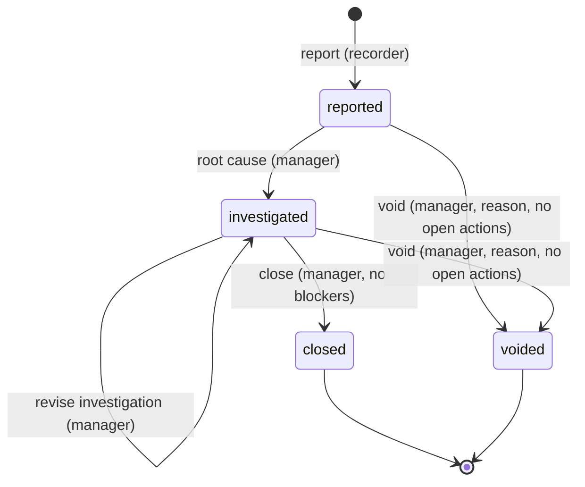

| Transition | Actor / preconditions | Effect / audit |
|---|---|---|
| new → reported | Recorder; site of the project; kind, severity, when (≤ now + 5 min), location, description; people (labourer of the project, staff member, or name; injured people with injury type and body part); an injury needs an injured person, a near miss none; up to 6 of the site's photos; optional closed incident it follows up | `INC-NNNN`; `safety.incident_reported` (kind, severity, people counts by role, photo count) |
| reported/investigated → same | Manager; correct details, people or photos (recorders may add photos) | `safety.incident_updated` (field names, counts), `safety.incident_photos_added` |
| reported → investigated | Manager; root-cause category and root cause (10–2,000 characters), contributing factors | Investigator and time stored; `safety.incident_investigated` |
| reported/investigated → same | Manager; regulator decision `notified` (date, reference) or `not_notifiable` (reason); replaceable until closed | `safety.incident_regulator_decision` (decision only) |
| investigated → closed | Manager; every corrective action verified or cancelled; ≥ 1 verified action or a no-action reason; a regulator decision when the incident is a serious or fatal injury or a dangerous occurrence (COMPLIANCE-REVIEW CR-HS-01); optional closing note | **Locked** for every role: the incident, its people and photos, its corrective actions and its linked treatments; `safety.incident_closed` |
| reported/investigated → voided | Manager; reason; no open or done corrective action | **Locked**; `safety.incident_voided` |

There is no delete and no reopening: anything found after closing is reported as a follow-up incident (`follow_up_of_id`).

**Corrective action** (`corrective_actions`)

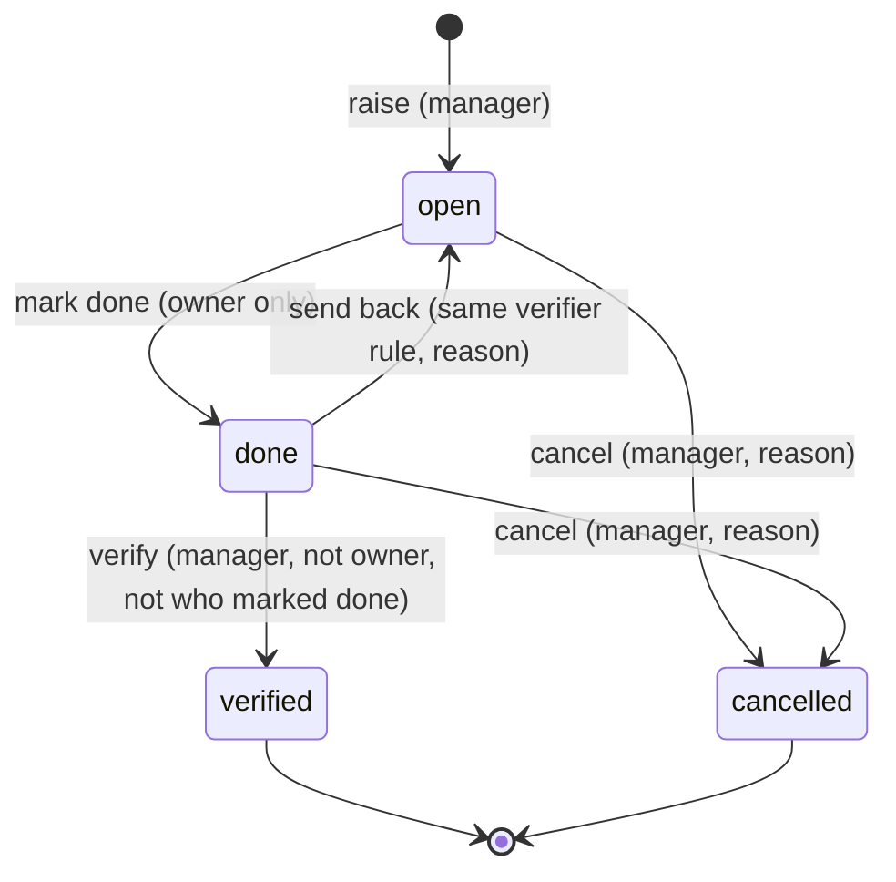

| Transition | Actor / preconditions | Effect / audit |
|---|---|---|
| new → open | Manager; description (5–1,000 characters), owner (staff who can read the project's safety records), due date; source an open incident, a confirmed toolbox talk, an inspection of the project, or none | `CA-NNNN`; `safety.action_raised` (source, IDs) |
| open → open | Manager; change description, owner or due date | `safety.action_updated` (field names) |
| open → done | The **owner**; optional note | Done by/at stored; `safety.action_done` |
| done → verified | Manager; independent of the owner and of whoever marked it done | **Final**; `safety.action_verified` |
| done → open | Manager; same independence; reason | `reject_count` + 1, last reason kept, done cleared; `safety.action_rejected` |
| open/done → cancelled | Manager; reason | **Final**; `safety.action_cancelled` |

Overdue = open after its due date (a done action awaiting verification is not overdue). Lists put overdue first. An action of a closed or voided incident cannot change.

**Toolbox talk** (`toolbox_talks`, `toolbox_talk_attendees`)

| Transition | Actor / preconditions | Effect / audit |
|---|---|---|
| new → draft | Recorder; site, date, topic, presenter (a recorder), optional minutes, notes, a site photo; attendees as gangs (members on the day) and/or labourers of the project, plus a count of others | `TBT-NNNN`; `safety.talk_recorded` (attendee counts) |
| draft → draft | Recorder; any content or attendee change | `safety.talk_updated` |
| draft → confirmed | Recorder; at least one attendee or counted other (may happen on creation) | **Locked**: the talk and attendance cannot change; `safety.talk_confirmed` |
| draft → cancelled | Recorder; reason | **Final**; `safety.talk_cancelled` |

**Records without a lifecycle.** An **induction** (`IND-NNNN`) is recorded once by a recorder and can only be **voided** by a manager with a reason. A **PPE issue** is `issued` → `returned` (recorder; date, condition) or → `replaced` (only by recording the newer issue that names it) or → `voided` (manager, reason); voiding a replacement puts the item it replaced back to `issued`. A **first-aid kit** is active → retired (manager, reason) and its **checks** are append-only (recorder). A **first-aider** is active → removed (manager, reason). A **treatment** (`FA-NNNN`) is recorded (recorder), linked to an open incident once (manager) or voided (manager, reason); a treatment linked to a closed incident cannot change.

## Plant and equipment (D8.3)

Implemented for the web app ([ARCHITECTURE §4.11](./ARCHITECTURE.md#411-plant-and-equipment-d83)). Every command runs in the tenant transaction with the caller's project permissions (role ∩ assignment), locks the item row, sends the version it read where the record is versioned (409 `version-conflict`) and writes a `plant.*` audit event (IDs, codes, dates, statuses and field names only). "Recorder" = `site.diary` or `plant.manage` on the site's project (fuel also `stores.manage`); "manager" = `plant.manage` on the item's project (or anywhere while it is in the yard). Records at a site of a closed or cancelled project are refused (409 `project-read-only`).

**Plant item** (`plant_items`; status derived and checked at commit by `app.check_plant_state`)

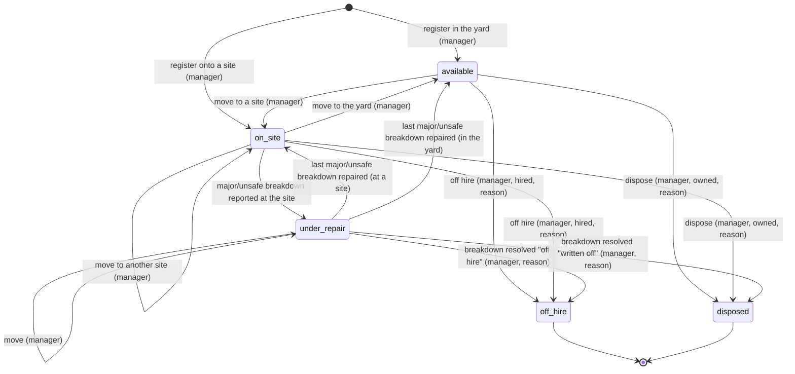

| Transition | Actor / preconditions | Effect / audit |
|---|---|---|
| new → available / on_site | Manager (on the starting site's project); code unique in the company; hired items need a supplier, rate, unit and hire start (an LPO must be that supplier's); metered items an opening reading; fuelled metered items a standard consumption | Move 1 recorded when it starts on a site; `plant.registered` |
| any open → same | Manager; name, category, quantity, make/model, registration, hire terms, standard consumption, service intervals, notes (code, ownership, meter, fuel type and opening reading fixed) | `plant.updated` (field names); later fuel issues carry the new standard |
| move | Manager on the item's project and on the destination; dated on or after the previous move, not in the future; never strands usage or fuel recorded at the old site after the date (409 `move-strands-records`) | Append-only `plant_moves` row; `plant.moved` |
| → under_repair and back | Follows open major/unsafe breakdowns automatically | — |
| → off_hire / disposed | Manager; date (not before the hire start, not in the future) and reason; no open breakdown (409 `plant-has-open-breakdowns`) or as the resolution of the breakdown itself | **Final**: returned to the yard, operator assignments ended, no more records; `plant.closed` |

**Breakdown** (`plant_breakdowns`, `BRK-NNNN` per company)

| Transition | Actor / preconditions | Effect / audit |
|---|---|---|
| new → open | Recorder; at a site where the item is that day, when (≤ now + 5 min), severity `minor`/`major`/`unsafe`, description | Major/unsafe: item `under_repair`; unsafe: no `working` day accepted while open; `plant.breakdown_reported` |
| open → repaired | Recorder (**unsafe: manager only**); date (on or after the report, not in the future), repaired by, cost reference, note | **Final**; status recomputed; `plant.breakdown_resolved` |
| open → off_hire | Manager; hired item; reason | **Final**; the item goes off hire; `plant.breakdown_resolved`, `plant.closed` |
| open → written_off | Manager; owned item; reason | **Final**; the item is disposed; `plant.breakdown_resolved`, `plant.closed` |

**Usage log and fuel issue** (`plant_usage_logs`, `plant_fuel_issues`; append-only)

| Transition | Actor / preconditions | Effect / audit |
|---|---|---|
| new → current | Recorder (fuel: also `stores.manage`); the item was at the site that day; date not in the future and ≤ 60 days back; meter readings monotonic (409 `meter-out-of-order`), ≤ 24.0 h or 1,500 km a day; usage: one original per item and day, operator assigned that day, no working day on unsafe plant; fuel: the item uses that fuel; client ID + `Idempotency-Key` | `plant.usage_recorded` / `plant.fuel_recorded`; a fuel issue that closes a full-tank window returns the window judged against the standard |
| current → superseded | Recorder **and** (manager or whoever recorded it); a correction with new values (usage: same day) and a reason; only the newest entry of a chain | New row with `corrects_id` (unique); `plant.usage_corrected` / `plant.fuel_corrected` |
| current → voided | Same actors; reason | New void row naming it; never counts again; `plant.usage_voided` / `plant.fuel_voided` |

There is no edit and no delete; corrections and voids keep the original visible as history.

**Other records.** An **operator assignment** is open (`to_on` empty or in the future) until **ended** once by a manager (`plant.operator_ended`); overlapping assignments of one person to one item are refused; a missing or expired certificate where the category needs one is flagged, never blocked (CR-PLT-01). A **meter reset** (manager; reason, note; after every reading) starts a new meter epoch and is never changed. A **service record** (recorder; `service`, `repair` or `inspection`) is `recorded` → `voided` by a manager with a reason (final); a `service` restarts the maintenance interval.

**Alerts** (computed on read; never stored): unsafe breakdown and service overdue, operator certificate missing or expired, and hire overrun (critical); fuel above the standard and fuel on a static meter (estimates, never proof of theft), open breakdown, idle on hire, service due and hire ending (warning). Off-hired and disposed items raise none.

## Documents, compliance and instructions (D8.4)

Implemented for the web app ([ARCHITECTURE §4.13](./ARCHITECTURE.md#413-documents-compliance-register-and-instructions-d84)). Every command runs in the tenant transaction with the caller's project permissions (role ∩ assignment), locks the document, instruction or request row, sends the version it read where the record is versioned (409 `version-conflict`) and writes an audit event (IDs, codes, dates, statuses and field names only). "Manager" = `documents.manage` on the project (contracts, BQs and insurance also need `finance.view`/`finance.manage`); "recorder" = `documents.manage`, `bq.edit` or `site.diary`; "instruction manager" = `documents.manage` or `bq.edit`. Writes on a closed or cancelled project are refused (409 `project-read-only`).

**Document and its versions** (`documents`, `document_versions`; exactly one current version, checked at commit)

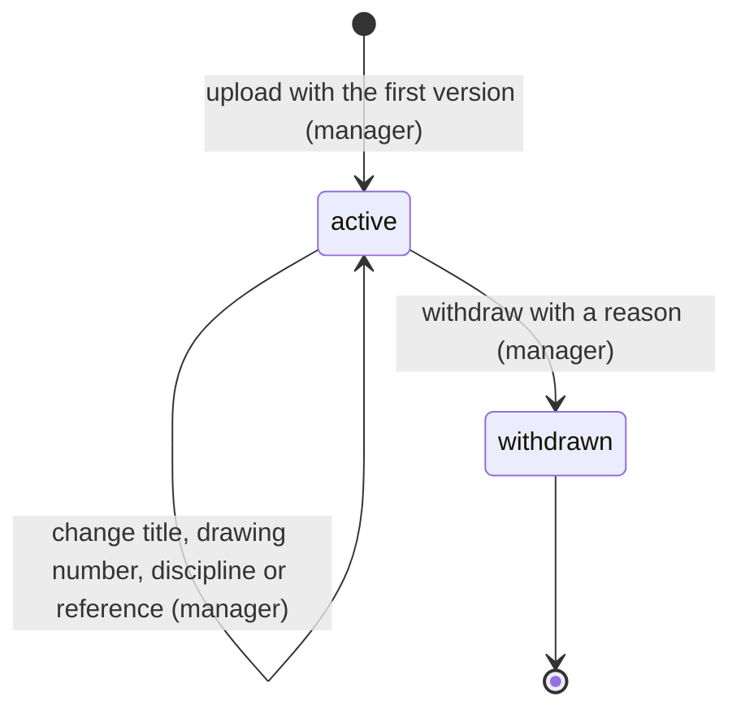

| Transition | Actor / preconditions | Effect / audit |
|---|---|---|
| new → active | Manager; a file accepted by content (PDF, JPEG, PNG, WebP, DOCX, XLSX; ≤ 25 MB; scanned); category; title; drawings: number (unique per project) and discipline; a revision label | Version 1 is current; `document.created` |
| new version | Manager; the current version the user saw (409 `version-stale`); a new revision after the current one or starting a new series; a change note; not the same file again; ≤ 50 versions | The new version is current; the previous one is **superseded** (time and successor recorded once); `document.version_added` |
| withdraw | Manager; reason | **Final**; versions stay downloadable and labelled; no new versions or approval requests; `document.withdrawn` |
| download | Any document reader (confidential categories: finance readers) | Streamed after the SHA-256 check; superseded versions named `_SUPERSEDED`; `document.downloaded` |

**Compliance item** (`compliance_records`; status derived on read in Nairobi dates)

| Status | When |
|---|---|
| `missing` | No record for the item (project items per project; company items once for the company) |
| `valid` | Current record without expiry, or expiring more than the type's reminder days from today |
| `expiring` | Today is within the reminder window: expiry − reminder days ≤ today ≤ expiry |
| `expired` | Today is after the expiry date |
| `not_applicable` | The current record says the item does not apply, with a reason |

| Command | Actor / preconditions | Effect / audit |
|---|---|---|
| record / renew / not applicable | Manager (company items: `config.manage`); the current record the user saw (409 `compliance-stale`); an active type; dates: issue not in the future, expiry required when the type expires and not before issue; evidence a version of the project the user can see; not applicable: a reason only | New current record; the previous one superseded (kept as history); `compliance.recorded` |
| add / change / retire / reactivate a type | `config.manage`; custom label (starter names are fixed), scope fixed after creation, expires flag, reminder days 1–365; at most 60 types | `compliance.type_created` / `compliance.type_updated`; a retired type leaves the registers and takes no records |
| export | Any document reader; EN or SW; 30 per 10 minutes | PDF or Excel generated on demand; `compliance.exported` |

**Consultant instruction** (`instructions` + append-only `instruction_responses`; status checked at commit against the latest response)

```mermaid
stateDiagram-v2
  [*] --> received: record (recorder; offline-ready)
  received --> acknowledged: acknowledge (recorder, not the issuer)
  acknowledged --> actioned: action with a note (recorder, not the issuer)
  received --> actioned: action with a note (recorder, not the issuer)
  received --> closed: close with a note (instruction manager)
  acknowledged --> closed: close with a note (instruction manager)
  actioned --> closed: close (instruction manager)
  closed --> received: reopen with a note (instruction manager)
```

| Transition | Actor / preconditions | Effect / audit |
|---|---|---|
| new → received | Recorder; number unique per project; dates issued and received not in the future, received on or after issued; a delay of the project if linked; a consultant may mark it issued by themselves; client ID + `Idempotency-Key` | `instruction.recorded` (a replay returns the original) |
| note | Recorder; not closed; a note | Response row, status unchanged; `instruction.responded` |
| acknowledge / action | Recorder who did not issue it (409 `instruction-issuer-cannot-respond`); action needs a note | Response row with from → to; `instruction.responded` |
| close / reopen | Instruction manager; a note unless closing an actioned instruction | Closed instructions are **locked**: no changes, notes, attachments or new variations; `instruction.responded` |
| change details | Instruction manager; not closed | `instruction.updated` (field names) |
| attach | Recorder; not closed; a version of a project document or a **verified** general site photo; ≤ 10 | Append-only attachment; `instruction.attachment_added` |

**Approval request** (`approval_requests` + one `approval_responses` row)

```mermaid
stateDiagram-v2
  [*] --> pending: raise on the current version of an active document (manager)
  pending --> approved: response (in the app: not the raiser or uploader; or a recorded paper response)
  pending --> approved_with_comments: response with comments
  pending --> rejected: response with comments
  pending --> resubmit: response with comments
  pending --> cancelled: cancel with a reason (the raiser)
  rejected --> [*]
  resubmit --> [*]
  approved --> [*]
  approved_with_comments --> [*]
  cancelled --> [*]
```

| Transition | Actor / preconditions | Effect / audit |
|---|---|---|
| new → pending | Manager; the current version of an active document; sent on (not in the future), due on or after; a resubmission names a rejected or *resubmit* request that has none yet | `APR-NNNN`; `approval.raised` |
| pending → decision | Manager; **in the app**: answers as themselves and is neither the raiser nor the uploader (403); **paper**: the consultant's name and the scan (another document of the project, uploaded after the request was raised, used for no other response: 422 `approval-evidence-invalid`) — the raiser may record it; the SHA-256 shown must match the version's (409 `approval-digest-mismatch`); responded on or after sent, not in the future; comments unless approved | **Final**; `approval.responded` |
| pending → cancelled | The raiser; reason | **Final**; `approval.cancelled` |
| overdue | Pending and due before today (Nairobi) | Computed on read: an `approval_overdue` reminder on the project and company lists |

## Schedule baseline and delay log (D6.2)

Implemented for the web app ([ARCHITECTURE §4.6](./ARCHITECTURE.md#46-schedule-d62)). Every command needs `projects.manage` on an open project (role ∩ assignment, checked by `ProjectAccess.editable`; closed and cancelled projects are read-only in the API and in every schedule trigger), runs in the tenant transaction under the company lock, checks the expected version and writes its audit event in the same transaction. There is no external effect, outbox event or offline capture; a retry after a lost response is refused as a version conflict (or `dependency-exists`) rather than applied twice.

**Activities and dependencies** (editable records, not a state machine). An activity's status follows its actual dates: `not_started → in_progress` (actual start) `→ complete` (actual finish, 100 %); recording progress can also clear them to correct a mistake (audited like any change). Planned dates are never stored: every read runs CPM (`computeSchedule`) at today's data date.

| Command | Preconditions | Effect / audit |
|---|---|---|
| Add activity | Code unique per project; duration 1–1,000 working days; WBS node of the project; BQ item in the newest approved BQ version; at most 500 activities | Version 1, physical basis; `schedule.activity_created` (code, duration, field names) |
| Edit activity | Expected version | Version + 1; `schedule.activity_updated` (field names) |
| Record progress | Expected version; no future actual dates (Nairobi); finish ≥ start; whole percent 0–100 or quantity done ≤ total; 100 % exactly with an actual finish; nothing before an actual start | Version + 1; `schedule.progress_recorded` (status, basis, field names) |
| Delete activity | Expected version; never started; not named by any delay version | Removed with its dependencies (baselines keep their copy); `schedule.activity_deleted` |
| Link | Both items in the project (a task, or a milestone that is not cancelled: its network link is created on first use, `schedule.milestone_linked`); pair not already linked; **no cycle** (API and `app.reject_schedule_cycle`); lag −60…365 | `schedule.dependency_created` (type, lag, kinds) |
| Change / remove link | Expected version (type and lag only; the two ends never change) | `schedule.dependency_updated` / `schedule.dependency_deleted` |
| Change calendar | Expected version (0 the first time); at least one working weekday | `schedule.calendar_updated` (weekdays, holidays on/off) |

**Baseline.** No baseline → baseline 1 → baseline 2 … (append-only; the newest is current).

| Transition | Actor / preconditions | Effect / audit |
|---|---|---|
| freeze (first or re-baseline) | `projects.manage`; name 1–120 characters; reason 3–500 characters; at least one activity or milestone; at most 50 baselines | Computes the schedule at today's data date and copies every task's and non-cancelled milestone's scheduled start, finish, duration, float and critical flag, the calendar, the start and the project finish into a new numbered baseline, written in one transaction (the item count is checked at commit). It becomes current; older ones stay comparable (`GET schedule?baselineId=`). `schedule.baseline_created` (number, item count, `reasonGiven`; the reason itself stays in the baseline row) |
| change or delete a baseline | — | Never possible: no API, no privilege for the runtime role and a trigger refusal for everyone |

Variance compares the current schedule with the chosen baseline in working days of the current calendar (later is positive); items added after the baseline, and every item when there is no baseline, show "unavailable"; items removed since are listed separately.

**Delay log.** `recorded (v1) → recorded (v2 …)` by amendment, `recorded → withdrawn` (final). Each step appends a version that supersedes the previous one exactly once.

| Transition | Actor / preconditions | Effect / audit |
|---|---|---|
| record | `projects.manage`; cause from the fixed list; start not in the future; end (optional while ongoing) between the start and today; working days lost in half days, ≤ the working days in the period (to today while ongoing); affected activities are tasks of the project; site diary of the same project; claim flag | DLY number = next per project; version 1; `schedule.delay_recorded` (number, cause, claim flag, activity count, diary linked, open) |
| amend | Expected version; not withdrawn; the same checks; reason 3–500 characters | Version + 1 with the full new content and the reason; `schedule.delay_amended` (version, changed field names, `reasonGiven`) |
| withdraw | Expected version; not withdrawn; reason | Final version with status `withdrawn` (content kept); `schedule.delay_withdrawn` |

The claim flag (`not_assessed`, `non_excusable`, `excusable`, `compensable`) records the company's position to support a later claim; PM-Buddy makes no legal determination and does not change the schedule from it. Delays do not move dates by themselves: the actual dates and progress do.

## Payroll

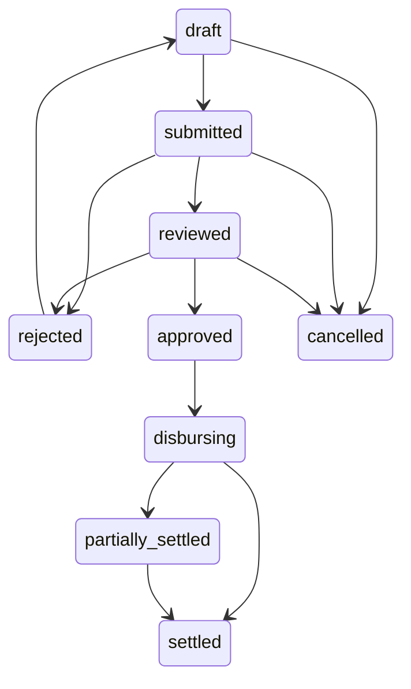

| Transition | Actor, scope and preconditions | Side effects and audit event | Retry |
|---|---|---|---|
| draft → submitted | Project payroll preparer; validated earnings, reviewed rules and funding proposal | Freeze submitted snapshot; `payroll.submitted` | Shared command rules |
| submitted → reviewed | Finance reviewer, distinct from preparer; matching snapshot | Record review; `payroll.reviewed` | Expected version |
| submitted/reviewed → rejected | Assigned reviewer/approver; reason required | No payable created; `payroll.rejected` | Expected version |
| rejected → draft | Preparer; increment version | Clear obsolete approvals; `payroll.reopened` | Expected version |
| reviewed → approved | Owner/authorised approver, distinct from preparer and reviewer; fresh MFA, limits and snapshot match | Immutable batch and authorised obligations; `payroll.approved` | Database uniqueness/version guard |
| draft/submitted/reviewed → cancelled | Authorised project manager; reason | Release provisional reservations; `payroll.cancelled` | Expected version |
| approved → disbursing | Payment worker acting for tenant; approved obligations and payout switch enabled | Reserve outstanding amounts; create attempts/outbox; `payroll.disbursing` | Unique attempt/reservation rules |
| disbursing → partially_settled/settled; partially_settled → settled | Settlement processor; derive from confirmed allocations across obligations, not independent flags | Record derived state; `payroll.settlement_updated` | Duplicate allocation prevented |

Failed lines remain outstanding, not automatically resubmittable if any attempt is uncertain. Closed-period attendance routes to an adjustment run referencing the original batch; never mutate settled payroll.

## Payment attempts

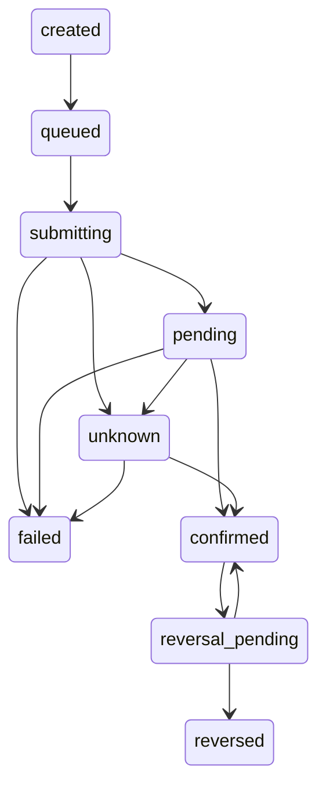

| Transition | Actor, scope and preconditions | Side effects and audit event | Retry |
|---|---|---|---|
| created → queued | Tenant payment service; authorised obligation, reservation and immutable recipient snapshot | Outbox work; `attempt.queued` | Unique key/fingerprint |
| queued → submitting | Worker; payout enabled, reservation still valid, no uncertain prior attempt | Persist call intent before external call; `attempt.submitting` | CAS ownership; never blindly repeat call |
| submitting → pending | Worker; provider accepted with expected identifiers | Save protected provider evidence; `attempt.pending` | Persist same result once |
| submitting/pending → unknown | Watchdog/worker; timeout, lost response or expired lease | Hold reservation; reconciliation case; `attempt.unknown` | No automatic resubmission |
| submitting/pending/unknown → failed | Verified definitive non-settlement result, not timeout; authorised reconciler for manual evidence review | Release reservation only when safe; `attempt.failed` | Deduplicate result |
| pending/unknown → confirmed | Durable inbox/reconciler; verified identifiers, amount, KES currency and direction | Allocation and balanced journal in transaction; `attempt.confirmed` | Unique provider receipt/allocation |
| confirmed → reversal_pending | Independent authorised approver; fresh MFA and reversal reason | Separate reversal request; `attempt.reversal_requested` | Reversal has separate idempotency key |
| reversal_pending → reversed/confirmed | Verified reversal success/definitive rejection | Compensating journal only on success; `attempt.reversed`/`attempt.reversal_rejected` | Unknown reversal remains pending review |

Late/out-of-order results never regress confirmed settlement to pending/failed. Conflicting definitive evidence opens a dispute. A callback can be processed after a timeout even if local state is still `submitting`; route through reconciliation with the same verification/atomic settlement controls. New payouts target only demonstrably unpaid outstanding obligations.

## Procurement and certification

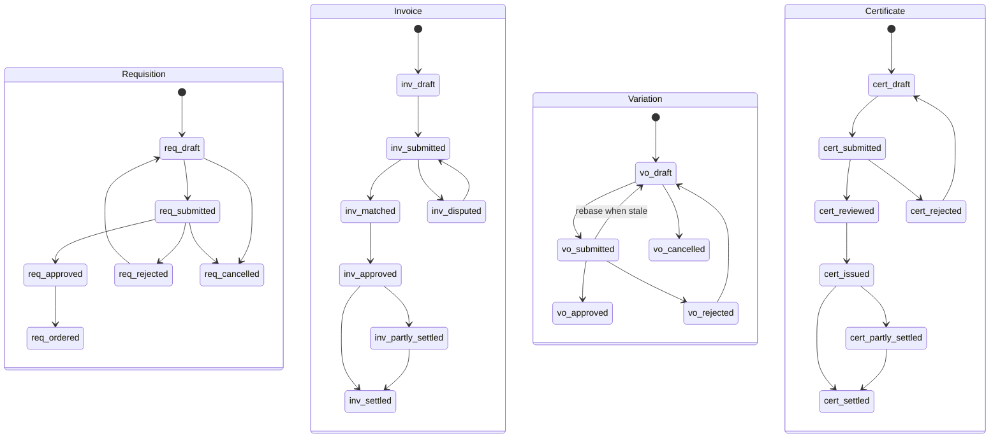

| Workflow / transition | Actor, scope and preconditions | Side effects and audit event | Retry |
|---|---|---|---|
| Requisition draft → submitted | Site requester; item/unit/version valid | `requisition.submitted` | Expected version |
| submitted → approved/rejected | Independent project approver; budget/limits or reason | Reserve commitment proposal or record rejection; `requisition.approved/rejected` | Expected version |
| rejected → draft | Requester; new version | Clear approval; `requisition.reopened` | Expected version |
| approved → ordered | Procurement; quote policy and LPO approved | Link LPO and committed cost; `requisition.ordered` | Unique conversion to order |
| draft/submitted → cancelled | Requester/manager; no issued LPO | `requisition.cancelled` | Expected version |
| Invoice draft → submitted | Finance clerk; source invoice and supplier identity verified | `invoice.submitted` | Duplicate supplier reference prevented |
| submitted → matched/disputed | Matching service/reviewer; LPO/GRN tolerance, eTIMS review, approved service exceptions | Matching evidence or dispute; `invoice.matched/disputed` | Expected version |
| disputed → submitted | Clerk; corrected draft version and evidence | Invalidate old match; `invoice.resubmitted` | Expected version |
| matched → approved | Independent Finance approver; limits, snapshot, review complete | Accrue cost and obligation once; `invoice.approved` | Unique accrual source |
| approved → partly_settled/settled; partly_settled → settled | Verified allocation processor | Derived cash/settlement state; `invoice.settlement_updated` | Allocation uniqueness |
| Variation draft → submitted | QS; instruction and BQ baseline/version attached | Freeze proposal; `variation.submitted` | Expected version |
| submitted → approved/rejected | Independent contract-authorised approver; reason/limits | New BQ version only on approval; `variation.approved/rejected` | Unique approved variation version |
| rejected → draft; draft → cancelled | QS; new version or cancellation reason | `variation.reopened/cancelled` | Expected version |
| draft/submitted/rejected → draft (rebase) | QS; base is no longer the newest approved BQ version | Re-point proposal and lines to the newest version, reprice, clear the snapshot; `variation.rebased` | Expected version |
| Certificate draft → submitted | QS; measured work and materials reconciled | Snapshot valuation; `certificate.submitted` | Expected version |
| submitted → reviewed/rejected | Independent reviewer; retention, advance recovery and prior certificates checked | `certificate.reviewed/rejected` | Expected version |
| rejected → draft | QS; new version | Clear approvals; `certificate.reopened` | Expected version |
| reviewed → issued | Contract-authorised issuer; snapshot unchanged | Immutable certificate/receivable; `certificate.issued` | Unique issued version |
| issued → partly_settled/settled; partly_settled → settled | Verified receipts allocation processor | Derived settlement state; `certificate.settlement_updated` | Allocation uniqueness |

The certificate rows above are the design target. **D6.3 part A implements a simpler chain** (draft → submitted → certified by an independent `finance.manage` holder; return; cancel; no separate review or issue step, settlement in D7.1): see "Measurements and valuations (D6.3)" below.

Approved invoices, issued LPOs and certificates use linked credits, cancellations or amendments with fresh approval rather than deletion. Detailed cancellation/return policies require QS/accounting review before their implementation.

### Variation as implemented (D2.3)

The Variation workflow is implemented ([ARCHITECTURE §4.3](./ARCHITECTURE.md#43-bq-versions-variations-and-rate-build-ups-d23)); the transition table lives in `packages/domain/src/bq/variation-lifecycle.ts` and is repeated by the `app.guard_variation_order` trigger. Additions to the contract above:

- **Rebase.** When another variation on the same base is approved, this one is stale. Approval is refused (409 `variation-stale`) until someone with `bq.edit` rebases it: from draft, submitted or rejected it returns to draft on the newest approved version, its lines move with it and are repriced, and lines that no longer apply are flagged for correction. Rebase from a non-stale variation is 409 `variation-not-stale`. Draft → draft rebase is not a status change, so only the history row and the audit event record it.
- **Snapshot binding.** Submission stores a SHA-256 digest of the proposal (instruction, base version and its total, VAT rate, every line and the totals). Approve and reject must quote that digest; the server recomputes it and refuses any mismatch with 409 `variation-stale`.
- **Who may decide.** `bq.approve_variation` on the project; approval also needs MFA verified within five minutes (403 `step-up-required`). The decider must be neither the creator nor the submitter (403 `maker-checker`), for rejection as well as approval. Rejection and cancellation need a reason (at least three characters), kept in `variation_status_changes`.
- **Approval side effect.** One transaction, serialised per BQ: the next BQ version is created from the base plus the lines, with totals and VAT recomputed at the base's snapshotted VAT rate. Approval limits by amount are not implemented yet.
- **Baseline.** Before any variation, the imported draft (BQ version 1) is approved as the contract baseline (`bq.approve_variation`, step-up, not the importer); it is then immutable.

### Procure-to-pay as implemented (D5.2)

Requisitions, RFQs, LPOs and supplier invoices are implemented ([ARCHITECTURE §4.5](./ARCHITECTURE.md#45-procure-to-pay-d52)); the transition tables live in `packages/domain/src/procurement/lifecycle.ts` and are repeated by `app.guard_requisition`, `app.guard_rfq`, `app.guard_lpo` and `app.guard_supplier_invoice`. Differences from and additions to the contract above:

- **Requisition.** `reopen` returns a submitted, rejected or approved requisition (not one on an open RFQ) to draft and clears the decision; material edits are only possible in draft. `approved → ordered` happens when its LPO is approved (`ordered → approved` again if that LPO is cancelled before anything was received or invoiced). Approve and reject need `procurement.approve` and someone who is not a contributor (creator, editor, submitter); reject and cancel need a reason. Budget and approval limits by amount are **not** implemented.
- **RFQ** (new): `open → awarded | cancelled`, `awarded → open` when its LPO is cancelled (so it can be reissued). Award needs `procurement.min_quotes` complete, valid quotations or an approved single-source exception (requested with a reason by someone with `procurement.manage_suppliers`, approved by a `procurement.approve` holder who did not contribute to the RFQ).
- **LPO** (new): `draft → submitted → approved`, `submitted → draft` (returned with a reason), `draft | submitted | approved → cancelled` (approved only while nothing was received or invoiced). Approval needs `procurement.approve`, step-up and a non-contributor; an approved LPO never changes (amend = cancel + reissue from the RFQ).
- **GRN** (new, not a state machine): `recorded → voided` with a reason, refused while an approved invoice relies on it. Recording is idempotent (client ID + `Idempotency-Key`).
- **Invoice.** `submitted → matched | disputed` happens in the submission transaction (no separate reviewer step). `matched ↔ disputed` on `rematch`; `disputed → matched` by an **exception** (independent `payments.approve`, step-up, reason; never for a missing eTIMS number, inconsistent totals, an empty invoice or a line not on the order); `disputed | matched → draft` on `reopen` for a corrected version (a new content version; the old match no longer counts). `matched → approved` by an independent `payments.approve` holder with step-up, only while the current match passes and is not stale, binding the match, the content version and the supplier's verified payout version. `approved → partly_settled → settled` follow recorded settlements (`payments.disburse`, step-up, not the approver, amount ≤ outstanding, idempotent). A payee change after approval stops settlement until the invoice is approved again (`approved | partly_settled` re-approval creates a new payable). Anything not yet approved can be cancelled with a reason (e.g. after a credit note); approved invoices are not cancelled in D5.2.
- **Audit events:** `requisition.created/updated/submitted/approved/rejected/reopened/cancelled`, `rfq.created/updated/exception_requested/exception_approved/awarded/cancelled`, `quotation.recorded/withdrawn`, `lpo.created/updated/…` (one per transition), `grn.recorded/voided`, `invoice.recorded/updated/submitted/matched/disputed/match_excepted/approved/reapproved/reopened/cancelled`, `invoice.settlement_recorded`, `procurement.document_added`; metadata carries IDs, statuses, field names and match reason codes, never amounts or free text.

### Supplier invoices through the supplier portal (D7.2)

The supplier's path joins the D5.2 invoice state machine above; nothing in it changes for staff-recorded invoices ([ARCHITECTURE §4.12](./ARCHITECTURE.md#412-supplier-portal-d72)).

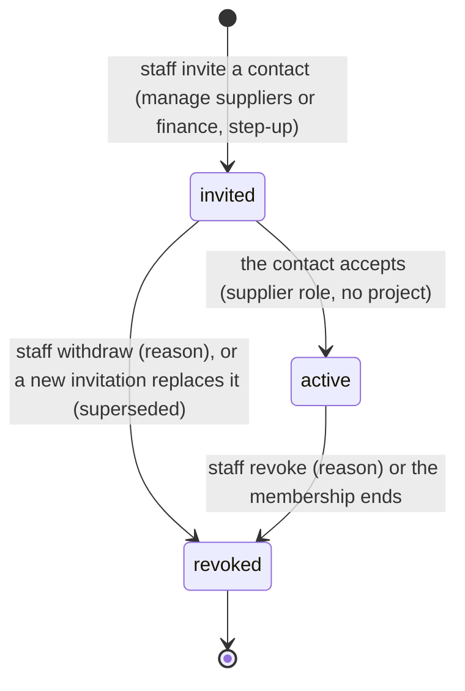

1. **Access.** A supplier manager (`procurement.manage_suppliers` or company-wide `finance.manage`, step-up) invites a contact from the supplier page; the contact opens `/supplier/join?token=…`, creates an account (or signs in) and accepts. The binding is `active` from then on; revoking it ends the membership and sessions at once. If the link expired (48 hours) or never arrived, staff simply invite again: the new invitation replaces the old one (cause `superseded`) and only the newest link works.
2. **Order.** Staff approve the LPO (D5.2, unchanged). It appears in the portal; the supplier may **acknowledge** it once (a record, not a transition).
3. **Delivery.** Staff record GRNs (D5.2, unchanged); the supplier sees what was received, rejected and why.
4. **Invoice.** The supplier submits against the approved LPO (eTIMS number required, PDF attached, client ID + `Idempotency-Key`). In **one transaction**: the invoice is recorded as `draft` by the supplier, the submission row is written, and `draft → submitted → matched | disputed` runs the three-way match. The supplier sees *under review* or *disputed* (with reason codes); staff see the invoice in their queue marked "Submitted by the supplier".
5. **Staff decision.** Exactly as D5.2: `rematch`, exception (independent `payments.approve`), approval (independent `payments.approve`, step-up, verified payee) or `cancel` with a reason. **`reopen` is refused** for a portal invoice (409 `supplier-invoice-locked`, API and trigger): to correct it, staff cancel it with a reason and the supplier submits a new invoice (a new number if the supplier's own numbering requires it; a cancelled invoice's number is free again under the D5.2 key rules).
6. **Payment.** `approved → partly_settled → settled` by staff recording settlements (D5.2). The supplier sees *approved*, *partly paid* or *paid* with each recorded payment (amount, date, method, reference) and its statement; the portal never confirms or initiates a payment.

Supplier-facing statuses (`supplierInvoiceStatus`): `submitted` → submitted; `matched` → under review; `disputed` → disputed; `approved` → approved; `partly_settled` → partly paid; `settled` → paid; `cancelled` → cancelled; a staff `draft` is not shown. Audit: `supplier_portal.user_invited/user_activated/user_revoked`, `supplier_portal.lpo_acknowledged`, `supplier_portal.invoice_submitted` (plus the invoice's own `invoice.*` events), `supplier_portal.statement_exported`.

## Client portal: receipts and variation decisions (D7.1)

Implemented in D7.1 ([ARCHITECTURE §4.15](./ARCHITECTURE.md#415-client-portal-d71)). Neither flow adds a state to D6.3's valuations or D2.3's variations: receipts are entries against a certified certificate, and the client's decision is a gate on `submitted → approved`.

### Client receipts

```mermaid
stateDiagram-v2
  [*] --> owed : certificate certified (D6.3; due = certified on + payment terms in force)
  owed --> part_paid : receipt recorded (finance.manage; ≤ outstanding)
  part_paid --> paid : receipts reach the certificate's total
  owed --> paid : one receipt for the whole amount
  part_paid --> owed : the only receipt reversed (reason)
  paid --> part_paid : a receipt reversed (reason)
  owed --> overdue : due date passes (derived, Nairobi dates)
  part_paid --> overdue : due date passes with something outstanding
```

The states are derived from the entries, never stored (`certificateBalances` in `packages/domain`); a correcting (negative) certificate is a **credit** applied to the oldest certificates still owed.

| Workflow / transition | Actor, scope and preconditions | Side effects and audit event | Retry |
|---|---|---|---|
| Receipt recorded | `finance.manage` on the project; open project; a **certified** certificate (409 `certificate-not-certified`); amount > 0 and ≤ outstanding (409 `receipt-exceeds-outstanding`, checked again under a lock by `app.guard_client_payment`); received today or earlier and not before certification (422 `receipt-date-invalid`); method, reference; ≤ 200 entries per certificate | Append-only `client_payments` row; the client's statement, overview and pay page change at once; the forecast and earned value follow (D-138); `client_payment.recorded` (IDs only) | Client `id` + `Idempotency-Key` + digest: a replay returns the view; another payload is 409 `idempotency-key-reused`; the same ID under another key 409 `payment-id-conflict` |
| Receipt reversed | `finance.manage`; open project; a receipt not already reversed (409 `receipt-already-reversed`; unique `reverses_id`); reason (≥ 3 characters, shown to the client) | A reversal entry for the full amount; `client_payment.reversed` | As above |
| Client terms changed | `projects.manage`; open project; on the version read (409 `version-conflict`) | New `project_client_settings` version; certificates already certified keep their due dates; `client_portal.terms_changed` | Expected version |
| Paybill instructions changed | `config.manage` + step-up; on the version read | New company version, shown to clients at once; `client_portal.payment_instructions_changed` | Expected version |
| Pay with M-Pesa (STK Push) | an assigned client; something outstanding (409 `nothing-outstanding`, 422 `amount-exceeds-outstanding`) | **Refused with 503 `stk-push-unavailable`** until D4.2 (the client pays by Paybill; finance records the receipt) | — |
| Anything else (edit, delete) | — | Refused (no UPDATE/DELETE for `pmb_app`; the trigger refuses every role) | — |

Once D4.2 exists, a payment request moves `created → submitting → pending → confirmed | failed` (`unknown` reconciled before any retry, `cancelled` only before submission; `CLIENT_PAYMENT_REQUEST_TRANSITIONS`); only a reconciled provider callback confirms, and only then is a receipt recorded.

### Variation decisions by the client

```mermaid
stateDiagram-v2
  [*] --> awaiting_decision : staff send the current submission (bq.edit; client view + digest frozen)
  awaiting_decision --> approved : client approves on the digest (once)
  awaiting_decision --> rejected : client rejects on the digest with a comment (once)
  awaiting_decision --> withdrawn : the variation is reopened, rebased, rejected, cancelled or approved first
  approved --> [*]
  rejected --> [*]
  withdrawn --> [*]
```

| Workflow / transition | Actor, scope and preconditions | Side effects and audit event | Retry |
|---|---|---|---|
| Send to the client | `bq.edit` on the project; open project; the variation is `submitted` (409 `invalid-transition`) and the request quotes its version and snapshot digest (409 `version-conflict`, `variation-stale`); not already sent for this submission (409 `already-sent`); a client user is assigned (409 `no-client-assigned`) | `variation_client_requests` row with the frozen client view and its SHA-256; `client_portal.variation_sent` | Expected version and digest |
| Client approves / rejects | an assigned client (portal, `app.acts_as_client`); the sending is still open (409 `request-closed`) and not decided (409 `already-decided`); quotes the client digest (409 `variation-stale`); a rejection needs a comment; 30 per hour | `variation_client_decisions` row; staff see it on the variation page; `client_portal.variation_decided` | — (once) |
| Internal approval (D2.3) | unchanged (`bq.approve_variation`, step-up, maker-checker, digest), **plus**: when the project's client terms require it, the client approved this submission (409 `client-approval-required`; trigger `app.hold_variation_for_client`) | As D2.3 | As D2.3 |
| Reject, rebase, cancel, reopen (D2.3) | unchanged; never wait for the client | An open sending becomes *withdrawn* (derived) | As D2.3 |

A rejection by the client does not reject the variation: staff decide what to do (revise and resubmit, then send again; or reject it). When the project does not require client approval, the client's decision is advisory and shown beside the internal one.

## Stores (D5.3)

Implemented in D5.3 ([ARCHITECTURE §4.6](./ARCHITECTURE.md#46-stores-d53)). The transition tables live in `packages/domain/src/stores/lifecycle.ts` and are repeated by `app.guard_stock_transfer` and `app.guard_stock_take`; stock itself only changes through ledger entries (`app.post_stock_entry`), never by editing a balance.

```mermaid
stateDiagram-v2
  state Transfer {
    [*] --> trf_dispatched : dispatch (stock leaves the source store)
    trf_dispatched --> trf_received : receive, every line as sent
    trf_dispatched --> trf_disputed : receive, a line differs (reason per line)
    trf_disputed --> trf_resolved : resolve (note; not the sender or receiver)
    trf_dispatched --> trf_cancelled : cancel (reason; dispatch reversed)
  }
  state StockTake {
    [*] --> stk_draft : start (system quantities snapshotted)
    stk_draft --> stk_draft : record counts
    stk_draft --> stk_submitted : submit (every line counted)
    stk_submitted --> stk_approved : approve (not a contributor; variances posted)
    stk_submitted --> stk_draft : return for recount (reason)
    stk_draft --> stk_cancelled : cancel (reason)
    stk_submitted --> stk_cancelled : cancel (reason)
  }
```

| Workflow / transition | Actor, scope and preconditions | Side effects and audit event | Retry |
|---|---|---|---|
| Issue / return / wastage recorded | `stores.manage` on the store's project; an issue names an approved-BQ item (lineage) and/or a project gang; a return names a posted issue and ≤ what is outstanding per line; wastage has a reason and a note; never more than on hand | Ledger entries at the average cost (returns at the issue's cost); `stock.issued`, `stock.returned`, `stock.wasted` | Client ID + `Idempotency-Key` (replay returns the original) |
| Movement posted → reversed | `stores.manage`; reason; an issue only after its returns are reversed | Reversing entries naming the originals; `stock.movement_reversed` | Refused once reversed |
| Transfer → dispatched | `stores.manage` on the source store; target is another store the caller can see; ≤ on hand | `transfer_out` entries at the average; in transit on both stores; `stock.transfer_dispatched` | Client ID + `Idempotency-Key` |
| dispatched → received / disputed | `stores.manage` on the destination store; a quantity for every line, a reason for each line that differs | `transfer_in` entries at the dispatch unit cost for what arrived; the shortfall's value is the transit loss; `stock.transfer_received` / `stock.transfer_disputed` | `Idempotency-Key` (replay returns the result) |
| disputed → resolved | `procurement.approve` on either project; neither the sender nor the receiver; note | No stock moves; `stock.transfer_resolved` | Expected version |
| dispatched → cancelled | `stores.manage` on the source store; reason | Dispatch reversed into the source store; `stock.transfer_cancelled` | Expected version |
| Stock take started (draft) | `stores.manage`; one open count per store | Lines snapshot the system quantity of every material held or with a reorder level (at most 300: a larger store is counted in turns, those counted longest ago first, and the response says how many are left); `stock_take.created` | Refused while another is open |
| Counts recorded | `stores.manage`; draft; lines of this count | Each count keeps the system quantity **at the moment it is counted** (snapshot + movements since), so movements during the count are not variances; the counter becomes a contributor; `stock_take.counted` | Count IDs + `Idempotency-Key` |
| draft → submitted | `stores.manage`; every line counted | Submitter becomes a contributor; `stock_take.submitted` | Expected version |
| submitted → approved | `procurement.approve`; **not a contributor** (creator, counters, submitter) | Each variance posted as an `adjustment` at the average cost (refused if a shortfall exceeds what is now on hand); `stock_take.approved` | Expected version |
| submitted → draft (return) | `procurement.approve`; reason | Recount; `stock_take.returned` | Expected version |
| draft / submitted → cancelled | `stores.manage` or `procurement.approve`; reason | Nothing posted, counts kept as evidence; `stock_take.cancelled` | Expected version |

GRNs post to stores as part of their own workflow (D5.2): recording receives the accepted quantities into the site's store; a void reverses them and is refused (`grn-stock-consumed`) when the goods were already issued or moved.

## Spending: petty cash, reconciliation, budgets and journals (D5.4)

Implemented in D5.4 ([ARCHITECTURE §4.8](./ARCHITECTURE.md#48-spending-and-cash-flow-d54)). The transition tables live in `packages/domain/src/spending/lifecycle.ts` and are repeated by the database guards (`app.guard_budget`, `app.guard_petty_cash_top_up`, `app.guard_petty_cash_expense`, `app.guard_petty_cash_count`, `app.guard_cost_journal`). A float's balance only changes through its own ledger entries (`app.post_float_entry`), and cost only through `cost_entries` posted once per source.

```mermaid
stateDiagram-v2
  state Budget {
    [*] --> b_draft : prepare (empty, from the approved BQ, or a copy of the version in force)
    b_draft --> b_draft : add / change / remove lines (preparer becomes a contributor)
    b_draft --> b_submitted : submit (lines fingerprinted)
    b_submitted --> b_approved : approve on the digest (finance.manage + step-up, not a contributor)
    b_submitted --> b_draft : return (reason)
    b_draft --> b_cancelled : cancel (reason)
    b_submitted --> b_cancelled : cancel (reason)
  }
  state TopUp {
    [*] --> t_requested : ask (custodian or finance.manage; within the limit)
    t_requested --> t_approved : approve (payments.approve + step-up, not the requester)
    t_requested --> t_rejected : reject (reason)
    t_approved --> t_paid : pay (payments.disburse + step-up, not the approver; method + reference)
    t_requested --> t_cancelled : cancel (reason)
    t_approved --> t_cancelled : cancel (reason)
  }
  state Expense {
    [*] --> e_submitted : record (custodian; cash leaves the float)
    e_submitted --> e_approved : approve (receipt attached; not the recorder or custodian)
    e_submitted --> e_rejected : reject (reason; cash back on the book)
  }
  state Count {
    [*] --> c_submitted : count (book balance snapshotted)
    c_submitted --> c_approved : approve (not the counter or custodian; variance posted)
    c_submitted --> c_returned : return (reason; count again)
  }
```

| Workflow / transition | Actor, scope and preconditions | Side effects and audit event | Retry |
|---|---|---|---|
| Float opened | `finance.manage` on the site's project; one float per site; the custodian holds `finance.petty_cash` on the project | Float with balance 0 and a limit; `petty_cash.float_created` | Unique per site (409 `float-exists`) |
| Custodian or limit changed; float closed | `finance.manage`; a new custodian only after an **approved count with nothing moved since** (or an empty float); closing needs a zero balance and nothing open | `petty_cash.float_updated` / `petty_cash.float_closed` | Expected version |
| Top-up asked → approved → paid | asked by the custodian or `finance.manage` (balance + amount ≤ limit); approved by `payments.approve` (not the requester nor the float's custodian); paid by `payments.disburse` (not the requester, the approver nor the custodian) with method, reference (unique per method) and a paid-on date between the request and today | Paid: a `top_up` float entry (the float row locked); `petty_cash.top_up_requested/approved/paid/rejected/cancelled` (IDs and statuses only) | Expected version |
| Expense recorded (submitted) | the float's custodian holding `finance.petty_cash`; dated today or within 90 days; tagged with a BQ item of the BQ in force or an active cost code and a category; M-Pesa needs a code (unique among expenses not rejected); amount + charge ≤ book balance | An `expense` float entry for amount + charge (locked; never below zero); `petty_cash.expense_recorded` (no amounts, codes or payees) | Client ID + `Idempotency-Key`: a replay returns the original; a changed retry of a recorded attempt is 409 `idempotency-key-reused`/`expense-id-conflict`, and the form keeps its ID and key and links to the recorded expense |
| Expense: pasted SMS | any petty-cash reader | Draft only (`confirmsSettlement: false`): the form is filled and labelled; records already holding the code are named; the text is never stored | Read-only |
| Receipt added | the recorder or `finance.manage`; not rejected; ≤ 3; JPEG/PNG/WebP within the size limit; malware hook | Private object, metadata row; `petty_cash.receipt_added` | Repeatable |
| submitted → approved | `finance.manage` or `procurement.approve` on the project; **not the recorder and not the custodian**; at least one receipt | Cost entries: accrual + payment of the amount (its tags), charge accrual + payment (fees); `petty_cash.expense_approved` | Expected version |
| submitted → rejected | same approvers; reason | An `expense_rejected` float entry restores the book (the custodian owes the cash); `petty_cash.expense_rejected` | Expected version |
| **Reconciliation**: count recorded | the custodian or `finance.manage`; one open count per float | Book balance snapshotted; variance = counted − book; `petty_cash.counted` | One open count (409 `count-open`) |
| count submitted → approved | `finance.manage` or `procurement.approve`; **not the counter and not the custodian** | A `count_adjustment` float entry of the variance; cost entries of the shortage (positive) or overage (negative), category petty cash; `petty_cash.count_approved` | Expected version |
| count submitted → returned | same approvers; reason | Nothing posted; count again; `petty_cash.count_returned` | Expected version |
| **Budget** prepared, lines edited, submitted | `finance.manage` or `bq.edit` on the project; one draft or submitted version per project; a line is a BQ item **or** a cost code, once each | Totals kept by triggers; submit stores the SHA-256 digest of the lines; `budget.created/line_added/line_updated/line_removed/submitted` | Expected version |
| budget submitted → approved | `finance.manage` + step-up; **not a contributor**; quotes the digest (409 `budget-stale` if the lines changed) | The newest approved version is in force; an approved version never changes; `budget.approved` | Expected version + digest |
| budget submitted → draft / cancelled | return: `finance.manage`, reason; cancel: a preparer, reason | `budget.returned` / `budget.cancelled` | Expected version |
| Journal proposed (adjustment or reversal) | company-wide `finance.manage`; each line tagged (BQ item or cost code, category, counterparty, reference, date, non-zero amount); a reversal names one entry not yet reversed and not itself a reversal | Nothing posts yet; `cost_journal.proposed` | — |
| journal submitted → approved / rejected | `finance.manage` + step-up for approval; **never the proposer**; reason to reject | Approved: one cost entry per line (a reversal carries the opposite amount and the original's tags); `cost_journal.approved/rejected` | Expected version |
| Expected receipt or payment (cash-flow line) | `finance.manage` on the project | Shown in the forecast on its expected date until received or cancelled; `cash_flow.item_created/updated/received/cancelled` | Expected version |

Supplier invoices and settlements post to the cost ledger as part of their own workflow (D5.2): approval (matched → approved) posts the accrual net of VAT, each settlement posts the cost part of the cash paid; neither can be posted twice.

## Measurements and valuations (D6.3)

Implemented in D6.3 part A ([ARCHITECTURE §4.10](./ARCHITECTURE.md#410-measurement-valuations-and-earned-value-d63-part-a)). The valuation transition table lives in `packages/domain/src/valuations/lifecycle.ts` (`VALUATION_TRANSITIONS`) and is repeated by `app.guard_valuation`; a measurement's state is derived (`measurementState`) from its single review and the newest correction naming it. Changes are serialised per company (tenant row lock) and use the expected `version` where a record is edited.

```mermaid
stateDiagram-v2
  state Measurement {
    [*] --> m_pending : record (site.diary or bq.edit; photos now or later)
    m_pending --> m_pending : add photos (≤ 6)
    m_pending --> m_approved : approve (bq.edit, not the measurer, ≥ 1 photo)
    m_pending --> m_rejected : reject (bq.edit, not the measurer, reason)
    m_pending --> m_withdrawn : corrected before review (new row, same item and date)
    m_approved --> m_superseded : an approved correction replaces it
  }
  state Valuation {
    [*] --> v_draft : create (bq.edit; one open per project)
    v_draft --> v_draft : edit date, notes, stores option; add / remove materials and adjustments
    v_draft --> v_submitted : submit (figures, terms and lines frozen; digest)
    v_submitted --> v_certified : certify on the digest (finance.manage + step-up, not a contributor; IPC-NNNN)
    v_submitted --> v_draft : return (finance.manage, reason)
    v_draft --> v_cancelled : cancel (reason)
    v_submitted --> v_cancelled : cancel (reason)
  }
```

| Workflow / transition | Actor, scope and preconditions | Side effects and audit event | Retry |
|---|---|---|---|
| Measurement recorded (pending) | `site.diary` or `bq.edit` on the project; open project; an item of the BQ in force that is measured (not a provisional/PC sum or contingency); date not in the future; quantity ≥ 0, percent ≤ 100; above the BQ quantity only with a reason; photos of the same project (≤ 6) | Row with basis, value derived on read; `progress.measured` (IDs, item lineage, basis, photo count) | Client ID + `Idempotency-Key` (replay returns the original, `replayed: true`); 409 `measurement-id-conflict`, `idempotency-key-reused` |
| Photos added | a recorder; only while pending; same project; ≤ 6 in total | `progress.measurement_photos_added` (count) | Duplicate photos ignored |
| pending → approved / rejected | `bq.edit`; **not the measurer** (403 `maker-checker`); approval needs ≥ 1 photo (422 `measurement-evidence-required`); reject needs a reason | One review row (database clock); approved measurements count in valuations and earned value from their measured date; `progress.measurement_approved/rejected` | One review per measurement (409 `measurement-not-pending`) |
| Correction | a recorder; same item and date as the original, reason; the original must not already be corrected (409 `invalid-transition`) | New measurement; the original becomes `withdrawn` (pending) or `superseded` once the correction is approved | As recording |
| Valuation created (draft) | `bq.edit`; approved BQ; one open valuation per project (409 `valuation-open`); date not before the last certificate nor in the future; a release needs its certified completion (409 `completion-not-certified`), a certified interim before it and retention held, once per stage | `VAL-NNNN`; figures previewed on every read; `valuation.created` | — |
| Draft edited; materials and adjustments added or removed | `bq.edit` (the editor becomes a contributor); interim drafts only for inputs; materials against a measured item, within the item's remaining amount (409 `materials-exceed-remaining`); recoveries ≤ advances (409 `recovery-exceeds-advance`); both checked when added and again at submission (a later approved measurement can make materials exceed) | `valuation.updated`, `valuation.materials_added/removed`, `valuation.adjustment_added/removed` (IDs, kinds, counts) | Expected version |
| draft → submitted | `bq.edit` (the submitter becomes a contributor) | Figures, terms, contract sums and lines frozen (revision + 1), digest stored; database re-verifies KE-VAL-1 and the lines at commit; `valuation.submitted` | Expected version |
| submitted → certified | `finance.manage` + step-up; **not a contributor** (403 `maker-checker`); the digest quoted equals a fresh recomputation (409 `valuation-stale`) | `IPC-NNNN` assigned by the database; the row is frozen for every role; counts as a previous certificate from now on; `valuation.certified` | Expected version + digest |
| submitted → draft (return) | `finance.manage`; reason | Frozen figures cleared (lines of the earlier revision kept); `valuation.returned` | Expected version |
| draft / submitted → cancelled | a preparer (`bq.edit`) or certifier (`finance.manage`); reason | Number kept, never reused; `valuation.cancelled` | Expected version |
| certified → anything | — | Refused (API 409 `invalid-transition`; database). A mistake is corrected on the next certificate (which may be negative) | — |
| Contract settings changed | `finance.manage`; values in range | New version; drafts recompute; a submitted valuation becomes stale until returned and resubmitted; `valuation.settings_updated` | Expected settings version |
| Certificate PDF / Excel | a certificate reader | Generated on demand (watermark until certified); `valuation.exported`; rate-limited | Repeatable |

## Report subscriptions (D8.1)

Implemented in D8.1 ([ARCHITECTURE §4.14](./ARCHITECTURE.md#414-dashboards-and-reports-d81), D-126, D-127). A person subscribes **themselves** to a report they may run now; the email carries a sign-in link, never report data.

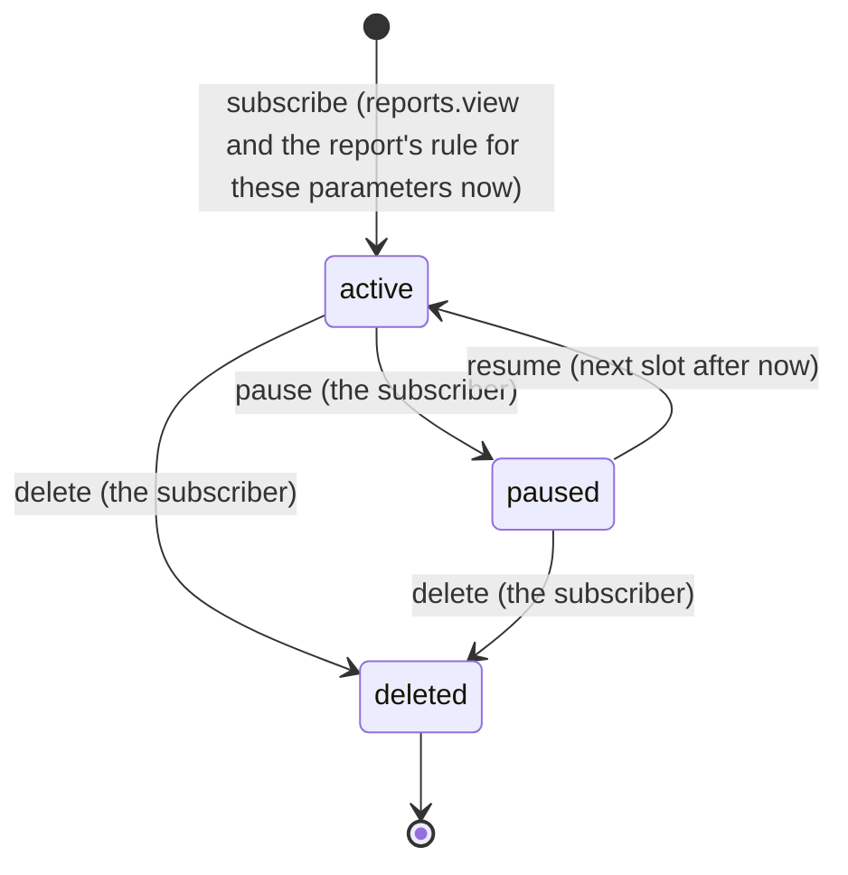

1. **Subscribe.** From a report's page, *Email me this report*: weekly (a weekday) or monthly (a day of the month; 29–31 run on the last day of shorter months), email language. The fixed parameters (project, site, store, batch, person, action) are kept as IDs; the period follows each run. Refused without an email address (422 `email-required`), above 20 per person or 200 per company (409 `subscription-limit`), or for the same report, parameters and schedule twice (409 `subscription-exists`).
2. **Due.** `next_run_at` is the next 07:00 Nairobi on the chosen day. Every minute one API instance (the holder of the advisory lock) takes up to 25 due subscriptions.
3. **Claim.** Each due subscription is handled in its own transaction in the subscriber's company context: the row is locked `FOR UPDATE SKIP LOCKED` and must still be active and due (another instance or a manual run skips it).
4. **Check.** The subscriber must still be a member with an email address, and must be able to run the report with its parameters **now** (`reports.view` + the source permission on the project; parameters still valid). Otherwise the run is **skipped** with the reason (`membership-ended`, `no-email-address`, `permission-lost`, `report-unavailable`) and nothing is sent.
5. **Send.** The email names the report, the company and the period (weekly: the last whole Monday–Sunday week; monthly: the previous month; as-at reports: the run date) and links to `/reports/<id>?…`. Opening the link needs sign-in and runs the report with that moment's permissions. A delivery error records **failed** (`delivery-failed`).
6. **Record.** One append-only run per subscription and due time (sent, skipped or failed), `last_run_at`, the next `next_run_at` (the next slot after now: missed slots are not replayed), and the audit event `report.subscription_run`.

| Action | Who | Effect |
|---|---|---|
| Subscribe | the person, for themselves only | `report.subscription_created` |
| Pause / resume / delete | the subscriber only (expected version) | `report.subscription_paused` / `_resumed` / `_deleted`; deleted is final and kept with its runs |
| See the company's subscriptions and runs | `config.manage` | read only |
| Send due emails now | `config.manage` | the same cycle for the company; `report.run_due_requested` |
