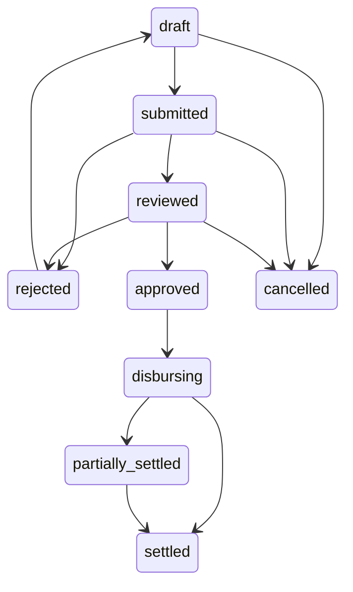
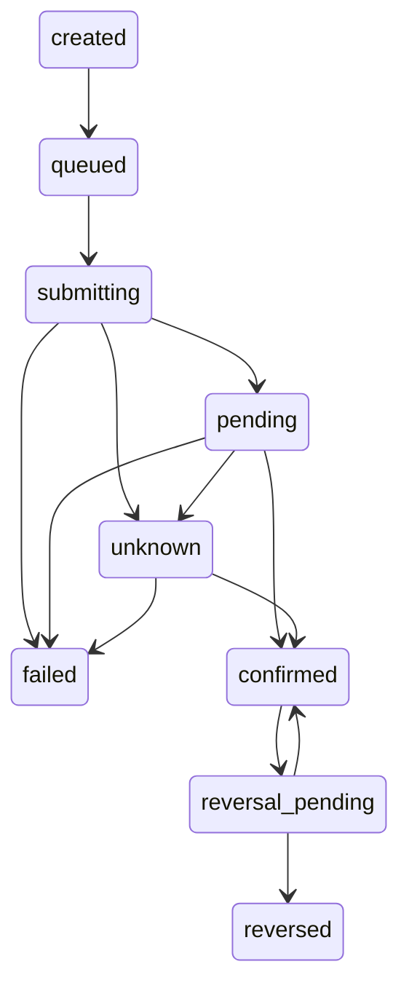
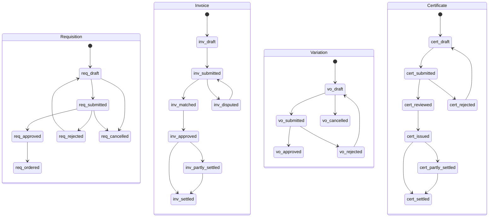

# PM-Buddy: Workflow contracts

Design requirements, not implemented payment/procurement APIs. See [brief §15](./PROJECT_BRIEF.md#15-mandatory-safeguards-pm-buddy-additions) and [acceptance matrix](./ACCEPTANCE_MATRIX.md).

## Shared transition rules

Every command resolves tenant/project membership on the server, checks permission and expected record version, and commits state, redacted audit event and outbox event atomically. Retried commands with the same tenant/operation/idempotency key and payload return the original result; a changed payload conflicts. Competing commands must not both consume the same version or outstanding balance.

Approvals bind an immutable snapshot of recipients, amounts, allocations and effective rules. Preparers cannot review/approve their own submission. Material edits before final approval create a new version and invalidate approvals. Approved financial records are immutable; subsequent corrections are separately approved linked records.

The tables below inherit these scope, audit and retry requirements. A failed precondition returns an explicit conflict/forbidden response without side effects.

## Payroll

| Transition | Actor, scope and preconditions | Side effects and audit event | Retry |
|---|---|---|---|
| draft → submitted | Project payroll preparer; validated earnings, reviewed rules and funding proposal | Freeze submitted snapshot; `payroll.submitted` | Shared command rules |
| submitted → reviewed | Finance reviewer, distinct from preparer; matching snapshot | Record review; `payroll.reviewed` | Expected version |
| submitted/reviewed → rejected | Assigned reviewer/approver; reason required | No payable created; `payroll.rejected` | Expected version |
| rejected → draft | Preparer; increment version | Clear obsolete approvals; `payroll.reopened` | Expected version |
| reviewed → approved | Owner/authorised approver, distinct from preparer and reviewer; fresh MFA, limits and snapshot match | Immutable batch and authorised obligations; `payroll.approved` | Database uniqueness/version guard |
| draft/submitted/reviewed → cancelled | Authorised project manager; reason | Release provisional reservations; `payroll.cancelled` | Expected version |
| approved → disbursing | Payment worker acting for tenant; approved obligations and payout switch enabled | Reserve outstanding amounts; create attempts/outbox; `payroll.disbursing` | Unique attempt/reservation rules |
| disbursing → partially_settled/settled; partially_settled → settled | Settlement processor; derive from confirmed allocations across obligations, not independent flags | Record derived state; `payroll.settlement_updated` | Duplicate allocation prevented |

Failed lines remain outstanding, not automatically resubmittable if any attempt is uncertain. Closed-period attendance routes to an adjustment run referencing the original batch; never mutate settled payroll.

## Payment attempts

| Transition | Actor, scope and preconditions | Side effects and audit event | Retry |
|---|---|---|---|
| created → queued | Tenant payment service; authorised obligation, reservation and immutable recipient snapshot | Outbox work; `attempt.queued` | Unique key/fingerprint |
| queued → submitting | Worker; payout enabled, reservation still valid, no uncertain prior attempt | Persist call intent before external call; `attempt.submitting` | CAS ownership; never blindly repeat call |
| submitting → pending | Worker; provider accepted with expected identifiers | Save protected provider evidence; `attempt.pending` | Persist same result once |
| submitting/pending → unknown | Watchdog/worker; timeout, lost response or expired lease | Hold reservation; reconciliation case; `attempt.unknown` | No automatic resubmission |
| submitting/pending/unknown → failed | Verified definitive non-settlement result, not timeout; authorised reconciler for manual evidence review | Release reservation only when safe; `attempt.failed` | Deduplicate result |
| pending/unknown → confirmed | Durable inbox/reconciler; verified identifiers, amount, KES currency and direction | Allocation and balanced journal in transaction; `attempt.confirmed` | Unique provider receipt/allocation |
| confirmed → reversal_pending | Independent authorised approver; fresh MFA and reversal reason | Separate reversal request; `attempt.reversal_requested` | Reversal has separate idempotency key |
| reversal_pending → reversed/confirmed | Verified reversal success/definitive rejection | Compensating journal only on success; `attempt.reversed`/`attempt.reversal_rejected` | Unknown reversal remains pending review |

Late/out-of-order results never regress confirmed settlement to pending/failed. Conflicting definitive evidence opens a dispute. A callback can be processed after a timeout even if local state is still `submitting`; route through reconciliation with the same verification/atomic settlement controls. New payouts target only demonstrably unpaid outstanding obligations.

## Procurement and certification

| Workflow / transition | Actor, scope and preconditions | Side effects and audit event | Retry |
|---|---|---|---|
| Requisition draft → submitted | Site requester; item/unit/version valid | `requisition.submitted` | Expected version |
| submitted → approved/rejected | Independent project approver; budget/limits or reason | Reserve commitment proposal or record rejection; `requisition.approved/rejected` | Expected version |
| rejected → draft | Requester; new version | Clear approval; `requisition.reopened` | Expected version |
| approved → ordered | Procurement; quote policy and LPO approved | Link LPO and committed cost; `requisition.ordered` | Unique conversion to order |
| draft/submitted → cancelled | Requester/manager; no issued LPO | `requisition.cancelled` | Expected version |
| Invoice draft → submitted | Finance clerk; source invoice and supplier identity verified | `invoice.submitted` | Duplicate supplier reference prevented |
| submitted → matched/disputed | Matching service/reviewer; LPO/GRN tolerance, eTIMS review, approved service exceptions | Matching evidence or dispute; `invoice.matched/disputed` | Expected version |
| disputed → submitted | Clerk; corrected draft version and evidence | Invalidate old match; `invoice.resubmitted` | Expected version |
| matched → approved | Independent Finance approver; limits, snapshot, review complete | Accrue cost and obligation once; `invoice.approved` | Unique accrual source |
| approved → partly_settled/settled; partly_settled → settled | Verified allocation processor | Derived cash/settlement state; `invoice.settlement_updated` | Allocation uniqueness |
| Variation draft → submitted | QS; instruction and BQ baseline/version attached | Freeze proposal; `variation.submitted` | Expected version |
| submitted → approved/rejected | Independent contract-authorised approver; reason/limits | New BQ version only on approval; `variation.approved/rejected` | Unique approved variation version |
| rejected → draft; draft → cancelled | QS; new version or cancellation reason | `variation.reopened/cancelled` | Expected version |
| Certificate draft → submitted | QS; measured work and materials reconciled | Snapshot valuation; `certificate.submitted` | Expected version |
| submitted → reviewed/rejected | Independent reviewer; retention, advance recovery and prior certificates checked | `certificate.reviewed/rejected` | Expected version |
| rejected → draft | QS; new version | Clear approvals; `certificate.reopened` | Expected version |
| reviewed → issued | Contract-authorised issuer; snapshot unchanged | Immutable certificate/receivable; `certificate.issued` | Unique issued version |
| issued → partly_settled/settled; partly_settled → settled | Verified receipts allocation processor | Derived settlement state; `certificate.settlement_updated` | Allocation uniqueness |

Approved invoices, issued LPOs and certificates use linked credits, cancellations or amendments with fresh approval rather than deletion. Detailed cancellation/return policies require QS/accounting review before their implementation.
